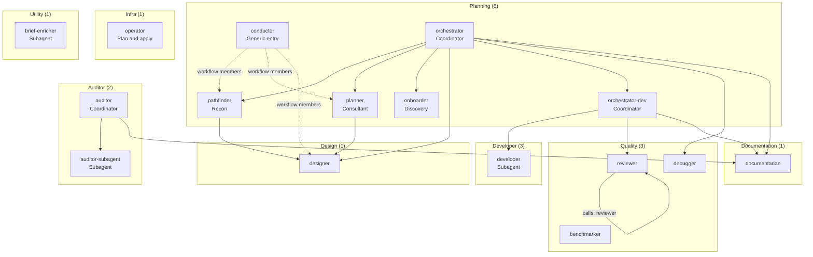

> [Lire en français](agents.fr.md)

# Agent Reference

16 agents in total, organized into 8 families (planning, developer, auditor, infra, quality, design, documentation, utility).
Each agent is defined in `agents/<family>/<id>.md` with a frontmatter declaring its metadata,
permissions, skills, and mode. This `agents/` folder is the source of truth for this page.

> See the [Glossary](../reference/glossary.en.md) for definitions of Agent, Bucket A/B, Skill, and other terms.

## Agents in a v5 session

In v5, the agent no longer decides the chain: the session **workflow** does
(YAML `apiVersion: oh/v1`, [ADR-039](./adr/039-declarative-workflows-oh-v1.en.md)).

- **Member agents**: the workflow `agents:` map lists the session agents, with their role
  (`workflow` in the chain, `independent` available on demand, `disabled` removed) and, if needed,
  a `mode` (`primary` / `subagent`) that replaces the frontmatter one.
- **Order**: `after:` locks an agent until a checkpoint is passed (or until another agent has run).
  While the lock holds, oh refuses delegation to that agent ([ADR-042](./adr/042-checkpoints-headless-decisions.en.md)).
- **Delegations**: `calls:` sets who may launch whom. Without `calls:`, the graph comes from the frontmatter `task`
  permission, restricted to the workflow members. Details: [Inter-agent delegation](./task-delegation.en.md).
- **Checkpoints**: declared in the workflow (`checkpoints:`), with a behavior per mode
  (`pause`, `auto`, `skip`, `conditional`). The agent signals them with the `workflow_checkpoint` MCP tool;
  oh keeps the state and raises the decisions ([ADR-042](./adr/042-checkpoints-headless-decisions.en.md)).
- **Entry agent**: the workflow `entry.agent`, or `conductor` by default (`cadrage`, `sweep` workflows).
  The `libre` workflow lets you pick the entry agent (`oh run libre --agent <id>`).
- **Session contract**: oh appends to every agent a generated « Contrat de session » section (template `bundle/templates/session-contract.md.tmpl`), computed from this graph and the workflow: role (entry agent, sub-agent launched with `task` by the listed callers, or both), return heading for each caller, agents it may launch, **its own** checkpoints only (checkpoint `by:`, CP-R11), the `max_fix_rounds` cap for the agent that passes the commit checkpoint, whether it may use the `question` tool (never for a sub-agent, never in a `headless` session), whether `workflow_report` is available. Role-specific passages are filtered at build time (`when:`, see [Variants by role](./skills.en.md#variants-by-role-and-by-session-when)): a sub-agent does not read the standalone path — see [Execution path](./task-delegation.en.md#execution-path-standalone-or-sub-agent).
- **Closed world**: an agent only sees the agents and skills of the **session bundle** built from the
  workflow ([ADR-043](./adr/043-session-bundle-deploy-removal.en.md)). OpenCode's native agents are
  disabled, and the `Attest` check blocks startup if anything else is visible
  ([ADR-041](./adr/041-closed-world-isolation.en.md)).

Consequence: the frontmatter `task` permissions describe what an agent *may* delegate in general.
In a session, only the agents of the bundle can be reached. To see the actual content of a session:
`oh workflow show <id>` and `oh bundle show <id>`.

## Agent Hierarchy

The diagram shows the delegations allowed by the frontmatter (`permission.task`). In a session, only
those linking two workflow members remain possible. `documentarian` can also be delegated to by most
writing agents (`developer-rw` base) and by `planner`, `pathfinder`, `debugger`, `reviewer`,
`benchmarker`: not all of these links are drawn.



> Detailed diagram: [`docs/diagrams/agent-hierarchy.mermaid`](../diagrams/agent-hierarchy.mermaid)

---

## Agent Format

```markdown
---
id: <unique-identifier>
label: <DisplayedName>
description: <Short description — visible in AI tools>
mode: primary         # primary (default) | subagent
model: <model>        # last level of the model cascade
permission_base: <base>   # optional — permissions/<base>.yaml (coordinator, developer-rw, readonly-code, readonly-ops)
permission:
  question: allow     # optional — enables OpenCode's question tool (interactive primary agents only)
  skill: allow        # allow | deny — enables the native skill tool (Bucket B)
  task:               # agents this agent may launch (then restricted to the workflow)
    "*": deny
    "documentarian": allow
skills: [path/to/skill, ...]          # Bucket A — assembled inline when the session bundle is built
native_skills: [path/to/skill, ...]   # Bucket B — delivered in the session bundle skills/, loaded on-demand
stack_skills: true        # optional — the project's stack skills in the agent catalogue
skills_from_callers: true # optional — the skills named by its callers in its catalogue
project_instructions: index # optional — full (default) | index | none
---

# <Title>

<Agent body>
```

| Field | Role |
|-------|------|
| `id` | Unique identifier, used by workflows (`agents:`, `entry.agent`, `calls:`) and in the session bundle |
| `label` | Name displayed in the tool |
| `description` | Short phrase describing the role — appears in agent lists |
| `mode` | `primary` (default) or `subagent` — controls visibility in OpenCode; the workflow can override it |
| `model` | Default model, last level of the cascade (workflow·agent > workflow > project·agent > … > frontmatter) |
| `permission_base` | Permission base (`permissions/<base>.yaml`) merged with `permission:`; single-level inheritance |
| `permission.question` | `allow` — enables OpenCode's `question` tool for this agent. Reserved for interactive `primary` agents. Always paired with the `posture/user-facing-posture` skill (filtered for the entry agent). |
| `permission.skill` | `allow` — enables the native `skill` tool so the agent can load Bucket B skills on-demand. In the closed world, only the skills of the agent's catalogue are allowed (see [Per-agent catalogue](./skills.en.md#per-agent-catalogue)). |
| `permission.task` | Agents this agent may launch. In a session, the list is restricted to the workflow members (or replaced by `calls:`). |
| `skills` | **Bucket A** — paths relative to `skills/`, injected inline when the session bundle is built, always active from the first token. Workflow protocols, handoff formats, universal principles. |
| `native_skills` | **Bucket B** — paths relative to `skills/`, delivered in the session bundle as `skills/<name>/SKILL.md`, loaded on-demand by the LLM via the `skill` tool. Domain standards, stack skills, checklists. |
| `stack_skills` | `true` — the stack skills of the detected project enter the agent's catalogue (`developer`, `reviewer`, `debugger`, `operator`). Without it, the agent does not see them. |
| `skills_from_callers` | `true` — the skills its callers name in their prompt or in the on-demand skills of their catalogue (except their own `native_skills:` and the sections addressed to another agent) enter its catalogue: the caller picks the skill to load (`developer` and its domain standards, `auditor-subagent` and its audit checklist). |
| `project_instructions` | What the agent gets of the project instructions (see [Project instructions by level](#project-instructions-by-level)): `full` (default, also for a team agent without the field), `index` or `none`. |

See [ADR-010](./adr/010-hybrid-skills-architecture.en.md) for the rationale behind the Bucket A / Bucket B split.

### Project instructions by level

The project instruction files (`ONBOARDING.md`, `CONVENTIONS.md`, `.claude/CLAUDE.md` and `[deploy] instruction_files`) are appended to the prompt of each agent, under `# Project instructions`, according to its `project_instructions` field:

| Level | Content | Shipped agents |
|-------|---------|----------------|
| `full` (default) | The whole text of each file | `developer`, `reviewer`, `debugger`, `benchmarker`, `operator`, `auditor-subagent`, `brief-enricher` and the team agents without the field |
| `index` | For each file: its path, its title, its estimated size and its `##` sections. Then, when `docs/wiki/index.md` exists: its title, its sections and the god nodes table (15 rows at most). The agent reads a file with `read` when its task depends on it: oh allows it to read each file of its index, on its exact path (read only, after its own rules and before the guards, which always win). A rule of the agent that denies or asks for that file (other than `"*"`) is kept, and the line says so | `orchestrator-dev`, `auditor`, `pathfinder`, `planner`, `designer`, `documentarian`, `onboarder` |
| `none` | Nothing; the session contract says the instructions exist and that the launched agents get them | `orchestrator`, `conductor` |

The wiki is read directly from `docs/wiki/index.md` (format of `doc-wiki-protocol`). Without instruction files or wiki, no level adds anything. On a project with 4,000 tokens of instructions, the `feature` workflow costs about 22,000 tokens less per run than with `full` everywhere (`testdata/budget.golden`, project `instruct`).

### Primary / Subagent Modes

The `mode:` field controls how an agent is exposed in OpenCode:

| Mode | OpenCode |
|------|----------|
| `primary` | Visible in the session Tab picker — present in the session bundle `agents/` |
| `subagent` | Invocable by other agents of the bundle, hidden in the Tab picker. Present in the session bundle `agents/` with a delegation-oriented description. |

The effective mode follows a priority: **workflow** (`agents.<id>.mode`) > **agent frontmatter** > **`primary`** (default).
Example: in `feature`, `planner` and `reviewer` are `subagent`; in `quick`, `developer` becomes `primary`.
The entry agent must be `primary`.

---

## Agent Inventory

Taken from the frontmatter files in `agents/`.

| Family | Agent | Mode (frontmatter) | Permission base | MCP (`mcp:` skills) |
|--------|-------|--------------------|-----------------|-----|
| planning | `conductor` | `primary` | `coordinator` | — |
| planning | `orchestrator` | `primary` | — | — |
| planning | `orchestrator-dev` | `primary` | — | — |
| planning | `planner` | `primary` | — | `gitlab`, `github` |
| planning | `pathfinder` | `primary` | — | `gitlab`, `github` |
| planning | `onboarder` | `primary` | — | `gitlab`, `github` |
| developer | `developer` | `subagent` | `developer-rw` | — |
| auditor | `auditor` | `primary` | `coordinator` | — |
| auditor | `auditor-subagent` | `subagent` | `readonly-code` | — |
| infra | `operator` | `primary` | `readonly-ops` | — |
| quality | `reviewer` | `primary` | — | — |
| quality | `debugger` | `primary` | — | — |
| quality | `benchmarker` | `primary` | — | — |
| design | `designer` | `primary` | — | `figma` |
| documentation | `documentarian` | `primary` | — | — |
| utility | `brief-enricher` | `subagent` | — | — |

---

## Skill Assignment Matrix (source of truth)

This table is the authoritative reference for which skills each agent loads. It is taken from the actual agent frontmatter files. For skill descriptions, see [Skills reference](./skills.en.md).

> `shared/universal-guardrails` is Bucket A (inline) in **every** agent except `brief-enricher`: it is not repeated in the tables.
> `shared/team-awareness` and `shared/team-policies-enforcement` are Bucket B in **every** agent, except `conductor` (only `shared/team-awareness`): they are not repeated either.
> `shared/living-docs-enrichment` is Bucket B (native / on-demand) everywhere it appears.

### Planning family

| Agent | Bucket A (inline) | Bucket B (native / on-demand) |
|-------|-------------------|-------------------------------|
| **conductor** | `posture/core-posture`, `posture/user-facing-posture`, `posture/coordinator-posture`, `workflow/workflow-map` (generated from the workflow YAML) | `shared/rtk-usage` |
| **orchestrator** | `posture/core-posture`, `posture/user-facing-posture`, `posture/coordinator-posture`, `orchestrator/orchestrator-workflow-modes`, `orchestrator/orchestrator-protocol`, `shared/hub-workflow-reference` | `shared/rtk-usage`, `orchestrator/orchestrator-recap-edge`, `developer/beads-plan`, `orchestrator/takeover-context-protocol` |
| **orchestrator-dev** | `posture/core-posture`, `posture/user-facing-posture`, `shared/handoff-envelope`, `posture/coordinator-posture`, `orchestrator/orchestrator-workflow-modes`, `orchestrator/orchestrator-dev-protocol`, `orchestrator/orchestrator-dev-payload` | `developer/dev-drift-detection`, `shared/rtk-usage`, `orchestrator/orchestrator-dev-ticket-workflow`, `orchestrator/orchestrator-dev-parallel`, `orchestrator/orchestrator-dev-recap`, `orchestrator/orchestrator-dev-edge-cases`, `orchestrator/error-recovery-protocol`, `orchestrator/team-coordination`, `orchestrator/takeover-context-protocol` |
| **planner** | `posture/core-posture`, `posture/user-facing-posture`, `shared/handoff-envelope`, `shared/execution-protocol`, `planning/planner-payload`, `planning/planner-workflow`, `adapters/gitlab-planner-protocol`, `adapters/github-planner-protocol`, `shared/hub-workflow-reference` | `planning/websearch-stack-research`, `shared/rtk-usage`, `planning/planner-phase-0`, `planning/planner-phase-1`, `planning/planner-phase-2`, `planning/planner-phase-2-5`, `planning/planner-phase-3-4`, `planning/planner-phase-5-6`, `planning/planner-patterns-protocol` (shipped only with the `team` MCP server), `shared/living-docs-enrichment`, `shared/websearch-usage`, `planning/planner-design-templates`, `developer/beads-plan`, `posture/expert-posture` |
| **pathfinder** | `posture/core-posture`, `posture/user-facing-posture`, `shared/handoff-envelope`, `shared/execution-protocol`, `planning/pathfinder-payload`, `planning/pathfinder-protocol`, `adapters/gitlab-pathfinder-protocol`, `adapters/github-pathfinder-protocol`, `shared/wiki-navigation` | `shared/websearch-usage`, `planning/websearch-stack-research`, `shared/rtk-usage`, `shared/living-docs-enrichment`, `developer/beads-plan` |
| **onboarder** | `posture/core-posture`, `posture/user-facing-posture`, `shared/handoff-envelope`, `shared/execution-protocol`, `planning/onboarder-payload`, `planning/onboarder-workflow`, `planning/onboarder-profiles`, `adapters/gitlab-onboarder-protocol`, `adapters/github-onboarder-protocol`, `shared/wiki-navigation` | `developer/dev-standards-git`, `planning/websearch-stack-research`, `shared/rtk-usage`, `planning/onboarder-phase-0`, `planning/onboarder-phase-1`, `planning/onboarder-phase-2`, `planning/onboarder-phase-3-4`, `planning/onboarder-phase-5`, `shared/living-docs-enrichment`, `shared/websearch-usage`, `developer/beads-plan`, `posture/expert-posture` |

### Developer family

| Agent | Bucket A (inline) | Bucket B (native / on-demand) |
|-------|-------------------|-------------------------------|
| **developer** | `posture/core-posture`, `posture/user-facing-posture`, `shared/handoff-envelope`, `developer/developer-payload`, `developer/dev-standards-universal`, `developer/dev-standards-simplicity`, `developer/beads-dev`, `shared/wiki-navigation`, `shared/context-mode-usage` | `developer/dev-standards-security`, `developer/dev-standards-git`, `developer/dev-standards-testing`, `developer/dev-standards-refactoring`, `developer/dev-standards-migration`, `developer/dev-standards-database`, `developer/test-generation`, `reviewer/reviewer-reception`, `shared/rtk-usage`, `shared/living-docs-enrichment`, `developer/beads-plan`, `developer/quick-fix` |

### Auditor family

| Agent | Bucket A (inline) | Bucket B (native / on-demand) |
|-------|-------------------|-------------------------------|
| **auditor** | `posture/core-posture`, `posture/user-facing-posture`, `posture/coordinator-posture`, `shared/execution-protocol`, `auditor/auditor-workflow`, `auditor/audit-protocol-light` | `auditor/auditor-phase-0-1`, `auditor/auditor-phase-3`, `auditor/auditor-phase-4`, `shared/rtk-usage`, `shared/living-docs-enrichment` |
| **auditor-subagent** | `posture/core-posture`, `shared/handoff-envelope`, `auditor/auditor-subagent-payload`, `auditor/audit-protocol-light`, `shared/wiki-navigation` | `auditor/websearch-cve-lookup`, `auditor/websearch-performance-research`, `shared/rtk-usage`, `posture/expert-posture`, `shared/websearch-usage` |

### Infra family

| Agent | Bucket A (inline) | Bucket B (native / on-demand) |
|-------|-------------------|-------------------------------|
| **operator** | `posture/core-posture`, `posture/user-facing-posture`, `shared/wiki-navigation` | `developer/dev-standards-security`, `shared/rtk-usage`, `shared/living-docs-enrichment` (+ Terraform/Helm/Kubernetes stack skills detected in the project) |

### Quality family

| Agent | Bucket A (inline) | Bucket B (native / on-demand) |
|-------|-------------------|-------------------------------|
| **reviewer** | `posture/core-posture`, `posture/user-facing-posture`, `shared/handoff-envelope`, `reviewer/reviewer-payload`, `reviewer/review-protocol`, `shared/wiki-navigation` | `reviewer/reviewer-adversarial`, `reviewer/reviewer-edge-case`, `reviewer/review-merge`, `developer/dev-standards-security`, `developer/dev-standards-backend`, `developer/dev-standards-frontend`, `developer/dev-standards-frontend-data`, `developer/dev-standards-frontend-a11y`, `developer/dev-standards-testing`, `developer/dev-standards-git`, `developer/dev-standards-api`, `developer/dev-standards-devops`, `shared/rtk-usage`, `shared/living-docs-enrichment`, `developer/dev-standards-universal` |
| **debugger** | `posture/core-posture`, `posture/user-facing-posture`, `shared/handoff-envelope`, `shared/execution-protocol`, `quality/debugger-payload`, `quality/debugger-workflow`, `shared/wiki-navigation` | `shared/rtk-usage`, `quality/debugger-phase-0-1`, `quality/debugger-phase-2-3`, `quality/debugger-phase-4-5`, `shared/living-docs-enrichment`, `posture/expert-posture`, `quality/debugger-forensic`, `quality/debugger-report-templates` |
| **benchmarker** | `posture/core-posture`, `posture/user-facing-posture`, `shared/wiki-navigation` | `shared/living-docs-enrichment` |

### Design family

| Agent | Bucket A (inline) | Bucket B (native / on-demand) |
|-------|-------------------|-------------------------------|
| **designer** | `posture/core-posture`, `posture/user-facing-posture`, `shared/handoff-envelope`, `shared/execution-protocol`, `designer/designer-payload`, `designer/designer-protocol` | `designer/ux-protocol`, `designer/ui-protocol`, `designer/figma-recon-protocol`, `designer/figma-deep-protocol`, `designer/prototype-protocol`, `design/websearch-design-patterns`, `shared/rtk-usage`, `designer/design-principles`, `designer/ui-patterns-reference`, `designer/content-design`, `designer/tui-patterns`, `shared/websearch-usage`, `posture/expert-posture` |

### Documentation family

| Agent | Bucket A (inline) | Bucket B (native / on-demand) |
|-------|-------------------|-------------------------------|
| **documentarian** | `posture/core-posture`, `posture/user-facing-posture`, `shared/handoff-envelope`, `documentarian/documentarian-payload`, `documentarian/doc-protocol` | `documentarian/doc-standards`, `documentarian/doc-adr`, `documentarian/doc-api`, `documentarian/doc-changelog`, `documentarian/doc-slides`, `documentarian/doc-wiki-protocol`, `shared/skill-authoring-protocol`, `shared/rtk-usage`, `shared/websearch-usage`, `posture/expert-posture` |

### Utility family

| Agent | Bucket A (inline) | Bucket B (native / on-demand) |
|-------|-------------------|-------------------------------|
| **brief-enricher** | *(none)* | *(none besides the team skills)* |

---

## Family — Coordinators

Agents that drive other agents without ever coding themselves.

### `conductor`

| | |
|--|--|
| **Label** | Conductor |
| **File** | `agents/planning/conductor.md` |
| **Mode** | `primary` |
| **Permissions** | `coordinator` base: no `bash`, no `edit` or `write`. `task` open on `*` in the frontmatter, restricted by the bundle to the workflow graph. `question` and `todowrite` allowed. |
| **Skills** | See [Skill Assignment Matrix](#skill-assignment-matrix-source-of-truth) — conductor row |
| **Invocation** | Default entry agent of a workflow without `entry.agent` (`cadrage`, `sweep`) |

Generic workflow coordination agent. It contains no hard-coded chain: it follows the
**`workflow/workflow-map`** skill, generated from the workflow YAML and inlined in the bundle (agents, allowed
delegations, checkpoints, modes, outputs).

Loop: find the next agent of the chain whose `after` condition is met, pass the checkpoint before it
(`workflow_checkpoint`), launch the agent with `task`, transcribe its return without summarizing it, repeat.
At the end of the chain: recap and declaration of the outputs (`workflow_outputs`).

It neither reads nor modifies files, runs no commands, does not write to Beads, and never asks again for the
mode (set at launch). It can only launch the agents of its "May delegate to" line in the map.
Upstream questions from an agent: it relays the question with `question`, then relaunches the agent with its `task_id`.

> See [ADR-039](./adr/039-declarative-workflows-oh-v1.en.md) (hybrid orchestration) and
> [ADR-042](./adr/042-checkpoints-headless-decisions.en.md) (checkpoints).

---

### `orchestrator`

| | |
|--|--|
| **Label** | Orchestrator |
| **File** | `agents/planning/orchestrator.md` |
| **Skills** | See [Skill Assignment Matrix](#skill-assignment-matrix-source-of-truth) — orchestrator row |
| **MCP Servers** | _(none)_ |
| **Invocation** | Entry agent of the `feature` and `libre` (default) workflows — `"Implement [feature]"` / `"Handle tickets [IDs]"` |

AI project manager. Drives the complete delivery of a feature by mobilizing the
workflow agents: exploration (`pathfinder`), planning (`planner`), design (`designer`),
implementation (via `orchestrator-dev`), diagnosis (`debugger`). Signals the workflow
checkpoints at each phase. Never codes.

**Chain:** set by the session workflow (v5, `oh/v1`), no longer by the agent. The former entry modes A–E become
workflows: `feature` and `cadrage` (A/B), `onboarding` (C), `debug` (D), `ticket` and `quick` (E). The agent keeps
only its posture and contracts (transcription, invocation of and return from planning agents, routing delegated to
the planner).

Never routes directly to the `developer` — always delegates to `orchestrator-dev`.

**Technical permissions:** `bash`, `read`, `edit`, `write`, `glob`, `grep` all disabled. Acts only via `task` (delegation), `question` and `workflow_checkpoint` (checkpoints). Invocable agents: `pathfinder`, `planner`, `onboarder`, `designer`, `orchestrator-dev`, `debugger`, `documentarian`, restricted to the workflow members.

**Context injection:** project context (stack, conventions) is automatically injected into the session: the project instructions (`ONBOARDING.md`, `CONVENTIONS.md`, `[deploy] instruction_files`) are embedded in the agents of the session bundle, at the level of each one (see [Project instructions by level](#project-instructions-by-level)): the orchestrator gets none of them (`none`), the agents it launches get them. The orchestrator never reads files directly — if context is missing, the `project-context` precondition of `feature` offers to run the `onboarding` workflow first.

**Missing agent handling:** if a required agent is not part of the session (the agents of a session are those of its workflow), the orchestrator asks a structured question with options: use a substitute (substitution table by domain) / skip the ticket. To make the agent available, add it to the workflow and relaunch the session (`oh deploy` removed in v5). Never silently falls back to another agent.

**Completion gate (CP-feature):** before building the CP-feature, checks that the final orchestrator-dev report documents the 3 completion checks (tests passed, observable behavior as expected, regressions documented). If missing → blocking: question to the user (ask orchestrator-dev again / accept / stop).

---

### `orchestrator-dev`

| | |
|--|--|
| **Label** | OrchestratorDev |
| **File** | `agents/planning/orchestrator-dev.md` |
| **Skills** | See [Skill Assignment Matrix](#skill-assignment-matrix-source-of-truth) — orchestrator-dev row |
| **Invocation** | Entry agent of the `ticket` and `review-feedback` workflows; subagent of `orchestrator` in `feature` — `"Implement tickets [IDs]"` |

AI tech lead specialized in driving implementation. Takes a list of ready-to-implement
Beads tickets, routes to the `developer` agent with the appropriate domain specified in the
invocation prompt (including `refactor`, `migration` and `tests`), supervises the review.
Three modes: `manuel`, `semi-auto`, `auto`, set at launch (`oh run … --mode`) within the workflow `modes.allowed` list.

CP-2 (commit or fix?) is `mandatory` and pauses in all modes of the shipped workflows. It unlocks `commit` and `close` (`unlocks:`; `commit` only in `review-feedback`): until it is approved, oh refuses these operations to every agent; then the `developer`, handed back by `orchestrator-dev`, commits and closes the ticket.

`bd close`, `bd comments add`, and `bd update` are always executed by the `developer` agent in delegation prompts — never directly by `orchestrator-dev`. The orchestrator-dev only reads Beads tickets (`bd show`, `bd list`).

Subagent (`feature` workflow): its checkpoints still go through `workflow_checkpoint`; a clarification outside a checkpoint gives an envelope with status `en-attente` (blocking questions), then the resumption with `task_id`; at the end of the loop, report filed and envelope.

**Architectural drift (BLOCKED_ARCHITECTURE):** when a developer returns this status, loads the `developer/dev-drift-detection` skill via the `skill` tool and presents 3 options to the user: revise the Beads ticket scope / revert + new approach / branch to a prerequisite refactoring ticket (set to `blocked` until resolved).

> [ADR-006](./adr/006-orchestrator-configurable-mode.en.md) (modes) is superseded: modes and checkpoints are declared in the workflow ([ADR-039](./adr/039-declarative-workflows-oh-v1.en.md), [ADR-042](./adr/042-checkpoints-headless-decisions.en.md)).

---

### `auditor`

| | |
|--|--|
| **Label** | Auditor |
| **File** | `agents/auditor/auditor.md` |
| **Skills** | See [Skill Assignment Matrix](#skill-assignment-matrix-source-of-truth) — auditor row |
| **Invocation** | Entry agent of the `audit` workflow (`oh run audit`) — `"Audit [project/scope]"` / `"Audit [domain]"` |

Multi-domain audit coordinator. Drives audits in 5 structured phases: prerequisites check
(scope, stack, file access) → project context loading (reads `ONBOARDING.md` first, or
quick reconnaissance) → domain selection with stack compatibility check → delegation to
the `auditor-subagent` agent (invoked as many times as needed, one domain per invocation) → consolidation executive summary (global score, top 5 priority
actions, cross-cutting recommendations).

Produces a multi-domain executive summary. Read-only (`coordinator` base) — never modifies files directly.

**Phase 4 — Living docs enrichment:** after the summary, consolidates the
`### Findings to document` sections of the received reports and proposes to the user to enrich
`ONBOARDING.md` and/or `CONVENTIONS.md`. If accepted, delegates writing to the `documentarian` via `task`
(skill `living-docs-enrichment`), provided `documentarian` is a workflow member. Cannot invoke the `documentarian` without explicit confirmation.

Subagent: a single session (execution protocol); it stops only on a blocking question (envelope with status `en-attente`) and resumes with `task_id`.

---

## Family — Audit Agents

Single subagent of the auditor (ADR-017). Read-only. Invocable via the auditor.

| Agent | File | Domain | References |
|-------|------|--------|-----------|
| `auditor-subagent` | `agents/auditor/auditor-subagent.md` | Security, Performance, Accessibility, Ecodesign, Architecture, Privacy, Observability, Infra, Database — domain specified at invocation | OWASP Top 10, Core Web Vitals, WCAG 2.1 AA / RGAA 4.1, RGESN / GreenIT, SOLID / Clean Architecture, GDPR / EDPB / CNIL, RED method / SLOs / OpenTelemetry, CIS Benchmarks / NSA-CISA Kubernetes Hardening, CIS PostgreSQL/MySQL |

The `auditor-subagent` receives the domain + `native_skill` to load in the invocation prompt from the `auditor` coordinator.
It injects `auditor/audit-protocol-light` (common lightweight report format)
+ its domain-specific skill (`auditor/audit-<domain>`) loaded on-demand
+ `auditor/auditor-subagent-payload` (statuses and sections of its report; envelope `shared/handoff-envelope`).

All reports produced include a **`### Findings to document`** section
at the end — findings to capitalize in `ONBOARDING.md` / `CONVENTIONS.md`.
This section is consolidated by the `auditor` coordinator in Phase 4 (skill `living-docs-enrichment`).
The agent never makes `task` calls — its read-only constraint is strict (`readonly-code` base). Its only shell access is the static analysis tools of the `infra` domain (`terraform validate`, `terraform plan`, `tflint`, `tfsec`, `checkov`, `trivy config`, `kube-score`, `kubesec`, `helm lint`, `helm template`, `infracost`), each one asked; every other command is refused.

---

## Family — Developer Agents

1 generic agent specialized by domain at invocation time.
Follows the same Beads workflow (`bd claim → implement → test → bd close`).

The **domain** and the **native_skills to load** are passed by `orchestrator-dev` in the invocation prompt.
Each `task` instance runs in its own child session — parallel invocations with different domains are independent.

Skills of the `developer` agent: `dev-standards-universal`, `dev-standards-simplicity`, `quick-fix`, `dev-standards-security`, `dev-standards-git`, `dev-standards-testing`, `beads-plan`, `beads-dev`, `developer/developer-payload`, `shared/living-docs-enrichment` (see the matrix for the bucket of each).

| Agent | File | Domain | Specific Native Skills |
|-------|------|--------|----------------------|
| `developer` | `agents/developer/developer.md` | frontend, backend, fullstack, api, mobile, data, devops, platform, security, refactor, migration, tests — domain passed at invocation | Domain skills injected via invocation prompt (routing table of `orchestrator-dev-protocol`): `dev-standards-refactoring` (refactor), `dev-standards-migration` (migration), `test-generation` (tests), `dev-standards-database` (schema, migrations, queries) |

**Separate agents (distinct workflow):**

| Agent | File | Domain |
|-------|------|--------|

> See [ADR-013](./adr/013-developer-agent-consolidation.en.md) for the consolidation decision.
> See [ADR-002](./adr/002-developer-segmentation.en.md) (superseded) for the previous segmentation rationale.
> Domain routing guide: [agents/developer-differentiation.md](./agents/developer-differentiation.md) (French).

**Domain → native_skills mapping (summary):**

| Domain | Native skills |
|--------|--------------|
| `frontend` | `dev-standards-frontend`, `dev-standards-frontend-a11y`, `dev-standards-testing` + detected stacks |
| `backend` | `dev-standards-backend`, `dev-standards-api`, `dev-standards-testing` + detected stacks |
| `fullstack` | `dev-standards-frontend`, `dev-standards-frontend-a11y`, `dev-standards-backend`, `dev-standards-api`, `dev-standards-testing` + detected stacks |
| `api` | `dev-standards-backend`, `dev-standards-api`, `dev-standards-testing` |
| `mobile` | `dev-standards-testing` + detected mobile stacks |
| `data` | `dev-standards-testing` + detected data stacks |
| `devops` | `dev-standards-devops` + detected infra stacks |
| `platform` | `dev-standards-devops` + detected platform stacks |
| `security` | `dev-standards-security-hardening`, `dev-standards-backend`, `dev-standards-testing` |
| `go` | `dev-standards-golang` + detected stacks |
| `rust` | `dev-standards-rust` + detected stacks |

Stack skills detected in the project are added to the session bundle when it is built. The frontend domain skills (`dev-standards-frontend`, `-a11y`, `-data`), offered by `orchestrator-dev`, `developer` and `reviewer`, are shipped only when the project has a frontend; without a project path, nothing is filtered.

**Post-ticket — Living docs enrichment:** after each `bd close`, identifies patterns, conventions, or technical constraints discovered during implementation that are absent from `CONVENTIONS.md` or `ONBOARDING.md`, and proposes to the user to capitalize them (skill `living-docs-enrichment`).

---

## Family — Infra Agents

### `operator`

| | |
|--|--|
| **Label** | Infra operator |
| **File** | `agents/infra/operator.md` |
| **Skills** | See [Skill Assignment Matrix](#skill-assignment-matrix-source-of-truth) — operator row |
| **Invocation** | Entry agent of the `infra-change` workflow (`oh run infra-change`) |

Applies an infrastructure change already written in the repository. Checks the real context against the target, produces the plan (`terraform plan -out`, `kubectl diff`, `helm diff upgrade`, `pulumi preview`), the cost delta, the risks and the rollback, presents them at `cp-plan`, then after `cp-apply` applies exactly the approved plan (`terraform apply <planfile>`) and checks the result. `readonly-ops` base: no edit, no write, no delegation; its infrastructure tools are asked and oh's infrastructure guard allows the reads, asks for the secrets and refuses every change until `cp-apply`. Writing IaC code belongs to the `developer` (devops domain, Terraform/Helm/Kubernetes stack skills), read-only analysis to the `infra` audit domain.

---

## Family — Design Agents

UX/UI design agent. Works upstream of implementation.
Never codes. Invocable directly or via the `orchestrator`.

### `designer`

| | |
|--|--|
| **Label** | Designer |
| **File** | `agents/design/designer.md` |
| **Mode** | `primary` (`subagent` in `feature` and `cadrage`) |
| **Permissions** | No `write`, no `edit`. `bash` deny-by-default (allowlist: `bd show *`, `bd list *`). MCP Figma access (sole agent with this permission). |
| **Skills** | See [Skill Assignment Matrix](#skill-assignment-matrix-source-of-truth) — designer row |
| **Invocation** | `"Explore Figma for [feature]"` / `"UX spec for [ticket]"` / `"UI spec for [component]"` / `"Full design spec for [feature]"` |

Unified design agent. Operates in four modes specified at invocation:

| Mode | Trigger | Output |
|------|---------|--------|
| `recon` | Figma exploration requested (by planner/pathfinder/onboarder via `task`) | Figma findings: components, tokens, design system detected |
| `ux` | UX spec requested | User flows, heuristics (Nielsen), acceptance criteria — no graphic mockups |
| `ui` | UI spec requested | Design tokens, component variants/states, UI guidelines for `developer` (frontend domain) |
| `ux+ui` | Full design spec requested | Complete UX phase then UI phase in a single session |

**Sole Figma agent:** `designer` is the only agent in the hub with MCP Figma access.
`planner`, `pathfinder`, and `onboarder` delegate their Figma needs to `designer` via
`task` (mode `recon`) instead of calling the MCP directly — provided `designer` is a workflow member.

**When invoked from `planner` (Phase 1.5 — optional design delegation):** produces
the spec in standardized format `## SPEC UX — [feature]` and/or `## SPEC UI — [ComponentName]`
for automatic reintegration into the plan (no `bd close` — the planner resumes control).

Subagent: never uses the `question` tool — assumptions are documented in the spec; a critical clarification stops the session (envelope `en-attente`), Design It Twice returns `choix-requis`.

**Delegation:** invoked by `orchestrator`, `planner`, `pathfinder` (`task` permissions) and by `conductor` in `cadrage`.

---

## Family — Quality Agents

Agents dedicated to code quality, invocable as the entry agent of a workflow or via a coordinator.

### `reviewer`

| | |
|--|--|
| **Label** | CodeReviewer |
| **File** | `agents/quality/reviewer.md` |
| **Skills** | See [Skill Assignment Matrix](#skill-assignment-matrix-source-of-truth) — reviewer row |
| **Invocation** | Entry agent of the `review` workflow (`oh run review`); subagent of `orchestrator-dev` — branch name / PR URL + optionally `bd show <ID>` (the reviewer fetches the diff itself via `git diff`) |

Analyzes PR/MR diffs. Produces a structured report by severity (Critical /
Major / Minor / Suggestion / Positive points). Read-only — never modifies files.

**Verification:** before reading the diff in detail, the main reviewer runs the project's build, tests, lint and type check once (the project's own scripts first: README, `CONVENTIONS.md`, `package.json` scripts, `Makefile`); parallel sub-reviews (`[REVIEW:single]`) do not rerun it. A failure is a 🔴 finding with an excerpt of the output (verdict `corriger`); a command that cannot run (missing dependencies, environment, database, permission refused) is a 🟡 "not verifiable" finding — the reviewer never installs anything and never fixes (`--fix`, `--write`, snapshot updates are refused). Files produced by the build and not ignored (`git status --porcelain` before/after) are a 🟡 finding: they would block the ticket closing, which requires a clean tree. The commands come from the stack detected when the bundle is built (frontmatter `verify: true`, `bricks.VerifyCommands`: `go test`, `npm test`, `npm run build`, `pytest`, `cargo test`, `make test`…, never an install): allowed in the workflows on the team's own code, asked in `review` (`risk: read`: a merge request often written by someone else, whose tests run its code). Without a project path or a known stack, the reviewer has no build command.

**Multi-mode review:** supports three review modes that can be combined:
- **Standard** — 6-category checklist, calibrated severity (default for per-ticket reviews)
- **Adversarial** — maximum skepticism posture, min. 10 findings, dangerous assumptions, architecture challenges, confidence score (mandatory at CP-feature, optional via `oh run review`)
- **Edge-case** — exhaustive unhandled execution path hunting (available everywhere as an option)

Combined modes (`standard+adversarial`, `all`) launch **parallel independent sessions** with full context isolation, then merge results via the `review-merge` skill (deduplication, severity hierarchy, provenance tagging). In the `review` workflow, this self-delegation is declared explicitly (`calls: [reviewer]`).

**Post-report — Living docs enrichment:** after producing the review report, identifies conventions and patterns observed in the diff that are absent from `CONVENTIONS.md` or `ONBOARDING.md`, and proposes to capitalize them. If accepted, delegates writing to the `documentarian` via `task` (skill `living-docs-enrichment`).

---

### `debugger`

| | |
|--|--|
| **Label** | Debugger |
| **File** | `agents/quality/debugger.md` |
| **Skills** | See [Skill Assignment Matrix](#skill-assignment-matrix-source-of-truth) — debugger row |
| **Invocation** | Entry agent of the `debug` workflow (`oh run debug`) — `"This bug: [stacktrace]"` / `"Analyze these logs: [logs]"` |

Diagnoses the root cause of a bug in 6 structured phases: artefact verification
(Phase 0 — pauses if insufficient) → contextual exploration → complementary questions
(optional) → 4-step diagnosis (reproduction/isolation/identification/graded hypothesis
high/medium/low) → edge case detection (race conditions, environment-specific, data,
configuration, dependencies, regression). Produces a diagnostic report with graded
hypotheses. Creates a Beads correction ticket after explicit confirmation.
Never fixes the bug.

**`--forensic` mode**: reinforced forensic analysis with evidence grading
(Confirmed / Deduced / Hypothesized). Stronghold-first — anchored on a Confirmed piece of evidence
before any reasoning. Produces a case file `.investigation-{slug}.md` (hypothesis table,
evidence, timeline, missing evidence). Missing evidence = a finding in itself. Delegation
mandatory if >5 files or >10K tokens.

**Phase 5 — Living docs enrichment:** after the report, identifies blind spots uncovered by the diagnosis and error patterns worth remembering, then proposes to the user to enrich `ONBOARDING.md` and/or `CONVENTIONS.md`. If accepted, delegates writing to the `documentarian` via `task` (skill `living-docs-enrichment`). Cannot invoke the `documentarian` without explicit user confirmation.

Subagent: a single session (execution protocol); it stops only on a blocking question (envelope with status `en-attente`) and resumes with `task_id`.

> See [ADR-004](./adr/004-qa-debugger-separation.en.md).

---

### `benchmarker`

| | |
|--|--|
| **Label** | Benchmarker |
| **File** | `agents/quality/benchmarker.md` |
| **Invocation** | Entry agent of the `benchmark` workflow (`oh run benchmark -i target=…`) or of a `libre` session — `"Benchmark [target]"` / `"Load test [endpoint]"` |

Performance benchmarking specialist. Operates in four modes:

| Mode | Tools | Output |
|------|-------|--------|
| `frontend` | Lighthouse, WebPageTest | Core Web Vitals report, LCP/CLS/FID analysis, optimization recommendations |
| `api` | k6, autocannon, wrk | Throughput/latency/error-rate report, percentile breakdown, bottleneck identification |
| `go` | pprof, benchstat | CPU/memory profile, flame graph analysis, benchmark comparison |
| `python` | py-spy, memory-profiler | Sampling profile, hot functions, memory leak detection |

Does not modify code: it only writes in `reports/benchmarks/` (permission). Before any measurement, it has the target, the environment, the load profile and the duration approved (`cp-target` checkpoint of the `benchmark` workflow, `question` tool in a `libre` session). Produces structured benchmark reports with baseline comparisons (before/after measurement) and actionable recommendations for the `developer`.

---

## Family — Planning Agents

### `planner`

| | |
|--|--|
| **Label** | ProjectPlanner |
| **File** | `agents/planning/planner.md` |
| **Skills** | See [Skill Assignment Matrix](#skill-assignment-matrix-source-of-truth) — planner row |
| **MCP Servers** | `gitlab`, `github` |
| **Invocation** | Subagent in `feature` and `cadrage` — natural language feature description / `"Plan ticket #42"` |

Functional and technical consultant who analyzes the project context before planning.
Workflow in 7 phases: prerequisites check → **complexity scoring** (Phase 0.5 — 4 criteria:
technical domains, third-party integrations, security sensitivity, codebase size; score 4–16 pts;
Small/Medium/Large/Enterprise tiers; drives mandatory pathfinder and pre-implementation audit)
→ contextual exploration (codebase, tickets,
UX/UI signals) → optional design delegation (Phase 1.5) → complementary questions →
hierarchical plan (epics → tickets, deduced and justified priorities) → edge case
detection (duplicates, oversized tickets, circular dependencies) → Beads creation with
full enrichment → optional ai-delegated delegation (Phase 5.5) → final verification.

Creates epics in Beads if > 5 tickets (asks otherwise), uses `--parent` and `--deps`
for hierarchy and dependencies. Handles contingencies: scope change, ticket splitting,
late dependency, duplicate. Never codes. Iterative phases with backwards possible
(max 3 iterations per phase).

**Phase 1.5 — Design delegation (optional):** when UX or UI signals are detected
in Phase 1, the planner offers 3 options to the user:
- **Option A** (`"invoke design"`) — directly invokes `designer`
  as a sub-agent (mode `ux`, `ui`, or `ux+ui`), awaits the structured block `## SPEC UX/UI — …` and integrates the spec into the plan.
- **Option B** — the user invokes the agent themselves and pastes the spec back.
- **Option C** (`"continue without design"`) — proceeds with available context,
  partial `--design` fields + `bd comments add` to trace the missing spec.

**Phase 6 — Living docs enrichment:** after plan validation, identifies architectural patterns and conventions observed in the codebase but absent from `ONBOARDING.md`/`CONVENTIONS.md`, and proposes to the user to capitalize them. If accepted, delegates writing to the `documentarian` via `task` (skill `living-docs-enrichment`).

---

### `pathfinder`

| | |
|--|--|
| **Label** | Pathfinder |
| **File** | `agents/planning/pathfinder.md` |
| **Skills** | See [Skill Assignment Matrix](#skill-assignment-matrix-source-of-truth) — pathfinder row |
| **MCP Servers** | `gitlab`, `github` |
| **Invocation** | Subagent in `feature` and `cadrage` — `"Pathfind feature [X]"` / `"Estimate the complexity of [feature]"` / `"Pathfind ticket #42"` |

Fast reconnaissance agent. Explores the context of a feature and produces a complexity
estimate (XS/S/M/L/XL) with a structured report usable by the planner or the orchestrator.
Free workflow — no rigid phases. Suggests escalating to the planner if the feature exceeds M.

**GitLab enrichment (optional):** if a GitLab issue or MR is provided, uses
`gitlab-pathfinder-protocol` to adjust the estimate based on acceptance criteria, labels, and milestone.

**Figma enrichment (optional):** if the feature touches a user interface, delegates
Figma reconnaissance to the `designer` (mode `recon`) to detect components and adjust complexity.

**Post-report — Living docs enrichment:** after producing the report, identifies architectural patterns and conventions observed during reconnaissance that are absent from `ONBOARDING.md`/`CONVENTIONS.md`, and proposes to the user to capitalize them. If accepted, delegates writing to the `documentarian` via `task` (skill `living-docs-enrichment`).

---

### `onboarder`

| | |
|--|--|
| **Label** | Onboarder |
| **File** | `agents/planning/onboarder.md` |
| **Skills** | See [Skill Assignment Matrix](#skill-assignment-matrix-source-of-truth) — onboarder row |
| **MCP Servers** | `gitlab`, `github` |
| **Invocation** | Entry agent of the `onboarding` workflow (`oh run onboarding`) — `"Onboard yourself on this project"` / `"Discover this project"` |

Project discovery agent. Explores an existing project's codebase in 6 structured phases
(prerequisites check → adaptive exploration 7 profiles → questions → context report →
edge case detection → deliverables production). Produces the [living documentation wiki](./living-wiki.en.md)
(`docs/wiki/`) and a minimal `ONBOARDING.md` pointing to it.

**Exploration capabilities:**
- **Phase 1.4 — Business context exploration**: domain detection (e-commerce, fintech, health, etc.),
  target users, key concepts, glossary. Semantic analysis of the codebase to extract recurring concepts.
- **Phase 1.4bis — GitLab exploration** (optional, if a GitLab project is detected): mapping of labels (types, priorities, domains), active milestones, backlog volume.
- **Phase 1.5 — Figma exploration** (optional, if a frontend is detected): search for project mockups,
  design system detection (DSFR, Material, Custom), design token extraction. Figma access goes through the `designer`.
- **Phase 1.6 — Test strategy exploration**: framework detection (Vitest, Jest, pytest, Playwright, Cypress),
  test/source ratio, philosophy identification (TDD, BDD, test-after), configured coverage threshold.

Detects edge cases: stack/conventions inconsistencies, known CVEs, hidden technical debt,
undocumented hybrid architecture. Produces a prioritized agent map in 3 levels
(priority by risk, recommended by stack, optional).

Read-only — never modifies files (except the wiki and `ONBOARDING.md`). `bash` denied.
Never automatically triggers another agent — it suggests invocations, the user decides.

Offered by the `project-context` precondition of `feature` and `cadrage` on a project without context.

**Phase 5 — Incremental enrichment:** when the wiki already exists (enriched by other agents), proposes incremental enrichment rather than a full overwrite. Full overwrite remains available with an explicit warning about losing accumulated enrichments.

Subagent: a single session (execution protocol); it stops only on a blocking question (envelope with status `en-attente`) and resumes with `task_id`.

---

## Family — Documentation Agents

### `documentarian`

| | |
|--|--|
| **Label** | Documentarian |
| **File** | `agents/documentation/documentarian.md` |
| **Skills** | See [Skill Assignment Matrix](#skill-assignment-matrix-source-of-truth) — documentarian row |
| **Invocation** | `independent` member of `feature`, `ticket`… — `"Document [topic]"` / `"Create an ADR for [decision]"` / `"Update the CHANGELOG"` / `"Enrich the wiki"` |

Writes and updates technical, functional, architectural documentation, API docs,
changelogs, and Marp presentations. Creates and maintains the living documentation wiki (`docs/wiki/`).
Systematically explores existing structure before writing. Adapts to the format in place —
recommends improvements without imposing them. Never changes a format without explicit confirmation.

Guiding principle: **explore → adapt or propose → wait if needed → write**.

---

## Family — Utility Agents

### `brief-enricher`

| | |
|--|--|
| **Label** | Brief Enricher |
| **File** | `agents/utility/brief-enricher.md` |
| **Mode** | `subagent` |
| **Permissions** | `read`, `glob`, `grep`, `skill`; everything else denied (`edit`, `write`, `bash`, `task`, `webfetch`, `todowrite`) |
| **Invocation** | Entry agent of the `brief-enrich` workflow (`oh run brief-enrich --headless`, formerly `oh takeover-brief enrich`) |

Read-only utility agent: enriches a takeover brief with an analysis of the source code.
It has no inline skill (not even `shared/universal-guardrails`).

---

## Rules Common to All Agents

- **Read-only agents** (no `edit` or `write`): conductor, orchestrator, auditor, auditor-subagent, reviewer, debugger, designer, planner, pathfinder, brief-enricher, operator — `planner`, `pathfinder` and `debugger` can still write to Beads; the `operator` changes the infrastructure after `cp-apply`, never the files
- **Agents that delegate documentation writing**: planner, pathfinder, debugger, reviewer — may invoke the `documentarian` via `task` to enrich `ONBOARDING.md` / `CONVENTIONS.md` / the wiki, only after explicit user confirmation (skill `living-docs-enrichment`) and if `documentarian` is a workflow member
- **Agents that write code**: `developer` — only modify files in their domain
- **Agents that write documentation**: documentarian — the agent in charge of writing to `ONBOARDING.md`, `CONVENTIONS.md` and the wiki afterwards (the `onboarder` creates them); other agents propose enrichments via the `living-docs-enrichment` skill, always delegated to `documentarian` after explicit user confirmation
- **Agents that create tickets**: planner (feature tickets), pathfinder (after confirmation), debugger (bug tickets after confirmation)
- **Agents that read tickets**: most can do `bd show <ID>` to contextualize their work, within the workflow `beads.allow` list
- **Coordinator agents**: conductor, orchestrator, orchestrator-dev, auditor — never code, drive other agents
- **Discovery agents**: onboarder — explores and reports, doesn't drive other agents
- **`primary` agents** (frontmatter): conductor, orchestrator, orchestrator-dev, planner, pathfinder, onboarder, auditor, designer, documentarian, debugger, reviewer, benchmarker, operator
- **`subagent` agents** (frontmatter): `developer`, `auditor-subagent`, `brief-enricher`
- **In a session**: the effective mode and possible delegations are those of the workflow; an agent outside the bundle does not exist for the session
