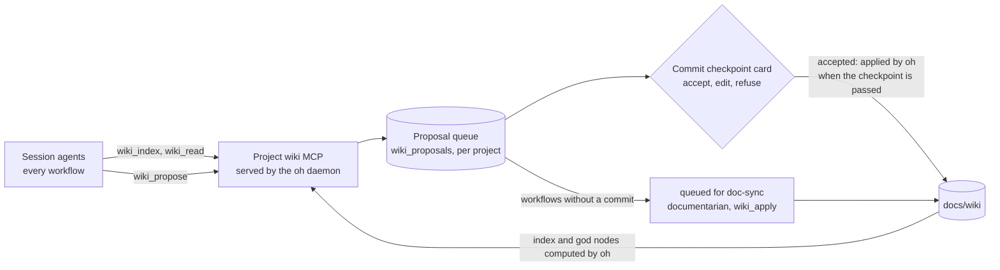

> [Lire en français](living-wiki.fr.md)

# Living Documentation Wiki

The **living documentation wiki** is the contextual documentation system for projects
managed by the hub. It replaces the old flat files (`ONBOARDING.md`, `CONVENTIONS.md`,
`docs/context/`) with a structured, navigable arborescence enriched incrementally.

---

## Concept

Inspired by Graphify's "knowledge graph" concept, the living documentation wiki is built
on two fundamental ideas:

**1. God nodes** — some concepts are more connected than others in a codebase.
They appear in multiple domains (technical AND business) and represent the zones
where critical decisions are concentrated. The wiki explicitly identifies them in `index.md`
to guide agents toward the essentials first.

**2. Confidence tags** — each enrichment carries an explicit confidence level
(`CONFIRMED`, `INFERRED`, `UNCERTAIN`) with the source (file + line when possible).
Future agents immediately know whether they can use information directly or need to verify it.

---

## Structure

```
docs/wiki/
├── index.md                    ← global map — always read first
├── technical/
│   ├── architecture.md         ← dominant patterns, layering, structural decisions
│   ├── stack.md                ← full stack, versions, key libraries
│   ├── tests.md                ← strategy, conventions, thresholds, frameworks
│   └── conventions.md          ← naming, git, linting, config, team patterns
└── business/
    ├── index.md                ← business domain map
    └── <domain>.md             ← business rules, flows, entities, risks
```

At the project root:
```
ONBOARDING.md                   ← minimal summary (15-25 lines), redirects to the wiki
```

---

## Confidence tag format

```markdown
- Description of the observation
  — `CONFIRMED` · <agent> · <YYYY-MM-DD> · <file:line>

- Description of an inferred observation
  — `INFERRED` · <agent> · <YYYY-MM-DD> · <file>

- Uncertain description
  — `UNCERTAIN` · <agent> · <YYYY-MM-DD>
```

| Tag | Meaning |
|-----|---------|
| `` `CONFIRMED` `` | Direct observation in code, file + line cited |
| `` `INFERRED` `` | Contextual reasoning from multiple files |
| `` `UNCERTAIN` `` | Hypothesis or undocumented convention, to be validated |

> **Note:** The hub uses French tags (`CONFIRMÉ`, `DÉDUIT`, `INCERTAIN`) in the wiki
> files since the hub operates primarily in French.

---

## Navigation protocol (skill `wiki-navigation`)

The `shared/wiki-navigation` skill is **Bucket A** (inline) in the agents that consult a project's context:
`pathfinder`, `onboarder`, `developer`,
`operator`, `auditor-subagent`, `reviewer`, `debugger`, `benchmarker`.

**Fundamental rule:** read `docs/wiki/index.md` first, then load only the page
relevant to the current task. Never read the full wiki by default.

```
Current task
     │
     ▼
docs/wiki/index.md (always)
     │
     ├── Implementation / naming  → technical/conventions.md
     ├── Architecture / layering  → technical/architecture.md
     ├── Stack / dependencies     → technical/stack.md
     ├── Tests / coverage         → technical/tests.md
     ├── Specific business domain → business/<domain>.md
     └── General context          → index.md is enough
```

---

## God node algorithm

A concept becomes a **god node** when it appears in ≥ 2 distinct wiki pages (the index aside).
**oh computes them** from the pages (wiki service, `cli/internal/services/wiki/`); no agent counts them again:

1. Candidate concepts: those the table of `index.md` declares, then those the pages put forward (a **bold** term of
   one to five words, not a label ending with a colon; an identifier in code mixing upper and lower case, such as
   `AuthService` or `useCart`).
2. A page cites a concept when it names it as a whole word (case insensitive) or, for a declared concept, when the
   table links to it.
3. At ≥ 2 pages: god node. Declared concepts keep their order, then come the others, by number of pages.
4. Criticality (written in French in the wiki): `Critique` (≥ 4 pages, named in « Points critiques actifs » or
   declared `Critique`), `Haute` (3 pages or declared `Haute`), `Normale` (2 pages).

A declared row whose pages and criticality oh finds again is kept as written (anchors included): with the same
data, the index injected in the prompts (level `index`, L7) does not change. `oh wiki check --fix` and applying a
proposal rewrite the table of `index.md` with the computed god nodes.

---

## Generation and enrichment

### Initial generation (onboarder)

The `onboarder` generates the wiki in Phase 5, after validation of the context report, in the `onboarding`
workflow (`oh run onboarding`).
All pages are created with the canonical format defined in the `doc-wiki-protocol` skill.

### Incremental enrichment (all agents): the wiki MCP of the project

After each report (audit, diagnosis, implementation, review), agents identify the findings to capitalise (skill
`shared/living-docs-enrichment`) and **propose** them with the `wiki_propose` tool of the `wiki` MCP server: the
agent proposes, the user validates, oh applies and checks.



1. The agent calls `wiki_propose(page, content, tag, source[, section])`. oh sets the author (the agent it sees
   calling the tool), cleans the content and queues it (`wp-<n>`, per project).
2. At the commit checkpoint (`cp-2` of `ticket`, `feature`, `review-feedback`; `cp-commit` of `quick`, `debug`,
   `sweep`), the decision card shows the proposals of the session: the user accepts, edits or refuses each one.
3. When the checkpoint is passed, **oh applies** the accepted proposals itself, before giving control back to the
   agent: they are committed with the code. The application is traced (status `applied`, `applied_by: oh`, date,
   `✎` entry in the timeline) and the agent gets the list of the files to commit.
4. Workflows without a commit (`audit`, `review`, `benchmark`, `infra-change`…) leave their proposals queued
   (`oh wiki pending`), for the future `doc-sync` workflow.

**Why oh applies, not the documentarian.** The `documentarian` is a member (`independent`) of `feature`, `ticket`
and `debug` only, never of `quick`, `sweep` nor `review-feedback`. Launching it from oh would take one more agent
turn (cost, non-determinism) in the middle of the workflow. The application is deterministic: the content was
validated by the user, oh adds it at the end of its section with the tag line (tag, author seen by oh, date,
source), updates the frontmatter (`updated`, `agents`, `confidence`) and recomputes the god nodes table. The
`documentarian` keeps `wiki_apply`, for its own sessions and for `doc-sync`.

| Tool | Role | Who |
|---|---|---|
| `wiki_index` | Index, pages, god nodes computed by oh, pending proposals | Every agent |
| `wiki_read(page, section)` | Targeted read of a page or a section | Every agent |
| `wiki_propose(page, content, tag, source)` | Queues a proposal; works in read-only workflows too | Every agent |
| `wiki_pending` | Pending proposals (project or session) | Coordinators |
| `wiki_apply(ids)` | Applies proposals | **documentarian only**, asked to the user |
| `wiki_check` | Frontmatter, links, tags, freshness, god nodes | Every agent, `oh wiki check` |

The server is injected in the bundles built from a workflow, for a project that has a `docs/wiki/`. Without the
daemon, `wiki_propose` answers "not recorded" and the agent keeps the proposal in its report.

### Check (`oh wiki check`)

Deterministic, run by oh on the files: frontmatter present and readable (`updated` a date, `confidence` in
`confirmed | mixed | uncertain` and consistent with the tags of the page, `agents` set), relative links and anchors,
tag lines in the form `` — `TAG` · agent · YYYY-MM-DD[ · source] `` (a source for `CONFIRMÉ`), page without any tag,
**freshness** (a page whose `updated` is older than the last commit of a file it cites, as a tag source or a link out
of the wiki; a cited file that is missing) and god nodes (table of the index against the computation). Errors give
a non-zero exit code; `--fix` recomputes the confidence of the pages and the god nodes table.

### Re-onboarding

If `docs/wiki/index.md` already exists, the `onboarder` proposes (workflow `refresh` input:
`oh run onboarding -i refresh=true`):
- **Incremental enrichment** (recommended) — via `living-docs-enrichment`
- **Full rewrite** — with a warning about loss of accumulated enrichments
- **Keep as is**

---

## Before / after comparison

| Before | After |
|--------|-------|
| 4 flat files (`ONBOARDING.md`, `CONVENTIONS.md`, `docs/context/technical.md`, `docs/context/business/<domain>.md`) | Structured wiki arborescence (`docs/wiki/`) |
| Agents potentially read all context each session | Agents read `index.md` (40-80 lines) then a single page |
| No confidence level on information | 3 levels: `CONFIRMED` / `INFERRED` / `UNCERTAIN` |
| Important concepts not identified | Explicit god nodes in `index.md` |
| `CONVENTIONS.md` read in full by each agent | `conventions.md` loaded only when relevant |
| No navigation protocol | `wiki-navigation` Bucket A skill in the agents that read the project context |

---

## The wiki in a v5 session

- **Creation**: `onboarding` workflow, whose only agent is the `onboarder`. It only writes to `docs/wiki/` and
  `ONBOARDING.md`; this limit is a prompt instruction, not a permission
  ([ADR-039](./adr/039-declarative-workflows-oh-v1.en.md)). Declared output: `wiki` (path).
- **Precondition**: `feature` and `cadrage` check that at least one of `docs/wiki/index.md`, `ONBOARDING.md`, or
  `CONVENTIONS.md` exists. Otherwise, oh offers to run `onboarding` first, then come back.
- **Injected context**: when the session bundle is built, `ONBOARDING.md`, `CONVENTIONS.md`,
  `.claude/CLAUDE.md`, and the `[deploy] instruction_files` are embedded in the agents' body
  ([ADR-043](./adr/043-session-bundle-deploy-removal.en.md)). The wiki itself is not embedded: agents read it
  on demand, with `wiki-navigation`. Hence a short `ONBOARDING.md` pointing to the wiki.
- **Writes**: the `onboarder` and the `documentarian` write the wiki in the session working folder (project or
  worktree). oh only writes there the proposals the user validated on the commit card, and the god nodes table it
  computes.
- **Enrichment**: every agent proposes with `wiki_propose`; no more direct delegation to the `documentarian`. The
  proposals of the workflows without a commit stay queued.
- **Injected index**: at the level `index` (L7), the wiki index and the god nodes computed by oh enter the prompt.

---

## References

- Skill `shared/wiki-navigation` — navigation protocol + god node algorithm
- Skill `documentarian/doc-wiki-protocol` — canonical formats + enrichment rules
- Skill `shared/living-docs-enrichment` — proposals with `wiki_propose`
- [`wiki` MCP server](../reference/cli-mcp.en.md#wiki-mcp-server) and [`oh wiki`](../reference/cli-projects.en.md#oh-wiki)
- ADR to come: decision to adopt the living documentation wiki
