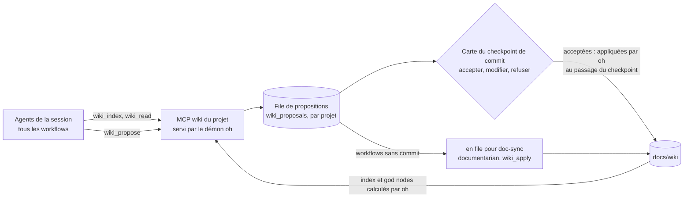

> [Read in English](living-wiki.en.md)

# Wiki Documentaire Vivant

Le **wiki documentaire vivant** est le système de documentation contextuelle des projets
gérés par le hub. Il remplace les anciens fichiers plats (`ONBOARDING.md`, `CONVENTIONS.md`,
`docs/context/`) par une arborescence structurée, navigable et enrichie de manière incrémentale.

---

## Concept

Inspiré du concept de "graphe de connaissance" de Graphify, le wiki documentaire vivant repose
sur deux idées fondamentales :

**1. Les god nodes** — certains concepts sont plus connectés que d'autres dans une codebase.
Ils apparaissent dans plusieurs domaines (technique ET métier) et représentent les zones
où se concentrent les décisions critiques. Le wiki les identifie explicitement dans `index.md`
pour guider les agents vers l'essentiel en premier.

**2. Les tags de confiance** — chaque enrichissement porte un niveau de confiance explicite
(`CONFIRMÉ`, `DÉDUIT`, `INCERTAIN`) avec la source (fichier + ligne si possible). Les agents
futurs savent immédiatement s'ils peuvent utiliser une information directement ou s'ils
doivent la vérifier.

---

## Structure

```
docs/wiki/
├── index.md                    ← carte globale obligatoire — toujours lue en premier
├── technical/
│   ├── architecture.md         ← patterns dominants, découpage, décisions structurantes
│   ├── stack.md                ← stack complète, versions, librairies clés
│   ├── tests.md                ← stratégie, conventions, seuils, frameworks
│   └── conventions.md          ← nommage, git, linting, config, patterns équipe
└── business/
    ├── index.md                ← carte des domaines métier
    └── <domain>.md             ← règles de gestion, flux, entités, risques
```

À la racine du projet :
```
ONBOARDING.md                   ← résumé minimaliste (15-25 lignes), redirige vers le wiki
```

---

## Format des tags de confiance

```markdown
- Description de l'observation
  — `CONFIRMÉ` · <agent> · <YYYY-MM-DD> · <fichier:ligne>

- Description d'une observation déduite
  — `DÉDUIT` · <agent> · <YYYY-MM-DD> · <fichier>

- Description incertaine
  — `INCERTAIN` · <agent> · <YYYY-MM-DD>
```

| Tag | Signification |
|-----|--------------|
| `` `CONFIRMÉ` `` | Observation directe dans le code, fichier + ligne citée |
| `` `DÉDUIT` `` | Raisonnement contextuel depuis plusieurs fichiers |
| `` `INCERTAIN` `` | Hypothèse ou convention non codée, à valider |

---

## Protocole de navigation (skill `wiki-navigation`)

Le skill `shared/wiki-navigation` est en **Bucket A** (inline) dans les agents qui consultent le contexte
d'un projet : `pathfinder`, `onboarder`, `developer`,
`operator`, `auditor-subagent`, `reviewer`, `debugger`, `benchmarker`.

**Règle fondamentale :** lire `docs/wiki/index.md` en premier, puis charger uniquement
la page pertinente à la tâche. Ne jamais lire le wiki en entier par défaut.

```
Tâche courante
     │
     ▼
docs/wiki/index.md (toujours)
     │
     ├── Implémentation / nommage → technical/conventions.md
     ├── Architecture / découpage → technical/architecture.md
     ├── Stack / dépendances       → technical/stack.md
     ├── Tests / couverture        → technical/tests.md
     ├── Domaine métier précis     → business/<domain>.md
     └── Contexte général          → index.md suffit
```

---

## Algorithme des god nodes

Un concept devient un **god node** quand il apparaît dans ≥ 2 pages wiki distinctes (l'index mis à part).
**oh les calcule** à partir des pages (service wiki, `cli/internal/services/wiki/`) ; aucun agent ne les recompte :

1. Concepts candidats : ceux que la table de `index.md` déclare, puis ceux que les pages mettent en avant
   (terme en **gras** d'un à cinq mots, hors libellé terminé par deux-points ; identifiant en code qui mêle
   majuscules et minuscules, comme `AuthService` ou `useCart`).
2. Une page cite un concept quand elle le nomme comme mot entier (sans tenir compte de la casse) ou, pour un
   concept déclaré, quand la table la lie.
3. Si ≥ 2 pages : god node. Les concepts déclarés gardent leur ordre, puis viennent les autres, par nombre de pages.
4. Criticité : `Critique` (≥ 4 pages, cité dans « Points critiques actifs » ou déclaré `Critique`), `Haute`
   (3 pages ou déclaré `Haute`), `Normale` (2 pages).

Une ligne déclarée dont oh retrouve les pages et la criticité est gardée telle quelle (ancres comprises) : à
données égales, l'index injecté dans les prompts (niveau `index`, L7) ne change pas. `oh wiki check --fix` et
l'application d'une proposition réécrivent la table de `index.md` avec les god nodes calculés.

---

## Génération et enrichissement

### Génération initiale (onboarder)

L'`onboarder` génère le wiki en Phase 5, après validation du rapport de contexte, dans le workflow
`onboarding` (`oh run onboarding`).
Toutes les pages sont créées avec le format canonique défini dans le skill `doc-wiki-protocol`.

### Enrichissement incrémental (tous les agents) : le MCP du wiki du projet

Après chaque rapport (audit, diagnostic, implémentation, review), les agents identifient les découvertes à
capitaliser (skill `shared/living-docs-enrichment`) et les **proposent** avec l'outil `wiki_propose` du serveur MCP
`wiki` : l'agent propose, l'utilisateur valide, oh applique et vérifie.



1. L'agent appelle `wiki_propose(page, contenu, tag, source[, section])`. oh fixe l'auteur (l'agent qu'il voit
   appeler l'outil), nettoie le contenu et le met en file (`wp-<n>`, par projet).
2. Au checkpoint de commit (`cp-2` de `ticket`, `feature`, `review-feedback` ; `cp-commit` de `quick`, `debug`,
   `sweep`), la carte de décision affiche les propositions de la session : l'utilisateur accepte, modifie
   ou refuse chacune.
3. Quand le checkpoint passe, **oh applique lui-même** les propositions acceptées, avant de rendre la main à
   l'agent : elles sont donc committées avec le code. L'application est tracée (statut `applied`, `applied_by: oh`,
   date, entrée `✎` dans la chronologie) et l'agent reçoit la liste des fichiers à committer.
4. Les workflows sans commit (`audit`, `review`, `benchmark`, `infra-change`…) laissent leurs propositions en file
   (`oh wiki pending`), pour le futur workflow `doc-sync`.

**Pourquoi oh applique, et non le documentarian.** Le `documentarian` n'est membre (`independent`) que de
`feature`, `ticket` et `debug`, jamais de `quick`, `sweep` ni `review-feedback`. Le lancer depuis oh demanderait un
tour d'agent de plus (coût, non-déterminisme) au milieu du workflow. L'application est déterministe : le contenu a
été validé par l'utilisateur, oh l'ajoute en fin de section avec la ligne de tag (tag, auteur vu par oh, date,
source), met à jour le frontmatter (`updated`, `agents`, `confidence`) et recalcule la table des god nodes. Le
`documentarian` garde `wiki_apply`, pour ses propres sessions et pour `doc-sync`.

| Outil | Rôle | Qui |
|---|---|---|
| `wiki_index` | Index, pages, god nodes calculés par oh, propositions en attente | Tous les agents |
| `wiki_read(page, section)` | Lecture ciblée d'une page ou d'une section | Tous les agents |
| `wiki_propose(page, contenu, tag, source)` | Met une proposition en file ; fonctionne aussi dans les workflows en lecture seule | Tous les agents |
| `wiki_pending` | Propositions en attente (projet ou session) | Coordinateurs |
| `wiki_apply(ids)` | Applique des propositions | **documentarian seulement**, soumis à l'utilisateur |
| `wiki_check` | Frontmatter, liens, tags, fraîcheur, god nodes | Tous les agents, `oh wiki check` |

Le serveur est injecté dans les paquets construits depuis un workflow, pour un projet qui a un `docs/wiki/`. Sans
démon, `wiki_propose` répond « non enregistrée » et l'agent garde la proposition dans son rapport.

### Vérification (`oh wiki check`)

Déterministe, lancée par oh sur les fichiers : frontmatter présent et lisible (`updated` en date, `confidence` dans
`confirmed | mixed | uncertain` et cohérent avec les tags de la page, `agents` renseigné), liens relatifs et ancres,
lignes de tag au format `` — `TAG` · agent · AAAA-MM-JJ[ · source] `` (une source pour `CONFIRMÉ`), page sans tag,
**fraîcheur** (page dont `updated` est antérieur au dernier commit d'un fichier qu'elle cite, en source de tag ou en
lien hors du wiki ; fichier cité absent) et god nodes (table de l'index face au calcul). Les erreurs donnent un code
de sortie non nul ; `--fix` recalcule la confiance des pages et la table des god nodes.

### Re-onboarding

Si `docs/wiki/index.md` existe déjà, l'`onboarder` propose (entrée `refresh` du workflow :
`oh run onboarding -i refresh=true`) :
- **Enrichissement incrémental** (recommandé) — via `living-docs-enrichment`
- **Réécriture complète** — avec avertissement sur la perte des enrichissements accumulés
- **Conserver l'existant**

---

## Comparaison avant / après

| Avant | Après |
|-------|-------|
| 4 fichiers plats (`ONBOARDING.md`, `CONVENTIONS.md`, `docs/context/technical.md`, `docs/context/business/<domain>.md`) | Arborescence wiki structurée (`docs/wiki/`) |
| Agents lisent potentiellement tout le contexte à chaque session | Agents lisent `index.md` (40-80 lignes) puis une seule page |
| Aucun niveau de confiance sur les informations | 3 niveaux : `CONFIRMÉ` / `DÉDUIT` / `INCERTAIN` |
| Concepts importants non identifiés | God nodes explicites dans `index.md` |
| `CONVENTIONS.md` lu entièrement par chaque agent | `conventions.md` chargé uniquement si pertinent |
| Aucun protocole de navigation | Skill `wiki-navigation` Bucket A dans les agents qui lisent le contexte du projet |

---

## Le wiki dans une session v5

- **Création** : workflow `onboarding`, dont le seul agent est l'`onboarder`. Il n'écrit que dans `docs/wiki/` et
  `ONBOARDING.md` ; cette limite est une consigne du prompt, pas une permission
  ([ADR-039](./adr/039-declarative-workflows-oh-v1.fr.md)). Sortie déclarée : `wiki` (chemin).
- **Précondition** : `feature` et `cadrage` vérifient qu'au moins un de `docs/wiki/index.md`, `ONBOARDING.md` ou
  `CONVENTIONS.md` existe. Sinon, oh propose de lancer d'abord `onboarding`, puis de revenir.
- **Contexte injecté** : à la construction du paquet de session, `ONBOARDING.md`, `CONVENTIONS.md`,
  `.claude/CLAUDE.md` et les fichiers de `[deploy] instruction_files` sont intégrés au corps des agents
  ([ADR-043](./adr/043-session-bundle-deploy-removal.fr.md)). Le wiki lui-même n'est pas intégré : les agents le
  lisent à la demande, avec `wiki-navigation`. D'où un `ONBOARDING.md` court qui renvoie au wiki.
- **Écritures** : l'`onboarder` et le `documentarian` écrivent le wiki dans le dossier de travail de la session
  (projet ou worktree). oh n'y écrit que les propositions validées par l'utilisateur à la carte du commit, et la
  table des god nodes qu'il calcule.
- **Enrichissement** : tous les agents proposent avec `wiki_propose` ; plus aucune délégation directe au
  `documentarian`. Les propositions des workflows sans commit restent en file.
- **Index injecté** : au niveau `index` (L7), l'index du wiki et les god nodes calculés par oh entrent dans le prompt.

---

## Références

- Skill `shared/wiki-navigation` — protocole de navigation + algorithme god nodes
- Skill `documentarian/doc-wiki-protocol` — formats canoniques + règles d'enrichissement
- Skill `shared/living-docs-enrichment` — propositions avec `wiki_propose`
- [Serveur MCP `wiki`](../reference/cli-mcp.fr.md#serveur-mcp-wiki) et [`oh wiki`](../reference/cli-projects.fr.md#oh-wiki)
- ADR à venir : décision d'adoption du wiki documentaire vivant
