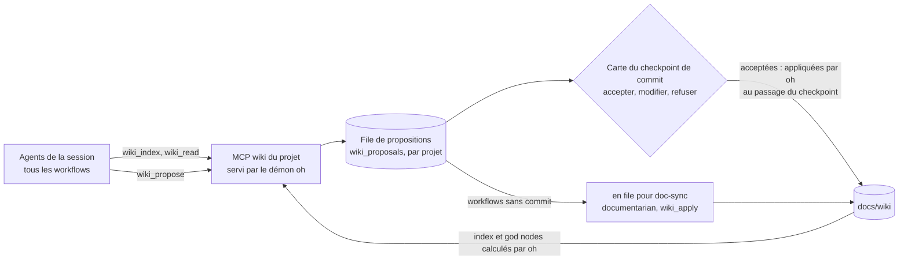

> [Read in English](living-wiki.en.md)

# Wiki Documentaire Vivant

Le **wiki documentaire vivant** est le système de documentation contextuelle des projets
gérés par le hub. Il remplace les anciens fichiers plats (`ONBOARDING.md`, `CONVENTIONS.md`,
`docs/context/`) par une arborescence structurée, navigable et enrichie de manière incrémentale.

---

## Concept

Inspiré du concept de "graphe de connaissance" de Graphify, le wiki documentaire vivant repose
sur deux idées fondamentales :

**1. Les god nodes** — certains concepts sont plus connectés que d'autres dans une codebase.
Ils apparaissent dans plusieurs domaines (technique ET métier) et représentent les zones
où se concentrent les décisions critiques. Le wiki les identifie explicitement dans `index.md`
pour guider les agents vers l'essentiel en premier.

**2. Les tags de confiance** — chaque enrichissement porte un niveau de confiance explicite
(`CONFIRMÉ`, `DÉDUIT`, `INCERTAIN`) avec la source (fichier + ligne si possible). Les agents
futurs savent immédiatement s'ils peuvent utiliser une information directement ou s'ils
doivent la vérifier.

---

## Structure

```
docs/wiki/
├── index.md                    ← carte globale obligatoire — toujours lue en premier
├── glossary.md                 ← termes du domaine
├── technical/
│   ├── architecture.md         ← patterns dominants, découpage, décisions structurantes
│   ├── stack.md                ← stack complète, versions, librairies clés
│   ├── tests.md                ← stratégie, conventions, seuils, frameworks
│   └── conventions.md          ← nommage, git, linting, config, patterns équipe
├── business/
│   ├── index.md                ← carte des domaines métier
│   └── <domain>.md             ← règles de gestion, flux, entités, risques
├── specs/                      ← spécifications (workflow spec)
├── decisions/                  ← ADR et decisions-rejetees.md
└── postmortems/                ← un incident par page
```

**Un seul référentiel (LD-F)** : specs, glossaire, décisions et postmortems vivent dans le wiki, pas à côté.
`wiki_check` signale une page hors de cette arborescence (`layout`, avertissement) ; les pages de `specs/`,
`decisions/` et `postmortems/` consignent des décisions ou des faits datés : leur frontmatter est vérifié, pas leurs
tags de confiance.
Trois workflows y écrivent directement, chacun un seul dossier, déclaré par `writes:` et commité seul après son
checkpoint : `spec` (planner, `specs/`), `incident` (debugger, `postmortems/`) et `spike` (pathfinder, `decisions/`).

À la racine du projet :
```
ONBOARDING.md                   ← résumé minimaliste (15-25 lignes), redirige vers le wiki
```

---

## Format des tags de confiance

```markdown
- Description de l'observation
  — `CONFIRMÉ` · <agent> · <YYYY-MM-DD> · <fichier:ligne>

- Description d'une observation déduite
  — `DÉDUIT` · <agent> · <YYYY-MM-DD> · <fichier>

- Description incertaine
  — `INCERTAIN` · <agent> · <YYYY-MM-DD>
```

| Tag | Signification |
|-----|--------------|
| `` `CONFIRMÉ` `` | Observation directe dans le code, fichier + ligne citée |
| `` `DÉDUIT` `` | Raisonnement contextuel depuis plusieurs fichiers |
| `` `INCERTAIN` `` | Hypothèse ou convention non codée, à valider |

---

## Protocole de navigation (skill `wiki-navigation`)

Le skill `shared/wiki-navigation` est en **Bucket A** (inline) dans les agents qui consultent le contexte
d'un projet : `pathfinder`, `onboarder`, `developer`,
`operator`, `auditor-subagent`, `reviewer`, `debugger`, `benchmarker`.

**Règle fondamentale :** lire `docs/wiki/index.md` en premier, puis charger uniquement
la page pertinente à la tâche. Ne jamais lire le wiki en entier par défaut.

```
Tâche courante
     │
     ▼
docs/wiki/index.md (toujours)
     │
     ├── Implémentation / nommage → technical/conventions.md
     ├── Architecture / découpage → technical/architecture.md
     ├── Stack / dépendances       → technical/stack.md
     ├── Tests / couverture        → technical/tests.md
     ├── Domaine métier précis     → business/<domain>.md
     └── Contexte général          → index.md suffit
```

---

## Algorithme des god nodes

Un concept devient un **god node** quand il apparaît dans ≥ 2 pages wiki distinctes (l'index mis à part).
**oh les calcule** à partir des pages (service wiki, `cli/internal/services/wiki/`) ; aucun agent ne les recompte :

1. Concepts candidats : ceux que la table de `index.md` déclare, puis ceux que les pages mettent en avant
   (terme en **gras** d'un à cinq mots ; identifiant en code qui mêle majuscules et minuscules, comme
   `AuthService` ou `useCart`). Le bruit est écarté : libellé (`**Note** :`, `**Règle :**`), phrase en gras,
   mot d'insistance (**jamais**, **Important**…), nom de produit ou de langage (`TypeScript`, `GitHub`…). Dans
   le glossaire, un terme défini (`**Panier** : …`) est un candidat.
2. Une page cite un concept quand elle le nomme comme mot entier (sans tenir compte de la casse), hors des
   métadonnées de ses tags (agent, date, source) et des cibles de ses liens, ou, pour un concept déclaré qu'une page
   nomme encore, quand la table la lie (un concept renommé qu'aucune page ne nomme plus est périmé, quels que soient
   ses liens). Les cartes du wiki (`index.md`, l'index d'un dossier, `glossary.md`) ne comptent pas : elles nomment
   tous les concepts.
3. Si ≥ 2 pages : god node. Les concepts déclarés gardent leur ordre, puis viennent les autres, par nombre de pages.
4. Criticité : `Critique` (≥ 4 pages, cité dans « Points critiques actifs » ou déclaré `Critique`), `Haute`
   (3 pages ou déclaré `Haute`), `Normale` (2 pages).

Une ligne déclarée dont oh retrouve les pages et la criticité est gardée telle quelle (ancres comprises) : à
données égales, l'index injecté dans les prompts (niveau `index`, L7) ne change pas. `oh wiki check --fix` et
l'application d'une proposition réécrivent la table de `index.md` avec les god nodes calculés.

---

## Génération et enrichissement

### Génération initiale (onboarder)

L'`onboarder` génère le wiki en Phase 5, après validation du rapport de contexte, dans le workflow
`onboarding` (`oh run onboarding`).
Toutes les pages sont créées avec le format canonique défini dans le skill `doc-wiki-protocol`.

### Enrichissement incrémental (tous les agents) : le MCP du wiki du projet

Après chaque rapport (audit, diagnostic, implémentation, review), les agents identifient les découvertes à
capitaliser (skill `shared/living-docs-enrichment`) et les **proposent** avec l'outil `wiki_propose` du serveur MCP
`wiki` : l'agent propose, l'utilisateur valide, oh applique et vérifie.



1. L'agent appelle `wiki_propose(page, contenu, tag, source[, section, replaces])`. oh fixe l'auteur (l'agent qu'il voit
   appeler l'outil), nettoie le contenu et le met en file (`wp-<n>`, par projet).
2. Au checkpoint de commit, celui qui déverrouille `commit` (`cp-2` de `ticket`, `implement-spec`,
   `review-feedback`, `security-fix` ; `cp-commit` de `quick`, `debug`, `sweep`, `sweep-task` ; `cp-wiki`,
   `cp-sync`, `cp-spec`, `cp-postmortem`, `cp-decision`… ; le dernier, quand un workflow déverrouille le commit deux
   fois), la carte de décision affiche les propositions de la session : l'utilisateur accepte, modifie
   ou refuse chacune, avec un motif facultatif conservé en cas de refus (ou, hors de la TUI, `oh wiki decide`).
3. Quand le checkpoint passe, **oh applique lui-même** les propositions acceptées, avant de rendre la main à
   l'agent : elles sont donc committées avec le code. L'application est tracée (statut `applied`, `applied_by: oh`,
   date, entrée `✎` dans la chronologie) et l'agent reçoit la liste des fichiers à committer.
4. Les workflows sans commit (`audit`, `review`, `benchmark`, `infra-change`…) laissent leurs propositions en file
   (`oh wiki pending`), pour le workflow `doc-sync`.

**Pourquoi oh applique, et non le documentarian.** Le `documentarian` n'est membre (`independent`) que de
`ticket` et `implement-spec`, jamais de `quick`, `debug`, `sweep` ni `review-feedback`. Le lancer depuis oh demanderait un
tour d'agent de plus (coût, non-déterminisme) au milieu du workflow. L'application est déterministe : le contenu a
été validé par l'utilisateur, oh l'ajoute en fin de section avec la ligne de tag (tag, auteur vu par oh, date,
source), met à jour le frontmatter (`updated`, `agents`, `confidence`) et recalcule la table des god nodes. Le
`documentarian` garde `wiki_apply`, pour ses propres sessions et pour `doc-sync`.

| Outil | Rôle | Qui |
|---|---|---|
| `wiki_index` | Index, pages, god nodes calculés par oh, propositions en attente | Tous les agents |
| `wiki_read(page, section)` | Lecture ciblée d'une page ou d'une section | Tous les agents |
| `wiki_propose(page, contenu, tag, source[, replaces])` | Met une proposition en file (ajout, ou remplacement d'une ligne : `replaces`, vérifiée à la proposition et à l'application, sinon `stale`) ; fonctionne aussi dans les workflows en lecture seule | Tous les agents |
| `wiki_pending` | Propositions en attente (projet ou session), puis les refus récents avec leur motif | Coordinateurs |
| `wiki_apply(ids)` | Applique des propositions | **documentarian seulement**, soumis à l'utilisateur |
| `wiki_check([paths, base, head, since_sync])` | Frontmatter, liens, tags, fraîcheur, arborescence, god nodes ; restreint à un changement : pages concernées et dérive | Tous les agents, `oh wiki check` |

Le serveur est injecté dans les paquets construits depuis un workflow, pour un projet qui a un `docs/wiki/`. Sans
démon, `wiki_propose` répond « non enregistrée » et l'agent garde la proposition dans son rapport.

### Sessions distantes

Dans une [session distante](../guides/remote-runners.fr.md) (job GitLab CI), le paquet est celui construit sur
votre machine : les agents ont les mêmes outils `wiki_*` qu'en local, servis par le démon oh du job sur **son
clone** du projet.

- **Lecture et vérification** : `wiki_index`, `wiki_read`, `wiki_check` (dérive d'un changement comprise) lisent le
  wiki du clone. Le démon du job tourne sous root et le clone appartient au compte `oh` des agents : oh lit les pages
  sans jamais sortir du projet (aucun lien symbolique, même posé pendant la lecture, ne le fait lire ni examiner un
  fichier hors du clone) et ses lectures git tournent sous le compte `oh`, comme toutes ses lectures git dans le
  clone.
- **Propositions** : `wiki_propose` met en file dans le job, avec l'auteur vu par oh. **Rien n'est appliqué dans le
  job** : le checkpoint de commit passé par le répondeur n'applique aucune proposition, et `wiki_apply` est refusé à
  tous les agents, `documentarian` compris (« les propositions remontent sur la machine »).
- **Retour** : les propositions de la session partent dans l'artefact `wiki.json`. `oh session fetch` les remet dans
  la file du projet sur votre machine, **en attente**, nettoyées et bornées de nouveau (l'artefact n'est pas de
  confiance : une proposition qui cite les données de session d'oh est refusée), et renumérotées par la file locale ;
  les rapports du job qui les citent reçoivent les nouveaux identifiants (`wp-…`). Un second fetch n'ajoute rien et
  ne revient pas sur vos décisions. Les identifiants cités dans la transcription du job restent ceux du job.
- **Validation** : comme en local, sur la carte du checkpoint de commit quand vous reprenez la session
  (`oh session attach`), ou avec `doc-sync` (`oh wiki pending`). oh applique les propositions acceptées dans le
  dossier de travail local de la session.

### Vérification (`oh wiki check`)

Déterministe, lancée par oh sur les fichiers : frontmatter présent et lisible (`updated` en date, `confidence` dans
`confirmed | mixed | uncertain` et cohérent avec les tags de la page, `agents` renseigné), liens relatifs et ancres,
lignes de tag au format `` — `TAG` · agent · AAAA-MM-JJ[ · source] `` (une source pour `CONFIRMÉ`), page sans tag,
**fraîcheur** (page dont `updated` est antérieur au dernier commit d'un fichier qu'elle cite, en source de tag ou en
lien hors du wiki ; fichier cité absent) et god nodes (table de l'index face au calcul). Les erreurs donnent un code
de sortie non nul ; `--fix` recalcule la confiance des pages et la table des god nodes.

### Dérive d'un changement : axe documentation du reviewer (LD-H)

`wiki_check` restreint à un changement (`paths`, ou `base` et `head`, ou `since_sync`) répond, de façon déterministe :
les problèmes des pages du wiki que le changement modifie, les **pages concernées** (celles qui citent un fichier
modifié, en source de tag ou en lien, ou qui portent un god node touché) et deux dérives :

- `drift_confirmed` : une page affirme en `CONFIRMÉ` (tag dont la source est le fichier, ou page `confidence:
  confirmed` qui le cite) ce qu'un fichier modifié dit désormais, et le changement ne la met pas à jour ;
- `drift_god_node` : un fichier modifié touche un god node (son nom est celui du concept, `AuthService` et
  `src/auth_service.go`, ou une page du god node le cite sur une ligne qui nomme le concept), et aucune page du god
  node n'est mise à jour.

Le `reviewer` appelle `wiki_check` avec la base et la branche de la review ; chaque dérive devient un finding 🟡
« Documentation » sur la page du wiki (seule exception à sa règle « pas de finding hors du diff »).

### Synchronisation : workflow `doc-sync` (LD-D)

`oh run doc-sync` (agent d'entrée : `documentarian`) rattrape le wiki sur le code et vide la file :

1. `wiki_check` avec `since_sync` : commits depuis la dernière synchronisation, fichiers modifiés, pages concernées
   et dérives ;
2. le `documentarian` met à jour ces pages (revérifié dans le code : `CONFIRMÉ` avec `fichier:ligne`) ;
3. `wiki_pending` : il vérifie chaque proposition en file et prépare sa recommandation ;
4. checkpoint `cp-sync` (une pause, obligatoire, `unlocks: [commit]`, `wiki: sync`) : la carte montre **toute la
   file du projet** ; l'utilisateur accepte, modifie ou refuse chaque proposition ;
5. au passage, oh applique les propositions acceptées et note la synchronisation ; le `documentarian` commite le
   wiki seul.

**Où est mémorisée la dernière synchronisation ?** Dans le dépôt, champ `synced:` du frontmatter de
`docs/wiki/index.md` (le commit dont la session est partie), écrit par oh et commité avec le wiki. Pas dans la base
d'oh : la marque voyage avec la branche, un clone et les autres membres d'une équipe lisent la même, et elle reste en
phase avec les pages qu'elle décrit (une branche non synchronisée garde l'ancienne). Si elle manque ou n'est plus
atteignable (historique réécrit), oh prend le dernier commit qui a modifié `docs/wiki/` ; un wiki jamais commité
n'a rien à synchroniser.

### Métriques (LD-I)

Calculées par oh (`oh wiki stats`, vue « Wiki » du mode projet de la TUI) : **couverture des domaines** (pages
`business/<domaine>.md` et domaines de la carte de l'index ; un domaine est couvert quand sa page existe et porte au
moins un enrichissement tagué), **âge médian des pages** (jours depuis `updated`, avec la plus ancienne), **part de
`INCERTAIN`** parmi les enrichissements tagués, **propositions en attente** (en file, acceptées non appliquées) et
dernière synchronisation.

### Purge

`oh gc` supprime, passé la rétention de l'historique (`[gc] history_days`), les propositions appliquées ou refusées ;
celles en attente restent, comme la dernière de chaque projet (son numéro sert de base au suivant : un numéro `wp-…`
n'est jamais redonné).

### Re-onboarding

Si `docs/wiki/index.md` existe déjà (entrée `refresh` du workflow : `oh run onboarding -i refresh=true`, ou un
onboarding sur un projet qui a déjà un wiki), l'`onboarder` ne modifie aucune page (skill
`onboarder-phase-5-reonboarding`) : après `wiki_check`, il compare chaque page au code et propose avec `wiki_propose`
seulement ce qui a changé (entrée périmée ou contredite, `EXPIRED`/`SUPERSEDED` d'une décision rejetée) ou un élément
structurant absent. Les propositions passent par la carte de `cp-wiki`, le checkpoint de commit du workflow : oh
applique les acceptées, puis l'onboarder commite `docs/wiki/` seul (`writes: ["docs/wiki/**"]`). Un wiki fidèle au
code ne reçoit aucune proposition. Plus de réécriture complète : supprimer `docs/wiki/` et relancer l'onboarding.

---

## Comparaison avant / après

| Avant | Après |
|-------|-------|
| 4 fichiers plats (`ONBOARDING.md`, `CONVENTIONS.md`, `docs/context/technical.md`, `docs/context/business/<domain>.md`) | Arborescence wiki structurée (`docs/wiki/`) |
| Agents lisent potentiellement tout le contexte à chaque session | Agents lisent `index.md` (40-80 lignes) puis une seule page |
| Aucun niveau de confiance sur les informations | 3 niveaux : `CONFIRMÉ` / `DÉDUIT` / `INCERTAIN` |
| Concepts importants non identifiés | God nodes explicites dans `index.md` |
| `CONVENTIONS.md` lu entièrement par chaque agent | `conventions.md` chargé uniquement si pertinent |
| Aucun protocole de navigation | Skill `wiki-navigation` Bucket A dans les agents qui lisent le contexte du projet |

---

## Le wiki dans une session v5

- **Création** : workflow `onboarding`, dont le seul agent est l'`onboarder`. Il n'écrit que dans `docs/wiki/`,
  `ONBOARDING.md` et `CONVENTIONS.md` (ses permissions), puis commite `docs/wiki/` seul après `cp-wiki`
  ([ADR-039](./adr/039-declarative-workflows-oh-v1.fr.md)). Sortie déclarée : `wiki` (chemin).
- **Précondition** : `spec` (et ses alias `cadrage`, `feature`) et `implement-spec` vérifient qu'au moins un de `docs/wiki/index.md`, `ONBOARDING.md` ou
  `CONVENTIONS.md` existe. Sinon, oh propose de lancer d'abord `onboarding`, puis de revenir.
- **Contexte injecté** : à la construction du paquet de session, `ONBOARDING.md`, `CONVENTIONS.md`,
  `.claude/CLAUDE.md` et les fichiers de `[deploy] instruction_files` sont intégrés au corps des agents
  ([ADR-043](./adr/043-session-bundle-deploy-removal.fr.md)). Le wiki lui-même n'est pas intégré : les agents le
  lisent à la demande, avec `wiki-navigation`. D'où un `ONBOARDING.md` court qui renvoie au wiki.
- **Écritures** : l'`onboarder` (création seulement) et le `documentarian` écrivent le wiki dans le dossier de travail de la session
  (projet ou worktree). Trois agents en lecture seule écrivent en plus une page déclarée par leur workflow
  (`writes:`) et la commitent seule : le `planner` sa spec (`specs/`, `spec`), le `debugger` son postmortem
  (`postmortems/`, `incident`), le `pathfinder` sa décision (`decisions/`, `spike`) ; oh relève ces pages comme
  sorties de la session et les passe au workflow suivant (`next:`, entrée `source` de `spec`). oh n'y écrit que les propositions validées par l'utilisateur à la carte du commit, la
  table des god nodes qu'il calcule et la marque `synced:` de `doc-sync`.
- **Enrichissement** : tous les agents proposent avec `wiki_propose` ; plus aucune délégation directe au
  `documentarian`. Les propositions des workflows sans commit restent en file.
- **Index injecté** : au niveau `index` (L7), l'index du wiki et les god nodes calculés par oh entrent dans le prompt.
- **Session distante** : mêmes outils, servis dans le job sur le clone ; les propositions remontent sur la machine
  pour y être validées (voir [Sessions distantes](#sessions-distantes)).

---

## Références

- Skill `shared/wiki-navigation` — protocole de navigation + algorithme god nodes
- Skill `documentarian/doc-wiki-protocol` — formats canoniques + règles d'enrichissement
- Skill `shared/living-docs-enrichment` — propositions avec `wiki_propose`
- [Serveur MCP `wiki`](../reference/cli-mcp.fr.md#serveur-mcp-wiki) et [`oh wiki`](../reference/cli-projects.fr.md#oh-wiki-check)
- ADR à venir : décision d'adoption du wiki documentaire vivant
