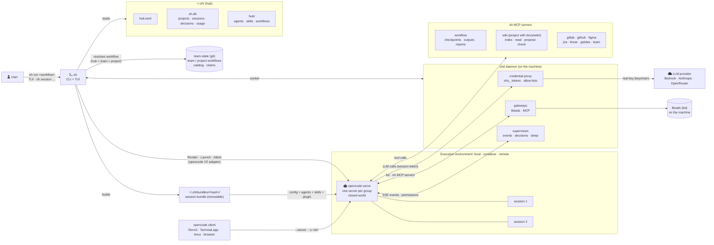
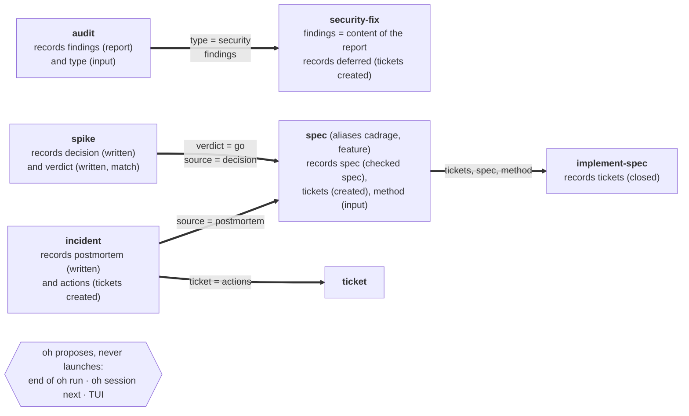
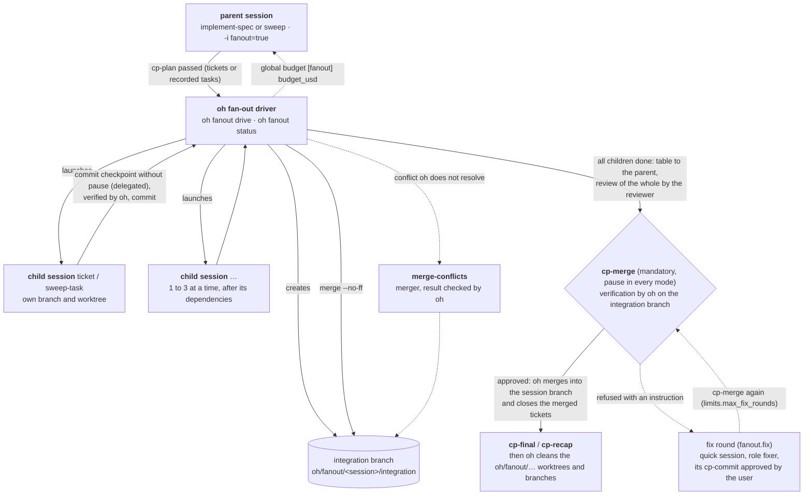
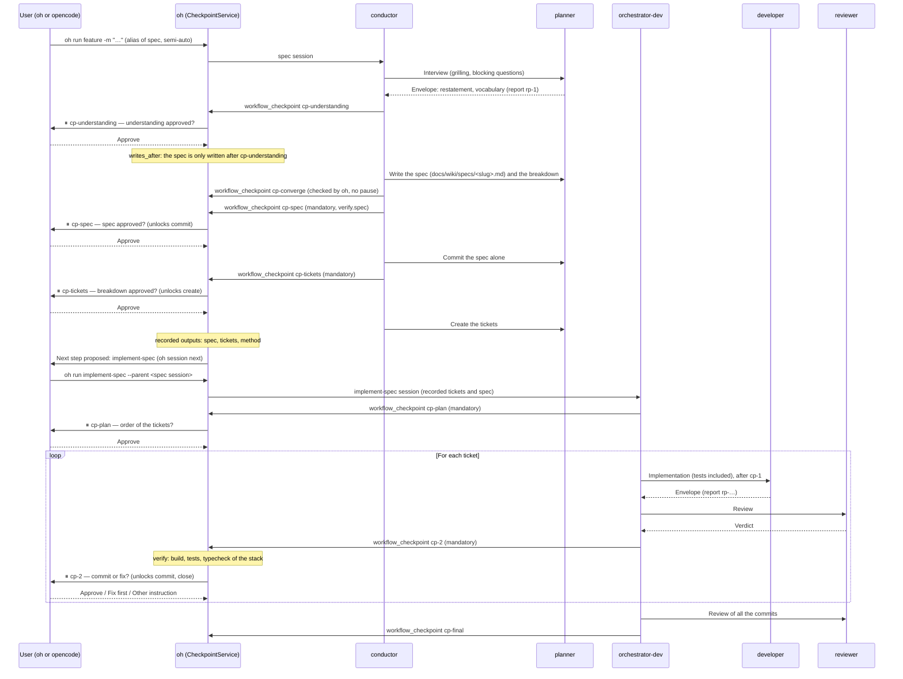

> [Lire en français](overview.fr.md)

# Architecture Overview

> See also: [Glossary](../reference/glossary.en.md) for term definitions, [v5 migration guide](../guides/migration-v5.en.md) for what changed since v4.

## System View

`oh` is the **control tower**, opencode the **cockpit**: `oh` picks the workflow, builds the session bundle, starts one opencode server per group and follows the sessions; opencode runs the agents and is the conversation interface. Closing the opencode window does not stop the session.



> Diagram source: [`docs/diagrams/system-overview.mermaid`](../diagrams/system-overview.mermaid)

## Session Flow

```
oh run <workflow> (or "Start" in the TUI)
  1. Workflow resolution        hub < team < project (< draft) < session options
  2. Launch form / --recap      inputs, mode, runtime, location, warnings
  3. Session bundle             ~/.oh/bundles/<hash>/ (immutable, shared by the group)
  4. Server group               one `opencode serve` per (bundle, project, runtime)
  5. Check                      closed world (Attest): otherwise the session does not start
  6. Session                    created through the API (id chosen by oh), initial prompt
  7. Opening                    iTerm2 → Terminal.app → tmux → browser → current terminal
  8. Follow-up and decisions    ohd daemon: feed, ⏸ ? ! $ ✗, notifications, sleep after 5 min
  9. End and next step          outputs recorded by oh, next step proposed (next:), never launched by itself
```

Nothing is written into the project anymore: `oh deploy` and `oh sync` are removed in v5 (they are aliases that explain the migration; leftovers of former deployments are removed with `oh migrate deploy-cleanup`).

Session lifecycle: [`session-lifecycle.mermaid`](../diagrams/session-lifecycle.mermaid); user guide: [v5 sessions](../guides/sessions-v5.en.md).

## Core Concepts

### Hub

The **hub** (`openhub`) is the central repository holding the sources of the agents (`agents/`), skills (`skills/`) and shipped workflows (`workflows/`). They are embedded in the binary (`internal/hubcontent`) and extracted to `~/.oh/hub/`. It is the source of truth: edit here, never in projects.

### Workflow

A **workflow** is a declarative YAML file (`apiVersion: oh/v1`) describing a use case: entry agent, member agents and their order (`after`, `calls`), checkpoints and their behaviour per mode (`manuel`, `semi-auto`, `auto`), inputs, typed outputs, resources (skills, MCP, plugins, allowed Beads commands), risk (`read`, `plan`, `write`, `publish`), allowed runtimes and restrictions (`limits`). The hub ships 24 of them: `spec`, `implement-spec`, `ticket`, `quick`, `sweep`, `review`, `review-feedback`, `audit`, `security-fix`, `debug`, `incident`, `spike`, `retro`, `triage`, `benchmark`, `infra-change`, `onboarding`, `doc-sync`, `skill-refresh`, `release`, `brief-enrich`, `libre`, and two workflows that oh starts in a fan-out (also usable by hand), `merge-conflicts` and `sweep-task`. `feature` and `cadrage` are no longer workflows but **aliases** (`aliases:`): `oh run feature` (like `oh start`) and `oh run cadrage` start `spec`, `oh run feature --tickets …` starts `implement-spec`. The generic `conductor` agent is the entry when no dedicated agent is set (`spec`, `sweep`, `security-fix`).

Workflows are resolved **by layers**: hub, then team and project (in the team-state repository), then session options. A more specific layer extends the previous one (`extends`); security can only be tightened, and a layer can lock fields (`enforce`). Each resolved value keeps its origin (`oh workflow show --origin`).

See [Shipped workflows](../reference/workflows.en.md), [Team workflows](../guides/team-workflows.en.md), [workflow map](../diagrams/workflow-scenarios-map.mermaid) and [layered resolution](../diagrams/config-resolution.mermaid). Decisions: [ADR-039](./adr/039-declarative-workflows-oh-v1.en.md), [ADR-040](./adr/040-workflows-team-state-governance.en.md).

### Workflow Composition

A workflow never launches another workflow. It declares its **outputs**, which oh **records itself** whenever it can (`record:`: tickets created or closed through the Beads gateway, spec checked at a checkpoint, last report filed, files written under given paths, launch input), and the workflows that may follow it (`next:`, with a `when: { outputs, equals }` condition and `session.output(<output>)` inputs). At the end of the session, oh **proposes** the next step without launching it: when the client closes (`oh run`), with `oh session next <id>` and first in "Chain with…" of the TUI; the next step started with `--parent <session>` reads the outputs of that session. Shipped chains: `spec` → `implement-spec` (tickets, spec, method), `audit` (`security`) → `security-fix` (content of the report), `spike` (verdict `go`) and `incident` → `spec` (origin page `source`), `incident` → `ticket` (action tickets).



> Diagram source: [`docs/diagrams/workflow-composition.mermaid`](../diagrams/workflow-composition.mermaid)

See [Composition](../reference/workflow-schema.en.md#composition-next-and-aliases), [Outputs recorded by oh](../reference/workflow-schema.en.md#outputs-recorded-by-oh-record) and the [workflow map](../diagrams/workflow-scenarios-map.mermaid).

### Session Bundle

At each launch, `internal/bundle` builds the **session bundle** `~/.oh/bundles/<hash>/` from the resolved workflow: member agents (Bucket A skills inlined), on-demand skills (Bucket B, stack skills, `skills.extra`, skills generated from the YAML such as `workflow/workflow-map`; each agent sees only its own catalogue of them, see [Per-agent catalogue](skills.en.md#per-agent-catalogue)), permissions, delegation graph and maximum depth, MCP servers (including oh's `workflow` and `wiki` servers) and the oh plugin. Each agent gets a generated **session contract** (its role, its callers and the agents it may launch, its checkpoints, its writes, the `question` tool or not: see [Agents](agents.en.md#agents-in-a-v5-session)), the text filtered for its role (`when:`, see [Variants by role](skills.en.md#variants-by-role-and-by-session-when)) and the project instructions at its level (`full`, `index`, `none`: see [Project instructions by level](agents.en.md#project-instructions-by-level)). The bundle is **immutable** and addressed by its hash: the sessions of a group share it, and a resume starts again from the same bundle.

Commands: `oh bundle show <workflow> [--budget]`, `oh bundle build <workflow>`. Decision: [ADR-043](./adr/043-session-bundle-deploy-removal.en.md).

### Closed World

A session sees **only** the agents and skills of its bundle: opencode native agents disabled, built-in skills denied, agents outside the workflow invisible. This is not configurable. The adapter checks it at every server start (`Attest`: agents, skills and MCP actually visible, effective rules per agent); on any mismatch, the session does not start. Decision: [ADR-041](./adr/041-closed-world-isolation.en.md).

### Server Group

A **group** = (bundle version, project, runtime). Each group has its own `opencode serve`, shared by its sessions; each session has its own location (project folder or worktree), environment, permission rules and prompt. Several tickets launched together (`oh run ticket --tickets a,b`) give N sessions in a single server, with one worktree per session that writes. An idle server with no pending decision goes to sleep after 5 minutes; resuming restarts the server on the same bundle.

### Tool Adapter

The logic stays in `oh`; one **adapter** per tool translates a neutral model (`SessionSpec`, `BundleSpec`) into the tool's format and drives its server: `Render`, server start, session creation through the API, `Attest`, events, decisions, control (interrupt, switch model, compact, fork), results, export/import. Only the **opencode V2** adapter exists (`internal/adapters/opencodev2`); opencode V1 is no longer supported. Nothing specific to a tool (name, provider ids, variables, API, paths, native agents) appears outside its adapter: the rest of oh goes through the interface and neutral capabilities, a single composition root (`cmd/v5_adapters.go`) picks the adapter, and an architecture test (`internal/archtest`) enforces it (D19). Decisions: [ADR-038](./adr/038-sessionspec-tool-adapters.en.md) (partly replaces [ADR-036](./adr/036-platform-abstraction-layer.en.md)), [ADR-048](./adr/048-opencode-v1-abandonment.en.md), [ADR-049](./adr/049-tool-independence-architecture-guard.en.md).

### `ohd` Daemon

The daemon (`oh daemon status|stop`, started on demand) runs on the machine and hosts:

- the **LLM credential proxy**: opencode only receives a group token (`ohs_…`); the real key stays in the keychain; allow-list of inference paths and models, SigV4 signing for AWS profiles, usage counting;
- session **supervision**: SSE event stream, pending decisions, state, system notifications, sleep, re-applying the session environment to sub-sessions;
- the **gateways**: Beads gateway (fake `bd`, in every runtime) and, off the machine, HTTP MCP gateway for the oh MCP servers of the bundle;
- the optional **restrictions** (off by default): max active sessions, per-session and daily budget, memory cap, model list (`oh budget`).

On Windows, the daemon runs inside the `oh` process. Decisions: [ADR-044](./adr/044-credential-proxy-session-limits.en.md), [ADR-047](./adr/047-session-interaction-daemon.en.md).

### Checkpoints and Decisions

A **checkpoint** is a control point of the workflow (`cp-1`, `cp-2`…), with a behaviour per mode (`pause`, `auto`, `skip`, `conditional`). It is enforced at three levels: the generated prompt (workflow map), the `workflow_checkpoint` MCP tool with an `ask` permission (approved through the permissions API) and the oh plugin. The state machine lives in `oh` (`CheckpointService`): agents locked by `after:` stay refused until the checkpoint is passed, and a circuit breaker stops looping delegations.

oh does not take the agent's word for it:

- **Unlocks** (`unlocks:`): `commit`, `close`, `create`, `apply`, `tag`, `mr` are refused to every agent until the checkpoint that opens them is passed, and the window closes afterwards (at the next mandatory checkpoint, or once the work is committed; `unlock_again` opens the commit a second time, in `incident`). No shipped workflow unlocks `push`.
- **Verification by oh** (`verify:`): before opening the unlocks, oh itself runs the build, tests and typecheck of the stack (or a command of the workflow), checks a spec (`verify.spec`: glossary, test points, breakdown) or reads and checks a breakdown (`tasks:` of `sweep`); a failure refuses the checkpoint. The agent's evidence (`evidence`) is cross-checked with the observed commands.
- **Order and author**: `after:` on a checkpoint enforces the order (`spec`), `by:` says which agent passes it, and the pause budget (CP-R2) bounds what stops the user in semi-auto.
- **Declared writes** (`agents.<id>.writes`): a read-only agent writes and commits on its own its documentation paths (the planner's spec, the debugger's postmortem, the pathfinder's decision), after the checkpoint that opens them (`writes_after`).

The decision card shows the verification, the evidence, the filed reports and the wiki proposals. See [Checkpoints](../reference/checkpoints.en.md).

Decisions (⏸ checkpoint, ? question, ! permission, $ budget, ✗ error) can be taken from any client: Sessions view and "To handle" box of the TUI, `oh session approve|answer|dismiss`, opencode interface or browser. The first answer wins. Decision: [ADR-042](./adr/042-checkpoints-headless-decisions.en.md) (replaces [ADR-003](./adr/003-orchestrator-checkpoints.en.md)).

### Reports and Scratch Folders

An agent launched by another returns a short **envelope** and files its full report in oh with `workflow_report` (`rp-<n>`, author set by oh, bounded, checked by hash); its caller reads it with `workflow_report_get`, the checkpoint card shows it and `oh session report` gives it. An agent may also get a **session scratch folder** (`agents.<id>.scratch`), a folder outside the repository that only it and its declared readers see (the debugger's reproduction in `debug`). See [Inter-agent delegation](task-delegation.en.md#return-envelope-and-filed-report-l5) and the [schema](../reference/workflow-schema.en.md#scratch-session-scratch-folders).

### Living Documentation Wiki

A project with `docs/wiki/` gets the `wiki` MCP server (`wiki_index`, `wiki_read`, `wiki_propose`, `wiki_pending`, `wiki_check`, `wiki_apply`). Agents **propose** their findings (`wiki_propose`) instead of writing the wiki; the user accepts, edits or refuses each proposal on the card of the commit checkpoint (`cp-wiki` of `onboarding`, `cp-sync` of `doc-sync`, `cp-2`, `cp-commit`…), and oh applies the accepted ones. `wiki_check` checks the wiki and computes the drift of a change (documentation axis of the reviewer). See [Living documentation wiki](living-wiki.en.md).

### Fan-out (experimental)

With `[fanout] experimental = true`, `implement-spec -i fanout=true` launches one `ticket` child session per ticket and `sweep -i fanout=true` one `sweep-task` child session per recorded subtask, each in its own branch and worktree. oh drives them (`oh fanout drive`), merges them into an integration branch (the `merger` on a conflict it does not resolve), then the mandatory `cp-merge` of the parent, verified by oh on that branch, replaces the commit checkpoint of the children (control substitution, CP-R3). Global budget, fix round and cleanup of the `oh/fanout/…` branches: see [Fan-out](../guides/fan-out.en.md) and [ADR-053](./adr/053-fanout-control-substitution.en.md).



> Diagram source: [`docs/diagrams/fanout-flow.mermaid`](../diagrams/fanout-flow.mermaid)

### Execution Environments

| Environment | Where opencode runs | What stays on the machine |
|---|---|---|
| ⌂ local | `opencode serve` process on the machine | everything |
| ▣ container | one container per group (Colima, Podman or Docker CLI); image = project dev Dockerfile + oh layer; bundle mounted read-only | keys (proxy), Beads (gateway), oh MCP servers (gateway) |
| ☁ remote | GitLab CI job of the `oh-runner` project (`oh runner run`) | machine keys; Beads: snapshot in, journal out, replayed locally (`oh session resolve`) |

The runtime is chosen at launch (`--runtime`, else project config, Settings, workflow), within `runtime.allowed`. See [topology](../diagrams/execution-topology.mermaid), [Container](../guides/container.en.md), [Remote runners](../guides/remote-runners.en.md). Decisions: [ADR-045](./adr/045-execution-environments.en.md), [ADR-046](./adr/046-beads-gateways.en.md).

### team-state

The **team-state** is the team's shared git repository: members, policies, claims, events, wiki, and now team and project workflows (`workflows/published`, drafts, history, `workflows.lock`) and the team brick catalog (`catalog/`). Any member can publish (draft → validated publication, offline queue). A project without a team gets a **solo space** (local team-state without remote, `oh team init --solo`, promotable with `oh team promote`). Decision: [ADR-040](./adr/040-workflows-team-state-governance.en.md).

### Agent

An **agent** is a Markdown file (`agents/<family>/<id>.md`) defining the identity of a role: who it is, what it does, what it does not do, its permissions and skills. 18 agents in 9 families (planning, developer, auditor, infra, delivery, quality, design, documentation, utility). See [agents.en.md](./agents.en.md).

### Skill

A **skill** is an injectable protocol block (report format, checklist, rules). Two delivery paths:

| Path | Frontmatter field | When loaded |
|--------|------------------|-------------|
| **Bucket A — Inline** | `skills: [...]` | Always — assembled into the agent body when the bundle is built |
| **Bucket B — On demand** | `native_skills: [...]` | The model loads it from the bundle's `skills/` via the `skill` tool |

See [skills.en.md](./skills.en.md), [delivery flow](../diagrams/skill-injection-flow.mermaid), [ADR-001](./adr/001-agent-skill-separation.en.md), [ADR-010](./adr/010-hybrid-skills-architecture.en.md).

### MCP Server

oh's **MCP servers** are native Go implementations (`cli/internal/mcp/`), run by `oh mcp serve <name>` (stdio JSON-RPC): `figma`, `gitlab`, `gslides`, `github`, `jira`, `linear`, `team`, `workflow` (state, checkpoints, outputs and reports, added to every workflow bundle) and `wiki` (project wiki, added when the project has a `docs/wiki/`). The servers enabled for the project are placed in the bundle at launch; the `mcp:` field of a workflow filters them. Off the machine, they are served by the daemon's MCP gateway. Tokens stay in the machine keychain.

### Adding bricks

Agents and skills outside the hub come from the team catalogue (`catalog/` of the team-state, or of a solo space), versioned and shared; `oh brick` edits and publishes it with the governance of the workflows and seals it in `catalog.lock` ([ADR-054](./adr/054-team-brick-catalogue.en.md)), `oh skill check` checks it. The former community skills registry (`oh skill add|list|remove|search`, `~/.oh/skills/`) is disconnected in v5 ([ADR-051](./adr/051-community-skills-disconnection.en.md)).

### Observability

The session registry (`oh.db`: sessions, decisions, usage per session and per day) feeds `oh metrics`, `oh serve`, the Sessions view and `oh session results` (cost, tokens, model, changed files, branch, MR description). The `agent_events` table (one row per agent of a session: the entry agent and each subagent, with status, duration, tokens, cost and skills loaded) is fed by the daemon and gives the per-agent table of `oh metrics`, `oh serve` and the Metrics view.

---

## Example — `oh run feature`: `spec` then `implement-spec`

`feature` is an alias: the first session (`spec`) writes the spec and creates the tickets, the second one (`implement-spec`), proposed by oh, implements them. The mode is set at launch (`--mode` or launch form); every checkpoint goes through `workflow_checkpoint`, and oh decides whether it waits for the user.



With `-i fanout=true` (experimental), each ticket becomes a child session and a single `cp-merge` replaces the `cp-2`s (see [Fan-out](#fan-out-experimental)). Both workflows in detail: [Shipped workflows](../reference/workflows.en.md#spec).

---

## Design Principles

### 1. Identity / protocol separation

The agent defines **who** it is, the skill defines **how** it works. Bucket A (always active, inline) for mandatory protocols, Bucket B (on demand) for domain contexts.

→ [ADR-001](./adr/001-agent-skill-separation.en.md), [ADR-010](./adr/010-hybrid-skills-architecture.en.md)

### 2. The workflow is the unit of launch

The sequence of agents, the checkpoints and the resources are declared in the workflow, not coded in the agents. An agent only knows the agents of its workflow.

→ [ADR-039](./adr/039-declarative-workflows-oh-v1.en.md)

### 3. Closed world, checked

The model only sees the bundle of its session; this is checked at every start.

→ [ADR-041](./adr/041-closed-world-isolation.en.md), [ADR-043](./adr/043-session-bundle-deploy-removal.en.md)

### 4. Explicit checkpoints, decided by oh

Critical steps require a user decision depending on the mode; the state machine is in `oh`, not in the prompt, and locked agents cannot be called before their checkpoint. What can be checked, oh checks itself instead of trusting the agent: tests before a commit, spec and breakdown, recorded outputs, merges of a fan-out.

→ [ADR-042](./adr/042-checkpoints-headless-decisions.en.md)

### 5. Secrets and Beads stay on the machine

opencode never receives an LLM key or an integration token; Beads is never copied into a container or a job (gateway, snapshot and journal).

→ [ADR-044](./adr/044-credential-proxy-session-limits.en.md), [ADR-046](./adr/046-beads-gateways.en.md), [ADR-019](./adr/019-agent-security-model.en.md)

### 6. The logic stays in oh

The CLI, the TUI and the future `oh serve` go through the same services (`internal/services/…`, `runsvc`, `daemon`); the AI tool sits behind an adapter.

→ [ADR-038](./adr/038-sessionspec-tool-adapters.en.md)

### 7. Separation of quality responsibilities

Implementing and diagnosing are given to different agents (developer, debugger); tests are written by the developer and checked by the reviewer. Audit, review and design agents do not write into the project. The wiki (`docs/wiki/`) is created by the `onboarder` and kept up to date by the `documentarian` (`doc-sync`); the other agents propose (`wiki_propose`) and oh applies what the user accepts. A read-only agent only writes the documentation paths its workflow opens to it (`writes:`) (see [Living documentation wiki](./living-wiki.en.md)).

→ [ADR-004](./adr/004-qa-debugger-separation.en.md), [ADR-013](./adr/013-developer-agent-consolidation.en.md)

---

## v5 Architecture Decisions

| ADR | Decision | Replaces / evolves |
|---|---|---|
| [038](./adr/038-sessionspec-tool-adapters.en.md) | Neutral `SessionSpec` model and tool adapters | partly replaces 036 (`platform` keeps `Credentials` and `StatsProvider`) |
| [039](./adr/039-declarative-workflows-oh-v1.en.md) | Declarative `oh/v1` workflows | replaces 006, 018 |
| [040](./adr/040-workflows-team-state-governance.en.md) | Workflows in the team-state, governance, solo space | evolves 024, 029, 033 |
| [041](./adr/041-closed-world-isolation.en.md) | Closed world and isolation check | evolves 019 |
| [042](./adr/042-checkpoints-headless-decisions.en.md) | Three-level checkpoints and headless decisions | replaces 003; evolves 019 (circuit breaker) |
| [043](./adr/043-session-bundle-deploy-removal.en.md) | Session bundle and removal of per-project deployment | replaces 011; evolves 008, 010, 012 |
| [044](./adr/044-credential-proxy-session-limits.en.md) | LLM credential proxy and session restrictions | evolves 019, 021, 033 |
| [045](./adr/045-execution-environments.en.md) | Execution environments: local, container, remote | — |
| [046](./adr/046-beads-gateways.en.md) | Beads on the machine and gateways | — |
| [047](./adr/047-session-interaction-daemon.en.md) | Session interaction, multi-session, `ohd` daemon | evolves 012 (automatic worktree) |
| [048](./adr/048-opencode-v1-abandonment.en.md) | Dropping opencode V1 | deprecates 014 |
| [049](./adr/049-tool-independence-architecture-guard.en.md) | Tool independence and architecture guard | evolves 038 |
| [050](./adr/050-session-context-capability.en.md) | Evolving session state through an adapter capability | evolves 047 |
| [051](./adr/051-community-skills-disconnection.en.md) | Community skills registry disconnected | partly replaces 027 (skill marketplace) |
| [052](./adr/052-beads-identity-provenance.en.md) | Beads identity and provenance: `--readonly`, actor, provenance events | evolves 046 |
| [053](./adr/053-fanout-control-substitution.en.md) | Fan-out: child sessions driven by oh and control substitution (CP-R3) | — |
| [054](./adr/054-team-brick-catalogue.en.md) | Team brick catalogue: `oh brick`, governance and integrity (`catalog.lock`) | evolves 040, follows 051 |

All ADRs: [`docs/architecture/adr/`](./adr/).

---

## File Structure

```
openhub/
├── agents/              ← Role definitions (18 agents, 9 families)
├── skills/              ← Protocols: Bucket A (inline) + Bucket B (on demand)
├── workflows/           ← Shipped workflows (oh/v1) + prompt templates
├── cli/                 ← Go binary (oh)
│   ├── cmd/             ← Cobra commands and TUI wiring
│   └── internal/
│       ├── workflow/    ← oh/v1 schema, layered resolution, validation, prompt rendering
│       ├── services/    ← Services shared by CLI/TUI: workflow, session, checkpoint, report, wiki, fanout, remote
│       ├── bundle/      ← Session bundle build (~/.oh/bundles/<hash>/)
│       ├── bricks/      ← Bricks: agent assembly, skills, permissions, model cascade
│       ├── sessionspec/ ← Neutral model (SessionSpec, BundleSpec)
│       ├── adapters/    ← Adapter interface + opencodev2 (render, server, Attest, plugin)
│       │   └── opencodev2/deploycleanup/ ← Cleanup of former deployments
│       ├── runsvc/      ← Launch: server groups, sessions, worktrees, sleep, resume
│       ├── daemon/      ← ohd daemon: supervision, decisions, feed, notifications
│       ├── credproxy/   ← LLM credential proxy
│       ├── gateway/     ← Beads and MCP gateways
│       ├── runtime/     ← Execution environments (local, container)
│       ├── remote/      ← Machine ↔ GitLab CI job contract, generated pipeline, GitLab client
│       ├── limits/      ← Session restrictions (I6)
│       ├── teamstate/   ← team-state repository (claims, workflows, catalog, solo)
│       ├── mcp/         ← Native MCP servers (including workflow, wiki and team)
│       ├── storage/     ← SQLite (oh.db), keychain, file encryption
│       ├── tui/         ← tview/tcell TUI (shell, views, widgets)
│       ├── evalrun/     ← Behaviour evaluations with a real model (oh eval)
│       └── …            ← beads, config, i18n, prompt, tracker, worktree, termlaunch…
├── evals/               ← Evaluation cases (oh eval, make test-eval)
├── docs/                ← Documentation (bilingual fr/en)
└── ~/.oh/               ← User data (outside the repository)
    ├── hub.toml · oh.db ← Configuration and registry
    ├── hub/             ← Extracted hub content (agents, skills, workflows)
    ├── bundles/<hash>/  ← Session bundles (immutable)
    ├── sessions/<id>/   ← Static environment, restrictions, results, reports, scratch folders, remote artifacts
    ├── servers/<group>/ ← opencode data of the group (XDG_DATA_HOME), proxy URL
    └── teams/<id>/      ← Solo spaces
```

**Platforms:** macOS and Linux (amd64, arm64); Windows local only (daemon inside the oh process, no container or remote).
