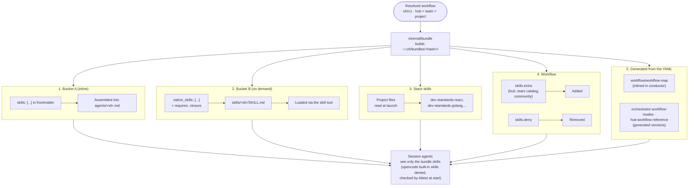

> 🇫🇷 [Lire en français](skills.fr.md)

# Skills Reference

Skills contain detailed protocols, output formats, checklists, and rules that agents apply.
The hub uses a **hybrid architecture** with two delivery paths (Bucket A inlined, Bucket B on demand) — see [ADR-010](./adr/010-hybrid-skills-architecture.en.md).

Sources of truth:

- the hub `skills/` folder (174 files: 169 skills and 5 annexes in `skills/templates/`);
- the agent frontmatter (`agents/**/*.md`): `skills:` = Bucket A (inlined), `native_skills:` = Bucket B (on demand).

Since v5, nothing is deployed into the project any more: skills reach the session through the **session bundle**, built at each launch from the workflow (see below).

> See the [Glossary](../reference/glossary.en.md) for definitions of Skill, Bucket A/B, Stack Skills, and other terms.

---

## Delivery in the session bundle (v5)

At each launch (`oh run <workflow>`), `internal/bundle` builds the session bundle `~/.oh/bundles/<hash>/` from the **resolved workflow** ([ADR-043](./adr/043-session-bundle-deploy-removal.en.md), [ADR-039](./adr/039-declarative-workflows-oh-v1.en.md)). The bundle is immutable, read-only, and identified by a hash of its content: same input, same bundle.

### What the bundle contains

| Element | Source | Where in the bundle |
|---------|--------|---------------------|
| **Member agents of the workflow** | The workflow `agents:` block | `agents/<id>.md` |
| **Bucket A skills** | `skills:` in each member agent's frontmatter (+ `requires:` closure) | Inlined into the agent body |
| **Bucket B skills** | `native_skills:` of the member agents and the skills they name, `requires:` closure resolved (see [Per-agent catalogue](#per-agent-catalogue)) | `skills/<id>/SKILL.md` (+ `annexes:` files) |
| **Stack skills** | Detected in the project at launch (`ResolveStackSkills`), for the `stack_skills: true` agents | `skills/<id>/SKILL.md` |
| **`skills.extra` / `skills.deny`** | The workflow `skills:` block: `extra` adds skills (hub, team catalog, community), `deny` removes some | Added to or removed from `skills/` |
| **Skills generated from the YAML** | The workflow itself | Replace the static skill with the same reference |

Skills generated from the workflow YAML (`cli/internal/bundle/workflowgen.go`):

- `workflow/workflow-map`: map of the workflow (agents, delegations, checkpoints, modes, outputs). Inlined into `conductor`. The static `skills/workflow/workflow-map.md` is only used outside a workflow.
- `orchestrator/orchestrator-workflow-modes` and `shared/hub-workflow-reference`: generated versions for the agents that load them (`orchestrator`, `orchestrator-dev`, `planner`). They replace the static hub file, now a « GÉNÉRÉ » stub. The pre-v5 skills `orchestrator-modes` and `orchestrator-ticket-routing` are removed.

Build rules:

- the identifier of a skill in the bundle is the last segment of its reference (`developer/beads-plan` → `beads-plan`). It must be unique and equal to the frontmatter `name:`;
- a `requires:` dependency that is missing, denied by `skills.deny` or cyclic is a build error;
- a skill referenced by an agent but missing from the hub is skipped (warning); `oh skill check` reports these cases.

### Per-agent catalogue

Each agent sees in its `skill` tool only **its** catalogue (`AgentDef.Skills` of the bundle), not every skill of the bundle. An agent's catalogue holds:

- its `native_skills:`;
- the deliverable skills named in its composed prompt (body and inlined skills). Sections that do not invite it to load a skill are ignored: « Relation avec … », « Injection … », and the sections addressed to another agent (rules for the consumer or the producer of a handoff format, « Pour le <agent> »). `[SKILL:…]` tags invite the agent receiving the delegation prompt, not the one writing it;
- the project's stack skills, only when its frontmatter sets `stack_skills: true` (`developer`, `reviewer`, `debugger`, `operator`);
- for the entry agent: the `skills.extra` skills and those named in the workflow prompt template;
- for an agent that sets `skills_from_callers: true` (`developer`, `auditor-subagent`): the skills named by its callers, in their prompt or in the on-demand skills of their catalogue (a routing skill of the caller telling the `developer` to load a standard), except their own `native_skills:` (the domain and its standards, the audit checklist);
- the `requires:` closure of all of these, then, step by step, the skills named with the same rules in the on-demand skills of its catalogue (`reviewer` loads `dev-standards-backend`, which points to `dev-standards-migration`), without the skills already inlined in its prompt. A stack skill never enters through a mention: only through the detected stack and `stack_skills`.

The bundle ships the union of the catalogues: a skill no agent can reach is no longer shipped (for example the stack skills in a workflow without a `stack_skills` agent). To cite a skill without inviting the reader to load it (a pointer for information), write it without code (`its doc-wiki-protocol skill`) or put it in a « Relation avec … » section. `TestAgentSkillReachability` and `TestNoSpuriousCatalogue` (`cli/internal/bundle/catalogue_test.go`) check these rules on the shipped workflows; `budget.golden` gives, per agent, the visible catalogue (`cat`) and the reachable skills (`rch`), equal.

Compatibility: a bundle built before the per-agent catalogue (no `skills` on the agents of `bundle.json`) keeps the former behaviour, every agent sees every skill of the bundle.

### Closed world

The model only sees the skills of the bundle ([ADR-041](./adr/041-closed-world-isolation.en.md)):

- the `skill` tool is denied on `*`, then allowed for the bundle skills only, and for each agent for the skills of its catalogue only;
- opencode built-in skills (`opencode`, `report`) are therefore denied;
- at start, `Attest` compares what the server exposes (agents, skills visible to each agent, MCP) with the bundle. Any difference makes the launch fail.

Consequence: a skill requested in a prompt (for example a `[SKILL:...]` marker injected by a coordinator) is only available if it is in the catalogue of the agent that receives it.

### Bundle cost

```bash
oh bundle show <workflow> --budget          # estimated tokens per agent and per skill
oh bundle show <workflow> -p <project>      # with the project's stack skills
oh bundle build <workflow> --json           # builds the bundle and describes its content
```

The former `oh skill budget` alias is removed ([ADR-051](./adr/051-community-skills-disconnection.en.md)). The budget is an estimate (≈ 4 characters per token). In the TUI, the **Bricks catalog** (`bricks`) shows the skills, their origin, their estimated cost, and the workflows that ship them.

Related ADRs: [ADR-043](./adr/043-session-bundle-deploy-removal.en.md) (session bundle), [ADR-041](./adr/041-closed-world-isolation.en.md) (closed world), [ADR-039](./adr/039-declarative-workflows-oh-v1.en.md) (`oh/v1` workflows), [ADR-010](./adr/010-hybrid-skills-architecture.en.md) (Bucket A/B, evolved by 043), [ADR-008](./adr/008-stack-skills-dynamic-injection.en.md) (stack skills, evolved by 043).

---

## Skill injection overview



> Detailed diagram: [`docs/diagrams/skill-injection-flow.mermaid`](../diagrams/skill-injection-flow.mermaid)

---

## Delivery paths

| Path | Declaration | Delivered to | When loaded |
|------|-------------|--------------|-------------|
| **Inline (Bucket A)** | `skills: [...]` in the agent frontmatter | Agent body, `agents/<id>.md` in the bundle | Always — from the first token |
| **Native (Bucket B)** | `native_skills: [...]` in the agent frontmatter | `skills/<id>/SKILL.md` in the bundle | On demand — the LLM loads it via the `skill` tool |
| **Stack** | Automatic detection in the project | `skills/<id>/SKILL.md` in the bundle | On demand |
| **Workflow** | `skills.extra` (add) / `skills.deny` (remove) | `skills/<id>/SKILL.md` in the bundle | On demand |
| **Generated** | Workflow YAML | Replaces the static skill with the same reference (inline or on demand) | Like the replaced skill |

**Bucket A** — Workflow protocols, handoff formats, universal principles, posture skills, core execution skills (`beads-dev`, `quick-fix`). Must be active from the first token.

**Bucket B** — Domain standards, stack skills, checklists, doc type skills, detailed phases, research skills. Loaded only when the task needs them.

All hub agents have `permission: skill: allow`, either directly or through their `permission_base` (`coordinator`, `developer-rw`, `readonly-code`, `readonly-ops`). In the session, the closed-world rules limit the `skill` tool to the bundle skills.

---

## Skill inventory (source of truth)

**169 skills** across 13 folders (128 domain skills + 41 stack skills), plus **5 annexes** in `skills/templates/`.

How to read the tables: the **Agents** column gives the bucket and the agents from their frontmatter (`A` = `skills:`, `B` = `native_skills:`). `—` = no agent references it: the skill is only in a bundle if a workflow adds it through `skills.extra`.

Short notations:

- **all** = the 15 agents except `brief-enricher`;
- **dev-rw** = `developer` (its domains include `refactor`, `migration` and `tests`).

### `shared/` — 14 skills (cross-cutting)

| Skill | Agents | Content |
|-------|--------|---------|
| `execution-protocol` | A: phased agents (auditor, debugger, designer, onboarder, pathfinder, planner) | Single execution protocol, one section per role (`when:`): entry agent = recap then validation per phase, phase 0 loop, at most 3 rounds; subagent = single session, stops only on a blocking question, resumed with `task_id` |
| `handoff-envelope` | A: agents launched by another (`when: role=subagent`) | Return envelope of at most 15 lines (`## Retour vers <appelant>`, agent, status, report `rp-…`, blocking questions, next step, summary, `task_id`); the whole report is filed first with `workflow_report`, included below the envelope when not recorded |
| `universal-guardrails` | A: all | Cross-cutting guardrails — git push, recap/question ordering, context-mode usage, cleanup of background processes |
| `wiki-navigation` | A: auditor-subagent, dev-rw, onboarder, operator, pathfinder, benchmarker, debugger, reviewer | Living wiki navigation: read the index first, load the relevant pages, never the whole wiki |
| `hub-workflow-reference` | A: orchestrator, planner | Agent catalog, pathfinder vs planner heuristic, standard sequences, handoff table. **Generated from the workflow** in the bundle |
| `websearch-usage` | A: pathfinder · B: auditor-subagent, designer, documentarian, onboarder, planner | `websearch` tool good practices: targeted queries, source checking |
| `living-docs-enrichment` | B: auditor, dev-rw, onboarder, operator, pathfinder, planner, benchmarker, debugger, reviewer | Incremental enrichment of the wiki (`docs/wiki/`), `ONBOARDING.md` and `CONVENTIONS.md`; delegates writing to the documentarian after confirmation |
| `team-awareness` | B (`mcp: team`): the 16 agents | Collaboration through the `team` MCP server (claims, status, activity) |
| `team-policies-enforcement` | B (`mcp: team`): the 16 agents except conductor | Compliance with team policies |
| `skill-authoring-protocol` | B: documentarian | Skill authoring — TDD RED/GREEN/REFACTOR, SDO checklist, anti-patterns, validation checklist |
| `rtk-usage` | B: 14 agents (all except benchmarker and brief-enricher) | **Pre-v5** — RTK guide (see [Pre-v5 skills](#pre-v5-skills)) |
| `context-mode-usage` | A: dev-rw | **Pre-v5** — usage of the context-mode `ctx_*` tools (see [Pre-v5 skills](#pre-v5-skills)) |
| `elicitation-techniques` | — | Elicitation techniques when requirements are ambiguous |
| `tracker-integration-protocol` | — | GitLab/GitHub tracker integration (triggers, ticket reading, errors) |

The last two are in no agent frontmatter: `elicitation-techniques` reaches the bundle through the `requires:` of `planning/planner-phase-1`; `tracker-integration-protocol` is only mentioned in the text of other skills, which does not add it to the bundle (only `requires:` does).

### `posture/` — 5 skills (behavioral posture)

| Skill | Agents | Content |
|-------|--------|---------|
| `core-posture` | A: all but brief-enricher | Common posture: straight to the useful content, nothing useful removed, complete deliverables |
| `user-facing-posture` | A: entry agents (`when: role=entry`) | Talking to the user: recap before `question`, use of the `question` tool (never for a checkpoint) |
| `coordinator-posture` | A: auditor, conductor, orchestrator, orchestrator-dev | Coordinator: delegate, read the envelope and the report (`workflow_report_get`) instead of transcribing it, relay blocking questions, `todowrite` as entry agent |
| `expert-posture` | B: auditor-subagent, designer, documentarian, onboarder, planner, debugger | Exploration before answering, argued counter-recommendation (⚠️), confirmation pause before a risky action (🛑) |

### `orchestrator/` — 13 skills

| Skill | Agents | Content |
|-------|--------|---------|
| `orchestrator-dev-payload` | A: orchestrator-dev (subagent) | Payload: statuses (`succès`, `partiel`, `bloqué`) and sections of the end-of-loop report |
| `orchestrator-protocol` | A: orchestrator | Feature orchestrator protocol — index, rules, session entries, CP-0. The sequence comes from the session workflow |
| `orchestrator-workflow-modes` | A: orchestrator, orchestrator-dev | The 3 modes (manual / semi-auto / auto) — behavior per checkpoint, absolute rules. **Generated from the workflow** in the bundle |
| `orchestrator-recap-edge` | B: orchestrator | Global feature recap and edge cases |
| `orchestrator-dev-protocol` | A: orchestrator-dev | Index, domain → skills routing matrix for `developer`, `tdd` label detection. Detailed phases loaded on demand |
| `orchestrator-dev-ticket-workflow` | B: orchestrator-dev | Ticket-by-ticket workflow (steps 1a to 6: presentation, branch, delegation, pre-review, review, decision, report) |
| `orchestrator-dev-recap` | B: orchestrator-dev | Implementation recap, return block, metrics |
| `orchestrator-dev-edge-cases` | B: orchestrator-dev | Edge cases: drift, failed review, conflicts, agent failure |
| `orchestrator-dev-feedback-mode` | — | Fix mini-workflow from a review feedback (`[MODE:feedback]`) |
| `orchestrator-dev-parallel` | B: orchestrator-dev | **Pre-v5** — parallelism with worktrees inside a session (see [Pre-v5 skills](#pre-v5-skills)) |
| `error-recovery-protocol` | B: orchestrator-dev | Retry and recovery after a subagent failure: classification, retry budget, fallbacks |
| `team-coordination` | B (`mcp: team`): orchestrator-dev | Team coordination (claims, conflicts, handover) |
| `takeover-context-protocol` | B (`mcp: team`): orchestrator, orchestrator-dev | Using a takeover brief on a ticket handed over by another member |

### `planning/` — 22 skills

| Skill | Agents | Content |
|-------|--------|---------|
| `planner-payload` | A: planner (subagent) | Payload: statuses (including `découpage-à-valider`) and report sections (tickets, planned agent, processing order) |
| `pathfinder-payload` | A: pathfinder (subagent) | Payload: statuses (`direct`, `escalade-planner`, `reconnaissance-partielle`) and report sections |
| `onboarder-payload` | A: onboarder (subagent) | Payload: statuses and sections of the onboarding report |
| `planner-workflow` | A: planner | 7-phase planner workflow — index and principles (0 prerequisites → 0.5 complexity scoring → 1 exploration + UX/UI signals → 1.5 design delegation → 2 questions → 3 plan → 4 edge cases → 5 Beads creation → 5.5 ai-delegated → 6 verification) |
| `planner-phase-0` | B: planner | Phase 0 (prerequisites) and 0.5 (complexity scoring: 4 criteria × 4 pts, Small/Medium/Large/Enterprise tiers) |
| `planner-phase-1` | B: planner | Phase 1 (exploration) and 1.5 (design delegation) |
| `planner-phase-2` | B: planner | Phase 2 — complementary questions ([FACT] / [DECISION], batch or frontier) |
| `planner-phase-2-5` | B: planner | Phase 2.5 (Large or Enterprise complexity, Medium on request) — shared understanding, Enterprise decision map |
| `planner-phase-3-4` | B: planner | Phase 3 (hierarchical plan) and 4 (edge cases) |
| `planner-phase-5-6` | B: planner | Phase 5 (Beads creation with its templates: epics, features, tasks, dependencies, labels), 5.5 (ai-delegated), 6 (verification) |
| `planner-design-templates` | B: planner | Phase 1.5 design delegation — UX/UI options, context to pass, resumption after spec |
| `planner-patterns-protocol` | B (`mcp: team`): planner | Reusing the team patterns library (Phase 3) |
| `pathfinder-protocol` | A: pathfinder | Fast reconnaissance, XS→XL estimate, plan draft, direct / escalate recommendation |
| `onboarder-workflow` | A: onboarder | 6-phase onboarder workflow — constraints by role, phase skill to load before each phase |
| `onboarder-profiles` | A: onboarder | Exploration profiles per technology (Vue.js, React/Next.js, Node.js, Python, API, Data/ML, DevOps, Mobile) |
| `onboarder-phase-0` | B: onboarder | Phase 0 — prerequisites. Like the other phases: `question` blocks kept for the entry agent (`when: role=entry`); subagent: `### Questions bloquantes` of the envelope or an assumption in the report, no phase validation |
| `onboarder-phase-1` | B: onboarder | Phase 1 — adaptive exploration |
| `onboarder-phase-2` | B: onboarder | Phase 2 — complementary questions |
| `onboarder-phase-3-4` | B: onboarder | Phase 3 (context report, agent matrix) and 4 (edge cases) |
| `onboarder-phase-5` | B: onboarder | Phase 5 — living wiki creation (no `docs/wiki/index.md`) |
| `onboarder-phase-5-reonboarding` | B: onboarder | Phase 5 — re-onboarding: enriching the existing wiki |
| `websearch-stack-research` | B: onboarder, pathfinder, planner | Stack, library and pattern research via websearch |

### `developer/` — 21 generic skills + 40 stack skills

| Skill | Agents | Content |
|-------|--------|---------|
| `developer-payload` | A: dev-rw (subagent) | Payload: statuses (`implémenté`, `partiellement-implémenté`, `bloqué`, `BLOCKED_ARCHITECTURE`) and report sections (diff, changes per file, criteria) |
| `dev-standards-universal` | A: dev-rw · B: reviewer | Clean Code, SOLID, naming, structure — language-agnostic. Completion gate (tests, behavior, regressions) and `BLOCKED_ARCHITECTURE` signal |
| `dev-standards-simplicity` | A: dev-rw | KISS, YAGNI, no premature abstraction or optimization, measurable complexity thresholds |
| `quick-fix` | B: dev-rw | Deterministic fixes without review (lint, missing import, typo, formatting) |
| `beads-dev` | A: dev-rw, documentarian | Beads executor workflow: `bd update --claim`, `bd close --suggest-next`, `ai-delegated` rules |
| `beads-plan` | B: pathfinder, developer, designer, documentarian, orchestrator, planner | Reading and creating Beads tickets: `bd list`, `bd show`, `bd create`, labels, dependencies, external links |
| `dev-standards-security` | B: dev-rw, operator, reviewer | Secrets, input validation, injections, auth, logs, dependencies |
| `dev-standards-testing` | B: dev-rw, reviewer | Testing strategy, pyramid, coverage, TDD, completion gate |
| `dev-standards-git` | B: documentarian, dev-rw, reviewer | Conventional Commits, branches, PR/MR |
| `dev-standards-backend` | B: reviewer | Layered architecture, DTOs, services, repositories |
| `dev-standards-frontend` | B: reviewer | Logic/presentation separation, performance, bundle, lazy loading |
| `dev-standards-frontend-data` | B: reviewer | Frontend data management — decision matrix (local state, Store, Queries, Cookies, WebStorage, IndexedDB, Query String) |
| `dev-standards-frontend-a11y` | B: reviewer | WCAG 2.1 A/AA, semantic HTML, ARIA, contrast |
| `dev-standards-api` | B: reviewer | Versioning, pagination, errors, idempotency, schema-first, breaking changes, webhooks |
| `dev-standards-devops` | B: reviewer | Shell scripts, secrets, image registries, observability, IaC |
| `dev-standards-refactoring` | B: dev-rw (domain `refactor`) | Refactoring patterns, impact analysis, small steps, test safety net |
| `dev-standards-migration` | B: dev-rw (domain `migration`) | Migrations (frameworks, versions, DB/ORM), Strangler Fig, rollback, destructive migration protocol |
| `dev-standards-database` | B: dev-rw | Schema (constraints, types, indexes), zero-downtime migrations (expand / contract), `EXPLAIN`, ORM pitfalls (N+1) |
| `test-generation` | B: dev-rw (domain `tests`) | Tests on existing code: coverage gap analysis, priorities, unit, integration and property-based tests |
| `dev-drift-detection` | B: orchestrator-dev | Architectural drift: signals, 3 options (revise scope / revert / branch off), report |
| `dev-standards-security-hardening` | — | CORS, HTTP headers, hashing, JWT, sessions, rate limiting, encryption |

Domain standards (`dev-standards-frontend`, `-backend`, `-api`…) are requested from `developer` by `orchestrator-dev` in the delegation prompt (matrix in `orchestrator-dev-protocol`). `developer` gets them in its catalogue because it sets `skills_from_callers: true`; `reviewer` declares them as Bucket B.

The **40 stack skills** in `developer/stacks/` are described in [Stack skills](#stack-skills--developerstacks).

### `auditor/` — 17 skills

| Skill | Agents | Content |
|-------|--------|---------|
| `auditor-subagent-payload` | A: auditor-subagent | Payload: statuses (`corrections-requises`, `acceptable`, `bloquant`) and sections of a domain audit report |
| `auditor-workflow` | A: auditor | 5-phase coordinator workflow (0 prerequisites → 1 project context → 2 domain selection → 3 delegation to subagents → 4 consolidation) |
| `auditor-phase-0-1` | B: auditor | Phases 0 (scope, stack, access) and 1 (project context) |
| `auditor-phase-3` | B: auditor | Phase 3 — per-domain subagent prompt, launch, blocking audit, collection |
| `auditor-phase-4` | B: auditor | Phase 4 — single-domain report or multi-domain synthesis, priority actions |
| `audit-protocol-light` | A: auditor, auditor-subagent | Common report format: 4 criticality levels (🔴/🟠/🟡/💡), /10 score, finding format |
| `websearch-cve-lookup` | B: auditor-subagent | CVE lookup (OWASP, NVD, advisories) |
| `websearch-performance-research` | B: auditor-subagent | Web research for performance audits |
| `audit-security` | — | OWASP Top 10, dependency CVEs, secrets, HTTP headers |
| `audit-performance` | — | Web Vitals, N+1, bundle size, cache |
| `audit-architecture` | — | SOLID, coupling, cohesion, technical debt |
| `audit-accessibility` | — | WCAG 2.1 AA, RGAA 4.1 |
| `audit-ecodesign` | — | RGESN, GreenIT, digital sobriety |
| `audit-privacy` | — | GDPR, EDPB, minimisation, consent, PIA |
| `audit-observability` | — | RED method, structured logs, traces, SLOs, alerting, dashboards |
| `audit-infra` | — | IaC review (Terraform/OpenTofu, Kubernetes, Helm, ArgoCD), IaC security (CIS, NSA/CISA), cost, drift; static analysis tools asked |
| `audit-database` | — | Roles and privileges, RLS, injection surfaces, encryption, backups, migration safety, sensitive data |

The 9 domain checklists are loaded on demand by `auditor-subagent`, which names them in its domain table: they ship in every bundle where it is a member (`audit`). The `type` input of `audit` offers exactly these domains (test `TestAuditTypeEnumMatchesDomainSkills`).

### `quality/` — 7 skills

| Skill | Agents | Content |
|-------|--------|---------|
| `debugger-payload` | A: debugger (subagent) | Payload: statuses and sections of the diagnosis report |
| `debugger-workflow` | A: debugger | 6-phase debugger workflow — index and principles |
| `debugger-forensic` | B: debugger | `--forensic` mode: Confirmed/Deduced/Hypothesized evidence, stronghold-first, `.investigation-{slug}.md` case file, delegation thresholds |
| `debugger-report-templates` | B: debugger | Templates for the diagnosis report and the Beads fix ticket |
| `debugger-phase-0-1` | B: debugger | Phase 0 (prerequisites) and 1 (exploration) |
| `debugger-phase-2-3` | B: debugger | Phase 2 (questions) and 3 (4-step diagnosis) |
| `debugger-phase-4-5` | B: debugger | Phase 4 (edge cases) and 5 (report + ticket) |

### `reviewer/` — 6 skills

| Skill | Agents | Content |
|-------|--------|---------|
| `reviewer-payload` | A: reviewer (subagent) | Payload: verdict (`commit`, `corriger`, `corriger-sécurité`) and sections of the review report |
| `review-protocol` | A: reviewer | Review protocol — report format, severities, confidence score, checklist, raw format for multi-mode fusion |
| `reviewer-adversarial` | B: reviewer | Adversarial review — maximum skepticism, at least 10 findings, 7 categories, dangerous assumptions |
| `reviewer-edge-case` | B: reviewer | Edge-case hunting — unhandled paths, boundaries, coercions, concurrency |
| `review-merge` | B: reviewer | Fusion of N reports: deduplication, `[STD]`/`[ADV]`/`[EDGE]` provenance, unified report |
| `reviewer-reception` | B: developer | How the developer handles review feedback |

### `designer/` — 11 skills

| Skill | Agents | Content |
|-------|--------|---------|
| `designer-payload` | A: designer (subagent) | Payload: statuses (`spec-complète`, `spec-partielle`, `choix-requis`, `prototype-livré`, `bloqué`) and report sections |
| `designer-protocol` | A: designer | Core protocol — mode detection (recon / ux / ui / ux+ui), routing to the specialized skills, common rules |
| `ux-protocol` | B: designer | Nielsen heuristics, user flows, UX spec, friction audit |
| `ui-protocol` | B: designer | Design tokens, component spec, visual consistency |
| `figma-recon-protocol` | B: designer | Light Figma reconnaissance (recon mode) |
| `figma-deep-protocol` | B: designer | Deep Figma exploration (ux, ui, ux+ui modes) |
| `prototype-protocol` | B: designer | Quick visual prototype to settle a design question |
| `design-principles` | B: designer | Extended Nielsen, Gestalt, Laws of UX, operational accessibility |
| `ui-patterns-reference` | B: designer | UI patterns per component type (navigation, dashboard, states, forms, modals) |
| `content-design` | B: designer | UX writing: interface messages, voice & tone |
| `tui-patterns` | B: designer | Terminal interface patterns (keyboard-first, widgets, anti-patterns) |

### `design/` — 1 skill

| Skill | Agents | Content |
|-------|--------|---------|
| `websearch-design-patterns` | B: designer | Web research for UI/UX patterns and design systems |

### `documentarian/` — 8 skills

| Skill | Agents | Content |
|-------|--------|---------|
| `documentarian-payload` | A: documentarian (subagent) | Payload: statuses and sections of the documentation report |
| `doc-protocol` | A: documentarian | Exploration before writing, adaptation to the existing docs, routing by doc type, gap checklist (annex `templates/doc-lacunes-checklist.md`) |
| `doc-standards` | B: documentarian | Diataxis, readability, standard structures, anti-patterns |
| `doc-adr` | B: documentarian | ADRs: format detection, MADR, naming, statuses |
| `doc-api` | B: documentarian | OpenAPI 3.x, contracts, breaking changes, narrative guide |
| `doc-changelog` | B: documentarian | Keep a Changelog, SemVer, Conventional Commits |
| `doc-slides` | B: documentarian | Marp presentations (4 templates, HTML/PDF compilation) |
| `doc-wiki-protocol` | B: documentarian | Living wiki format: pages, frontmatter, confidence tags, updates |

### `adapters/` — 6 skills (tracker integration)

| Skill | Agents | Content |
|-------|--------|---------|
| `gitlab-planner-protocol` | A: planner | Reading the GitLab source ticket, labels and milestones for the breakdown |
| `gitlab-pathfinder-protocol` | A: pathfinder | Reading a GitLab ticket to refine the estimate, detection of existing MRs |
| `gitlab-onboarder-protocol` | A: onboarder | GitLab labels, milestones and recent tickets to enrich `ONBOARDING.md` and `CONVENTIONS.md` |
| `github-planner-protocol` | — | GitHub equivalent for the planner |
| `github-pathfinder-protocol` | — | GitHub equivalent for the pathfinder |
| `github-onboarder-protocol` | — | GitHub equivalent for the onboarder |

The GitLab skills are inlined even when the bundle has no `gitlab` MCP. Figma integrations go through the `designer` agent ([ADR-020](./adr/020-designer-fusion.en.md)).

### `workflow/` — 1 skill

| Skill | Agents | Content |
|-------|--------|---------|
| `workflow-map` | A: conductor | Map of the session workflow. **Generated from the YAML** when the bundle is built; the static file is only used outside a workflow |

### `templates/` — 5 annexes

The files in `skills/templates/` are not skills: they are annexes (`annexes:` in a skill frontmatter), copied next to the `SKILL.md` in the bundle. Examples: `review-report-format.md`, `doc-lacunes-checklist.md`, `debugger-case-file.md`, the per-agent handoff blocks.

---

## Pre-v5 skills

These files still exist in `skills/`. They describe behavior from before v5; some are still shipped because an agent declares them.

| Skill | Still shipped? | What changed in v5 |
|-------|----------------|--------------------|
| `shared/rtk-usage` | Yes — Bucket B of 14 agents (all except `benchmarker` and `brief-enricher`), so in every shipped bundle except `benchmark` and `brief-enrich` | RTK was installed as a global opencode V1 plugin (`oh plugin`, removed in v5). oh no longer installs it |
| `shared/context-mode-usage` | Yes — Bucket A of `developer` | Describes the `ctx_*` tools of the `context-mode` plugin, which does not load under opencode V2. `universal-guardrails` mentions them too |
| `orchestrator/orchestrator-dev-parallel` | Yes — Bucket B of `orchestrator-dev` (`feature`, `ticket`, `review-feedback`, `libre` bundles) | Simultaneous implementation in the session tree, then one `cp-2` and one commit per ticket (no worktree created by the agent, no grouped approval). For one session and one worktree per ticket: `oh run ticket --tickets a,b` |

---

## Skill format

```markdown
---
name: <skill-name>            # = file name, identifier in the bundle
description: <Short description — shown in the session skill catalog>
requires: [<ref>, …]          # optional — skills shipped together with this one
annexes: [templates/<f>.md]   # optional — files copied next to the SKILL.md
plugin: <id>                  # optional — shipped only when the workflow loads this plugin
mcp: <server>                 # optional — shipped only when the session has this MCP server
when: <condition>             # optional — kept only for the agents it applies to
versions: { <tech>: "<version>" }  # stack skills — versions covered
reviewed: <YYYY-MM-DD>        # stack skills — date of the last review
---

# Skill — <Title>

<Skill body>
```

> `name:` must equal the file name: opencode identifies skills by name. `requires:`, `annexes:`, `plugin:`, `mcp:` and `when:` are read by oh and stripped from the delivered `SKILL.md`. A `plugin: context-mode` skill (instructions for tools provided by a plugin) enters the bundle only when the workflow declares that plugin (`plugins:`). An `mcp: gitlab` skill (tracker adapter: `adapters/gitlab-*`, and `adapters/github-*` with `mcp: github`) enters the bundle only when the session has that MCP server (configured for the project): planner, pathfinder and onboarder list both adapters, only the one of the configured tracker is shipped. The team skills (`team-awareness`, `team-policies-enforcement`, `team-coordination`, `takeover-context-protocol`, `planner-patterns-protocol`) have `mcp: team`: shipped only when the session has the `team` MCP server. Likewise, the permissions of a plugin (context-mode `ctx_*` tools, `rtk` commands; listed in `permissions/plugin-tools.yaml`) are removed from the agents when the plugin is not loaded. An agent that names a skill absent from the bundle (plugin not loaded, MCP server missing, frontend skills in a project without frontend) gets a line naming it: it does not try to load it. A skill named by an on-demand skill and absent from the bundle is named in a line closing that skill, where the model reads the mention; when it is absent for some of the agents loading that skill only (`when:`), the line goes in the prompt of those agents. The `bucket:` field is obsolete: the bucket is decided in the agent frontmatter.
> The reference used in agent frontmatter is the path relative to `skills/`, without `.md` (`developer/beads-plan`).
> **Allowed keys.** The delivered `SKILL.md` keeps only the [Agent Skills](https://agentskills.io/specification) keys: `name`, `description`, `license`, `compatibility`, `metadata`, `allowed-tools`. The hub keys `requires`, `annexes`, `plugin`, `mcp`, `when`, `statuses` (return statuses of a payload `<agent>-payload`, shown in the session contract of its callers), `versions` and `reviewed` (freshness of the stack skills) are read by oh and never delivered. Any other key is an `unknown_key` error of `oh skill check` (the obsolete `bucket:` is a `legacy_bucket` warning). `name:` is at most 64 characters, lowercase letters, digits and single hyphens (`^[a-z0-9]+(-[a-z0-9]+)*$`, `invalid_name`); `description:` is at most 200 characters (`long_description`; 1024 is the standard limit) and opens with a trigger « Utiliser quand… » (`description_not_trigger`, warning).
> `oh skill check` checks the catalog. Errors: duplicate identifiers, missing or cyclic `requires:`, invalid frontmatter, `name:` different from the file name, `invalid_name`, `long_description`, `unknown_key`, missing annex, `invalid_when`, `missing_freshness` and `invalid_freshness` (freshness metadata of a stack skill). Warnings: missing description, obsolete `bucket:`, skills referenced by an agent but not found, templates referenced in the text but not declared in `annexes:`, templates no skill uses, description without a « Utiliser … » trigger. Non-zero exit code on errors.

### Variants by role and by session (`when:`)

A skill, or a block of its text, may apply to some agents of the session only. oh evaluates it at build time, for each agent: the model reads only what concerns it.

```markdown
---
name: user-facing-posture
when: role=entry                  # whole skill: only for an entry agent
---

<!-- oh:when role=subagent -->
Text read by a sub-agent only.
<!-- /oh:when -->
```

- **Condition**: terms separated by spaces, all true; or several groups separated by `|`, one true. A term is `key=v1,v2` (one of the values), `key!=v1,v2` (none of them), or, for a yes/no key, `key` and `!key`.
- **Keys**: `role` (`entry`: the entry agent, or an agent no one launches; `subagent`: an agent launched with `task`; an entry agent others may launch has both), `agent` (the agent itself: producer side of a shared format), `calls` (an agent it may launch: consumer side), `mcp`, `plugin`, `method` (the method of the session: `standard` or `tdd`, see [TDD method](../reference/checkpoints.en.md#tdd-method-cp-seams-and-cp-red-r7)), and the yes/no keys `websearch`, `beads_write`, `ticket`, `wiki` (the project has `docs/wiki/`), `shell`, `headless` (workflow `headless: true`).
- **Markers**: alone on their line, balanced, nestable; never delivered.
- **Inlined skills and agent body**: filtered for the agent before inlining. **On-demand skills**: filtered for the union of the agents whose catalogue holds them (a block stays when one of them meets its condition). A skill whose `when:` fails for an agent leaves its catalogue and its `requires:`; if the agent names it, the absent-skills line lists it.
- Skill mentions are read **after** filtering: a skill named only in a block left out does not enter the catalogue.
- `oh skill check` reports an invalid condition or markers (`invalid_when`, error). The role of each agent is written in its [session contract](agents.en.md).


---

## Stack skills — `developer/stacks/`

These skills are delivered **on demand** (like Bucket B). At launch, `ResolveStackSkills()` (`cli/internal/bricks/stack_skills.go`) detects the project stack and adds the matching skills to the catalogue of the agents that set `stack_skills: true` (`developer`, `reviewer`, `debugger`, `operator`); a bundle without any of these agents does not ship them. See [ADR-008](./adr/008-stack-skills-dynamic-injection.en.md) (evolved by 043).

### Automatic detection

`DetectSignals()` (`cli/internal/bricks/stack_signals.go`) scans the project once: folders up to 4 levels deep, at most 20,000 entries, without entering dependencies, builds and tooling (`node_modules`, `vendor`, `.git`, `dist`, `build`, `target`, `.venv`, `docs`…). Monorepos are followed: the walk finds nested manifests (`apps/web/package.json`, `services/api/go.mod`…), and the workspace folders declared by `package.json` (`workspaces`), `pnpm-workspace.yaml` or `go.work` are read even beyond that depth. Dependencies are matched by **exact name**: `dependencies` and `devDependencies` of every `package.json`; Python dependencies of `pyproject.toml` (`[project]`, optional dependencies, `[dependency-groups]`, `[tool.poetry.*dependencies]`), `requirements*.txt` and `Pipfile` (normalised names, versions ignored); gems of the `Gemfile`; `require` of `composer.json`. Every stack found adds its skills: a project can get several languages and frameworks (`eslint-config-next`, `@testing-library/jest-dom` or `prettier-plugin-svelte` alone add nothing).

| Signal detected | Skills added |
|-----------------|--------------|
| `tsconfig*.json`, or `typescript` dependency | `dev-standards-typescript` |
| `pyproject.toml`, `requirements*.txt` (or `requirements/*.txt`), `setup.py`, `Pipfile` | `dev-standards-python` |
| `go.mod` or `go.work` | `dev-standards-golang` |
| `Cargo.toml` | `dev-standards-rust` |
| npm `vue` | `dev-standards-vuejs` |
| npm `react` (not in a React Native app without `react-dom`) | `dev-standards-react` |
| npm `next`, or `next.config.*` | `dev-standards-nextjs`, `dev-standards-react` |
| npm `nuxt`, or `nuxt.config.*` | `dev-standards-nuxtjs`, `dev-standards-vuejs` |
| `angular.json`, or npm `@angular/core` | `dev-standards-angular` |
| npm `express` | `dev-standards-express` |
| npm `@nestjs/core`, or `nest-cli.json` | `dev-standards-nestjs` |
| Python `django`, or `manage.py` | `dev-standards-django` |
| Python `fastapi` | `dev-standards-fastapi` |
| Composer `laravel/framework`, or `artisan` | `dev-standards-laravel` |
| gem `rails`, or `config/application.rb` | `dev-standards-rails` |
| `pom.xml` / `build.gradle(.kts)` naming `spring-boot` or `org.springframework.boot` | `dev-standards-springboot` |
| Gradle build or version catalog with `com.android.application`, `com.android.library`, `kotlin("android")`; or `AndroidManifest.xml` | `dev-standards-kotlin` (Android) |
| `schema.prisma`, `prisma.config.ts`, or npm `prisma` / `@prisma/client` | `dev-standards-prisma` |
| npm `typeorm` | `dev-standards-typeorm` |
| Python `sqlalchemy` | `dev-standards-sqlalchemy` |
| npm `mongoose` or `mongodb` | `dev-standards-mongodb` |
| `openapi.y(a)ml`, `swagger.y(a)ml`, `*.openapi.y(a)ml` (or `.json`) | `dev-standards-openapi` |
| npm `vitest` | `dev-standards-vitest` |
| npm `jest` | `dev-standards-jest` |
| `playwright.config.*`, or npm `@playwright/test` | `dev-standards-playwright` |
| `cypress.config.*`, or npm `cypress` | `dev-standards-cypress` |
| npm `react-native` or `expo` | `dev-standards-react-native` |
| `pubspec.yaml` with a `flutter:` key | `dev-standards-flutter` |
| `Package.swift` or `*.xcodeproj` | `dev-standards-swift` |
| Python `pandas` | `dev-standards-pandas` |
| `dbt_project.yml` | `dev-standards-dbt` |
| Python `apache-airflow`, or a `dags/*.py` importing `airflow` | `dev-standards-airflow` |
| Python `pyspark` | `dev-standards-pyspark` |
| `Dockerfile*`, `*.dockerfile`, `Containerfile`, `compose*.y(a)ml`, `docker-compose*.y(a)ml` | `dev-standards-docker` |
| `.github/workflows/*.y(a)ml` | `dev-standards-github-actions` |
| `.gitlab-ci.yml` | `dev-standards-gitlab-ci` |
| `*.tf` or `*.tofu` | `dev-standards-terraform` |
| `kustomization.y(a)ml`, or a YAML with `apiVersion` and `kind: Deployment`/`Service`/… in `k8s/`, `kubernetes/`, `deploy(ment(s))/`, `manifests/`, `argocd/`, `gitops/` | `dev-standards-kubernetes` |
| `Chart.yaml` | `dev-standards-helm` |
| A YAML with `apiVersion: argoproj.io/…` in the same folders | `dev-standards-argocd` |

The other signals (Java, Ruby, PHP, Dart, Svelte, Fastify, Flask, package managers, `Makefile`…) add no skill; they are kept for the project context (`prompt.DetectStack`: primary language = the first one found at the root, in the order Go, TypeScript, JavaScript, Python, Ruby, Rust, Kotlin (Android), Java, PHP, Dart, Swift; else the first one found anywhere). The frontend domain skills (`dev-standards-frontend*`) are kept only in a project with a web frontend: a React Native app alone is not one. A stack missed by the detection is added by a (team or project) workflow through `skills.extra`. `oh bundle show <workflow> -p <project>` shows the ones that are kept.

### Freshness (`versions:`, `reviewed:`)

Each stack skill declares in its frontmatter the versions it covers and the date of its last review, two hub keys never delivered to the agents (the prompt budget does not change):

```yaml
versions:
  react: "19.3"           # lowercase technology → version described ("12+": a minimum only)
  react-compiler: "1.0"
reviewed: 2026-10-12      # last review against the published versions
```

`oh skill check` requires them on every stack skill (`missing_freshness`, `invalid_freshness`); the hub tests also check that each version is on the « Versions de référence » line of the skill. `oh skill check --stale` lists the skills whose review is older than 90 days, and the `skill-refresh` workflow updates them: see [Stack skill freshness](../guides/skill-refresh.en.md).

### Catalog of the 40 stack skills

| Category | Skill | Detection | Content |
|----------|-------|-----------|---------|
| Languages | `dev-standards-typescript` | Yes | Strict config, interfaces vs types, typed errors, type guards, generics |
| Languages | `dev-standards-python` | Yes | ruff, mypy/pyright, exceptions, logging, pytest |
| Languages | `dev-standards-golang` | Yes | Modules, errors, interfaces, goroutines/channels, testify, golangci-lint |
| Languages | `dev-standards-rust` | Yes | Ownership/borrowing, thiserror/anyhow, traits, tokio, clippy |
| Frontend | `dev-standards-vuejs` | Yes | Composition API, `<script setup>`, Pinia, composables, Vue Router |
| Frontend | `dev-standards-react` | Yes | Hooks, TanStack Query, memo/useCallback, RTL |
| Frontend | `dev-standards-nextjs` | Yes | App Router, Server/Client Components, ISR, Server Actions |
| Frontend | `dev-standards-nuxtjs` | Yes | Auto-imports, useFetch, Nitro routes, routeRules |
| Frontend | `dev-standards-angular` | Yes | Standalone components, Signals, inject(), RxJS, Reactive Forms |
| Backend | `dev-standards-express` | Yes | Domain routing, zod middleware, AppError, helmet/cors |
| Backend | `dev-standards-nestjs` | Yes | Modules, DTOs + class-validator, guards, ConfigService |
| Backend | `dev-standards-django` | Yes | BaseModel UUID, serializers, services, migrations |
| Backend | `dev-standards-fastapi` | Yes | pydantic-settings, Pydantic v2, async services, httpx tests |
| Backend | `dev-standards-laravel` | Yes | Eloquent, FormRequest, API Resources, queues/jobs |
| Backend | `dev-standards-rails` | Yes | MVC, service objects, query objects, RSpec |
| Backend | `dev-standards-springboot` | Yes | JPA, record DTOs + @Valid, @Transactional, ProblemDetail |
| ORM / DB | `dev-standards-prisma` | Yes | Schema, singleton client, explicit select, transactions |
| ORM / DB | `dev-standards-typeorm` | Yes | Entities, custom repository, parameterised QueryBuilder |
| ORM / DB | `dev-standards-sqlalchemy` | Yes | Mapped v2, async sessions, Alembic |
| ORM / DB | `dev-standards-mongodb` | Yes | Mongoose schemas, lean(), indexes, aggregations |
| API spec | `dev-standards-openapi` | Yes | `$ref`, reusable schemas, writeOnly, JWT security, codegen |
| Testing | `dev-standards-vitest` | Yes | vi.mock, vi.fn, vi.spyOn, fake timers, Vue Test Utils |
| Testing | `dev-standards-jest` | Yes | jest.mock, jest.fn, RTL, snapshots |
| Testing | `dev-standards-playwright` | Yes | Semantic locators, POM, session fixtures |
| Testing | `dev-standards-cypress` | Yes | data-cy, cy.intercept, custom commands, cy.session |
| Mobile | `dev-standards-react-native` | Yes | Expo, React Navigation, Zustand/RTK, Detox |
| Mobile | `dev-standards-flutter` | Yes | BLoC/Riverpod, freezed, flutter_test |
| Mobile | `dev-standards-swift` | Yes | SwiftUI, MVVM, Swift Concurrency, XCTest |
| Mobile | `dev-standards-kotlin` | Yes (Android) | Jetpack Compose, MVVM+Clean, Hilt, Coroutines+Flow |
| Data / ML | `dev-standards-pandas` | Yes | Vectorisation, pandera, `.pipe()` |
| Data / ML | `dev-standards-dbt` | Yes | staging/intermediate/mart layers, schema.yml, tests |
| Data / ML | `dev-standards-airflow` | Yes | TaskFlow API, idempotence, Connections/Variables |
| Data / ML | `dev-standards-pyspark` | Yes | DataFrame API, broadcast join, partitioning, MLflow |
| DevOps / CI | `dev-standards-docker` | Yes | Multi-stage, non-root, .dockerignore, healthchecks, BuildKit secrets |
| DevOps / CI | `dev-standards-github-actions` | Yes | Minimal permissions, concurrency, SHA pinning, OIDC |
| DevOps / CI | `dev-standards-gitlab-ci` | Yes | `rules`, YAML templates, masked variables, `when: manual` in prod |
| Platform | `dev-standards-terraform` | Yes | Modules, variables + validation, remote state, plan → PR → apply |
| Platform | `dev-standards-kubernetes` | Yes | Deployment, RBAC, NetworkPolicy, ResourceQuota, PDB, Kustomize |
| Platform | `dev-standards-helm` | Yes | Chart structure, values without secrets, helm diff + --atomic |
| Platform | `dev-standards-argocd` | Yes | GitOps, sync policies per env, ESO, Vault |

---

## Adding skills

A skill that is not in the hub is added to the **team catalogue** (`catalog/skills/` of the team-state, or of a solo space): it is versioned, shared, and used by validation and bundles like a hub skill. See [Team brick catalogue](../guides/team-workflows.en.md#team-brick-catalogue).

> **Disconnected in v5** ([ADR-051](./adr/051-community-skills-disconnection.en.md)): the former community skills registry (`oh skill add|list|remove|search`, `~/.oh/skills/<name>/`) is no longer wired. `~/.oh/skills` is no longer read; `oh doctor` reports the packages left there. The redesign of adding bricks (dedicated command, verified import into the team catalogue, TUI) is described in the ADR.

---

## Agent ↔ skills matrix

Summary of the frontmatter of the 16 agents (`agents/**/*.md`). For the per-agent view, see also the [Skill Assignment Matrix](./agents.en.md#skill-assignment-matrix-source-of-truth).

Common skills, not repeated in the table:

- `shared/universal-guardrails` (A): all agents except `brief-enricher`;
- `shared/team-awareness` (B, `mcp: team`): the 16 agents;
- `shared/team-policies-enforcement` (B, `mcp: team`): all except `conductor`;
- `shared/rtk-usage` (B, [pre-v5](#pre-v5-skills)): the agents marked ¹.

Returns between agents (L5): the launched agent inlines `handoff-envelope` and its payload `<agent>-payload`; the caller reads the statuses in its session contract (table generated from the payloads of the agents it launches) and the report with `workflow_report_get`. The postures `user-facing-posture`, `handoff-envelope` and the payloads are filtered by role (`when:`).

| Agent | Bucket A (`skills:`) | Bucket B (`native_skills:`) |
|-------|----------------------|-----------------------------|
| `conductor` ¹ | core-posture, user-facing-posture, coordinator-posture, **workflow-map** (generated) | — |
| `orchestrator` ¹ | core-posture, user-facing-posture, coordinator-posture, orchestrator-workflow-modes (generated), orchestrator-protocol, hub-workflow-reference (generated) | orchestrator-recap-edge, beads-plan, takeover-context-protocol |
| `orchestrator-dev` ¹ | core-posture, user-facing-posture, handoff-envelope, coordinator-posture, orchestrator-workflow-modes (generated), orchestrator-dev-protocol, orchestrator-dev-payload | dev-drift-detection, orchestrator-dev-ticket-workflow, orchestrator-dev-parallel, orchestrator-dev-recap, orchestrator-dev-edge-cases, error-recovery-protocol, team-coordination, takeover-context-protocol |
| `pathfinder` ¹ | core-posture, user-facing-posture, handoff-envelope, execution-protocol, pathfinder-payload, pathfinder-protocol, gitlab-pathfinder-protocol, github-pathfinder-protocol, wiki-navigation | websearch-usage, websearch-stack-research, living-docs-enrichment, beads-plan |
| `planner` ¹ | core-posture, user-facing-posture, handoff-envelope, execution-protocol, planner-payload, planner-workflow, gitlab-planner-protocol, github-planner-protocol, hub-workflow-reference (generated) | websearch-stack-research, planner-phase-0, planner-phase-1, planner-phase-2, planner-phase-2-5, planner-phase-3-4, planner-phase-5-6, planner-patterns-protocol (`mcp: team`), living-docs-enrichment, websearch-usage, planner-design-templates, beads-plan, expert-posture |
| `onboarder` ¹ | core-posture, user-facing-posture, handoff-envelope, execution-protocol, onboarder-payload, onboarder-workflow, onboarder-profiles, gitlab-onboarder-protocol, github-onboarder-protocol, wiki-navigation | websearch-stack-research, onboarder-phase-0, onboarder-phase-1, onboarder-phase-2, onboarder-phase-3-4, onboarder-phase-5, onboarder-phase-5-reonboarding, living-docs-enrichment, websearch-usage, expert-posture |
| `designer` ¹ | core-posture, user-facing-posture, handoff-envelope, execution-protocol, designer-payload, designer-protocol | ux-protocol, ui-protocol, figma-recon-protocol, figma-deep-protocol, prototype-protocol, websearch-design-patterns, design-principles, ui-patterns-reference, content-design, tui-patterns, websearch-usage, expert-posture |
| `documentarian` ¹ | core-posture, user-facing-posture, handoff-envelope, documentarian-payload, doc-protocol | doc-standards, doc-adr, doc-api, doc-changelog, doc-slides, doc-wiki-protocol, skill-authoring-protocol, websearch-usage, expert-posture |
| `developer` ¹ | core-posture, user-facing-posture, handoff-envelope, developer-payload, dev-standards-universal, dev-standards-simplicity, beads-dev, wiki-navigation, context-mode-usage | dev-standards-security, dev-standards-git, dev-standards-testing, dev-standards-refactoring, dev-standards-migration, dev-standards-database, test-generation, reviewer-reception, living-docs-enrichment, beads-plan, quick-fix |
| `reviewer` ¹ | core-posture, user-facing-posture, handoff-envelope, reviewer-payload, review-protocol, wiki-navigation | reviewer-adversarial, reviewer-edge-case, review-merge, dev-standards-security, dev-standards-backend, dev-standards-frontend, dev-standards-frontend-data, dev-standards-frontend-a11y, dev-standards-testing, dev-standards-git, dev-standards-api, dev-standards-devops, living-docs-enrichment, dev-standards-universal |
| `debugger` ¹ | core-posture, user-facing-posture, handoff-envelope, execution-protocol, debugger-payload, debugger-workflow, wiki-navigation | debugger-phase-0-1, debugger-phase-2-3, debugger-phase-4-5, living-docs-enrichment, expert-posture, debugger-forensic, debugger-report-templates |
| `auditor` ¹ | core-posture, user-facing-posture, coordinator-posture, execution-protocol, auditor-workflow, audit-protocol-light | auditor-phase-0-1, auditor-phase-3, auditor-phase-4, living-docs-enrichment |
| `auditor-subagent` ¹ | core-posture, handoff-envelope, auditor-subagent-payload, audit-protocol-light, wiki-navigation | websearch-cve-lookup, websearch-performance-research, expert-posture, websearch-usage |
| `operator` ¹ | core-posture, user-facing-posture, wiki-navigation | dev-standards-security, living-docs-enrichment |
| `benchmarker` | core-posture, user-facing-posture, wiki-navigation | living-docs-enrichment |
| `brief-enricher` | — (`skills: []`) | — (common skills only) |

Every shipped agent is a member of at least one of the 14 shipped workflows. Stack skills are added to each bundle depending on the project ([Stack skills](#stack-skills--developerstacks)).
