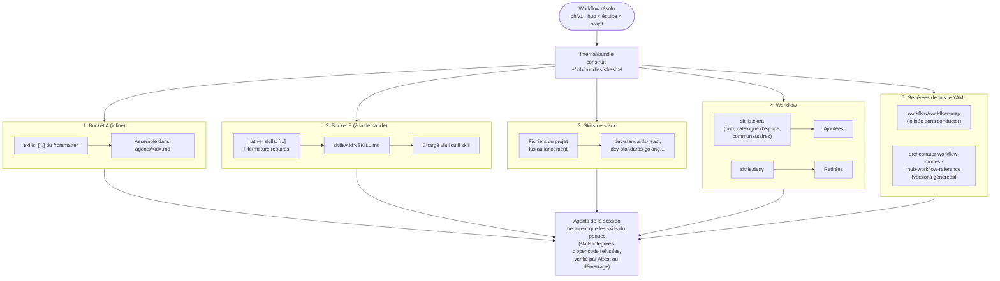

> [Read in English](skills.en.md)

# Référence des skills

Les skills contiennent des protocoles détaillés, des formats de sortie, des checklists et des règles que les agents appliquent.
Le hub utilise une **architecture hybride** avec deux chemins de livraison (Bucket A inliné, Bucket B à la demande) — voir [ADR-010](./adr/010-hybrid-skills-architecture.fr.md).

Sources de vérité :

- le dossier `skills/` du hub (175 fichiers : 170 skills et 5 annexes dans `skills/templates/`) ;
- le frontmatter des agents (`agents/**/*.md`) : `skills:` = Bucket A (inliné), `native_skills:` = Bucket B (à la demande).

Depuis la v5, rien n'est plus déployé dans le projet : les skills arrivent dans la session par le **paquet de session**, construit à chaque lancement depuis le workflow (voir ci-dessous).

> Voir le [Glossaire](../reference/glossary.fr.md) pour les définitions de Skill, Bucket A/B, Stack Skills et autres termes.

---

## Livraison dans le paquet de session (v5)

À chaque lancement (`oh run <workflow>`), `internal/bundle` construit le paquet de session `~/.oh/bundles/<hash>/` à partir du **workflow résolu** ([ADR-043](./adr/043-session-bundle-deploy-removal.fr.md), [ADR-039](./adr/039-declarative-workflows-oh-v1.fr.md)). Le paquet est immuable, en lecture seule et identifié par un hash de son contenu : même entrée, même paquet.

### Ce que contient le paquet

| Élément | Origine | Où dans le paquet |
|---------|---------|-------------------|
| **Agents membres du workflow** | Bloc `agents:` du workflow | `agents/<id>.md` |
| **Skills Bucket A** | `skills:` du frontmatter de chaque agent membre (+ fermeture `requires:`) | Inlinées dans le corps de l'agent |
| **Skills Bucket B** | `native_skills:` des agents membres et skills qu'ils nomment, fermeture `requires:` résolue (voir [Catalogue par agent](#catalogue-par-agent)) | `skills/<id>/SKILL.md` (+ annexes `annexes:`) |
| **Skills de stack** | Détectées dans le projet au lancement (`ResolveStackSkills`), pour les agents `stack_skills: true` | `skills/<id>/SKILL.md` |
| **`skills.extra` / `skills.deny`** | Bloc `skills:` du workflow : `extra` ajoute des skills (hub, catalogue de l'équipe, communautaires), `deny` en retire | Ajout ou retrait dans `skills/` |
| **Skills générées depuis le YAML** | Le workflow lui-même | Remplacent la version statique de même référence |

Skills générées depuis le YAML du workflow (`cli/internal/bundle/workflowgen.go`) :

- `workflow/workflow-map` : carte du workflow (agents, délégations, checkpoints, modes, sorties). Inlinée dans `conductor`. La version statique de `skills/workflow/workflow-map.md` ne sert que hors workflow.
- `orchestrator/orchestrator-workflow-modes` et `shared/hub-workflow-reference` : versions générées pour les agents qui les chargent (`orchestrator`, `orchestrator-dev`, `planner`). Elles remplacent le fichier statique du hub, qui n'est plus qu'un bouchon « GÉNÉRÉ ». Les skills d'avant la v5 `orchestrator-modes` et `orchestrator-ticket-routing` sont supprimées.

Règles de construction :

- l'identifiant d'une skill dans le paquet est le dernier segment de sa référence (`developer/beads-plan` → `beads-plan`). Il doit être unique et égal au `name:` du frontmatter ;
- une dépendance `requires:` introuvable, refusée par `skills.deny` ou cyclique est une erreur au build ;
- une skill référencée par un agent mais absente du hub est ignorée (avertissement) ; `oh skill check` signale ces cas.

### Catalogue par agent

Chaque agent ne voit dans son outil `skill` que **son** catalogue (`AgentDef.Skills` du paquet), pas toutes les skills du paquet. Le catalogue d'un agent contient :

- ses `native_skills:` ;
- les skills livrables nommées dans son prompt composé (corps et skills inlinées). Les sections qui ne l'invitent pas à charger une skill sont ignorées : « Relation avec … », « Injection … », et les sections adressées à un autre agent que lui (règles pour le consommateur ou le producteur d'un format de handoff, « Pour le <agent> »). Les balises `[SKILL:…]` invitent l'agent qui reçoit le prompt de délégation, pas celui qui l'écrit ;
- les skills de stack du projet, seulement si son frontmatter porte `stack_skills: true` (`developer`, `reviewer`, `debugger`, `operator`) ;
- pour l'agent d'entrée : les skills de `skills.extra` et celles nommées dans le modèle du prompt du workflow ;
- pour un agent qui porte `skills_from_callers: true` (`developer`, `auditor-subagent`) : les skills nommées par ses appelants, dans leur prompt ou dans les skills à la demande de leur catalogue (une skill de routage de l'appelant qui dit au `developer` de charger un standard), sauf leurs propres `native_skills:` (le domaine et ses standards, la checklist d'audit) ;
- la fermeture `requires:` de tout cela, puis, de proche en proche, les skills nommées avec les mêmes règles dans les skills à la demande de son catalogue (le `reviewer` charge `dev-standards-backend`, qui renvoie à `dev-standards-migration`), sans les skills déjà inlinées dans son prompt. Une skill de stack n'entre jamais par une mention : seulement par la pile détectée et `stack_skills`.

Le paquet livre l'union des catalogues : une skill qu'aucun agent ne peut atteindre n'est plus livrée (par exemple les skills de stack dans un workflow sans agent `stack_skills`). Pour citer une skill sans inviter le lecteur à la charger (renvoi pour information), l'écrire sans code (`sa skill doc-wiki-protocol`) ou la placer dans une section « Relation avec … ». `TestAgentSkillReachability` et `TestNoSpuriousCatalogue` (`cli/internal/bundle/catalogue_test.go`) vérifient ces règles sur les workflows livrés ; `budget.golden` donne par agent le catalogue visible (`cat`) et les skills atteignables (`rch`), égaux.

Compatibilité : un paquet construit avant le catalogue par agent (`skills` absent des agents de `bundle.json`) garde l'ancien comportement, chaque agent voit toutes les skills du paquet.

### Monde fermé

Le modèle ne voit que les skills du paquet ([ADR-041](./adr/041-closed-world-isolation.fr.md)) :

- l'outil `skill` est refusé sur `*`, puis autorisé pour les seules skills du paquet, et pour chaque agent pour les seules skills de son catalogue ;
- les skills intégrées d'opencode (`opencode`, `report`) sont donc refusées ;
- au démarrage, `Attest` compare ce que le serveur expose (agents, skills visibles pour chaque agent, MCP) au paquet. Un écart fait échouer le lancement.

Conséquence : une skill que l'on demande dans un prompt (par exemple `[SKILL:...]` injecté par un coordinateur) n'est disponible que si elle est dans le catalogue de l'agent qui la reçoit.

### Coût d'un paquet

```bash
oh bundle show <workflow> --budget          # tokens estimés par agent et par skill
oh bundle show <workflow> -p <projet>       # avec les skills de stack du projet
oh bundle build <workflow> --json           # construit le paquet et décrit son contenu
```

L'ancien alias `oh skill budget` est supprimé ([ADR-051](./adr/051-community-skills-disconnection.fr.md)). Le budget est une estimation (≈ 4 caractères par token). Dans la TUI, le **Catalogue des briques** (`bricks`) montre les skills, leur origine, leur coût estimé et les workflows qui les livrent.

ADR liés : [ADR-043](./adr/043-session-bundle-deploy-removal.fr.md) (paquet de session), [ADR-041](./adr/041-closed-world-isolation.fr.md) (monde fermé), [ADR-039](./adr/039-declarative-workflows-oh-v1.fr.md) (workflows `oh/v1`), [ADR-010](./adr/010-hybrid-skills-architecture.fr.md) (Bucket A/B, évolué par 043), [ADR-008](./adr/008-stack-skills-dynamic-injection.fr.md) (skills de stack, évolué par 043).

---

## Vue d'ensemble de l'injection de skills



> Diagramme détaillé (en anglais) : [`docs/diagrams/skill-injection-flow.mermaid`](../diagrams/skill-injection-flow.mermaid)

---

## Chemins de livraison

| Chemin | Déclaration | Livré dans | Quand chargé |
|--------|-------------|------------|--------------|
| **Inline (Bucket A)** | `skills: [...]` du frontmatter de l'agent | Corps de l'agent, `agents/<id>.md` du paquet | Toujours — dès le premier token |
| **Natif (Bucket B)** | `native_skills: [...]` du frontmatter de l'agent | `skills/<id>/SKILL.md` du paquet | À la demande — le LLM la charge via l'outil `skill` |
| **Stack** | Détection automatique dans le projet | `skills/<id>/SKILL.md` du paquet | À la demande |
| **Workflow** | `skills.extra` (ajout) / `skills.deny` (retrait) | `skills/<id>/SKILL.md` du paquet | À la demande |
| **Générée** | YAML du workflow | Remplace la skill statique de même référence (inline ou à la demande) | Comme la skill remplacée |

**Bucket A** — Protocoles de workflow, formats de handoff, principes universels, skills de posture, skills d'exécution de base (`beads-dev`, `quick-fix`). Doit être actif dès le premier token.

**Bucket B** — Standards de domaine, skills de stack, checklists, skills de type documentaire, phases détaillées, skills de recherche. Chargées seulement quand la tâche en a besoin.

Tous les agents du hub ont `permission: skill: allow`, directement ou par leur `permission_base` (`coordinator`, `developer-rw`, `readonly-code`, `readonly-ops`). Dans la session, les règles du monde fermé limitent l'outil `skill` aux skills du paquet.

---

## Inventaire des skills (source de vérité)

**170 skills** dans 13 dossiers (129 skills de domaine + 41 skills de stack), plus **5 annexes** dans `skills/templates/`.

Lecture des tableaux : la colonne **Agents** donne le bucket et les agents d'après leur frontmatter (`A` = `skills:`, `B` = `native_skills:`). `—` = aucun agent ne la référence : la skill n'est dans un paquet que si un workflow l'ajoute par `skills.extra`.

Notations courtes :

- **tous** = les 15 agents sauf `brief-enricher` ;
- **dev-rw** = `developer` (ses domaines comprennent `refactor`, `migration` et `tests`).

### `shared/` — 14 skills (transverses)

| Skill | Agents | Contenu |
|-------|--------|---------|
| `execution-protocol` | A : agents à phases (auditor, debugger, designer, onboarder, pathfinder, planner) | Protocole d'exécution unique, une section par rôle (`when:`) : agent d'entrée = récap puis validation par phase, boucle de phase 0, 3 tours au plus ; sous-agent = session unique, arrêt seulement sur question bloquante, reprise avec `task_id` |
| `handoff-envelope` | A : agents lancés par un autre (`when: role=subagent`) | Enveloppe de retour de 15 lignes au plus (`## Retour vers <appelant>`, agent, statut, rapport `rp-…`, questions bloquantes, suite proposée, résumé, `task_id`) ; rapport complet déposé avant avec `workflow_report`, inclus sous l'enveloppe s'il n'est pas enregistré |
| `universal-guardrails` | A : tous | Garde-fous transverses — git push, ordre récap/question, usage de context-mode, nettoyage des processus en arrière-plan |
| `wiki-navigation` | A : auditor-subagent, dev-rw, onboarder, operator, pathfinder, benchmarker, debugger, reviewer | Navigation du wiki vivant : lire l'index d'abord, charger les pages utiles, jamais le wiki entier |
| `hub-workflow-reference` | A : orchestrator, planner | Catalogue des agents, heuristique pathfinder vs planner, séquences standard, table des handoffs. **Version générée depuis le workflow** dans le paquet |
| `research` | B : auditor-subagent, designer, documentarian, onboarder, pathfinder, planner | Recherche web (`websearch`, `webfetch`) : partir de l'existant, requêtes ciblées, recoupement par deux sources ou la source officielle, comparaison de librairies, sécurité, restitution (fusion de `websearch-usage` et `websearch-stack-research`, R1-c) |
| `living-docs-enrichment` | B : auditor, dev-rw, onboarder, operator, pathfinder, planner, benchmarker, debugger, reviewer | Enrichissement incrémental du wiki (`docs/wiki/`), d'`ONBOARDING.md` et de `CONVENTIONS.md` ; délègue l'écriture au documentarian après confirmation |
| `team-awareness` | B (`mcp: team`) : les 16 agents | Collaboration via le serveur MCP `team` (claims, statut, activité) |
| `team-policies-enforcement` | B (`mcp: team`) : les 16 agents sauf conductor | Respect des politiques d'équipe |
| `skill-authoring-protocol` | B : documentarian | Rédaction de skills — TDD RED/GREEN/REFACTOR, checklist SDO, anti-patterns, checklist de validation |
| `rtk-usage` | B : 14 agents (tous sauf benchmarker et brief-enricher) | **Antérieure à v5** — guide RTK (voir [Skills antérieures à v5](#skills-antérieures-à-v5)) |
| `context-mode-usage` | A : dev-rw | **Antérieure à v5** — usage des outils `ctx_*` de context-mode (voir [Skills antérieures à v5](#skills-antérieures-à-v5)) |
| `elicitation-techniques` | — | Techniques d'élicitation quand les besoins sont ambigus |
| `tracker-integration-protocol` | — | Intégration tracker GitLab/GitHub (déclencheurs, lecture de ticket, erreurs) |

Les deux dernières ne sont dans aucun frontmatter d'agent : `elicitation-techniques` entre dans le paquet par le `requires:` de `planning/planner-phase-1` ; `tracker-integration-protocol` est seulement cité dans le texte d'autres skills, ce qui ne l'ajoute pas au paquet (seul `requires:` le fait).

### `posture/` — 5 skills (posture comportementale)

| Skill | Agents | Contenu |
|-------|--------|---------|
| `core-posture` | A : tous sauf brief-enricher | Posture commune : droit au contenu utile, rien d'utile retiré, livrables complets |
| `user-facing-posture` | A : agents d'entrée (`when: role=entry`) | Échange avec l'utilisateur : récap avant `question`, usage de l'outil `question` (jamais pour un checkpoint) |
| `coordinator-posture` | A : auditor, conductor, orchestrator, orchestrator-dev | Coordinateur : déléguer, lire l'enveloppe et le rapport (`workflow_report_get`) au lieu de le retranscrire, relayer les questions bloquantes, `todowrite` en agent d'entrée |
| `expert-posture` | B : auditor-subagent, designer, documentarian, onboarder, planner, debugger | Exploration avant de répondre, recommandation contraire argumentée (⚠️), pause de confirmation avant une action à risque (🛑) |

### `orchestrator/` — 13 skills

| Skill | Agents | Contenu |
|-------|--------|---------|
| `orchestrator-dev-payload` | A : orchestrator-dev (sous-agent) | Payload : statuts (`succès`, `partiel`, `bloqué`) et sections du rapport de fin de boucle |
| `orchestrator-protocol` | A : orchestrator | Protocole de l'orchestrator feature — index, règles, entrées de session, CP-0. L'enchaînement vient du workflow de la session |
| `orchestrator-workflow-modes` | A : orchestrator, orchestrator-dev | Les 3 modes (manuel / semi-auto / auto) — comportements par checkpoint, règles absolues. **Version générée depuis le workflow** dans le paquet |
| `orchestrator-recap-edge` | B : orchestrator | Récap global de feature et cas particuliers |
| `orchestrator-dev-protocol` | A : orchestrator-dev | Index, matrice de routage domaine → skills à demander à `developer`, détection du label `tdd`. Phases détaillées chargées à la demande |
| `orchestrator-dev-ticket-workflow` | B : orchestrator-dev | Workflow ticket par ticket (étapes 1a à 6 : présentation, branche, délégation, pre-review, review, décision, compte rendu) |
| `orchestrator-dev-recap` | B : orchestrator-dev | Récap d'implémentation, bloc retour, métriques |
| `orchestrator-dev-edge-cases` | B : orchestrator-dev | Cas particuliers : dérive, review échouée, conflits, panne d'agent |
| `orchestrator-dev-feedback-mode` | — | Mini-workflow de correction depuis un feedback de review (`[MODE:feedback]`) |
| `orchestrator-dev-parallel` | B : orchestrator-dev | **Antérieure à v5** — parallélisme par worktrees dans une session (voir [Skills antérieures à v5](#skills-antérieures-à-v5)) |
| `error-recovery-protocol` | B : orchestrator-dev | Retry et reprise après échec d'un sous-agent : classification, budget de retry, replis |
| `team-coordination` | B (`mcp: team`) : orchestrator-dev | Coordination d'équipe (claims, conflits, passage de relais) |
| `takeover-context-protocol` | B (`mcp: team`) : orchestrator, orchestrator-dev | Utiliser un brief de reprise sur un ticket transféré par un autre membre |

### `planning/` — 23 skills

| Skill | Agents | Contenu |
|-------|--------|---------|
| `planner-payload` | A : planner (sous-agent) | Payload : statuts (dont `découpage-à-valider`) et sections du rapport (tickets, agent prévu, ordre de traitement) |
| `pathfinder-payload` | A : pathfinder (sous-agent) | Payload : statuts (`direct`, `escalade-planner`, `reconnaissance-partielle`) et sections du rapport |
| `onboarder-payload` | A : onboarder (sous-agent) | Payload : statuts et sections du rapport d'onboarding |
| `planner-workflow` | A : planner | Workflow planner en 7 phases — index et principes (0 prérequis → 0.5 complexity scoring → 1 exploration + signaux UX/UI → 1.5 délégation design → 2 questions → 3 plan → 4 cas particuliers → 5 création Beads → 5.5 ai-delegated → 6 vérification) |
| `planner-phase-0` | B : planner | Phase 0 (prérequis) et 0.5 (complexity scoring : 4 critères × 4 pts, tiers Small/Medium/Large/Enterprise) |
| `planner-phase-1` | B : planner | Phase 1 (exploration) et 1.5 (délégation design) |
| `grilling` | B : planner | Interroger la demande avant les questions : la confronter au code et aux règles (quantificateurs, acteurs, visibilité, cycle de vie, invariants), une question par décision, priorisée |
| `planner-phase-2` | B : planner | Phase 2 — questions complémentaires ([FACT] / [DECISION], batch ou frontier) |
| `planner-phase-2-5` | B : planner | Phase 2.5 (complexité Large ou Enterprise, Medium sur demande) — compréhension partagée, decision map Enterprise |
| `planner-phase-3-4` | B : planner | Phase 3 (plan hiérarchique) et 4 (cas particuliers) |
| `planner-phase-5-6` | B : planner | Phase 5 (création Beads avec ses templates : epics, features, tasks, dépendances, labels), 5.5 (ai-delegated), 6 (vérification) |
| `planner-design-templates` | B : planner | Délégation design Phase 1.5 — options UX/UI, contexte à transmettre, reprise après spec |
| `planner-patterns-protocol` | B (`mcp: team`) : planner | Réutilisation de la bibliothèque de patterns de l'équipe (Phase 3) |
| `pathfinder-protocol` | A : pathfinder | Reconnaissance rapide, estimation XS→XL, draft de plan, recommandation direct / escalade |
| `onboarder-workflow` | A : onboarder | Workflow onboarder en 6 phases — contraintes par rôle, skill de phase à charger avant chaque phase |
| `onboarder-profiles` | A : onboarder | Profils d'exploration par technologie (Vue.js, React/Next.js, Node.js, Python, API, Data/ML, DevOps, Mobile) |
| `onboarder-phase-0` | B : onboarder | Phase 0 — prérequis. Comme les autres phases : blocs `question` réservés à l'agent d'entrée (`when: role=entry`) ; sous-agent : `### Questions bloquantes` de l'enveloppe ou hypothèse dans le rapport, sans validation de phase |
| `onboarder-phase-1` | B : onboarder | Phase 1 — exploration adaptative |
| `onboarder-phase-2` | B : onboarder | Phase 2 — questions complémentaires |
| `onboarder-phase-3-4` | B : onboarder | Phase 3 (rapport de contexte, matrice agents) et 4 (cas particuliers) |
| `onboarder-phase-5` | B : onboarder | Phase 5 — création du wiki vivant (`docs/wiki/index.md` absent) |
| `onboarder-phase-5-reonboarding` | B : onboarder | Phase 5 — re-onboarding : enrichissement du wiki existant |
| `codebase-design` | B : pathfinder | Choisir une conception dans un code existant : contraintes outillées, écrites et de fait relevées avec leur source, deux options comparées, recommandation qui cite la contrainte décisive |

### `developer/` — 21 skills génériques + 40 skills de stack

| Skill | Agents | Contenu |
|-------|--------|---------|
| `developer-payload` | A : dev-rw (sous-agent) | Payload : statuts (`implémenté`, `partiellement-implémenté`, `bloqué`, `BLOCKED_ARCHITECTURE`) et sections du rapport (diff, changements par fichier, critères) |
| `dev-standards-universal` | A : dev-rw · B : reviewer | Clean Code, SOLID, nommage, structure — agnostique du langage. Gate de complétion (tests, comportement, régressions) et signal `BLOCKED_ARCHITECTURE` |
| `dev-standards-simplicity` | A : dev-rw | KISS, YAGNI, pas d'abstraction ni d'optimisation prématurées, seuils de complexité mesurables |
| `quick-fix` | B : dev-rw | Corrections déterministes sans review (lint, import manquant, typo, formatage) |
| `beads-dev` | A : dev-rw, documentarian | Workflow exécuteur Beads : `bd update --claim`, `bd close --suggest-next`, règles `ai-delegated` |
| `beads-plan` | B : pathfinder, developer, designer, documentarian, orchestrator, planner | Lecture et création de tickets Beads : `bd list`, `bd show`, `bd create`, labels, dépendances, liens externes |
| `dev-standards-security` | B : dev-rw, operator, reviewer | Secrets, validation des entrées, injections, auth, logs, dépendances |
| `dev-standards-testing` | B : dev-rw, reviewer | Stratégie de tests, pyramide, couverture, TDD, gate de complétion |
| `dev-standards-git` | B : documentarian, dev-rw, reviewer | Conventional Commits, branches, PR/MR |
| `dev-standards-backend` | B : reviewer | Architecture en couches, DTOs, services, repositories |
| `dev-standards-frontend` | B : reviewer | Séparation logique/présentation, performance, bundle, lazy loading |
| `dev-standards-frontend-data` | B : reviewer | Gestion des données côté frontend — matrice de décision (état local, Store, Queries, Cookies, WebStorage, IndexedDB, Query String) |
| `dev-standards-frontend-a11y` | B : reviewer | WCAG 2.1 A/AA, HTML sémantique, ARIA, contrastes |
| `dev-standards-api` | B : reviewer | Versioning, pagination, erreurs, idempotence, schema-first, breaking changes, webhooks |
| `dev-standards-devops` | B : reviewer | Scripts shell, secrets, registries d'images, observabilité, IaC |
| `dev-standards-refactoring` | B : dev-rw (domaine `refactor`) | Patterns de refactoring, analyse d'impact, petits pas, filet de tests |
| `dev-standards-migration` | B : dev-rw (domaine `migration`) | Migrations (frameworks, versions, DB/ORM), Strangler Fig, rollback, protocole de migration destructive |
| `dev-standards-database` | B : dev-rw | Schéma (contraintes, types, index), migrations sans interruption (expand / contract), `EXPLAIN`, pièges des ORM (N+1) |
| `test-generation` | B : dev-rw (domaine `tests`) | Tests sur du code existant : analyse des gaps de couverture, priorités, tests unitaires, d'intégration et property-based |
| `dev-drift-detection` | B : orchestrator-dev | Dérive architecturale : signaux, 3 options (réviser scope / revert / bifurquer), rapport |
| `dev-standards-security-hardening` | — | CORS, headers HTTP, hashing, JWT, sessions, rate limiting, chiffrement |

Les standards de domaine (`dev-standards-frontend`, `-backend`, `-api`…) sont demandés à `developer` par `orchestrator-dev` dans le prompt de délégation (matrice de `orchestrator-dev-protocol`). `developer` les reçoit dans son catalogue parce qu'il porte `skills_from_callers: true` ; `reviewer` les déclare en Bucket B.

Les **40 skills de stack** de `developer/stacks/` sont décrites dans [Skills de stack](#skills-de-stack--developerstacks).

### `auditor/` — 17 skills

| Skill | Agents | Contenu |
|-------|--------|---------|
| `auditor-subagent-payload` | A : auditor-subagent | Payload : statuts (`corrections-requises`, `acceptable`, `bloquant`) et sections du rapport d'audit d'un domaine |
| `auditor-workflow` | A : auditor | Workflow du coordinateur en 5 phases (0 prérequis → 1 contexte projet → 2 sélection des domaines → 3 délégation aux sous-agents → 4 consolidation) |
| `auditor-phase-0-1` | B : auditor | Phases 0 (périmètre, stack, accès) et 1 (contexte projet) |
| `auditor-phase-3` | B : auditor | Phase 3 — prompt du sous-agent par domaine, lancement, audit bloquant, collecte |
| `auditor-phase-4` | B : auditor | Phase 4 — rapport d'un domaine ou synthèse multi-domaines, actions prioritaires |
| `audit-protocol-light` | A : auditor, auditor-subagent | Format de rapport commun : 4 niveaux de criticité (🔴/🟠/🟡/💡), score /10, format des findings |
| `websearch-cve-lookup` | B : auditor-subagent | Recherche CVE (OWASP, NVD, advisories) |
| `websearch-performance-research` | B : auditor-subagent | Recherche web pour les audits de performance |
| `audit-security` | — | OWASP Top 10, CVE des dépendances, secrets, headers HTTP |
| `audit-performance` | — | Web Vitals, N+1, taille du bundle, cache |
| `audit-architecture` | — | SOLID, couplage, cohésion, dette technique |
| `audit-accessibility` | — | WCAG 2.1 AA, RGAA 4.1 |
| `audit-ecodesign` | — | RGESN, GreenIT, sobriété numérique |
| `audit-privacy` | — | RGPD, EDPB, minimisation, consentement, PIA |
| `audit-observability` | — | Méthode RED, logs structurés, traces, SLOs, alerting, dashboards |
| `audit-infra` | — | Revue IaC (Terraform/OpenTofu, Kubernetes, Helm, ArgoCD), sécurité IaC (CIS, NSA/CISA), coût, drift ; outils d'analyse statique demandés |
| `audit-database` | — | Rôles et privilèges, RLS, surfaces d'injection, chiffrement, sauvegardes, sûreté des migrations, données sensibles |

Les 9 checklists de domaine sont chargées à la demande par `auditor-subagent`, qui les nomme dans sa table des domaines : elles sont livrées dans chaque paquet dont il est membre (`audit`). L'entrée `type` d'`audit` propose exactement ces domaines (test `TestAuditTypeEnumMatchesDomainSkills`).

### `quality/` — 7 skills

| Skill | Agents | Contenu |
|-------|--------|---------|
| `debugger-payload` | A : debugger (sous-agent) | Payload : statuts et sections du rapport de diagnostic |
| `debugger-workflow` | A : debugger | Workflow debugger en 6 phases — index et principes |
| `debugger-forensic` | B : debugger | Mode `--forensic` : preuves Confirmed/Deduced/Hypothesized, stronghold-first, case file `.investigation-{slug}.md`, seuils de délégation |
| `debugger-report-templates` | B : debugger | Gabarits du rapport de diagnostic et du ticket Beads de correction |
| `debugger-phase-0-1` | B : debugger | Phase 0 (prérequis) et 1 (exploration) |
| `debugger-phase-2-3` | B : debugger | Phase 2 (questions) et 3 (diagnostic en 4 étapes) |
| `debugger-phase-4-5` | B : debugger | Phase 4 (cas particuliers) et 5 (rapport + ticket) |

### `reviewer/` — 6 skills

| Skill | Agents | Contenu |
|-------|--------|---------|
| `reviewer-payload` | A : reviewer (sous-agent) | Payload : verdict (`commit`, `corriger`, `corriger-sécurité`) et sections du rapport de review |
| `review-protocol` | A : reviewer | Protocole de review — deux axes toujours séparés (conformité à la demande : ce qui manque, ce qui dépasse ; qualité du code), vérification, sévérités, score de confiance, format brut pour la fusion multi-mode |
| `reviewer-adversarial` | B : reviewer | Review adversariale — scepticisme maximal, 10 findings minimum, 7 catégories, hypothèses dangereuses |
| `reviewer-edge-case` | B : reviewer | Chasse aux cas limites — chemins non gérés, frontières, coercions, concurrence |
| `review-merge` | B : reviewer | Fusion de N rapports : déduplication, provenance `[STD]`/`[ADV]`/`[EDGE]`, rapport unifié |
| `reviewer-reception` | B : developer | Traitement d'un feedback de review par le développeur |

### `designer/` — 11 skills

| Skill | Agents | Contenu |
|-------|--------|---------|
| `designer-payload` | A : designer (sous-agent) | Payload : statuts (`spec-complète`, `spec-partielle`, `choix-requis`, `prototype-livré`, `bloqué`) et sections du rapport |
| `designer-protocol` | A : designer | Protocole central — détection du mode (recon / ux / ui / ux+ui), routage vers les skills spécialisées, règles communes |
| `ux-protocol` | B : designer | Heuristiques Nielsen, user flows, spec UX, audit de friction |
| `ui-protocol` | B : designer | Tokens de design, spec de composants, cohérence visuelle |
| `figma-recon-protocol` | B : designer | Reconnaissance Figma légère (mode recon) |
| `figma-deep-protocol` | B : designer | Exploration Figma approfondie (modes ux, ui, ux+ui) |
| `prototype-protocol` | B : designer | Prototype visuel rapide pour trancher une question de design |
| `design-principles` | B : designer | Nielsen enrichi, Gestalt, Laws of UX, accessibilité opérationnelle |
| `ui-patterns-reference` | B : designer | Patterns UI par type de composant (navigation, dashboard, états, formulaires, modals) |
| `content-design` | B : designer | UX writing : messages d'interface, voice & tone |
| `tui-patterns` | B : designer | Patterns d'interfaces terminal (clavier d'abord, widgets, anti-patterns) |

### `design/` — 1 skill

| Skill | Agents | Contenu |
|-------|--------|---------|
| `websearch-design-patterns` | B : designer | Recherche web de patterns UI/UX et design systems |

### `documentarian/` — 8 skills

| Skill | Agents | Contenu |
|-------|--------|---------|
| `documentarian-payload` | A : documentarian (sous-agent) | Payload : statuts et sections du rapport de documentation |
| `doc-protocol` | A : documentarian | Exploration avant rédaction, adaptation à l'existant, routage par type de doc, checklist de lacunes (annexe `templates/doc-lacunes-checklist.md`) |
| `doc-standards` | B : documentarian | Diataxis, lisibilité, structures types, anti-patterns |
| `doc-adr` | B : documentarian | ADR : détection du format, MADR, nommage, statuts |
| `doc-api` | B : documentarian | OpenAPI 3.x, contrats, breaking changes, guide narratif |
| `doc-changelog` | B : documentarian | Keep a Changelog, SemVer, Conventional Commits |
| `doc-slides` | B : documentarian | Présentations Marp (4 gabarits, compilation HTML/PDF) |
| `doc-wiki-protocol` | B : documentarian | Format du wiki vivant : pages, frontmatter, tags de confiance, mise à jour |

### `adapters/` — 6 skills (intégration trackers)

| Skill | Agents | Contenu |
|-------|--------|---------|
| `gitlab-planner-protocol` | A : planner | Lecture du ticket source GitLab, labels et milestones pour la décomposition |
| `gitlab-pathfinder-protocol` | A : pathfinder | Lecture d'un ticket GitLab pour affiner l'estimation, détection de MR existantes |
| `gitlab-onboarder-protocol` | A : onboarder | Labels, milestones et tickets récents GitLab pour enrichir `ONBOARDING.md` et `CONVENTIONS.md` |
| `github-planner-protocol` | — | Équivalent GitHub pour le planner |
| `github-pathfinder-protocol` | — | Équivalent GitHub pour le pathfinder |
| `github-onboarder-protocol` | — | Équivalent GitHub pour l'onboarder |

Les skills GitLab sont inlinées même sans MCP `gitlab` dans le paquet. Les intégrations Figma passent par l'agent `designer` ([ADR-020](./adr/020-designer-fusion.fr.md)).

### `workflow/` — 1 skill

| Skill | Agents | Contenu |
|-------|--------|---------|
| `workflow-map` | A : conductor | Carte du workflow de la session. **Générée depuis le YAML** à la construction du paquet ; le fichier statique ne sert que hors workflow |

### `templates/` — 5 annexes

Les fichiers de `skills/templates/` ne sont pas des skills : ce sont des annexes (`annexes:` du frontmatter d'une skill), copiées à côté du `SKILL.md` dans le paquet. Exemples : `review-report-format.md`, `doc-lacunes-checklist.md`, `debugger-case-file.md`. Les blocs de handoff par agent ont disparu en L5 : l'enveloppe et les payloads les remplacent.

---

## Skills antérieures à v5

Ces fichiers existent toujours dans `skills/`. Ils décrivent un comportement antérieur à v5 ; certains sont encore livrés parce qu'un agent les déclare.

| Skill | Encore livrée ? | Ce qui a changé en v5 |
|-------|-----------------|-----------------------|
| `shared/rtk-usage` | Oui — Bucket B de 14 agents (tous sauf `benchmarker` et `brief-enricher`), donc dans tous les paquets livrés sauf `benchmark` et `brief-enrich` | RTK s'installait comme plugin global opencode V1 (`oh plugin`, supprimé en v5). oh ne l'installe plus |
| `shared/context-mode-usage` | Oui — Bucket A de `developer` | Décrit les outils `ctx_*` du plugin `context-mode`, qui ne se charge pas sous opencode V2. `universal-guardrails` en parle aussi |
| `orchestrator/orchestrator-dev-parallel` | Oui — Bucket B d'`orchestrator-dev` (paquets `feature`, `ticket`, `review-feedback`, `libre`) | Implémentation simultanée dans l'arborescence de la session, puis un `cp-2` et un commit par ticket (plus de worktrees créés par l'agent ni de validation groupée). Pour une session et un worktree par ticket : `oh run ticket --tickets a,b` |

---

## Format d'un skill

```markdown
---
name: <nom-du-skill>          # = nom du fichier, identifiant dans le paquet
description: <Description courte — affichée dans le catalogue de skills de la session>
requires: [<ref>, …]          # facultatif — skills livrées avec celle-ci
annexes: [templates/<f>.md]   # facultatif — fichiers copiés à côté du SKILL.md
plugin: <id>                  # facultatif — livrée seulement si le workflow charge ce plugin
mcp: <serveur>                # facultatif — livrée seulement si la session a ce serveur MCP
when: <condition>             # facultatif — gardée seulement pour les agents qu'elle concerne
versions: { <techno>: "<version>" }  # skills de stack — versions couvertes
reviewed: <AAAA-MM-JJ>        # skills de stack — date de la dernière revue
---

# Skill — <Titre>

<Corps du skill>
```

> `name:` doit être égal au nom du fichier : opencode identifie les skills par leur nom. `requires:`, `annexes:`, `plugin:`, `mcp:` et `when:` sont lus par oh et retirés du `SKILL.md` livré. Une skill `plugin: context-mode` (consignes d'outils fournis par un plugin) n'entre dans le paquet que si le workflow déclare ce plugin (`plugins:`). Une skill `mcp: gitlab` (adaptateur de tracker : `adapters/gitlab-*`, `adapters/github-*` avec `mcp: github`) n'entre dans le paquet que si la session a ce serveur MCP (configuré pour le projet) : planner, pathfinder et onboarder listent les deux adaptateurs, seul celui du tracker configuré est livré. Les skills d'équipe (`team-awareness`, `team-policies-enforcement`, `team-coordination`, `takeover-context-protocol`, `planner-patterns-protocol`) ont `mcp: team` : livrées seulement quand la session a le serveur MCP `team`. De même, les permissions propres à un plugin (outils `ctx_*` de context-mode, commandes `rtk` ; liste dans `permissions/plugin-tools.yaml`) sont retirées des agents quand le plugin n'est pas chargé. Un agent qui cite une skill absente du paquet (plugin absent, serveur MCP absent, skills frontend dans un projet sans frontend) reçoit une ligne qui la nomme : il ne tente pas de la charger. Une skill citée par une skill à la demande et absente du paquet est nommée dans une ligne à la fin de cette skill, là où le modèle lit la mention ; si elle n'est absente que pour certains des agents qui chargent cette skill (`when:`), la ligne va dans le prompt de ces agents. Le champ `bucket:` est obsolète : le bucket se décide dans le frontmatter de l'agent.
> La référence utilisée dans le frontmatter des agents est le chemin relatif à `skills/`, sans `.md` (`developer/beads-plan`).
> **Clés autorisées.** Le `SKILL.md` livré ne garde que les clés [Agent Skills](https://agentskills.io/specification) : `name`, `description`, `license`, `compatibility`, `metadata`, `allowed-tools`. Les clés du hub `requires`, `annexes`, `plugin`, `mcp`, `when`, `statuses` (statuts de retour d'un payload `<agent>-payload`, repris dans le contrat de session de ses appelants), `versions` et `reviewed` (fraîcheur des skills de stack) sont lues par oh et jamais livrées. Toute autre clé est une erreur `unknown_key` d'`oh skill check` (l'ancien `bucket:` est un avertissement `legacy_bucket`). `name:` fait au plus 64 caractères, minuscules, chiffres et tirets simples (`^[a-z0-9]+(-[a-z0-9]+)*$`, `invalid_name`) ; `description:` fait au plus 200 caractères (`long_description` ; 1024 est la limite du standard) et commence par un déclencheur « Utiliser quand… » (`description_not_trigger`, avertissement).
> `oh skill check` vérifie le catalogue. Erreurs : identifiants en double, `requires:` manquants ou cycliques, frontmatter invalide, `name:` différent du nom de fichier, `invalid_name`, `long_description`, `unknown_key`, annexe introuvable, `invalid_when`, `missing_freshness` et `invalid_freshness` (métadonnées de fraîcheur d'une skill de stack). Avertissements : description absente, champ `bucket:` obsolète, skills référencées par un agent mais introuvables, templates cités dans le texte mais absents d'`annexes:`, templates utilisés par aucune skill, description sans déclencheur « Utiliser … ». Code de sortie non nul en cas d'erreur.

### Variantes par rôle et par session (`when:`)

Une skill, ou un bloc de son texte, peut ne valoir que pour certains agents de la session. oh l'évalue au build, pour chaque agent : le modèle ne lit que ce qui le concerne.

```markdown
---
name: user-facing-posture
when: role=entry                  # skill entière : seulement pour un agent d'entrée
---

<!-- oh:when role=subagent -->
Texte lu seulement par un sous-agent.
<!-- /oh:when -->
```

- **Condition** : des termes séparés par des espaces, tous vrais ; ou plusieurs groupes séparés par `|`, l'un vrai. Un terme s'écrit `clé=v1,v2` (l'une des valeurs), `clé!=v1,v2` (aucune), ou, pour une clé oui/non, `clé` et `!clé`.
- **Clés** : `role` (`entry` : l'agent d'entrée, ou un agent que personne ne lance ; `subagent` : un agent lancé par `task` ; un agent d'entrée que d'autres peuvent lancer a les deux), `agent` (l'agent lui-même : côté producteur d'un format partagé), `calls` (un agent qu'il peut lancer : côté consommateur), `mcp`, `plugin`, et les clés oui/non `websearch`, `beads_write`, `ticket`, `wiki` (le projet a `docs/wiki/`), `shell`, `headless` (workflow `headless: true`).
- **Marqueurs** : seuls sur leur ligne, équilibrés, imbricables ; ils ne sont jamais livrés.
- **Skills inlinées et corps de l'agent** : filtrés pour l'agent avant l'inlining. **Skills à la demande** : filtrées pour l'union des agents dont le catalogue les contient (un bloc reste si l'un d'eux remplit sa condition). Une skill dont le `when:` échoue pour un agent sort de son catalogue et de ses `requires:` ; s'il la nomme, la ligne des skills absentes la cite.
- Les mentions de skills sont lues **après** le filtrage : une skill nommée seulement dans un bloc écarté n'entre pas au catalogue.
- `oh skill check` signale une condition ou des marqueurs invalides (`invalid_when`, erreur). Le rôle de chaque agent est écrit dans son [contrat de session](agents.fr.md).


---

## Skills de stack — `developer/stacks/`

Ces skills sont livrées **à la demande** (comme le Bucket B). Au lancement, `ResolveStackSkills()` (`cli/internal/bricks/stack_skills.go`) détecte la stack du projet et ajoute les skills correspondantes au catalogue des agents qui portent `stack_skills: true` (`developer`, `reviewer`, `debugger`, `operator`) ; un paquet sans aucun de ces agents ne les livre pas. Voir [ADR-008](./adr/008-stack-skills-dynamic-injection.fr.md) (évolué par 043).

### Détection automatique

`DetectSignals()` (`cli/internal/bricks/stack_signals.go`) parcourt le projet une seule fois : dossiers jusqu'à 4 niveaux de profondeur, 20 000 entrées au plus, sans entrer dans les dépendances, builds et outillage (`node_modules`, `vendor`, `.git`, `dist`, `build`, `target`, `.venv`, `docs`…). Les monorepos sont suivis : le parcours trouve les manifestes imbriqués (`apps/web/package.json`, `services/api/go.mod`…), et les dossiers de workspace déclarés par `package.json` (`workspaces`), `pnpm-workspace.yaml` ou `go.work` sont lus même au-delà de cette profondeur. Les dépendances sont comparées par **nom exact** : `dependencies` et `devDependencies` de chaque `package.json` ; dépendances Python de `pyproject.toml` (`[project]`, dépendances optionnelles, `[dependency-groups]`, `[tool.poetry.*dependencies]`), `requirements*.txt` et `Pipfile` (noms normalisés, versions ignorées) ; gems du `Gemfile` ; `require` de `composer.json`. Chaque stack trouvée ajoute ses skills : un projet peut recevoir plusieurs langages et frameworks (`eslint-config-next`, `@testing-library/jest-dom` ou `prettier-plugin-svelte` seuls n'ajoutent rien).

| Signal détecté | Skills ajoutées |
|----------------|-----------------|
| `tsconfig*.json`, ou dépendance `typescript` | `dev-standards-typescript` |
| `pyproject.toml`, `requirements*.txt` (ou `requirements/*.txt`), `setup.py`, `Pipfile` | `dev-standards-python` |
| `go.mod` ou `go.work` | `dev-standards-golang` |
| `Cargo.toml` | `dev-standards-rust` |
| npm `vue` | `dev-standards-vuejs` |
| npm `react` (pas dans une app React Native sans `react-dom`) | `dev-standards-react` |
| npm `next`, ou `next.config.*` | `dev-standards-nextjs`, `dev-standards-react` |
| npm `nuxt`, ou `nuxt.config.*` | `dev-standards-nuxtjs`, `dev-standards-vuejs` |
| `angular.json`, ou npm `@angular/core` | `dev-standards-angular` |
| npm `express` | `dev-standards-express` |
| npm `@nestjs/core`, ou `nest-cli.json` | `dev-standards-nestjs` |
| Python `django`, ou `manage.py` | `dev-standards-django` |
| Python `fastapi` | `dev-standards-fastapi` |
| Composer `laravel/framework`, ou `artisan` | `dev-standards-laravel` |
| gem `rails`, ou `config/application.rb` | `dev-standards-rails` |
| `pom.xml` / `build.gradle(.kts)` citant `spring-boot` ou `org.springframework.boot` | `dev-standards-springboot` |
| Build Gradle ou catalogue de versions avec `com.android.application`, `com.android.library`, `kotlin("android")` ; ou `AndroidManifest.xml` | `dev-standards-kotlin` (Android) |
| `schema.prisma`, `prisma.config.ts`, ou npm `prisma` / `@prisma/client` | `dev-standards-prisma` |
| npm `typeorm` | `dev-standards-typeorm` |
| Python `sqlalchemy` | `dev-standards-sqlalchemy` |
| npm `mongoose` ou `mongodb` | `dev-standards-mongodb` |
| `openapi.y(a)ml`, `swagger.y(a)ml`, `*.openapi.y(a)ml` (ou `.json`) | `dev-standards-openapi` |
| npm `vitest` | `dev-standards-vitest` |
| npm `jest` | `dev-standards-jest` |
| `playwright.config.*`, ou npm `@playwright/test` | `dev-standards-playwright` |
| `cypress.config.*`, ou npm `cypress` | `dev-standards-cypress` |
| npm `react-native` ou `expo` | `dev-standards-react-native` |
| `pubspec.yaml` avec une clé `flutter:` | `dev-standards-flutter` |
| `Package.swift` ou `*.xcodeproj` | `dev-standards-swift` |
| Python `pandas` | `dev-standards-pandas` |
| `dbt_project.yml` | `dev-standards-dbt` |
| Python `apache-airflow`, ou un `dags/*.py` qui importe `airflow` | `dev-standards-airflow` |
| Python `pyspark` | `dev-standards-pyspark` |
| `Dockerfile*`, `*.dockerfile`, `Containerfile`, `compose*.y(a)ml`, `docker-compose*.y(a)ml` | `dev-standards-docker` |
| `.github/workflows/*.y(a)ml` | `dev-standards-github-actions` |
| `.gitlab-ci.yml` | `dev-standards-gitlab-ci` |
| `*.tf` ou `*.tofu` | `dev-standards-terraform` |
| `kustomization.y(a)ml`, ou un YAML avec `apiVersion` et `kind: Deployment`/`Service`/… dans `k8s/`, `kubernetes/`, `deploy(ment(s))/`, `manifests/`, `argocd/`, `gitops/` | `dev-standards-kubernetes` |
| `Chart.yaml` | `dev-standards-helm` |
| Un YAML avec `apiVersion: argoproj.io/…` dans les mêmes dossiers | `dev-standards-argocd` |

Les autres signaux (Java, Ruby, PHP, Dart, Svelte, Fastify, Flask, gestionnaires de paquets, `Makefile`…) n'ajoutent pas de skill ; ils sont gardés pour le contexte projet (`prompt.DetectStack` : langage principal = le premier trouvé à la racine, dans l'ordre Go, TypeScript, JavaScript, Python, Ruby, Rust, Kotlin (Android), Java, PHP, Dart, Swift ; sinon le premier trouvé ailleurs). Les skills de domaine frontend (`dev-standards-frontend*`) ne sont gardées que dans un projet qui a un frontend web : une app React Native seule n'en est pas un. Une stack que la détection manque s'ajoute par un workflow (d'équipe ou de projet) avec `skills.extra`. `oh bundle show <workflow> -p <projet>` affiche celles qui sont retenues.

### Fraîcheur (`versions:`, `reviewed:`)

Chaque skill de stack déclare dans son frontmatter les versions qu'elle couvre et la date de sa dernière revue, deux clés du hub jamais livrées aux agents (le budget des prompts ne change pas) :

```yaml
versions:
  react: "19.3"           # technologie en minuscules → version décrite (« 12+ » : un minimum seulement)
  react-compiler: "1.0"
reviewed: 2026-10-12      # dernière revue face aux versions publiées
```

`oh skill check` les exige sur toute skill de stack (`missing_freshness`, `invalid_freshness`) ; les tests du hub vérifient aussi que chaque version figure sur la ligne « Versions de référence » de la skill. `oh skill check --stale` liste les skills dont la revue dépasse 90 jours, et le workflow `skill-refresh` les met à jour : voir [Fraîcheur des skills de stack](../guides/skill-refresh.fr.md).

### Catalogue des 40 skills de stack

| Catégorie | Skill | Détection | Contenu |
|-----------|-------|-----------|---------|
| Langages | `dev-standards-typescript` | Oui | Config stricte, interfaces vs types, erreurs typées, type guards, generics |
| Langages | `dev-standards-python` | Oui | ruff, mypy/pyright, exceptions, logging, pytest |
| Langages | `dev-standards-golang` | Oui | Modules, erreurs, interfaces, goroutines/channels, testify, golangci-lint |
| Langages | `dev-standards-rust` | Oui | Ownership/borrowing, thiserror/anyhow, traits, tokio, clippy |
| Frontend | `dev-standards-vuejs` | Oui | Composition API, `<script setup>`, Pinia, composables, Vue Router |
| Frontend | `dev-standards-react` | Oui | Hooks, TanStack Query, memo/useCallback, RTL |
| Frontend | `dev-standards-nextjs` | Oui | App Router, Server/Client Components, ISR, Server Actions |
| Frontend | `dev-standards-nuxtjs` | Oui | Auto-imports, useFetch, routes Nitro, routeRules |
| Frontend | `dev-standards-angular` | Oui | Standalone components, Signals, inject(), RxJS, Reactive Forms |
| Backend | `dev-standards-express` | Oui | Routage par domaine, middleware zod, AppError, helmet/cors |
| Backend | `dev-standards-nestjs` | Oui | Modules, DTOs + class-validator, guards, ConfigService |
| Backend | `dev-standards-django` | Oui | BaseModel UUID, serializers, services, migrations |
| Backend | `dev-standards-fastapi` | Oui | pydantic-settings, Pydantic v2, services async, tests httpx |
| Backend | `dev-standards-laravel` | Oui | Eloquent, FormRequest, API Resources, queues/jobs |
| Backend | `dev-standards-rails` | Oui | MVC, service objects, query objects, RSpec |
| Backend | `dev-standards-springboot` | Oui | JPA, record DTOs + @Valid, @Transactional, ProblemDetail |
| ORM / BDD | `dev-standards-prisma` | Oui | Schema, client singleton, select explicite, transactions |
| ORM / BDD | `dev-standards-typeorm` | Oui | Entités, repository custom, QueryBuilder paramétré |
| ORM / BDD | `dev-standards-sqlalchemy` | Oui | Mapped v2, sessions async, Alembic |
| ORM / BDD | `dev-standards-mongodb` | Oui | Schemas Mongoose, lean(), index, agrégations |
| Spec API | `dev-standards-openapi` | Oui | `$ref`, schemas réutilisables, writeOnly, sécurité JWT, codegen |
| Tests | `dev-standards-vitest` | Oui | vi.mock, vi.fn, vi.spyOn, fake timers, Vue Test Utils |
| Tests | `dev-standards-jest` | Oui | jest.mock, jest.fn, RTL, snapshots |
| Tests | `dev-standards-playwright` | Oui | Locators sémantiques, POM, fixtures de session |
| Tests | `dev-standards-cypress` | Oui | data-cy, cy.intercept, commandes custom, cy.session |
| Mobile | `dev-standards-react-native` | Oui | Expo, React Navigation, Zustand/RTK, Detox |
| Mobile | `dev-standards-flutter` | Oui | BLoC/Riverpod, freezed, flutter_test |
| Mobile | `dev-standards-swift` | Oui | SwiftUI, MVVM, Swift Concurrency, XCTest |
| Mobile | `dev-standards-kotlin` | Oui (Android) | Jetpack Compose, MVVM+Clean, Hilt, Coroutines+Flow |
| Data / ML | `dev-standards-pandas` | Oui | Vectorisation, pandera, `.pipe()` |
| Data / ML | `dev-standards-dbt` | Oui | Couches staging/intermediate/mart, schema.yml, tests |
| Data / ML | `dev-standards-airflow` | Oui | TaskFlow API, idempotence, Connections/Variables |
| Data / ML | `dev-standards-pyspark` | Oui | DataFrame API, broadcast join, partitionnement, MLflow |
| DevOps / CI | `dev-standards-docker` | Oui | Multi-stage, non-root, .dockerignore, healthchecks, secrets BuildKit |
| DevOps / CI | `dev-standards-github-actions` | Oui | Permissions minimales, concurrency, SHA pinning, OIDC |
| DevOps / CI | `dev-standards-gitlab-ci` | Oui | `rules`, templates YAML, variables masquées, `when: manual` en prod |
| Plateforme | `dev-standards-terraform` | Oui | Modules, variables + validation, state distant, plan → PR → apply |
| Plateforme | `dev-standards-kubernetes` | Oui | Deployment, RBAC, NetworkPolicy, ResourceQuota, PDB, Kustomize |
| Plateforme | `dev-standards-helm` | Oui | Structure de chart, values sans secrets, helm diff + --atomic |
| Plateforme | `dev-standards-argocd` | Oui | GitOps, sync policies par env, ESO, Vault |

---

## Ajouter des skills

Une skill qui n'est pas dans le hub s'ajoute au **catalogue d'équipe** (`catalog/skills/` du team-state, ou d'un espace solo) : elle est versionnée, partagée et utilisée par la validation et les paquets comme une skill du hub. Voir [Catalogue de briques d'équipe](../guides/team-workflows.fr.md#catalogue-de-briques-déquipe).

> **Déconnecté en v5** ([ADR-051](./adr/051-community-skills-disconnection.fr.md)) : l'ancien registre de skills communautaires (`oh skill add|list|remove|search`, `~/.oh/skills/<nom>/`) n'est plus branché. `~/.oh/skills` n'est plus lu ; `oh doctor` signale les paquets qui y restent. La refonte de l'ajout de briques (commande dédiée, import vérifié vers le catalogue d'équipe, TUI) est décrite dans l'ADR.

---

## Matrice agents ↔ skills

Résumé du frontmatter des 16 agents (`agents/**/*.md`). Pour la vue par agent, voir aussi la [Matrice d'assignation des skills](./agents.fr.md#matrice-dassignation-des-skills-source-de-verite).

Communs, non répétés dans le tableau :

- `shared/universal-guardrails` (A) : tous les agents sauf `brief-enricher` ;
- `shared/team-awareness` (B, `mcp: team`) : les 16 agents ;
- `shared/team-policies-enforcement` (B, `mcp: team`) : tous sauf `conductor` ;
- `shared/rtk-usage` (B, [antérieure à v5](#skills-antérieures-à-v5)) : les agents marqués ¹.

Retours entre agents (L5) : l'agent lancé inclut `handoff-envelope` et son payload `<agent>-payload` ; l'appelant lit les statuts dans son contrat de session (table générée depuis les payloads des agents qu'il lance) et le rapport avec `workflow_report_get`. Les postures `user-facing-posture`, `handoff-envelope` et les payloads sont filtrées par rôle (`when:`).

| Agent | Bucket A (`skills:`) | Bucket B (`native_skills:`) |
|-------|----------------------|-----------------------------|
| `conductor` ¹ | core-posture, user-facing-posture, coordinator-posture, **workflow-map** (générée) | — |
| `orchestrator` ¹ | core-posture, user-facing-posture, coordinator-posture, orchestrator-workflow-modes (générée), orchestrator-protocol, hub-workflow-reference (générée) | orchestrator-recap-edge, beads-plan, takeover-context-protocol |
| `orchestrator-dev` ¹ | core-posture, user-facing-posture, handoff-envelope, coordinator-posture, orchestrator-workflow-modes (générée), orchestrator-dev-protocol, orchestrator-dev-payload | dev-drift-detection, orchestrator-dev-ticket-workflow, orchestrator-dev-parallel, orchestrator-dev-recap, orchestrator-dev-edge-cases, error-recovery-protocol, team-coordination, takeover-context-protocol |
| `pathfinder` ¹ | core-posture, user-facing-posture, handoff-envelope, execution-protocol, pathfinder-payload, pathfinder-protocol, gitlab-pathfinder-protocol, github-pathfinder-protocol, wiki-navigation | research, codebase-design, living-docs-enrichment, beads-plan |
| `planner` ¹ | core-posture, user-facing-posture, handoff-envelope, execution-protocol, planner-payload, planner-workflow, gitlab-planner-protocol, github-planner-protocol, hub-workflow-reference (générée) | research, planner-phase-0, planner-phase-1, planner-phase-2, planner-phase-2-5, planner-phase-3-4, planner-phase-5-6, planner-patterns-protocol (`mcp: team`), living-docs-enrichment, planner-design-templates, beads-plan, expert-posture |
| `onboarder` ¹ | core-posture, user-facing-posture, handoff-envelope, execution-protocol, onboarder-payload, onboarder-workflow, onboarder-profiles, gitlab-onboarder-protocol, github-onboarder-protocol, wiki-navigation | research, onboarder-phase-0, onboarder-phase-1, onboarder-phase-2, onboarder-phase-3-4, onboarder-phase-5, onboarder-phase-5-reonboarding, living-docs-enrichment, expert-posture |
| `designer` ¹ | core-posture, user-facing-posture, handoff-envelope, execution-protocol, designer-payload, designer-protocol | ux-protocol, ui-protocol, figma-recon-protocol, figma-deep-protocol, prototype-protocol, websearch-design-patterns, design-principles, ui-patterns-reference, content-design, tui-patterns, research, expert-posture |
| `documentarian` ¹ | core-posture, user-facing-posture, handoff-envelope, documentarian-payload, doc-protocol | doc-standards, doc-adr, doc-api, doc-changelog, doc-slides, doc-wiki-protocol, skill-authoring-protocol, research, expert-posture |
| `developer` ¹ | core-posture, user-facing-posture, handoff-envelope, developer-payload, dev-standards-universal, dev-standards-simplicity, beads-dev, wiki-navigation, context-mode-usage | dev-standards-security, dev-standards-git, dev-standards-testing, dev-standards-refactoring, dev-standards-migration, dev-standards-database, test-generation, reviewer-reception, living-docs-enrichment, beads-plan, quick-fix |
| `reviewer` ¹ | core-posture, user-facing-posture, handoff-envelope, reviewer-payload, review-protocol, wiki-navigation | reviewer-adversarial, reviewer-edge-case, review-merge, dev-standards-security, dev-standards-backend, dev-standards-frontend, dev-standards-frontend-data, dev-standards-frontend-a11y, dev-standards-testing, dev-standards-git, dev-standards-api, dev-standards-devops, living-docs-enrichment, dev-standards-universal |
| `debugger` ¹ | core-posture, user-facing-posture, handoff-envelope, execution-protocol, debugger-payload, debugger-workflow, wiki-navigation | debugger-phase-0-1, debugger-phase-2-3, debugger-phase-4-5, living-docs-enrichment, expert-posture, debugger-forensic, debugger-report-templates |
| `auditor` ¹ | core-posture, user-facing-posture, coordinator-posture, execution-protocol, auditor-workflow, audit-protocol-light | auditor-phase-0-1, auditor-phase-3, auditor-phase-4, living-docs-enrichment |
| `auditor-subagent` ¹ | core-posture, handoff-envelope, auditor-subagent-payload, audit-protocol-light, wiki-navigation | websearch-cve-lookup, websearch-performance-research, expert-posture, research |
| `operator` ¹ | core-posture, user-facing-posture, wiki-navigation | dev-standards-security, living-docs-enrichment |
| `benchmarker` | core-posture, user-facing-posture, wiki-navigation | living-docs-enrichment |
| `brief-enricher` | — (`skills: []`) | — (communs seulement) |

Chaque agent livré est membre d'au moins un des 14 workflows livrés. Les skills de stack s'ajoutent à chaque paquet selon le projet ([Skills de stack](#skills-de-stack--developerstacks)).
