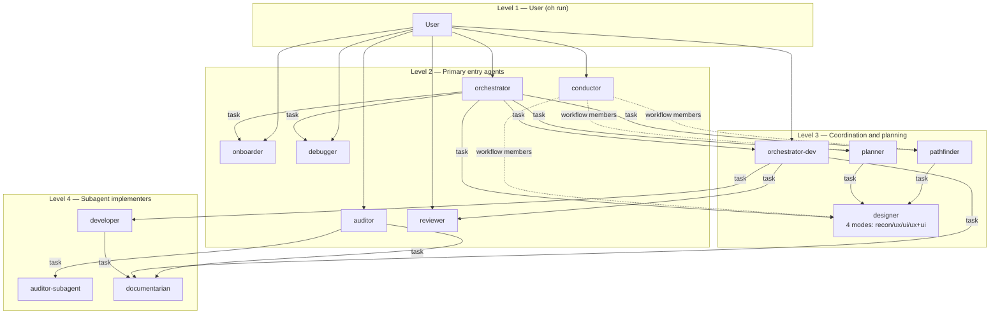
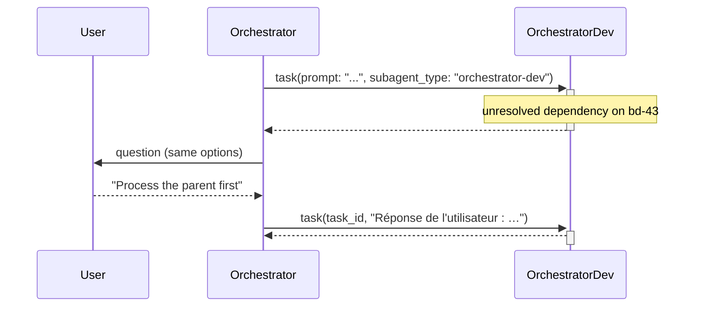

> [Lire en français](task-delegation.fr.md)

# Inter-Agent Delegation — The `task` Tool

This document details the agent delegation mechanism in OpenCode,
the invocation hierarchy, and inter-agent communication protocols.

> See also: [ADR-039](./adr/039-declarative-workflows-oh-v1.en.md) (workflows, graph and depth),
> [ADR-041](./adr/041-closed-world-isolation.en.md) (closed world),
> [ADR-042](./adr/042-checkpoints-headless-decisions.en.md) (checkpoints, locks, circuit breaker),
> [ADR-047](./adr/047-session-interaction-daemon.en.md) (sessions, `ohd` daemon),
> [ADR-009](./adr/009-inter-agent-handoff-contracts.en.md) (handoff contracts).
> [ADR-003](./adr/003-orchestrator-checkpoints.en.md) (checkpoints) and [ADR-006](./adr/006-orchestrator-configurable-mode.en.md)
> (modes) are superseded by ADR-039 and ADR-042.

---

## Delegation in v5 — the workflow graph

In v5, who may launch whom is no longer decided by the agents' prompts or by an `opencode.json` deployed in the
project: the session **workflow** sets it, and oh enforces it.

### Delegation graph

When the session bundle is built, oh computes the delegation graph (`SubagentGraph`):

- if the agent has a `calls:` field in the workflow, its targets are exactly that list;
- otherwise, its targets come from the `task` permission of its frontmatter, **restricted to the workflow members**
  (`conductor` has `task: "*": allow`: it can only launch the members of its workflow);
- **self-delegation** only exists when explicit: `calls: [reviewer]` in the `review` workflow (parallel `reviewer`
  sessions). A `task` permission to itself in the frontmatter is not enough.

```yaml
agents:
  orchestrator-dev: { role: workflow, calls: [developer] }   # review-feedback: developer only
  reviewer: { role: workflow, calls: [reviewer] }            # review: explicit self-delegation
```

### Depth

The maximum depth of the graph, from the entry agent, is written to the session config
(`experimental.subagent_depth`, at least 1). Otherwise opencode V2 limits delegation to a single level.
Examples: `feature` gives 3 (orchestrator → orchestrator-dev → developer → documentarian), `ticket` 2, `audit` 1.

### Refusal outside the graph

In the session config, for each agent, delegation (`subagent` in opencode V2 rules) is denied on `*`, then allowed
only toward the graph targets. An agent outside the bundle does not exist: opencode's native agents are disabled,
and `Attest` checks at startup that nothing else is visible ([ADR-041](./adr/041-closed-world-isolation.en.md)).

### `after:` locks and circuit breaker

- **Locks**: an agent declared with `after: <checkpoint>` (or `after: <agent>`) is locked. Until the checkpoint is
  passed, oh sets a `subagent <agent>` `deny` rule on the session through the opencode API, and lifts it when the
  checkpoint is passed. Example: in `feature`, `developer` is denied before `cp-1`.
- **Circuit breaker**: beyond `circuit_breaker.max_consecutive_subagents` consecutive delegations without user
  intervention, oh denies `subagent *` and raises a ✗ decision in "To handle". Dismissing the decision lifts the denial.

See [ADR-042](./adr/042-checkpoints-headless-decisions.en.md).

### Subagents and child sessions

Each `task` call creates a **child session** in the group's opencode server. The `ohd` daemon attaches it to the
root session: its activity, permissions, and questions show up in the "To handle" section of the Sessions view and
in `oh session inbox`, under the root session. Session rules (locks, circuit breaker) are also applied to
sub-sessions ([ADR-047](./adr/047-session-interaction-daemon.en.md)).

### Known limits (opencode 2.0.20)

- Sub-sessions do not get the session environment: the daemon applies it again.
- The message of a permission refusal is not passed to the agent, which only sees "Unable to execute".
  oh sends the instruction of a refusal as a separate message.

---

## The `task` tool — core mechanics

The `task` tool is the sole delegation mechanism between agents in OpenCode.
It allows a parent agent to invoke a child agent to perform an autonomous task,
then retrieve the result as a text output.

### Interface

```typescript
task({
  subagent_type: string,   // ID of the agent to invoke (required)
  prompt: string,          // Instructions for the sub-agent (required)
  description: string,     // Short description (3-5 words) for tracking
  task_id?: string         // ID of a previous session to resume (optional)
})
```

### Behavior

- **Isolated session**: the sub-agent has its own LLM context —
  it does not see the parent's conversation history.
- **Single result**: the sub-agent returns a single text message to the parent
  at the end of its session.
- **Context via prompt**: any information needed by the sub-agent must be
  explicitly passed in the `prompt`.
- **Child session**: the sub-agent runs in a child session, attached by oh to the root session
  (see [Subagents and child sessions](#subagents-and-child-sessions)).

### Difference from other tools

| Tool | Role | Modifies the project? |
|------|------|-----------------------|
| `task` | Delegate a task to another agent | Depends on the sub-agent |
| `bash` | Execute a shell command | Yes (if modifying command) |
| `edit` | Modify an existing file | Yes |
| `write` | Create a new file | Yes |
| `question` | Ask the user a question | No |

### Permissions — per-agent whitelist

Each agent declares in its frontmatter (`agents/<family>/<id>.md`) which sub-agents it may invoke.
There is no longer an `opencode.json` deployed in the project: oh compiles these declarations into the session
bundle config, restricted to the workflow graph (see [Delegation graph](#delegation-graph)).

```yaml
# agents/planning/orchestrator.md
permission:
  task:
    "*": deny
    "pathfinder": allow
    "planner": allow
    "onboarder": allow
    "designer": allow
    "orchestrator-dev": allow
    "debugger": allow
    "documentarian": allow
```

```yaml
# agents/planning/orchestrator-dev.md
permission:
  task:
    "*": deny
    "developer": allow
    "reviewer": allow
    "documentarian": allow
```

The `"*": "deny"` pattern with explicit exceptions ensures that an agent
cannot arbitrarily invoke any other agent. In a session, the list is further
limited to the workflow members.

---

## Agent hierarchy and routing rules

### The 4 invocation levels

The diagram shows the delegations allowed by the frontmatter files. A session only keeps the part linking the
members of its workflow; the entry agent is set by the workflow (`entry.agent`, or `conductor`).



### Invocation rights matrix

Taken from the frontmatter `task` permissions (including the `developer-rw` base). In a session, each row is
restricted to the workflow members, or replaced by `calls:`.

| Calling agent | Can invoke via `task` |
|---------------|-----------------------|
| `conductor` | `*` — in practice the members of its workflow |
| `orchestrator` | `pathfinder`, `planner`, `onboarder`, `designer`, `orchestrator-dev`, `debugger`, `documentarian` |
| `orchestrator-dev` | `developer`, `reviewer`, `documentarian` |
| `auditor` | `auditor-subagent`, `documentarian` |
| `planner` | `designer`, `documentarian` |
| `pathfinder` | `designer`, `documentarian` |
| `reviewer` | `documentarian`; `reviewer` (itself) only with `calls: [reviewer]` |
| `debugger`, `benchmarker` | `documentarian` |
| `developer` | `documentarian` |
| `auditor-subagent`, `designer`, `documentarian`, `onboarder`, `brief-enricher` | *(none)* |

### `primary` vs `subagent` modes

| Mode | User visibility | Invocation |
|------|-----------------|------------|
| `primary` | Visible in the Tab picker | Directly by the user or via `task` |
| `subagent` | Hidden from the Tab picker | Only via `task` by an authorized parent |

In the frontmatter files, `developer`, `auditor-subagent`, and
`brief-enricher` are in `subagent` mode. The workflow can change the mode of a member (`agents.<id>.mode`):
in `feature`, `planner` and `reviewer` become `subagent`; in `quick`, `developer` becomes `primary`.

### Absolute rule — level isolation

> **The orchestrator NEVER routes directly to the `developer`.**

This rule is fundamental: the `orchestrator` always delegates to
`orchestrator-dev`, which in turn delegates to the `developer` with the right domain.
This indirection allows:

- Centralizing the implementation workflow (review, correction cycles)
- Maintaining consistent handoff protocols
- Isolating responsibilities (design vs. implementation)

---

## Inter-agent communication protocols

### Return envelope and filed report (L5)

An agent launched with `task` returns a **short envelope** (skill `shared/handoff-envelope`, at most 15 lines) and files its **whole report** in oh with the `workflow_report` tool:

```markdown
## Retour vers conductor
**Agent** : developer · **Statut** : implémenté
**Rapport** : rp-3
### Questions bloquantes
Aucune.
### Suite proposée
Lancer la review du ticket bd-42.
### Résumé
Null guard ajouté dans UserService ; 2 tests ; go test ./... passe.
task_id : ses_abc123
```

- **Title**: the real caller, as named by the generated session contract (`## Retour vers <appelant>`); no skill writes an agent name in it.
- **Status**: a value of the agent's payload (`<agent>-payload`, frontmatter `statuses:`), or `en-attente` when a blocking question stops it.
- **Report**: `rp-<n>`, kept by oh and shown on the card of the next checkpoint. Without the daemon (answer « non enregistré »), `**Rapport** : inclus` and the whole report follows the envelope under `### Rapport complet`.
- **Payload**: each agent launched by another inlines its payload (200 to 400 tokens): the statuses of its return and the sections of its report.

### Caller side: no more transcription

The caller reads the envelope with its coordinator posture (`posture/coordinator-posture`):

- it finds the statuses of the agents it launches in its **session contract** (table « Statuts de leurs retours », generated from their payloads);
- it reads the report with `workflow_report_get` (whole or one section) when it needs it to decide, route or pass on, and cites it in `reports` of `workflow_checkpoint`; it does not copy it;
- as entry agent, it shows the user the agent, the status, the summary, the report id and the blocking questions; the whole report is on the card;
- it never summarises a report itself: it passes the id, or the useful section verbatim (the reviewer's corrections are copied verbatim into Beads).

| Payload | Agent | Statuses |
|---------|-------|----------|
| `developer/developer-payload` | `developer` | `implémenté`, `partiellement-implémenté`, `bloqué`, `BLOCKED_ARCHITECTURE` |
| `reviewer/reviewer-payload` | `reviewer` | `commit`, `corriger`, `corriger-sécurité` |
| `documentarian/documentarian-payload` | `documentarian` | `documenté`, `partiellement-documenté`, `bloqué` |
| `orchestrator/orchestrator-dev-payload` | `orchestrator-dev` | `succès`, `partiel`, `bloqué` |
| `auditor/auditor-subagent-payload` | `auditor-subagent` | `corrections-requises`, `acceptable`, `bloquant` |
| `designer/designer-payload` | `designer` | `spec-complète`, `spec-partielle`, `choix-requis`, `prototype-livré`, `bloqué` |
| `planning/planner-payload` | `planner` | `découpage-à-valider`, `planification-complète`, `planification-partielle`, `bloqué` |
| `planning/pathfinder-payload` | `pathfinder` | `direct`, `escalade-planner`, `reconnaissance-partielle` |
| `planning/onboarder-payload` | `onboarder` | `contexte-établi`, `contexte-partiel`, `bloqué` |
| `quality/debugger-payload` | `debugger` | `diagnostiqué`, `partiellement-diagnostiqué`, `non-reproductible` |

→ [ADR-009](./adr/009-inter-agent-handoff-contracts.en.md) (handoff contracts, replaced in L5 by the envelope and the payloads)

---

## Session resumption with `task_id`

### Mechanism

A subagent never calls `question`. A decision that blocks it goes into the `### Questions bloquantes` of its envelope (status `en-attente`) and it stops. The caller:

1. shows the context to the user (or, when it is a subagent itself, puts the question in its own envelope);
2. asks the question with the `question` tool;
3. relaunches the subagent with the same `task_id` and the answer (« Réponse de l'utilisateur : … »); the subagent resumes where it stopped.

Checkpoints never go through this mechanism: the agent that passes a checkpoint (its session contract says so) calls `workflow_checkpoint` itself, even when launched via `task`.



### The `task_id` is an OpenCode session ID

The `task_id` is not a proprietary LLM identifier — it is a **standard OpenCode session ID**, returned by the `task` tool to the caller. Resuming with `task_id` reconnects the child session, its history intact. A subagent does not always know its own id: the `task_id` line of the envelope is optional, the caller keeps the one `task` returned.

**Residual risk — server restart:** if the opencode server restarts between the `en-attente` envelope and the resumption, the child session may no longer be reachable. In v5, the server is started and supervised by oh (one server per group); a paused session resumes with the same bundle (`oh session resume`). See `### task_id — session not found` in Attention points.

---

## Execution path: entry agent or sub-agent

The path is not guessed from the prompt: oh appends to each agent a **session contract** generated from the workflow graph (role, callers and return title, callable agents and the statuses of their returns, own checkpoints, `question` allowed or not, `workflow_report`).

| Position in the workflow | Generated role | Path |
|--------------------------|----------------|------|
| Entry agent, called by no member | entry agent | recap then `question` at the end of each phase, deliverable as text |
| Entry agent that a member may also call | both | sub-agent when the prompt comes from an agent (`[CONTEXTE]` marker, `[REVIEW:single]` or resumption with `task_id`), entry agent otherwise |
| Reached only via `task` | sub-agent | a single session, stops only on a blocking question, final envelope |

A single protocol for phased agents (`shared/execution-protocol`), one section per role, filtered at build time (`when: role=…`, [Variants by role](./skills.en.md#variants-by-role-and-by-session-when)). The postures follow the same rule: `posture/user-facing-posture` for the entry agent; `posture/subagent-posture`, `shared/handoff-envelope` and the payload for the sub-agent. The former path skills (`*-execution-modes`, `-standalone` / `-subagent` pairs) were removed in L5. The `[SKILL:<ref>]` markers left in a `task` prompt (`[SKILL:designer/prototype-protocol]`, `[SKILL:orchestrator/orchestrator-dev-feedback-mode]`) name an extra skill to load.

```
task(
  subagent_type: "planner",
  task_id: "<task_id>",
  prompt: "Réponse de l'utilisateur : [option]."
)
```

---

## Checkpoints and decision points

> **v5.** Checkpoints are declared in the workflow YAML (`checkpoints:`), with their behavior per mode.
> `feature` example: `cp-tickets`, `cp-0`, `cp-spec`, `cp-1`, `cp-2`, `cp-3`, `cp-feature`. The agent signals them with the
> `workflow_checkpoint` MCP tool (not with `question`); oh keeps the state machine, answers automatic checkpoints
> itself, and raises a ⏸ decision in "To handle" for those that wait for the user. Agents locked by `after:` stay
> denied until their checkpoint is passed ([ADR-042](./adr/042-checkpoints-headless-decisions.en.md)). The table
> below describes the `feature` workflow; the workflow YAML is the reference (`oh workflow show <id>`).

### Full checkpoint table (`feature`)

| Checkpoint | Called by | Moment | Mode (manuel / semi-auto / auto) | Unlocks |
|------------|-----------|--------|----------------------------------|---------|
| **cp-tickets** | `orchestrator` | Planning agent's breakdown, before any ticket creation (with existing tickets only: confirms the list) | pause / pause / pause (mandatory) | `create` |
| **cp-0** | `orchestrator` | Ticket table, before any implementation | pause / pause / pause (mandatory) | — (`orchestrator-dev` is locked until `cp-0` by `after:`) |
| **cp-spec** | `orchestrator` | After a UX/UI spec by the designer | conditional in all modes | — |
| **cp-1** | `orchestrator-dev` | Before each ticket | pause / auto / auto | — (`developer` is locked until `cp-1` by `after:`) |
| **cp-2** | `orchestrator-dev` | After review — commit or fix? | **pause / pause / pause** (mandatory) | `commit`, `close` |
| **cp-3** | `orchestrator-dev` | After commit — next ticket? | pause / auto / auto | — |
| **cp-feature** | `orchestrator` | End of feature | pause / pause / auto | — |

The other workflows declare their own checkpoints (`grep -h '^  cp-' workflows/*.yaml`): `cp-ticket` (debug, unlocks `create`), `cp-commit` (debug, quick, sweep), `cp-plan` and `cp-apply` (infra-change, `cp-apply` unlocks `apply`), `cp-target` (benchmark), `cp-scope`, `cp-fix`, `cp-recap`… No shipped workflow unlocks `push`.

### Absolute rule — CP-2 is non-automatable

> **CP-2 (commit or fix?) is a pause in ALL modes, without exception.**

This rule cannot be overridden, even in `auto` mode. In the shipped workflows, `cp-2` is `mandatory: true`
and `pause` in all three modes: a team or project layer cannot relax it. Justification:

- "No technical errors" ≠ "meets functional expectations"
- The decision to commit engages the user's responsibility
- An AI confidence score on a review report would be false precision

→ [ADR-042](./adr/042-checkpoints-headless-decisions.en.md) (supersedes [ADR-006](./adr/006-orchestrator-configurable-mode.en.md))

### Note: upstream questions

Since L5, a single form: the envelope with status `en-attente`, its `### Questions bloquantes`, then the resumption with `task_id`. The « Retour intermédiaire » and « Question pour l'orchestrator » blocks are gone.

### Anti-loop counters

To prevent infinite loops, limits are enforced by the skills. In addition, oh applies a circuit breaker
on consecutive delegations (`circuit_breaker.max_consecutive_subagents`, see
[`after:` locks and circuit breaker](#after-locks-and-circuit-breaker)):

| Counter | Limit | Action when exceeded |
|---------|-------|----------------------|
| Spec revisions | 3 | Requests manual intervention |
| Re-audits after correction | 2 | Acceptance with reservations |
| Review cycles | 3 | Blockage signaled, user choice |

---

## Attention points and known limitations

### `task_id` — risk of session not found

The `task_id` is a standard OpenCode session ID — session resumption is reliable as long as the session exists server-side. The only real risk is **session not found**: if OpenCode restarts between the upstream question and the resumption, the child session may have disappeared.

| Cause | Probability | Impact |
|-------|-------------|--------|
| OpenCode restart between upstream question and resumption | Low — requires a restart during the wait window | Workflow interrupted — resumption impossible via `task_id` |
| `task_id` mistaken by the caller | Very low — LLM error | Same impact |

**Safety net in `orchestrator-protocol.md`:** if re-invocation with `task_id` fails (no result, error), the orchestrator must detect the case and offer the user the option to restart `orchestrator-dev` from scratch with the remaining tickets — see the dedicated section in `orchestrator-protocol.md`.

**What remains unknown on the SDK side:**
- How the child agent knows its own `task_id` during execution (not publicly documented)
- Session TTL (probably unlimited but unspecified)

### `en-attente` envelope vs final return

An envelope with status `en-attente` is not a final return: the caller relays the blocking questions, relaunches with `task_id`, and waits for the final return (payload status, report `rp-…`) before building its recap or passing the next checkpoint (for instance `cp-feature` after orchestrator-dev).

### Conditional parallelism (mode `auto` only)

By default, `orchestrator-dev` processes tickets **sequentially**. A **conditional parallelism** mode is available exclusively in `auto` mode when all 4 parallelizability criteria are met.

#### Why sequential is the default mode

Three constraints make parallelism irrelevant or risky in the general case:

| Constraint | Impact |
|---|---|
| **CP-2 absolute pause** | Even in parallel, CP-2s from N sessions are processed sequentially (one report at a time) — the gain during the implementation phase is "absorbed" by the review |
| **Human bottleneck** | In `manual`/`semi-auto` modes, human pauses (CP-1, CP-3) dominate total time — parallelizing implementation does not speed up these decisions |
| **Undetectable implicit dependencies** | Two tickets without a formal `deps` relationship may have semantic dependencies invisible to the orchestrator |

The real gain from parallelism only exists in `auto` mode, and only during the implementation phase.

#### The 4 parallelizability criteria

A batch of tickets is eligible for parallel processing if and only if **all** these criteria are met:

| # | Criterion | Verification |
|---|---|---|
| 1 | **No formal dependency between tickets in the batch** | `bd dep list <ID>` for each ticket — the intersection with the batch IDs is empty |
| 2 | **Disjoint domains** | Tickets given to `developer` with distinct domains (`refactor` and `migration` included) — no `fullstack` domain in the batch |
| 3 | **No foreseeable cross-cutting files** | No ticket mentions shared types, database migrations, or global configuration files |
| 4 | **`auto` mode active** | `manual` and `semi-auto` modes remain sequential |

If a single criterion is not met → **forced sequential**.

#### Behavior in conditional parallel mode

- **Launch**: N `developer*` sub-agents started simultaneously (max 3 in parallel), each in its child session
- **CP-2**: processed **sequentially** even in parallel — one question at a time in the order results arrive
- **Late conflict detection**: if a sub-agent modifies a file already modified by another parallel session (`git status`), the orchestrator triggers an early CP-2 before continuing
- **Global recap**: produced only when **all** parallel sessions have returned a `final` recap
- **Limit**: maximum 3 simultaneous parallel sessions

This parallelism stays inside one oh session, in the same folder. To handle tickets in separate oh sessions
(one session and one worktree per ticket), use `oh run ticket --tickets a,b`
(see [v5 sessions](../guides/sessions-v5.en.md)).

#### What parallelism does not solve

Parallelism does not eliminate CP-2 pauses — it groups them in time. For a batch of N tickets in parallel, the user will read N successive review reports at the end of the implementation phase instead of reading them one by one. This is a posture shift: aggregated supervision rather than ticket-by-ticket supervision.

### Mode transmission via prompt

The workflow mode (`manual`, `semi-auto`, `auto`) is transmitted in the
`prompt` text, not as a structured parameter of the `task` tool.

In v5, the mode is set at launch (`oh run <workflow> --mode …`, otherwise the workflow `modes.default`) and is no
longer asked by the agent. The initial session prompt always contains the `Mode de workflow : <mode>` line, and
oh applies the behavior of each checkpoint in that mode. The rules below cover passing the mode from an agent
to its sub-agents.

#### Canonical values

Three exact values are accepted (case-insensitive):

| Value | Mode applied (`feature` and `ticket` workflows) |
|-------|--------------|
| `manuel` | All pauses active |
| `semi-auto` | CP-1 and CP-3 automatic, CP-2 manual — default of the shipped workflows |
| `auto` | Fully automatic except CP-2 (absolute pause) and, in `feature`, `cp-0` and `cp-spec` |

Never transmit the raw interface option label (`"Manuel (Recommandé)"`, `"Semi-auto"`) — normalize to lowercase before transmission.

**Example of correct prompt wording:**
```
Workflow mode: semi-auto
```

#### Identified failure cases

| Case | Probability | Impact |
|------|-------------|--------|
| **Resumption via `task_id` without re-transmitting the mode** | 🔴 High — systematic at CP-2 | Mode silently lost; `manuel` fallback assumed but not guaranteed |
| Mode absent from initial prompt | 🟠 Medium | Unexpected CP-1/CP-3 pauses if mode was `semi-auto`/`auto` |
| Badly formatted mode (e.g. `"automatique"`) | 🟡 Low-Medium | Parsing undefined — risk of unintended `auto` mode |
| Contradictory modes in the prompt | 🟡 Low | Indeterminate behavior — first occurrence applied |

**The most critical case:** each CP-2 invoked from the orchestrator triggers a session resumption via `task_id`. The resumption prompt does not naturally contain the mode — it must be explicitly re-transmitted.

#### Fixes applied in the skills

To mitigate these risks, the following changes have been applied:

**`orchestrator-workflow-modes.md`**
- Explicit definition of the three canonical values on the sender side
- Prohibition on transmitting raw interface labels

**`orchestrator-protocol.md`**
- Self-check before delegation: "is the canonical mode in the prompt?"
- `task_id` resumption prompt modified to systematically include the mode:
  ```
  "User response at CP <phase>… Workflow mode: <canonical value>. Resume…"
  ```

**`orchestrator-dev-protocol.md`**
- Parsing rule documented: canonical values, explicit `manuel` fallback, signal if absent or ambiguous
- Confirmation of received mode in the startup message:
  ```
  [orchestrator-dev] Workflow mode received: <value>. The ## Return block will be produced at end of session.
  ```
- Two new prohibitions in "What you do NOT do"

### Non-inherited permissions

A sub-agent does not inherit its parent's permissions. Each agent has its
own permissions, declared in its frontmatter (`permission:` and `permission_base`) and compiled into the session
bundle config. The project config (`opencode.json`, `.opencode/`) is not read
(`OPENCODE_DISABLE_PROJECT_CONFIG=1`). A `developer` can write code even if its parent `orchestrator-dev`
cannot.

The **session** rules set by oh (`after:` locks, circuit breaker, checkpoints), on the other hand, apply to the
root session and its sub-sessions. Permission requests from a sub-agent show up in "To handle" under the root
session; if they are refused, the agent does not receive the refusal message (opencode 2.0.20 limit).
