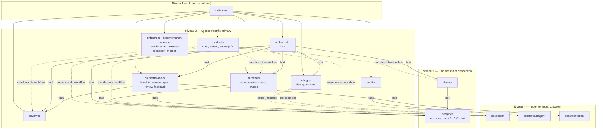
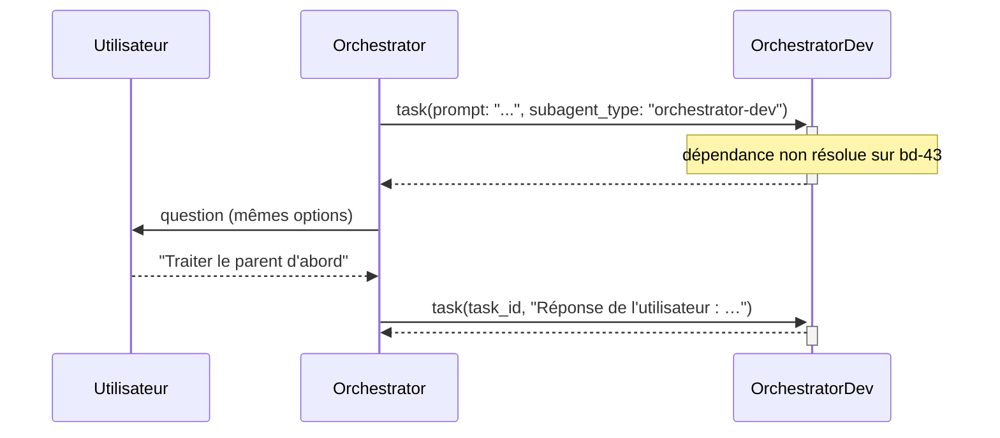

> [Read in English](task-delegation.en.md)

# Délégation inter-agents — L'outil `task`

Ce document détaille le mécanisme de délégation entre agents dans OpenCode,
la hiérarchie d'invocation et les protocoles de communication inter-agents.

> Voir aussi : [ADR-039](./adr/039-declarative-workflows-oh-v1.fr.md) (workflows, graphe et profondeur),
> [ADR-041](./adr/041-closed-world-isolation.fr.md) (monde fermé),
> [ADR-042](./adr/042-checkpoints-headless-decisions.fr.md) (checkpoints, verrous, coupe-circuit),
> [ADR-047](./adr/047-session-interaction-daemon.fr.md) (sessions, démon `ohd`),
> [ADR-009](./adr/009-inter-agent-handoff-contracts.fr.md) (contrats de handoff).
> [ADR-003](./adr/003-orchestrator-checkpoints.fr.md) (checkpoints) et [ADR-006](./adr/006-orchestrator-configurable-mode.fr.md)
> (modes) sont remplacés par ADR-039 et ADR-042.

---

## Délégation en v5 — le graphe du workflow

En v5, qui peut lancer qui n'est plus décidé par le prompt des agents ni par un `opencode.json` déployé dans le
projet : c'est le **workflow** de la session qui le fixe, et oh le fait respecter.

### Graphe de délégation

À la construction du paquet de session, oh calcule le graphe de délégation (`SubagentGraph`) :

- si l'agent a un champ `calls:` dans le workflow, ses cibles sont exactement cette liste ;
- sinon, ses cibles viennent de la permission `task` de son frontmatter, **restreinte aux membres du workflow**
  (`conductor` a `task: "*": allow` : il ne peut lancer que les membres de son workflow) ;
- l'**auto-délégation** n'existe que si elle est explicite : `calls: [reviewer]` dans le workflow `review` (sessions
  `reviewer` parallèles). Une permission `task` vers soi-même dans le frontmatter ne suffit jamais, y compris dans un
  workflow à entrée au choix (`libre`) : oh y calcule les membres de proche en proche sans en déduire de `calls:`, et
  un agent ne s'y appelle pas lui-même (les modes combinés du reviewer passent par `oh run review`) ;
- `calls:` peut aussi ouvrir une délégation que le frontmatter n'a pas : dans `incident` et `spike`, le `debugger`
  et le `pathfinder` (sans permission `task` vers lui) lancent le `developer` (`calls: [developer]`).

```yaml
agents:
  orchestrator-dev: { role: workflow, calls: [developer] }   # review-feedback : seulement developer
  reviewer: { role: workflow, calls: [reviewer] }            # review : auto-délégation explicite
```

### Profondeur

La profondeur maximale du graphe, depuis l'agent d'entrée, est écrite dans la config de session
(`experimental.subagent_depth`, au moins 1). opencode V2 limite sinon la délégation à un seul niveau.
Exemples : `libre` donne 2 (orchestrator → orchestrator-dev → reviewer), `spec` 2 (conductor → planner → designer), `ticket`, `implement-spec`, `audit` et `incident` 1.

### Refus hors graphe

Dans la config de session, pour chaque agent, la délégation (`subagent` dans les règles d'opencode V2) est refusée
sur `*`, puis autorisée vers les seules cibles du graphe. Un agent hors du paquet n'existe pas : les agents natifs
d'opencode sont désactivés, et `Attest` vérifie au démarrage que rien d'autre n'est visible
([ADR-041](./adr/041-closed-world-isolation.fr.md)).

### Verrous `after:` et coupe-circuit

- **Verrous** : un agent déclaré avec `after: <checkpoint>` (ou `after: <agent>`) est verrouillé. Tant que le checkpoint
  n'est pas passé, oh pose sur la session une règle `subagent <agent>` en `deny`, par l'API d'opencode, et la lève
  au passage du checkpoint. Exemples : dans `ticket` et `implement-spec`, `developer` est refusé avant `cp-1` ; dans `spike`, avant `cp-question` ; dans `security-fix`, l'`auditor-subagent` attend que le `developer` ait tourné (`after: developer`).
- **Coupe-circuit** : au-delà de `circuit_breaker.max_consecutive_subagents` délégations consécutives sans
  intervention de l'utilisateur, oh refuse `subagent *` et lève une décision ✗ dans « À traiter ». Classer la décision
  lève le refus.

Voir [ADR-042](./adr/042-checkpoints-headless-decisions.fr.md).

### Sous-agents et sessions enfants

Chaque appel `task` crée une **session enfant** dans le serveur opencode du groupe. Le démon `ohd` la rattache à la
session racine : son activité, ses permissions et ses questions apparaissent dans la section « À traiter » de la vue
Sessions et dans `oh session inbox`, sous la session racine. Les règles de session (verrous, coupe-circuit) sont aussi
appliquées aux sous-sessions ([ADR-047](./adr/047-session-interaction-daemon.fr.md)).

### Limites connues (opencode 2.0.20)

- Les sous-sessions n'ont pas l'environnement de la session : le démon le réapplique.
- Le message d'un refus de permission n'est pas transmis à l'agent, qui ne voit que « Unable to execute ».
  oh envoie la consigne d'un refus par un message séparé.

---

## L'outil `task` — mécanique de base

L'outil `task` est le seul mécanisme de délégation entre agents dans OpenCode.
Il permet à un agent parent d'invoquer un agent enfant pour réaliser une tâche
autonome, puis de récupérer le résultat sous forme textuelle.

### Interface

```typescript
task({
  subagent_type: string,   // ID de l'agent à invoquer (obligatoire)
  prompt: string,          // Instructions pour le sous-agent (obligatoire)
  description: string,     // Description courte (3-5 mots) pour le suivi
  task_id?: string         // ID d'une session précédente à reprendre (optionnel)
})
```

### Comportement

- **Session isolée** : le sous-agent dispose de son propre contexte LLM —
  il ne voit pas l'historique de conversation du parent.
- **Résultat unique** : le sous-agent retourne un seul message textuel au parent
  à la fin de sa session.
- **Contexte via prompt** : toute information nécessaire au sous-agent doit être
  transmise explicitement dans le `prompt`.
- **Session enfant** : le sous-agent tourne dans une session enfant, rattachée par oh à la session racine
  (voir [Sous-agents et sessions enfants](#sous-agents-et-sessions-enfants)).

### Différence avec les autres outils

| Outil | Rôle | Modifie le projet ? |
|-------|------|---------------------|
| `task` | Déléguer une tâche à un autre agent | Dépend du sous-agent |
| `bash` | Exécuter une commande shell | Oui (si commande modifiante) |
| `edit` | Modifier un fichier existant | Oui |
| `write` | Créer un nouveau fichier | Oui |
| `question` | Poser une question à l'utilisateur | Non |

### Permissions — whitelist par agent

Chaque agent déclare dans son frontmatter (`agents/<famille>/<id>.md`) quels sous-agents il peut invoquer.
Il n'y a plus de `opencode.json` déployé dans le projet : oh compile ces déclarations dans la config du paquet de
session, restreintes au graphe du workflow (voir [Graphe de délégation](#graphe-de-délégation)).

```yaml
# agents/planning/orchestrator.md
permission:
  task:
    "*": deny
    "pathfinder": allow
    "planner": allow
    "onboarder": allow
    "designer": allow
    "orchestrator-dev": allow
    "reviewer": allow
    "debugger": allow
```

```yaml
# agents/planning/orchestrator-dev.md
permission:
  task:
    "*": deny
    "developer": allow
    "reviewer": allow
    "documentarian": allow
```

Le pattern `"*": "deny"` avec des exceptions explicites garantit qu'un agent
ne peut pas invoquer arbitrairement n'importe quel autre agent. Dans une session, la liste est en plus
limitée aux membres du workflow.

---

## Hiérarchie des agents et règles de routing

### Les 4 niveaux d'invocation

Le schéma montre les délégations permises par les frontmatter. Une session n'en garde que la partie qui relie
les membres de son workflow ; l'agent d'entrée est fixé par le workflow (`entry.agent`, ou `conductor`).



### Matrice des droits d'invocation

Relevé des permissions `task` des frontmatter (base `developer-rw` comprise). Dans une session, chaque ligne est
restreinte aux membres du workflow, ou remplacée par `calls:`.

| Agent appelant | Peut invoquer via `task` |
|---------------|--------------------------|
| `conductor` | `*` — en pratique les membres de son workflow |
| `orchestrator` | `pathfinder`, `planner`, `onboarder`, `designer`, `orchestrator-dev`, `reviewer`, `debugger` |
| `orchestrator-dev` | `developer`, `reviewer`, `documentarian` |
| `auditor` | `auditor-subagent` |
| `planner` | `designer` |
| `pathfinder` | `designer` ; `developer` avec `calls:` (`spike`) |
| `reviewer` | `reviewer` (lui-même) seulement avec `calls: [reviewer]` (`review` ; jamais dans `libre`) |
| `debugger` | *(aucun)* ; `developer` avec `calls:` (`incident`) |
| `developer`, `merger`, `release-manager`, `benchmarker`, `operator`, `auditor-subagent`, `designer`, `documentarian`, `onboarder`, `brief-enricher` | *(aucun)* |

Dans les fan-out, ce n'est pas un agent qui lance les sessions enfants, `merge-conflicts` ou le tour de correction : c'est oh (pilote du fan-out), hors du graphe de délégation.

### Modes `primary` vs `subagent`

| Mode | Visibilité utilisateur | Invocation |
|------|------------------------|------------|
| `primary` | Visible dans le Tab picker | Directe par l'utilisateur ou via `task` |
| `subagent` | Invisible dans le Tab picker | Uniquement via `task` par un parent autorisé |

Dans les frontmatter, `developer`, `auditor-subagent` et
`brief-enricher` sont en mode `subagent`. Le workflow peut changer le mode d'un membre (`agents.<id>.mode`) :
dans `spec`, `pathfinder`, `planner` et `designer` passent en `subagent`, dans `implement-spec` le `reviewer` ; dans `quick` et `sweep-task`, `developer` passe en `primary`.

### Règle absolue — isolation des niveaux

> **L'orchestrator ne route JAMAIS directement vers le `developer`.**

Cette règle vaut dans `libre`, seul workflow de l'`orchestrator` : il délègue toujours à
`orchestrator-dev`, qui lui-même délègue au `developer` avec le bon domaine.
Cette indirection permet de :

- Centraliser le workflow d'implémentation (review, cycles de correction)
- Maintenir des protocoles de handoff cohérents
- Isoler les responsabilités (conception vs implémentation)

---

## Protocoles de communication inter-agents

### Enveloppe de retour et rapport déposé (L5)

Un agent lancé avec `task` rend une **enveloppe courte** (skill `shared/handoff-envelope`, 15 lignes au plus) et dépose son **rapport complet** dans oh avec l'outil `workflow_report` :

```markdown
## Retour vers conductor
**Agent** : developer · **Statut** : implémenté
**Rapport** : rp-3
### Questions bloquantes
Aucune.
### Suite proposée
Lancer la review du ticket bd-42.
### Résumé
Null guard ajouté dans UserService ; 2 tests ; go test ./... passe.
task_id : ses_abc123
```

- **Titre** : l'appelant réel, tel que le nomme le contrat de session généré (`## Retour vers <appelant>`) ; aucune skill n'écrit un nom d'agent en dur.
- **Statut** : une valeur du payload de l'agent (`<agent>-payload`, frontmatter `statuses:`), ou `en-attente` quand une question bloquante l'arrête.
- **Rapport** : `rp-<n>`, gardé par oh et montré dans la carte du checkpoint suivant. Sans démon (réponse « non enregistré »), `**Rapport** : inclus` et le rapport complet suit l'enveloppe sous `### Rapport complet`.
- **Payload** : chaque agent lancé par un autre inclut son payload (200 à 400 tokens) : les statuts de son retour et les sections de son rapport.

### Côté appelant : plus de retranscription

L'appelant lit l'enveloppe selon sa posture de coordinateur (`posture/coordinator-posture`) :

- il trouve les statuts des agents qu'il lance dans son **contrat de session** (table « Statuts de leurs retours », générée depuis leurs payloads) ;
- il lit le rapport avec `workflow_report_get` (en entier ou une section) quand il en a besoin pour décider, router ou transmettre, et le cite dans `reports` de `workflow_checkpoint` ; il ne le recopie pas ;
- agent d'entrée, il affiche à l'utilisateur l'agent, le statut, le résumé, l'identifiant du rapport et les questions bloquantes ; le rapport complet est dans la carte ;
- il ne résume jamais un rapport de sa main : il transmet l'identifiant, ou la section utile telle quelle (les corrections du reviewer sont copiées verbatim dans Beads).

| Payload | Agent | Statuts |
|---------|-------|---------|
| `developer/developer-payload` | `developer` | `implémenté`, `partiellement-implémenté`, `bloqué`, `BLOCKED_ARCHITECTURE` |
| `reviewer/reviewer-payload` | `reviewer` | `commit`, `corriger`, `corriger-sécurité` |
| `documentarian/documentarian-payload` | `documentarian` | `documenté`, `partiellement-documenté`, `bloqué` |
| `orchestrator/orchestrator-dev-payload` | `orchestrator-dev` | `succès`, `partiel`, `bloqué` |
| `auditor/auditor-subagent-payload` | `auditor-subagent` | `corrections-requises`, `acceptable`, `bloquant` |
| `designer/designer-payload` | `designer` | `spec-complète`, `spec-partielle`, `choix-requis`, `prototype-livré`, `bloqué` |
| `planning/planner-payload` | `planner` | `découpage-à-valider`, `planification-complète`, `planification-partielle`, `bloqué` |
| `planning/pathfinder-payload` | `pathfinder` | `direct`, `escalade-planner`, `reconnaissance-partielle` |
| `planning/onboarder-payload` | `onboarder` | `contexte-établi`, `contexte-partiel`, `bloqué` |
| `quality/debugger-payload` | `debugger` | `diagnostiqué`, `partiellement-diagnostiqué`, `non-reproductible` |

Les agents qui ne sont jamais lancés par un autre (`release-manager`, `merger`, `operator`, `benchmarker`, `conductor`, `orchestrator`) n'ont pas de payload. Dans `security-fix`, le contrat du `developer` (une ligne `F<n>` par constat retenu : corrigé ou faux positif, test, fichiers) passe à l'`auditor-subagent` avec son rapport.

→ [ADR-009](./adr/009-inter-agent-handoff-contracts.fr.md) (contrats de handoff, remplacés en L5 par l'enveloppe et les payloads)

---

## Reprise de session avec `task_id`

### Mécanisme

Un sous-agent n'appelle jamais `question` : un agent qui n'a aucun rôle d'entrée dans le workflow (le planner et le pathfinder de `spec`, le pathfinder de `sweep`…) ne reçoit pas l'outil (règle `question` refusée sur `*`, dernière de ses règles : opencode ne donne pas l'outil au modèle) ; un agent d'entrée qu'un autre agent peut aussi lancer (le reviewer de `review`) le garde. Une décision qui le bloque va dans les `### Questions bloquantes` de son enveloppe (statut `en-attente`) et il s'arrête. L'appelant :

1. affiche le contexte à l'utilisateur (ou, s'il est lui-même sous-agent, reporte la question dans sa propre enveloppe) ;
2. pose la question avec l'outil `question` ;
3. relance le sous-agent avec le même `task_id` et la réponse (« Réponse de l'utilisateur : … ») ; le sous-agent reprend où il s'était arrêté.

Les checkpoints, eux, ne passent jamais par ce mécanisme : l'agent qui passe un checkpoint (son contrat de session le dit) appelle lui-même `workflow_checkpoint`, même lancé via `task`.



### Le `task_id` est un ID de session OpenCode

Le `task_id` n'est pas un identifiant LLM propriétaire — c'est un **ID de session OpenCode standard**, renvoyé par l'outil `task` à l'appelant. La reprise via `task_id` reconnecte la session enfant, son historique intact. Un sous-agent ne connaît pas toujours son propre identifiant : la ligne `task_id` de l'enveloppe est facultative, l'appelant garde celui que `task` lui a rendu.

**Risque résiduel — redémarrage du serveur :** si le serveur opencode redémarre entre l'enveloppe `en-attente` et la reprise, la session enfant peut ne plus être joignable. En v5, le serveur est lancé et supervisé par oh (un serveur par groupe) ; une session mise en veille reprend avec le même paquet (`oh session resume`). Voir `### task_id — session introuvable` dans Points d'attention.

---

## Parcours d'exécution : agent d'entrée ou sous-agent

Le parcours n'est pas deviné depuis le prompt : oh ajoute à chaque agent un **contrat de session** généré depuis le graphe du workflow (rôle, appelants et titre de retour, agents appelables et statuts de leurs retours, checkpoints propres, `question` autorisé ou non, `workflow_report`).

| Position dans le workflow | Rôle généré | Parcours |
|---------------------------|-------------|----------|
| Agent d'entrée, appelé par aucun membre | agent d'entrée | récap puis `question` à chaque fin de phase, livrable en texte |
| Agent d'entrée qu'un membre peut aussi appeler | les deux | sous-agent si le prompt vient d'un agent (marqueur `[CONTEXTE]`, `[REVIEW:single]` ou reprise avec `task_id`), agent d'entrée sinon |
| Atteint seulement via `task` | sous-agent | une seule session, arrêt seulement sur une question bloquante, enveloppe finale |

Un seul protocole pour les agents à phases (`shared/execution-protocol`), une section par rôle, filtrée au build (`when: role=…`, [Variantes par rôle](./skills.fr.md#variantes-par-rôle-et-par-session-when)). Les postures suivent la même règle : `posture/user-facing-posture` pour l'agent d'entrée ; `shared/handoff-envelope` et le payload pour le sous-agent. Les anciennes skills de parcours (`*-execution-modes`, paires `-standalone` / `-subagent`) ont disparu en L5. Les marqueurs `[SKILL:<réf>]` restants dans un prompt `task` (`[SKILL:designer/prototype-protocol]`, `[SKILL:orchestrator/orchestrator-dev-feedback-mode]`) désignent une skill supplémentaire à charger.

```
task(
  subagent_type: "planner",
  task_id: "<task_id>",
  prompt: "Réponse de l'utilisateur : [option]."
)
```

---

## Checkpoints et points de décision

> **v5.** Les checkpoints sont déclarés dans le YAML du workflow (`checkpoints:`), avec leur comportement par mode.
> Exemple `implement-spec` : `cp-plan`, `cp-1`, `cp-2`, `cp-3`, `cp-final` (`cp-seams` et `cp-red` en méthode `tdd`, `cp-merge` en fan-out). L'agent les signale avec l'outil MCP
> `workflow_checkpoint` (pas avec `question`) ; oh tient la machine à états, répond seul aux checkpoints automatiques
> et pose une décision ⏸ dans « À traiter » pour ceux qui attendent l'utilisateur. Les agents verrouillés par `after:`
> restent refusés tant que leur checkpoint n'est pas passé
> ([ADR-042](./adr/042-checkpoints-headless-decisions.fr.md)). Le tableau ci-dessous décrit le workflow `implement-spec` (version séquentielle) ;
> le YAML du workflow fait foi (`oh workflow show <id>`).

### Tableau complet des checkpoints (`implement-spec`)

| Checkpoint | Appelé par | Moment | Mode (manuel / semi-auto / auto) | Déverrouille |
|------------|------------|--------|----------------------------------|--------------|
| **cp-plan** | `orchestrator-dev` | Ordre des tickets, agent prévu, tickets écartés, avant toute délégation | pause / pause / pause (obligatoire) | — |
| **cp-1** | `orchestrator-dev` | Avant chaque ticket | pause / auto / auto | — (`developer` verrouillé jusqu'à `cp-1` par `after:`) |
| **cp-2** | `orchestrator-dev` | Après review — commit ou correction ? Vérifié par oh (build, tests, typecheck de la stack) | **pause / pause / pause** (obligatoire) | `commit`, `close` |
| **cp-3** | `orchestrator-dev` | Après commit — ticket suivant ? | pause / auto / auto | — |
| **cp-final** | `orchestrator-dev` | Revue de l'ensemble des commits par le reviewer, récap | pause / pause / auto | — |

Les autres workflows déclarent leurs propres checkpoints (`grep -h '^  cp-' workflows/*.yaml`) : `cp-understanding`, `cp-converge`, `cp-spec` et `cp-tickets` (`spec`, dans cet ordre, `after:`), `cp-ticket` (`debug`, déverrouille `create`), `cp-commit` (`quick`, `debug`, `sweep`, `sweep-task`), `cp-plan` et `cp-apply` (`infra-change`, `cp-apply` déverrouille `apply`), `cp-plan` de `sweep` (découpage relevé par oh, `tasks:`), `cp-merge` (fan-out), `cp-mitigated`, `cp-postmortem` et `cp-actions` (`incident`), `cp-triage` et `cp-rescan` (`security-fix`), `cp-question` et `cp-decision` (`spike`), `cp-wiki` (`onboarding`), `cp-sync` (`doc-sync`), `cp-refresh` (`skill-refresh`), `cp-release` (`release`, déverrouille `commit`, `tag`, `mr`), `cp-target` (`benchmark`), `cp-fix`, `cp-recap`… Aucun workflow livré ne déverrouille `push`. Vérification par oh, ordre, budget de pauses et fenêtres : [Checkpoints](../reference/checkpoints.fr.md).

### Règle absolue — CP-2 est non automatisable

> **CP-2 (commit ou correction ?) est une pause dans TOUS les modes, sans exception.**

Cette règle ne peut pas être outrepassée, même en mode `auto`. Dans les workflows livrés, `cp-2` est `mandatory: true`
et en `pause` dans les trois modes : une couche équipe ou projet ne peut pas l'assouplir. Seule exception, déclarée par la couche hub : dans un fan-out, le `cp-2` des enfants passe sans pause, remplacé par le `cp-merge` obligatoire de la parente, vérifié par oh et jamais forcé (substitution de contrôle, CP-R3, [ADR-053](./adr/053-fanout-control-substitution.fr.md)). Justification :

- "Absence d'erreur technique" ≠ "conforme aux attentes fonctionnelles"
- La décision de commiter engage la responsabilité de l'utilisateur
- Un score de confiance IA sur un rapport de review serait une fausse précision

→ [ADR-042](./adr/042-checkpoints-headless-decisions.fr.md) (remplace [ADR-006](./adr/006-orchestrator-configurable-mode.fr.md))

### Note : questions montantes

Depuis L5, une seule forme : l'enveloppe au statut `en-attente`, ses `### Questions bloquantes`, puis la reprise avec `task_id`. Les blocs « Retour intermédiaire » et « Question pour l'orchestrator » ont disparu.

### Compteurs anti-boucle

Pour éviter les boucles infinies, des limites sont imposées par les skills. En plus, oh applique un coupe-circuit
sur les délégations consécutives (`circuit_breaker.max_consecutive_subagents`, voir
[Verrous `after:` et coupe-circuit](#verrous-after-et-coupe-circuit)) :

| Compteur | Limite | Action au dépassement |
|----------|--------|----------------------|
| Révisions de spec | 3 | Demande d'intervention manuelle |
| Re-audits après correction | 2 | Acceptation avec réserves |
| Cycles de review | 3 | Signalement blocage, choix utilisateur |

---

## Points d'attention et limites connues

### `task_id` — risque de session introuvable

Le `task_id` est un ID de session OpenCode standard — la reprise de session est fiable tant que la session existe côté serveur. Le seul risque réel est la **session introuvable** : si OpenCode redémarre entre la question montante et la reprise, la session enfant peut avoir disparu.

| Cause | Probabilité | Impact |
|-------|-------------|--------|
| Redémarrage d'OpenCode entre question montante et reprise | Faible — nécessite un redémarrage pendant la fenêtre d'attente | Workflow interrompu — reprise impossible via `task_id` |
| `task_id` mal repris par l'appelant | Très faible — erreur LLM | Même impact |

**Garde-fou dans `orchestrator-protocol.md` :** si la ré-invocation avec `task_id` échoue (pas de résultat, erreur), l'orchestrator doit détecter le cas et proposer à l'utilisateur de relancer `orchestrator-dev` depuis zéro avec les tickets restants — voir la section dédiée dans `orchestrator-protocol.md`.

**Ce qui reste inconnu côté SDK :**
- Comment l'agent enfant connaît son propre `task_id` pendant l'exécution (non documenté publiquement)
- TTL des sessions (probablement illimité mais non spécifié)

### Enveloppe `en-attente` vs retour final

Une enveloppe au statut `en-attente` n'est pas un retour final : l'appelant relaie les questions bloquantes, relance avec `task_id`, et attend le retour final (statut du payload, rapport `rp-…`) avant de construire son récap ou de passer le checkpoint qui suit (par exemple `cp-final` après le reviewer, ou le récap de l'`orchestrator` après orchestrator-dev dans `libre`).

### Parallélisme conditionnel (mode `auto` uniquement)

Par défaut, `orchestrator-dev` traite les tickets **séquentiellement**. Un mode
de **parallélisme conditionnel** est disponible exclusivement en mode `auto` lorsque
les 4 critères de parallélisabilité sont réunis.

#### Pourquoi le séquentiel est le mode par défaut

Trois contraintes rendent le parallélisme non pertinent ou risqué dans le cas général :

| Contrainte | Impact |
|---|---|
| **CP-2 pause absolue** | Même en parallèle, les CP-2 de N sessions sont traités en séquentiel (un rapport à la fois) — le gain en phase d'implémentation est "absorbé" par la review |
| **Goulot humain** | En modes `manuel`/`semi-auto`, les pauses humaines (CP-1, CP-3) dominent le temps total — paralléliser l'implémentation n'accélère pas ces décisions |
| **Dépendances implicites non détectables** | Deux tickets sans relation `deps` formelle peuvent avoir des dépendances sémantiques invisibles à l'orchestrator |

Le gain réel du parallélisme n'existe qu'en mode `auto`, et uniquement sur la phase d'implémentation.

#### Les 4 critères de parallélisabilité

Un lot de tickets est éligible au traitement parallèle si et seulement si **tous** ces critères sont vérifiés :

| # | Critère | Vérification |
|---|---|---|
| 1 | **Pas de dépendance formelle entre tickets du lot** | `bd dep list <ID>` pour chaque ticket — l'intersection avec les IDs du lot est vide |
| 2 | **Domaines disjoints** | Tickets confiés à `developer` avec des domaines distincts (`refactor` et `migration` compris) — pas de domaine `fullstack` dans le lot |
| 3 | **Pas de fichiers transverses prévisibles** | Aucun ticket ne mentionne de types partagés, migrations de base de données, ou fichiers de configuration globaux |
| 4 | **Mode `auto` actif** | Les modes `manuel` et `semi-auto` restent séquentiels |

Si un seul critère n'est pas vérifié → **séquentiel forcé**.

#### Comportement en mode parallèle conditionnel

- **Lancement** : N sous-agents `developer*` démarrés simultanément (max 3 en parallèle), chacun dans sa session enfant
- **CP-2** : traité en **séquentiel** même en parallèle — une question à la fois dans l'ordre d'arrivée des résultats
- **Détection de conflit tardif** : si un sous-agent modifie un fichier déjà modifié par une autre session parallèle (`git status`), l'orchestrator déclenche un CP-2 anticipé avant de continuer
- **Récap global** : produit uniquement quand **toutes** les sessions parallèles ont retourné un récap `final`
- **Limite** : maximum 3 sessions parallèles simultanées

Ce parallélisme reste à l'intérieur d'une session oh, dans le même dossier. Pour traiter des tickets dans des
sessions oh séparées (une session et un worktree par ticket), utiliser `oh run ticket --tickets a,b`
(voir [Sessions v5](../guides/sessions-v5.fr.md)), ou le fan-out expérimental d'`implement-spec`
(`-i fanout=true`) : une session enfant par ticket, pilotée et mergée par oh, une seule validation à `cp-merge`
(voir [Fan-out](../guides/fan-out.fr.md)).

#### Ce que le parallélisme ne résout pas

Le parallélisme ne supprime pas les pauses CP-2 — il les regroupe dans le temps. Pour un lot de N tickets en parallèle, l'utilisateur lira N rapports de review successifs en fin de phase d'implémentation au lieu de les lire au fil de l'eau. C'est un changement de posture : supervision agrégée plutôt que supervision ticket par ticket.

### Transmission du mode via prompt

Le mode de workflow (`manuel`, `semi-auto`, `auto`) est transmis dans le texte
du `prompt`, pas comme paramètre structuré de l'outil `task`.

En v5, le mode est fixé au lancement (`oh run <workflow> --mode …`, sinon `modes.default` du workflow) et n'est plus
demandé par l'agent. Le prompt initial de la session contient toujours la ligne `Mode de workflow : <mode>`, et
c'est oh qui applique le comportement de chaque checkpoint dans ce mode. Les règles ci-dessous portent sur la
transmission du mode d'un agent à ses sous-agents.

#### Valeurs canoniques

Trois valeurs exactes sont acceptées (insensible à la casse) :

| Valeur | Mode appliqué (workflows `ticket` et `implement-spec`) |
|--------|---------------|
| `manuel` | Toutes les pauses actives |
| `semi-auto` | CP-1 et CP-3 automatiques, CP-2 manuels — défaut des workflows livrés |
| `auto` | Tout automatique sauf les checkpoints obligatoires : CP-2 (pause absolue) et, dans `implement-spec`, `cp-plan` |

Ne jamais transmettre le label brut de l'option d'interface (`"Manuel (Recommandé)"`, `"Semi-auto"`) — normaliser en minuscule avant transmission.

**Exemple de formulation correcte dans le prompt :**
```
Mode de workflow : semi-auto
```

#### Cas de défaillance identifiés

| Cas | Probabilité | Impact |
|-----|-------------|--------|
| **Reprise via `task_id` sans re-transmission du mode** | 🔴 Élevée — systématique au CP-2 | Mode perdu silencieusement ; fallback `manuel` supposé mais non garanti |
| Mode absent dans le prompt initial | 🟠 Moyenne | Pauses CP-1/CP-3 inattendues si mode était `semi-auto`/`auto` |
| Mode mal formaté (ex: `"automatique"`) | 🟡 Faible-Moyenne | Parsing non défini — risque de mode `auto` non demandé |
| Modes contradictoires dans le prompt | 🟡 Faible | Comportement indéterminé — première occurrence appliquée |

**Le cas le plus critique (session `libre`) :** chaque CP-2 invoqué depuis l'orchestrator entraîne une reprise de session via `task_id`. Le prompt de reprise ne contient pas naturellement le mode — il doit être re-transmis explicitement.

#### Correctifs appliqués dans les skills

Pour mitiger ces risques, les modifications suivantes ont été appliquées :

**`orchestrator-workflow-modes.md`**
- Définition explicite des trois valeurs canoniques côté émetteur
- Interdiction de transmettre les labels bruts de l'interface

**`orchestrator-protocol.md`**
- Autocontrôle avant délégation : "le mode canonique est-il dans le prompt ?"
- Prompt de reprise `task_id` modifié pour inclure systématiquement le mode :
  ```
  "Réponse de l'utilisateur au CP <phase>… Mode de workflow : <valeur canonique>. Reprendre…"
  ```

**`orchestrator-dev-protocol.md`**
- Règle de parsing documentée : valeurs canoniques, fallback `manuel` explicite, signal si absent ou ambigu
- Confirmation du mode reçu dans le message de démarrage :
  ```
  [orchestrator-dev] Mode de workflow reçu : <valeur>. Le bloc ## Retour sera produit en fin de session.
  ```
- Deux nouvelles interdictions dans "Ce que tu ne fais PAS"

### Permissions non héritées

Un sous-agent n'hérite pas des permissions de son parent. Chaque agent a ses
propres permissions, déclarées dans son frontmatter (`permission:` et `permission_base`) et compilées dans la
config du paquet de session. La config du projet (`opencode.json`, `.opencode/`) n'est pas lue
(`OPENCODE_DISABLE_PROJECT_CONFIG=1`). Un `developer` peut écrire du code même si son parent `orchestrator-dev`
ne le peut pas.

Les règles de **session** posées par oh (verrous `after:`, coupe-circuit, checkpoints) s'appliquent en revanche à
la session racine et à ses sous-sessions. Les demandes de permission d'un sous-agent remontent dans « À traiter »
sous la session racine ; si elles sont refusées, l'agent ne reçoit pas le message du refus (limite d'opencode 2.0.20).
