# Rapport : oh aujourd'hui → oh cible

> **Statut : décisions arrêtées le 12 octobre 2026** (section 12). Le plan détaillé d'exécution est dans `~/.opencode/plan/oh-modernisation-plan.md`.
>
> Compilation de l'audit initial, des vagues de consolidation C0 à C4, des deux analyses d'allègement, de l'analyse d'enrichissement et de l'analyse Beads. État au 12 octobre 2026 (`main` après la consolidation).
>
> Rapports sources détaillés (machine locale) :
> - allègement : `/private/var/folders/74/n9955l812k972sl5cj314qdm0000gn/T/opencode/lightening2/report.md` (avec les 183 descriptions réécrites)
> - enrichissement : `/private/var/folders/74/n9955l812k972sl5cj314qdm0000gn/T/opencode/enrich/report.md`

## Sommaire

0. [Résumé exécutif](#0-résumé-exécutif)
1. [Architecture actuelle d'oh](#1-architecture-actuelle-doh)
2. [Les agents](#2-les-agents)
3. [Les skills et la composition des prompts](#3-les-skills-et-la-composition-des-prompts)
4. [Les workflows : graphe actuel, étapes et liens](#4-les-workflows--graphe-actuel-étapes-et-liens)
5. [La documentation vivante : état, angle mort, cible](#5-la-documentation-vivante--état-angle-mort-cible)
6. [Garde-fous, Beads, évaluation](#6-garde-fous-beads-évaluation)
7. [Tableau comparatif complet](#7-tableau-comparatif-complet)
8. [Architecture cible et graphe cible des workflows](#8-architecture-cible-et-graphe-cible-des-workflows)
9. [Checkpoints : charge de décision et impacts](#9-checkpoints--charge-de-décision-et-impacts)
10. [Feuille de route unifiée](#10-feuille-de-route-unifiée)
11. [Risques](#11-risques)
12. [Décisions arrêtées](#12-décisions-arrêtées-12-octobre-2026)

---

## 0. Résumé exécutif

- **La force d'oh est la gouvernance, pas le contenu.** Checkpoints qui déverrouillent des actions, passerelle Beads, monde fermé, couches qui ne peuvent que durcir : aucun framework de référence (Pocock, superpowers, spec-kit, Claude Code) ne fait respecter ses étapes, elles n'y sont que du texte. Chaque amélioration doit transformer une bonne pratique en **contrôle qu'oh vérifie**.
- **La consolidation est faite** (lots C0 à C4).
  - 16 agents au lieu de 20, aucun agent sans workflow.
  - 14 workflows.
  - Une vingtaine de bugs corrigés, dont un trou de sécurité sur les fichiers de hooks.
  - Une dizaine de lints de contenu.
  - Une mesure de référence chiffrée, `budget.golden`.
- **Le contexte reste lourd.**
  - 475 000 tokens de prompts sur les 14 workflows, dont 95 000 pour `feature`.
  - 80 à 92 % de chaque prompt vient de skills inlinés.
  - Chaque agent voit tout le catalogue de skills.
  - Cible : **−62 %**.
- **Il manque des capacités modernes** :
  - une spec écrite et relisible ;
  - l'implémentation parallèle d'un graphe de tickets ;
  - une vérification lancée par oh lui-même ;
  - le TDD, la release, les incidents, les évaluations.
- **La documentation vivante est le point que les analyses ont sous-traité.** Aujourd'hui, elle ne repose que sur des instructions (prompt et skills) : aucun MCP ne porte le wiki du projet. La section 5 propose d'en faire la colonne vertébrale, avec un **MCP du wiki du projet** construit sur le modèle du wiki d'équipe existant (propositions, puis validation humaine).
- **Les checkpoints sont la force d'oh, mais leur coût pour l'utilisateur n'était pas mesuré.** Appliquées telles quelles, les propositions doubleraient le nombre de décisions d'une feature (environ 9 → 18). La section 9 chiffre cette charge et la ramène à environ 7 grâce à quatre règles : un budget de pauses, la substitution de contrôle dans le fan-out, `cp-docs` fusionné dans le checkpoint de commit, et la validation par lot.

---

## 1. Architecture actuelle d'oh

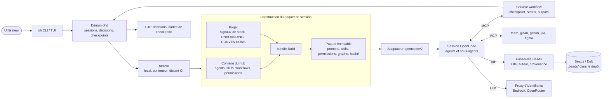

Les cinq couches de garde, de la plus proche de l'agent à la plus globale :

| Couche | Rôle |
|---|---|
| Permissions de l'agent | Base (`developer-rw`, `coordinator`, `readonly-code`, `readonly-ops`) plus règles propres |
| Gardes générées | Garde globale (shell, oh, hooks), git, Beads, infra (`apply`), hooks d'édition propres à chaque agent |
| Verrous de checkpoint | `commit`, `close`, `create`, `apply` (et `push`) refusés jusqu'au passage du checkpoint |
| Passerelle Beads | `beads.allow`, lecture seule réelle, auteur fixé par oh, provenance |
| Démon | Validation vue par oh, disjoncteur, intégrité du paquet |

---

## 2. Les agents

### 2.1 Aujourd'hui : 16 agents en 8 familles

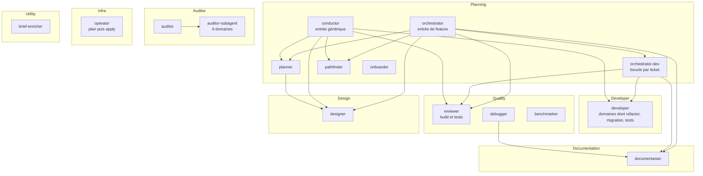

### 2.2 Ce qui a changé pendant la consolidation

| Avant | Après |
|---|---|
| `developer-refactor`, `developer-migrator`, `test-generator` | Domaines `refactor`, `migration`, `tests` du `developer`, plus les skills `test-generation` et `dev-standards-database` |
| `infra` (édition, `rm`, `curl`) | Domaine d'audit `infra`, agent `operator` (aucune écriture), workflow `infra-change` |
| `database` | Domaine d'audit `database` et skill développeur |
| 4 agents sans workflow | 0 |
| Mode deviné à partir d'un tag `[SKILL:]` jamais envoyé | « Rôle dans cette session », généré depuis le graphe du workflow |

---

## 3. Les skills et la composition des prompts

### 3.1 Comment un prompt d'agent est composé aujourd'hui

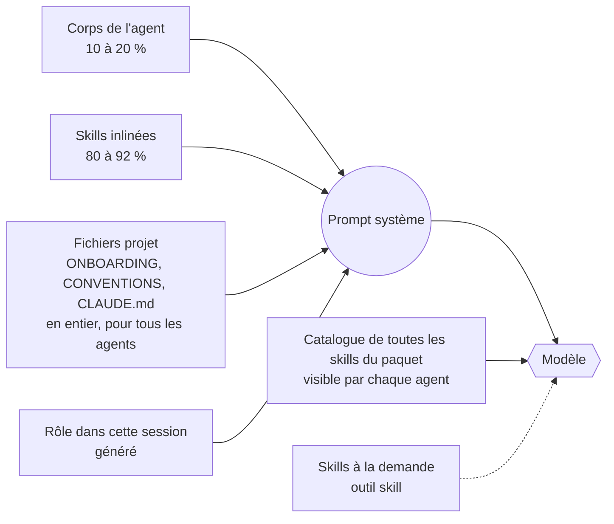

### 3.2 Chiffres actuels (`budget.golden`)

| Workflow | Prompts (tokens) | dont inliné | Catalogue par agent |
|---|---|---|---|
| libre | 107 000 | 89 800 | 91 skills / 5 900 |
| feature | 95 200 | 80 700 | 81 / 5 400 |
| ticket | 50 800 | 42 700 | 47 / 3 100 |
| sweep | 49 200 | 41 800 | 33 / 2 600 |
| review-feedback | 44 300 | 37 600 | 40 / 2 800 |
| cadrage | 36 900 | 31 600 | 37 / 2 400 |
| debug | 26 900 | 21 600 | 31 / 1 800 |
| audit | 23 900 | 21 600 | 24 / 1 300 |

Les skills inlinés les plus lourds sont `auditor-workflow` (8 700 tokens), `review-protocol` (5 300), `orchestrator-dev-protocol` (3 900) et `orchestrator-protocol` (3 200).

### 3.3 Ce que révèle l'analyse exhaustive

- **22 contradictions** entre skills. Les plus graves :
  - `question` est prescrit au developer, qui n'y a pas droit ;
  - `git restore` est promis alors que la garde git le refuse ;
  - la limite de tours de correction se contredit d'une skill à l'autre ;
  - le diff du developer utilise `HEAD~1` ;
  - les titres de retour sont faux pour environ la moitié des appels ;
  - le marqueur `orchestrator_feature` est mort, avec encore 31 occurrences.
- **Registre des règles** : 4 173 lignes normatives, dont 306 déjà imposées par une garde, 346 en double et 178 dépendantes du rôle.
- **Descriptions** : 61 sur 183 dépassent 200 caractères, et 4 seulement sont rédigées comme un déclencheur.

---

## 4. Les workflows : graphe actuel, étapes et liens

### 4.1 Vue d'ensemble des 14 workflows

| Workflow | Risque | Agent d'entrée | Checkpoints (ce qu'ils déverrouillent) | Sorties |
|---|---|---|---|---|
| onboarding | write (wiki) | onboarder | — | wiki |
| cadrage | plan | conductor | cp-scope, **cp-tickets [create]**, cp-recap | tickets |
| feature | write | orchestrator | **cp-tickets [create]**, cp-0, cp-spec, cp-1, **cp-2 [commit, close]**, cp-3, cp-feature | tickets, branche |
| ticket | write | orchestrator-dev | cp-1, **cp-2 [commit, close]**, cp-3 | branche |
| quick | write | developer | **cp-commit [commit, close]** | — |
| debug | write | debugger | **cp-ticket [create]**, **cp-commit [commit, close]** | tickets |
| sweep | write | conductor | cp-plan, **cp-commit [commit]**, cp-recap | branche |
| review | read | reviewer | — | — |
| review-feedback | write | orchestrator-dev | cp-fix, **cp-2 [commit]** | branche |
| audit | read | auditor | — | — |
| infra-change | write | operator | cp-plan, **cp-apply [apply]** | — |
| benchmark | write (rapports) | benchmarker | cp-target, cp-recap | rapport |
| brief-enrich | read (sans interface) | brief-enricher | — | — |
| libre | write | au choix | — | — |

### 4.2 Graphe actuel : étapes de chaque workflow et liens entre workflows

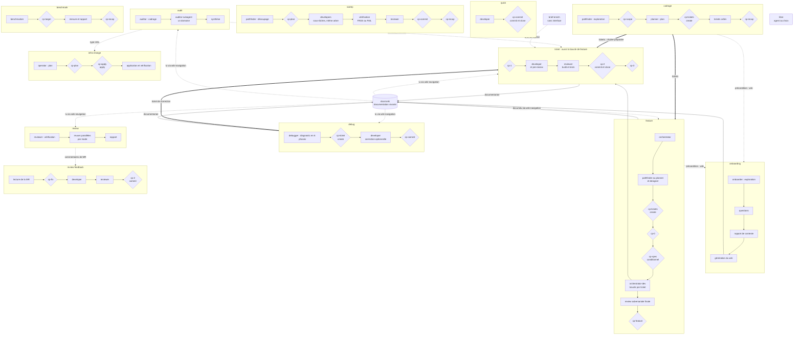

**Légende** : les flèches pleines doubles sont des chaînes proposées par oh, les pointillés des liens faits à la main ou des lectures, et les losanges des checkpoints.

**Ce que montre le graphe :**
- **Aucun workflow n'en enchaîne un autre automatiquement.** La seule exception est la suggestion « Chain with… » après `cadrage`.
- **Les sorties d'`audit` et `review` restent dans la conversation.** Aucun ticket n'est créé, aucune nouvelle analyse n'est relancée.
- **Le wiki n'est enrichi que par `feature`, `ticket` et `debug`.** Il ne l'est pas par `quick`, `sweep`, `review-feedback`, `audit`, `review`, `infra-change` ni `benchmark`.

---

## 5. La documentation vivante : état, angle mort, cible

### 5.1 Réponse franche

**Non, elle n'a pas été traitée comme centrale.** Les analyses l'ont abordée par morceaux, et certaines propositions l'auraient même affaiblie :

| Analyse ou action | Effet sur la documentation vivante |
|---|---|
| C1 (piste D) | Juste, mais `audit` et `review` ne font plus que *proposer* des enrichissements, puisque ces workflows sont en lecture seule |
| Allègement | Propose de réduire `wiki-navigation` (de 1 600 à 350 tokens) et de découper `living-docs-enrichment`. C'est légitime pour la taille, mais sans compensation, la capitalisation devient un sujet de second rang |
| Enrichissement | Glossaire et ADR en continu (`domain-modeling`), `retro`. Utile, mais en parallèle du wiki et pas dedans |
| Instructions projet | `ONBOARDING.md` et `CONVENTIONS.md` sont injectés en entier dans tous les prompts, alors que le concept même du wiki est « lire `index.md`, puis une seule page » (contradiction C-21) |

### 5.2 Fonctionnement actuel

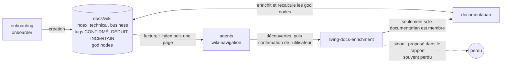

### 5.3 Défauts structurels

| # | Défaut | Conséquence |
|---|---|---|
| LD-1 | La capitalisation dépend de la présence du documentarian dans le workflow | Elle est perdue dans 8 workflows sur 14 |
| LD-2 | Les enrichissements transitent par la retranscription des coordinateurs | Même perte d'information que pour les reviews |
| LD-3 | Aucune détection de dérive entre le code et le wiki | Des pages `CONFIRMÉ` deviennent fausses sans que personne le sache |
| LD-4 | Les god nodes, la fraîcheur et les liens sont gérés à la main par un agent | Rien n'est vérifié par oh |
| LD-5 | Fichiers plats injectés en entier, alors que le wiki est fait pour une lecture ciblée | Coût en tokens, et deux sources de vérité |
| LD-6 | Spec, glossaire, ADR et postmortems sont prévus hors du wiki dans les propositions d'enrichissement | La connaissance est éclatée |
| LD-7 | Le reviewer ne vérifie pas si la documentation est à jour | Un changement d'architecture peut être mergé sans mise à jour du wiki |
| LD-8 | Pas de métriques (couverture, âge, part de `INCERTAIN`) | Impossible de piloter la qualité du wiki |

### 5.4 Cible : la documentation vivante comme colonne vertébrale

Chaque workflow suit une boucle en trois temps : **lire → produire → capitaliser**. oh garantit les deux extrémités ; les agents ne produisent que le contenu.

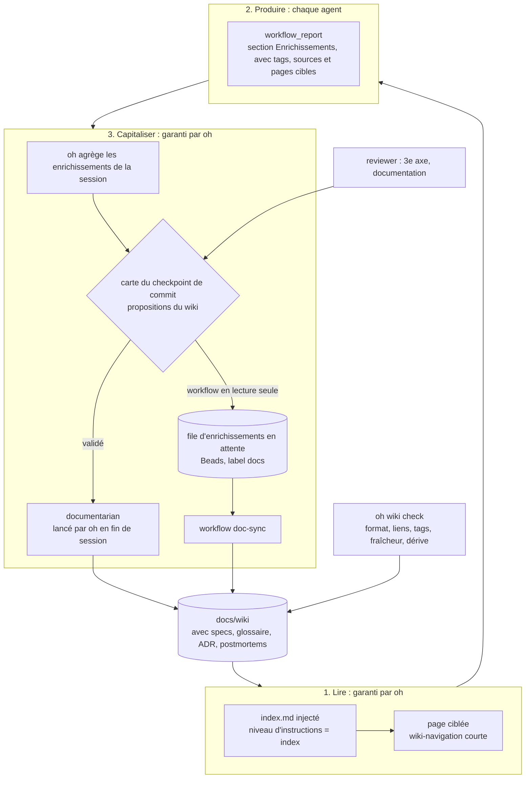

**Les propositions, nommées LD-A à LD-I :**

| Id | Proposition | Mécanisme |
|---|---|---|
| **LD-A** | Section « Enrichissements » dans **chaque** rapport (`workflow_report`), avec page cible, tag et source | oh stocke les enrichissements : rien n'est perdu, quel que soit le workflow |
| **LD-B** | Propositions du wiki **dans la carte du checkpoint de commit** (pas de pause séparée) : l'utilisateur valide, puis oh lance le documentarian | Le documentarian n'a plus besoin d'être membre du workflow |
| **LD-C** | Workflows en lecture seule (audit, review) : les enrichissements partent dans une file (tickets Beads `docs`), consommée par **`doc-sync`** | `risk: read` reste pur |
| **LD-D** | Nouveau workflow **`doc-sync`** : à partir des commits depuis la dernière synchronisation, il trouve les pages concernées, les met à jour et marque `CONFIRMÉ` ce qui est revérifié | Proposé après un merge ou une release |
| **LD-E** | **`oh wiki check`**, déterministe | Frontmatter, liens cassés, tags manquants, pages plus vieilles que les fichiers qu'elles citent, god nodes recalculés **par oh** |
| **LD-F** | **Un seul référentiel** : `docs/wiki/specs/`, `docs/wiki/glossary.md`, `docs/wiki/decisions/` (ADR, décisions rejetées), `docs/wiki/postmortems/` | Les nouveaux workflows (`spec`, `incident`, `spike`) écrivent dans le wiki |
| **LD-G** | Injection en mode **index** : `index.md` et les god nodes pour la plupart des agents, le texte complet seulement pour ceux qui codent | Supprime la double source (C-21) et allège |
| **LD-H** | **Reviewer, troisième axe « documentation »** : le changement touche-t-il un god node ou une page `CONFIRMÉ` ? Si la page n'est pas à jour, finding 🟡 | La dérive est détectée au moment de la review |
| **LD-I** | **Métriques** dans la TUI : couverture des domaines, âge médian des pages, part de `INCERTAIN`, enrichissements en attente | Pilotage |

Enfin, `retro` alimente à la fois le wiki et les skills. Aucun `AGENTS.md` n'est généré : oh n'écrit jamais ce fichier (ADR-043).

### 5.5 Ce qui porte la documentation vivante aujourd'hui

| Élément | Nature | Rôle |
|---|---|---|
| `cli/internal/prompt/onboard.go` | Prompt | Demande à l'onboarder de créer ou d'enrichir `docs/wiki/` |
| `doc-wiki-protocol` | Skill | Format des pages, frontmatter, tags de confiance, god nodes |
| `wiki-navigation` | Skill | Lire `index.md`, puis une seule page |
| `living-docs-enrichment` | Skill | Proposer des enrichissements, puis déléguer au documentarian |
| `onboarder-phase-5` | Skill | Génération initiale du wiki |
| Permissions de l'onboarder | Permission | Écriture limitée à `docs/wiki/`, `ONBOARDING.md`, `CONVENTIONS.md` |
| **Serveur MCP `team`** (`wiki_list`, `wiki_read`, `wiki_write`, `wiki_pending`) | **MCP** | **Wiki d'équipe transverse aux projets** (dépôt team-state), avec propositions en attente et validation humaine. Ce n'est **pas** le `docs/wiki/` du projet |

**Conclusion :** pour le wiki du projet, il n'y a que des instructions. oh ne le lit pas, ne le vérifie pas, et rien ne garantit qu'il soit enrichi.

### 5.6 Cible : un MCP du wiki du projet (LD-J, décidé)

On reprend le modèle déjà éprouvé du wiki d'équipe : l'agent **propose**, un humain **valide**, oh **applique et vérifie**.

| Outil | Rôle | Qui l'utilise |
|---|---|---|
| `wiki_index` | Renvoie l'index et les god nodes, **calculés par oh** | Tous les agents |
| `wiki_read(page, section)` | Lecture ciblée d'une page ou d'une section | Tous les agents |
| `wiki_propose(page, contenu, tag, source)` | Met une proposition en file, avec tag de confiance et source. Fonctionne aussi dans les workflows en lecture seule, puisque l'agent n'écrit aucun fichier | Tous les agents |
| `wiki_pending` | Liste les propositions en attente ; elles s'affichent dans la carte du checkpoint de commit | Coordinateurs, TUI |
| `wiki_apply(ids)` | Applique les propositions validées dans `docs/wiki/` | **documentarian seulement** |
| `wiki_check` | Format, liens, tags, fraîcheur, dérive par rapport au code | oh, `doc-sync`, CI |

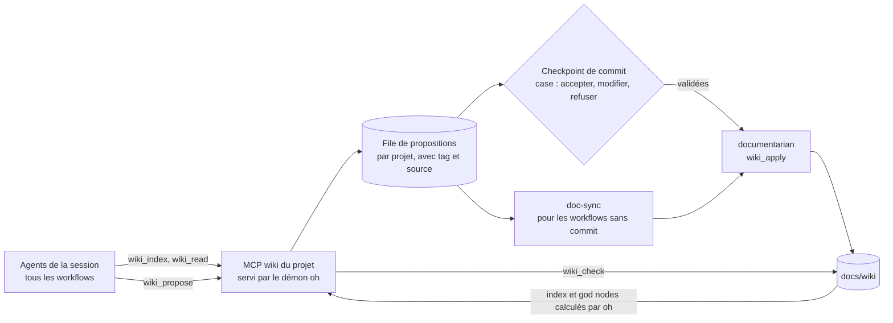

Ce MCP couvre en un seul mécanisme LD-A (rien n'est perdu), LD-B et LD-C (capitalisation dans tous les workflows, y compris en lecture seule), LD-E (vérification par oh) et LD-G (lecture par l'index). Il remplace la délégation directe au documentarian et réduit fortement `living-docs-enrichment`.

**Sécurité :** le contenu proposé est une donnée non fiable, affichée échappée. `wiki_apply` est réservé au documentarian. Les propositions ne peuvent pas citer de fichier de brouillon (section 6.4).

---

## 6. Garde-fous, Beads, évaluation

### 6.1 Garde-fous : forces et trous restants

| Domaine | Aujourd'hui | Restant |
|---|---|---|
| Commit, close, create, apply | Verrous réels, garde de fermeture (commit non vide, arbre propre) | La vérification des tests reste déclarative (E1) |
| Push | Aucun agent ne pousse | `risk: publish` inutilisé |
| Hooks | Corrigé en C4 : la confirmation ne vaut que pour les agents autorisés | — |
| Contenu | Lints de capacités, lecture seule, titres, modèles | Les heuristiques ignorent les lignes « refus » et « jamais » |
| audit-v5 | 34 constats corrigés, 11 partiels, 37 ouverts | S-13, S-31, S-32 (MCP jira et github) avant toute écriture vers une forge |

### 6.2 Beads

**Constat (`bd` 1.3.1).** À chaque commande, bd pose un verrou fichier `<projet>/.beads.gate.lock`, qu'il ne supprime jamais. Dans les projets initialisés avant bd 1.3 (comme ce dépôt), ce verrou n'est couvert par aucune exclusion git : `.beads/` est exclu, mais pas ce fichier frère posé à la racine.

| | Aujourd'hui | Cible |
|---|---|---|
| Emplacement | `.beads/` dans le dépôt (exclu localement) | **A** : `/.beads.gate.lock` exclu partout, avec réparation par `oh doctor`. **B** : base dans `~/.oh/beads/<projet>`, redirigée par `.beads/redirect` (testé : verrou, Dolt et logs restent à l'extérieur) |
| Risque `git clean -fdx` | La base est supprimée | Impossible avec B |
| Worktrees | Une vue par emplacement | Une seule base partagée |
| Fichiers de bd dans le dépôt | Verrous, Dolt, logs | Aucun avec B |

### 6.3 Brouillons de session (décidé)

Le debugger peut écrire des brouillons (scripts de reproduction, notes), sous ces conditions :

| Règle | Mise en œuvre |
|---|---|
| Hors du dépôt et hors de la documentation | `~/.oh/sessions/<session>/scratch/<agent>/`, jamais sous `docs/` ni dans le wiki |
| Illisibles par les autres agents, y compris ceux d'une session parallèle | Garde globale : refus de `*.oh/sessions/*/scratch/*` pour tous les agents, puis autorisation seulement pour le **propriétaire** sur le dossier de **sa** session |
| Lisibles seulement par l'agent chargé de les rendre définitifs | Déclaré dans le workflow : `scratch: { from: debugger, readers: [developer] }`. L'agent désigné lit les brouillons de la session courante, jamais ceux d'une autre session |
| Jamais commités ni exécutés par un autre agent | Hors dépôt ; aucune règle shell n'autorise un autre agent à les lancer |
| Jamais cités dans la documentation | `wiki_propose` refuse tout contenu qui référence un chemin de brouillon |
| Supprimés avec la session | `oh gc` |
| Le test de reproduction devient définitif par le developer | Le debugger le décrit dans le ticket de correction ; le developer (lecteur déclaré) l'écrit dans le code |

### 6.4 Évaluation

| Aujourd'hui | Cible |
|---|---|
| Lints statiques, goldens, budget, 27 tests e2e de plomberie, absents de la CI | **`oh eval`** sur 5 niveaux (déclenchement, protocole vérifié sur la trace, résultat sur tests cachés, grille notée par `grader`, comparaison avec et sans le skill). Passe légère en CI sur chaque PR, passe complète la nuit, registre des règles |

---

## 7. Tableau comparatif complet

Colonnes : ✅ garder · ➕ ajouter · 🔧 améliorer · 🔁 changer · ❌ supprimer.

### 7.1 Agents

| Agent | Aujourd'hui | Action | Cible |
|---|---|---|---|
| conductor | Entrée de `cadrage` et `sweep` | ✅ | Entrée générique, contrat de session |
| orchestrator | Entrée de `feature` | 🔁 puis ❌ | Disparaît quand `feature` devient l'enchaînement `spec` → `implement-spec` |
| orchestrator-dev | Boucle par ticket | 🔧 | Plus de copies des formats des autres agents, enveloppe, limite de tours appliquée |
| planner | Plan et tickets | 🔧 | Entrée de `spec`, interview (grilling), tickets en tranches verticales, `bd graph` affiché au checkpoint |
| pathfinder | Exploration | 🔧 | Moins de texte inliné, recherche (`research`) |
| onboarder | Création du wiki | 🔧 | Glossaire par défaut, points de test identifiés, wiki via le MCP |
| developer | Implémentation | 🔧 | TDD, vérification avant de terminer, enveloppe, sans `question` |
| auditor / auditor-subagent | 9 domaines | 🔧 | Constats structurés en sortie, découpage par phase, vocabulaire `codebase-design` |
| operator | infra-change | ✅ | — |
| reviewer | Review avec build et tests | 🔧 | Trois axes : spec, standards, **documentation** |
| debugger | Diagnostic sans écriture | 🔧 | Boucle « d'abord un test qui échoue », brouillons de session isolés (section 6.4), verdict |
| benchmarker | benchmark | ✅ | — |
| designer | UX/UI | 🔧 | Prototype logique |
| documentarian | Wiki | 🔁 | **Applique les propositions validées** (`wiki_apply`, `doc-sync`), `retro`, `writing-for-agents` |
| brief-enricher | Sans interface | 🔧 | Clé `headless` |
| release-manager | — | ➕ | Workflow `release` |
| merger | — | ➕ | Résolution de conflits dans `implement-spec` |
| grader | — | ➕ | Notation pour `oh eval` |

### 7.2 Skills

| Famille | Aujourd'hui | Action |
|---|---|---|
| Postures (8 fichiers qui se chevauchent) | Inlinées partout | 🔁 Fusion en `core`, `coordinator`, `user-facing`, `subagent`, choisies au build selon le rôle |
| Execution-modes (5) et paires standalone/subagent (3) | Environ 19 000 tokens à la demande | 🔁 Un seul `execution-protocol` avec une section par rôle |
| Formats de handoff (11) et templates (13) | Producteur et consommateur mélangés | 🔁 Une **enveloppe**, un petit payload par agent, et `workflow_report` |
| retranscription-coordinateur | 2 000 tokens × 4 coordinateurs | ❌ après `workflow_report` |
| auditor-workflow, review-protocol, orchestrator-dev-protocol | Énormes, inlinés | 🔧 Découpage par phase, déplacement en annexes |
| wiki-navigation, living-docs-enrichment | Moyens ou lourds | 🔁 Cœur court, et prise en charge par oh (LD-A, LD-B) |
| 22 contradictions | — | 🔧 Lot P1 |
| 183 descriptions | 61 de plus de 200 caractères | 🔁 Rédigées en déclencheurs, 200 caractères au plus, avec lint |
| Skills d'équipe | Livrées partout | 🔁 `mcp: team` |
| Nouvelles | — | ➕ grilling, domain-modeling, spec-writing, tdd, verification-before-completion, diagnosing-bugs, revue sur deux axes, codebase-design, research, prototype-logic, handoff, retro, triage, writing-for-agents, skill-authoring, release-management, pr-description, incident-response, postmortem, resolving-merge-conflicts |
| Stacks (40) | À jour (octobre 2026) | 🔧 Métadonnées de versions, revue de fraîcheur automatique, `dev-standards-java` |
| Skills externes | Registre déconnecté (ADR-051) | 🔁 Aucun skill repris tel quel : nos propres skills, **inspirés** des skills MIT pertinents, en français. `oh brick import` au backlog |

### 7.3 Workflows

| Workflow | Action | Cible |
|---|---|---|
| onboarding | 🔧 | Glossaire, rafraîchissement par `doc-sync`, wiki via le MCP |
| cadrage | 🔁 | Devient **`spec`** (alias `cadrage`) |
| feature | 🔁 | Enchaînement `spec` → `implement-spec` |
| ticket | 🔧 | Mode `tdd`, vérification lancée par oh à `cp-2`, propositions du wiki dans la carte |
| quick | 🔧 | Vérification, propositions du wiki (version légère) |
| debug | 🔧 | Test qui échoue d'abord, verdict, propositions du wiki dans la carte |
| sweep | 🔁 | Variante d'`implement-spec` (`source: tasks`, un worktree par sous-tâche) |
| review | 🔧 | Trois axes, enrichissements mis en file |
| review-feedback | 🔧 | Rapports stockés |
| audit | 🔧 | Sortie `findings`, enchaînement vers `security-fix` |
| infra-change, benchmark, brief-enrich, libre | ✅ | Contrat de session, rapports |
| **spec** | ➕ | Interview, spec, glossaire et ADR, tickets |
| **implement-spec** | ➕ | Tickets prêts lancés en sessions enfants, un worktree chacune, merge par oh |
| **release** | ➕ | `risk: publish`, verrous `tag`, `push`, `mr` |
| **incident** | ➕ | Atténuation, postmortem, actions |
| **security-fix** | ➕ | Constats → tickets → correction → nouvelle analyse |
| **spike** | ➕ | Question → recherche → go / clarify / kill |
| **retro** | ➕ | À partir de la trace de session, améliorations de l'environnement et du wiki |
| **triage** | ➕ | Issues de la forge → tickets prêts pour un agent |
| **doc-sync** | ➕ | **Documentation vivante** : rattrapage après des merges |
| **skill-author** et `oh eval` | ➕ | Écriture et évaluation de skills |

### 7.4 Moteur

| Fonction | Aujourd'hui | Action |
|---|---|---|
| Étapes | Texte des prompts et verrous `after:` | 🔁 Pas de DAG général, mais des primitives bornées |
| Vérification | Déclarée par l'agent | ➕ **E1** : oh lance la vérification au checkpoint · **E2** : preuves recoupées avec les appels observés |
| Parallélisme | Même arbre de travail | ➕ **E3** : sessions enfants dans des worktrees, avec merge |
| Enchaînement | « Chain with… » | ➕ **E4** : `next:`, et sorties utilisées comme entrées |
| Boucles | Consigne `max_fix_rounds` | 🔧 **E5** : limite appliquée par le démon |
| Conditions | Jamais évaluées | ➕ **E6** : `when:` qui ne peut qu'ajouter des contrôles |
| Préconditions | `path_exists` seulement | ➕ **E7** : git propre, branche, Beads, outils installés |
| Écritures en plan | Interdites | ➕ **E8** : `writes:` limité à des chemins de documentation |
| Opérations verrouillables | commit, close, create, apply, push | ➕ **E9** : merge, tag, mr, remember |
| Preuves et trace | — | ➕ **E10** : registre de preuves · **E11** : `oh session trace` |
| Rapports | Blocs retranscrits | ➕ **`workflow_report`** |
| Contrat par agent | Note de rôle | 🔁 Contrat généré, champ `by:` sur les checkpoints |
| Variantes et catalogue | Tout le paquet pour tout le monde | ➕ `when:` et catalogue par agent |
| Instructions projet | En entier pour tous | 🔁 Niveaux `none`, `index`, `full` |
| Documentation | Instructions seulement | ➕ **MCP du wiki du projet** (`wiki_index`, `wiki_read`, `wiki_propose`, `wiki_pending`, `wiki_apply`, `wiki_check`), propositions dans la carte de commit, `doc-sync` |
| Checkpoints | Pauses non budgétées, carte avec le seul résumé de l'agent, fenêtres longues, pas de valideur en équipe | 🔧 Budget de pauses et lint (CP-R2), substitution dans le fan-out (CP-R3), `cp-docs` fusionné (CP-R4), cartes avec preuves (CP-R5), validation par lot (CP-R6), fenêtres bornées (CP-R8), `approver:` (CP-R9) — voir section 9 |

### 7.5 Qualité, écosystème, Beads

| Sujet | Action |
|---|---|
| `oh eval`, CI, registre des règles, revue de fraîcheur | ➕ |
| Tests instables, délai des tests, cache du lint, copie embarquée | 🔧 |
| Validation au format Agent Skills (déjà conforme à la livraison) | ✅ |
| Export portable, publication sur skills.sh, `AGENTS.md` | ❌ retiré (pas de publication, ADR-043) |
| Adaptateur Claude Code | ❌ retiré (pas d'actualité) |
| `AGENTS.md` natif d'OpenCode dans un projet | 🔧 Vérifier qu'il n'entre pas dans les prompts hors du monde fermé, sinon le neutraliser ou le signaler dans `oh doctor` |
| Beads A | 🔧 maintenant |
| Beads B (base hors du dépôt) | Backlog |
| Diagrammes : SVG générés à la main | 🔁 Blocs Mermaid intégrés dans les `.md`, SVG supprimés, test de rendu |
| Code mort (`DetectStack`/`BuildContext`, `HasGitHubActions`/`HasGitLabCI`) | ❌ |

---

## 8. Architecture cible et graphe cible des workflows

### 8.1 Prompt cible d'un agent

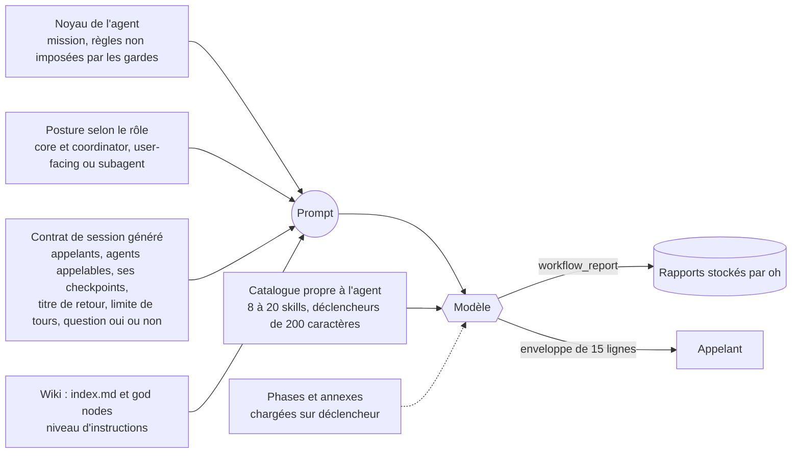

### 8.2 Agents cibles

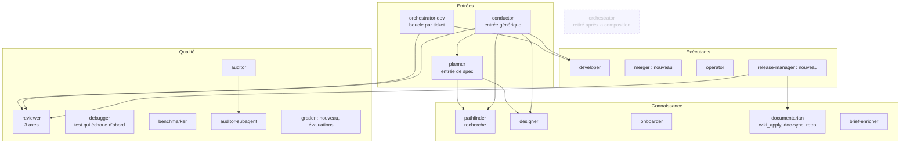

### 8.3 Graphe cible des workflows et de leurs liens

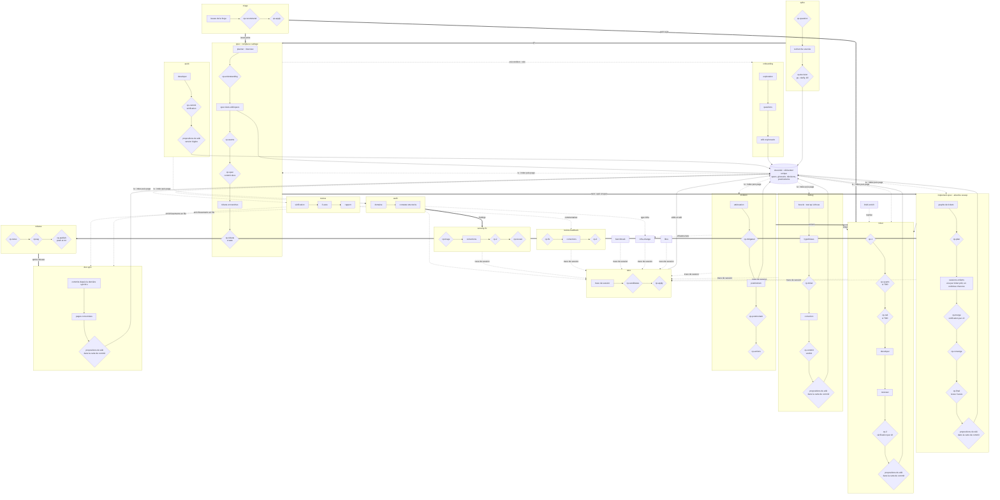

Ce que ce graphe change par rapport à aujourd'hui :
- **Tous les workflows sont reliés** : par enchaînement (`next:`), par une sortie utilisée comme entrée, ou par la trace de session.
- **Le wiki est au centre** :
  - il est lu par tous les workflows ;
  - il est alimenté par tous les workflows via `wiki_propose`, et les propositions sont validées dans la carte du checkpoint de commit ;
  - il est alimenté par les workflows en lecture seule via `doc-sync`.

### 8.4 Cycle de vie d'un sujet, de bout en bout (cible)

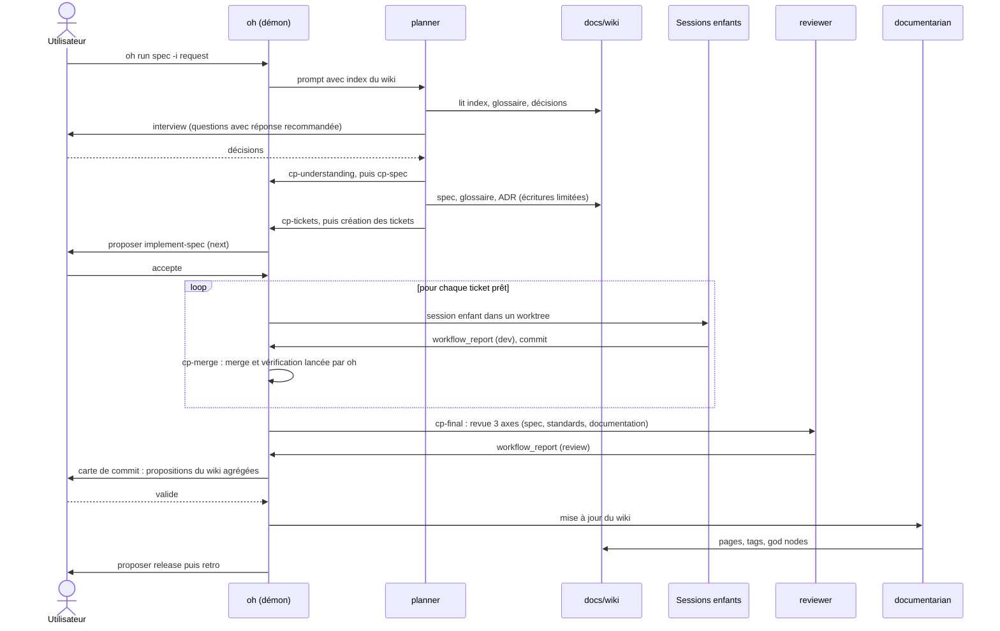

---

## 9. Checkpoints : charge de décision et impacts

Les checkpoints sont ce qui distingue oh des autres frameworks. Chaque pause a pourtant un coût : du temps humain, une session arrêtée en mode distant et, surtout, un risque de **validation machinale**. Un utilisateur qui valide vingt fois par jour finit par ne plus lire, et le checkpoint ne protège plus rien. Le nombre de pauses est donc **un paramètre de sécurité**, pas seulement une question de confort.

### 9.1 Pauses actuelles par workflow et par mode

N = nombre de tickets traités.

| Workflow | Mode par défaut | manuel | semi-auto | auto | Obligatoires |
|---|---|---|---|---|---|
| feature | semi-auto | 3 + 3N (+ cp-spec) | **3 + N** (+ cp-spec) | 2 + N (+ cp-spec) | cp-tickets, cp-0, cp-2 |
| ticket | semi-auto | 3N | **N** | N | cp-2 |
| cadrage | semi-auto | 3 | **2** | 1 | cp-tickets |
| sweep | semi-auto | 3 | **3** | 2 | cp-plan, cp-commit |
| review-feedback | semi-auto | 2 | **2** | 1 | cp-2 |
| quick | manuel | 1 | 1 | 1 | cp-commit |
| debug | manuel | 2 | 2 | 2 | cp-commit (cp-ticket déverrouille `create`, donc traité comme obligatoire) |
| infra-change | manuel | 2 | 2 | 2 | cp-apply |
| benchmark | manuel | 2 | 1 | 1 | cp-target |
| audit, review, onboarding, brief-enrich, libre | — | 0 | 0 | 0 | — |

**Constats :**
- **Le mode « auto » met quand même en pause** sur les checkpoints obligatoires, c'est voulu : un commit demande toujours une décision humaine. Un utilisateur qui s'attend à de l'autonomie complète sera surpris. Ce n'est expliqué ni ici ni dans les guides.
- **`cp-spec` est conditionnel, mais la condition n'est jamais évaluée par oh** : il met donc en pause chaque fois que l'agent le signale.
- **En mode distant**, `cp-2` est en `defer` (la session s'arrête et attend l'utilisateur sur sa machine), `cp-apply` en `forbid`, `cp-1` et `cp-3` en `auto`. Un ticket distant s'arrête donc à chaque commit.
- **La fenêtre `create` reste ouverte** après `cp-tickets` jusqu'à ce que ce checkpoint soit redemandé. Elle couvre donc toute l'implémentation de `feature`.
- **La carte de décision ne montre que le résumé écrit par l'agent.** L'utilisateur décide sur une affirmation, pas sur une preuve.

### 9.2 Ce que les propositions ajoutent si on les applique telles quelles

| Proposition | Pauses ajoutées en semi-auto | Problème |
|---|---|---|
| `spec` (remplace `cadrage`) | 4 (cp-understanding, cp-seams, cp-spec, cp-tickets) au lieu de 2 | +2 pauses |
| `implement-spec` | cp-plan, cp-converge, cp-final, cp-docs, plus **N × cp-2 dans chaque session enfant** | **Angle mort important** : chaque enfant est un `ticket`, avec son `cp-2` obligatoire. Comme une couche ne peut que durcir, le parent ne peut pas l'assouplir. Résultat : N + 4 pauses, et 2N + 4 si `cp-docs` est aussi dans chaque enfant |
| Mode TDD | cp-seams (pause), cp-red (auto) | +1 pause par ticket TDD |
| `cp-docs` partout | +1 pause par workflow d'écriture | Lassitude sur 9 workflows |
| `release` | 3 pauses | Acceptable, l'action est irréversible |
| security-fix, incident, triage, retro, spike | 2 à 4 chacun | — |

### 9.3 Charge de décision : aujourd'hui, propositions brutes, cible

Exemple : une feature de 5 tickets, en semi-auto.

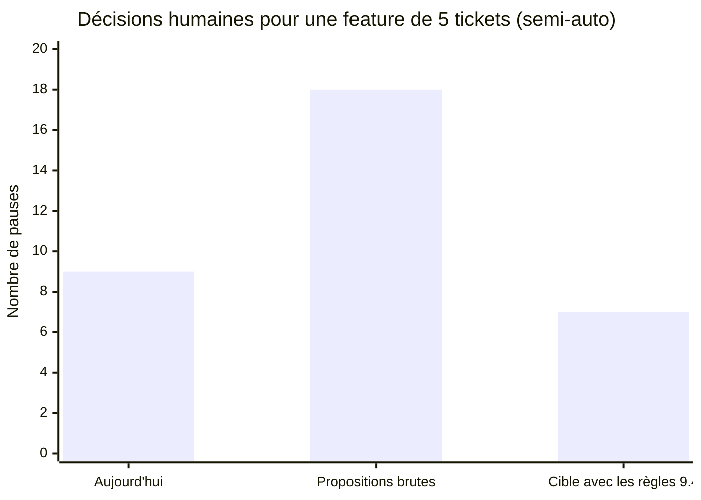

| Scénario | Détail des pauses | Total |
|---|---|---|
| Aujourd'hui (`cadrage`, puis `feature`) | cadrage : cp-scope, cp-tickets · feature : cp-tickets, cp-0, cp-feature, 5 × cp-2 | **~9** (sans cp-spec, et `cadrage` est facultatif) |
| Propositions brutes (`spec`, puis `implement-spec`) | spec : 4 · implement-spec : cp-plan, cp-converge, cp-final, cp-docs · enfants : 5 × cp-2, 5 × cp-docs | **~18** |
| Cible avec les règles 9.4 | spec : cp-understanding, cp-spec, cp-tickets (cp-seams fusionné dans cp-spec) · implement-spec : cp-plan, cp-final avec docs · 1 validation groupée des merges · cp-converge seulement s'il trouve un écart | **~7** |

La cible donne **moins** de décisions qu'aujourd'hui, et chacune est **mieux informée** : rapports stockés, vérification lancée par oh, diff.

### 9.4 Règles de conception proposées

| # | Règle | Effet |
|---|---|---|
| **CP-R1** | Un checkpoint n'existe que s'il protège une **action irréversible** (commit, close, create, apply, push, tag, mr, merge) ou une **décision humaine réelle** (périmètre, compréhension, arbitrage). Tout le reste devient une **étape vérifiée par oh**, sans pause. | Moins de pauses machinales |
| **CP-R2** | **Budget de pauses** par type de workflow en semi-auto : 2 au plus pour un workflow de cadrage, plus 1 par action irréversible. Un lint le vérifie sur les workflows livrés et signale un dépassement dans les workflows d'équipe. | Charge maîtrisée |
| **CP-R3** | **Substitution de contrôle** dans le fan-out : le `cp-2` d'une session enfant passe en automatique **si et seulement si** le parent porte un `cp-merge` obligatoire avec vérification lancée par oh. La substitution est déclarée (`delegates: cp-2`), validée et tracée. Elle ne relâche donc rien. | N pauses → 1 validation groupée |
| **CP-R4** | **`cp-docs` fusionné dans le checkpoint de commit** : la carte affiche « code et enrichissements », avec une case pour accepter ou refuser les enrichissements. Les workflows sans commit gardent la file d'enrichissements et `doc-sync`. | 0 pause supplémentaire |
| **CP-R5** | **Cartes de décision enrichies** : rapports `workflow_report` attachés, résultat de la vérification lancée par oh (E1), diff, preuves recoupées (E2), et un avertissement quand une affirmation de l'agent n'a pas été observée. | Décision sur des preuves |
| **CP-R6** | **Validation par lot** dans la TUI : plusieurs `cp-2` ou `cp-merge` en attente (mode distant, fan-out) se valident en une fois, chaque élément restant consultable et refusable individuellement. | Mode distant utilisable |
| **CP-R7** | **Conditions évaluées par oh** (E6) : un checkpoint conditionnel ne met en pause que si sa condition est vraie (entrée, label, chemins modifiés). | Fin des pauses inutiles sur cp-spec |
| **CP-R8** | **Fenêtres de déverrouillage bornées** : une fenêtre `create` se referme au checkpoint obligatoire suivant ; une fenêtre `commit` se referme au commit. | Moins d'actions possibles hors du moment prévu |
| **CP-R9** | **Mode équipe** : rôle de valideur par checkpoint (`approver:` pour l'humain, à côté de `by:` pour l'agent), par exemple un lead pour `cp-apply` et `cp-publish`. | Responsabilités claires |
| **CP-R10** | **Mode « auto » documenté** : « auto = tout sauf les décisions obligatoires ». La TUI affiche au lancement le nombre de pauses attendues pour le mode choisi. | Pas de surprise |
| **CP-R11** | **Contrat par agent** : chaque agent ne voit que les checkpoints qu'il passe (L3). | Moins de tokens, moins d'appels à un mauvais checkpoint |

### 9.5 Substitution de contrôle dans le fan-out

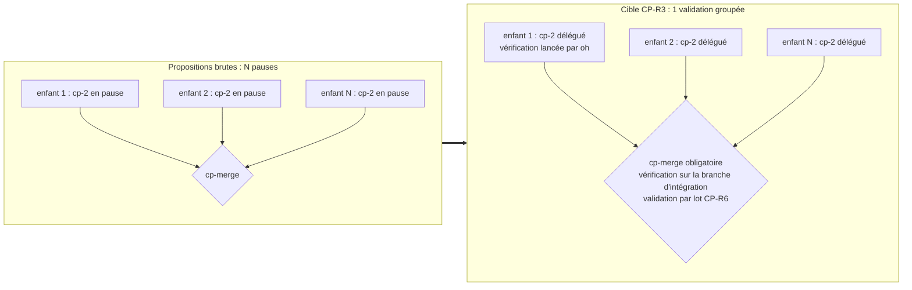

### 9.6 Carte de décision cible

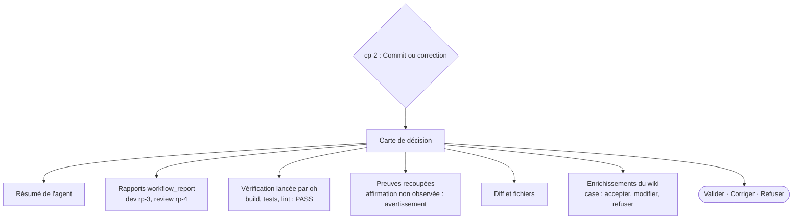

### 9.7 Impacts par dimension

| Dimension | Aujourd'hui | Cible |
|---|---|---|
| Nombre de pauses (feature, 5 tickets, semi-auto) | ~9 | ~7 |
| Qualité de la décision | Résumé écrit par l'agent | Rapports, vérification, preuves, diff |
| Mode distant | Arrêt à chaque `cp-2` | Validation par lot |
| Mode équipe | Valideur non défini | `approver:` par checkpoint |
| Fenêtres de déverrouillage | `create` ouvert jusqu'à la fin | Bornées au checkpoint suivant |
| Conditions | Jamais évaluées | Évaluées par oh |
| Tokens | Table complète dans chaque prompt | Checkpoints de l'agent seulement |
| Lisibilité des modes | « auto » trompeur | Nombre de pauses affiché au lancement |

---

## 10. Feuille de route unifiée

```mermaid
gantt
    title Feuille de route : durées relatives, l'ordre seul compte
    dateFormat X
    axisFormat %s
    section P0 Filets
    Registre des règles, snapshots, trace E11, oh eval de base :p0, 0, 3
    section P1 Assainissement
    22 contradictions, 6 skills à la demande, descriptions :p1, 3, 3
    Beads A (.beads.gate.lock) :b1, 3, 1
    section P2 Mécanismes
    Catalogue par agent L2 :p2a, 6, 2
    when et contrat de session L3 :p2b, 8, 3
    Instructions par niveau L7 et index du wiki :p2c, 11, 1
    section Démarrage tôt, en parallèle
    workflow_report L4 :l4, 3, 6
    Vérification par oh E1, E2, E5 :r3, 6, 4
    section P3 Handoffs
    Enveloppe, protocole unique, fin de la retranscription L5 :p3, 12, 3
    Découpage par phase, par famille L6 :p3b, 15, 3
    section Documentation vivante
    MCP du wiki du projet, propositions dans la carte, doc-sync :ld, 12, 4
    section Checkpoints
    Budget de pauses CP-R2 et lint, conditions évaluées CP-R7 :ck1, 6, 3
    Cartes enrichies CP-R5, fenêtres bornées CP-R8 :ck2, 9, 3
    Substitution CP-R3, validation par lot CP-R6, approver CP-R9 :ck3, 19, 4
    section P4 Enrichissement
    Skills R1, workflow spec R4, TDD R7, fraîcheur R13 :e1, 15, 4
    Composition R5, fan-out R6, release R8 :e2, 19, 5
    security-fix, incident, spike, retro, triage R9 :e3, 24, 4
```

| Phase | Gain ou valeur | Validation |
|---|---|---|
| P0 | Filet de sécurité | Mesure de référence, évaluations de base |
| P1 | Environ −56 000 tokens, sans code | Registre des règles, goldens |
| P2 | Catalogues −92 %, −38 000 tokens de prompts | Goldens des contrats, évaluations S2, S3, S5 |
| L4 et R3 | Fin des pertes d'information, vérification réelle | e2e, S1, S2, S8 |
| P3 | −60 000 à −117 000 tokens | Registre, évaluations sur Haiku ×3 et Sonnet |
| Documentation vivante | 14 workflows sur 14 qui capitalisent | `oh wiki check`, métriques |
| Checkpoints | Environ 7 décisions mieux informées au lieu de 9 (ou 18 sans les règles) | Lint de budget de pauses, goldens des cartes, évaluations S2 et S8 |
| P4 | Nouvelles capacités | Évaluations avec et sans le skill, budget |

### Backlog (hors du plan actuel)

| Sujet | Raison |
|---|---|
| Beads B : base hors du dépôt | Décision : backlog |
| `oh brick import` (ADR-053) | Aucun skill repris tel quel |
| Publication des skills, `npx skills`, skills.sh | Pas de publication prévue |
| Adaptateur Claude Code | Pas d'actualité |
| `AGENTS.md` généré | Retiré (ADR-043) |
| Valideur humain par checkpoint en équipe (`approver:`) | Après P4 |

### Pistes en parallèle

Chaque piste a ses propres fichiers.

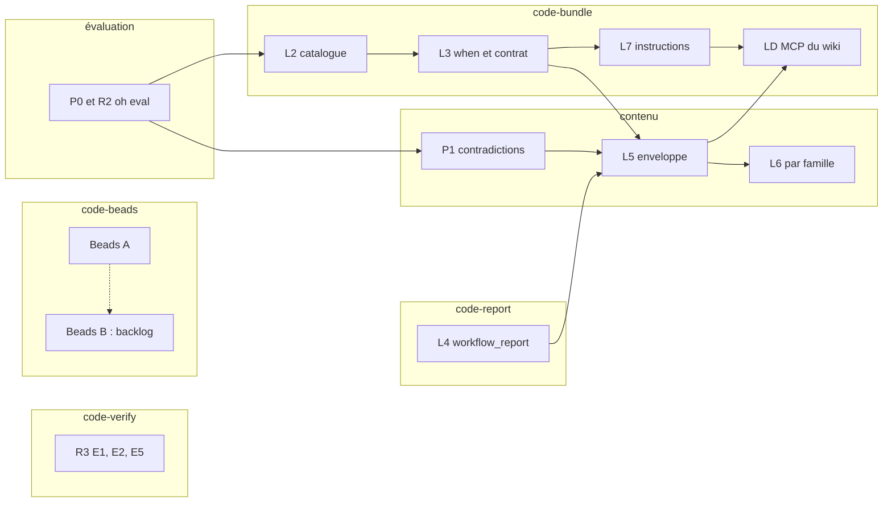

---

## 11. Risques

| Risque | Parade |
|---|---|
| L'allègement fait perdre des règles | Registre des règles, évaluations, Sonnet avant les merges sensibles |
| L'enrichissement fait regrossir le contexte | Tout à la demande, garder un skill seulement si l'évaluation montre un gain, budget à ±2 % |
| La documentation vivante devient du bruit | Tags de confiance, validation dans la carte de commit, `wiki_check`, métriques |
| Le fan-out (E3), plus gros changement depuis la v5 | Derrière un drapeau expérimental, séquentiel d'abord |
| Écritures vers les forges (triage, release) | Correctifs S-13, S-31, S-32 d'abord |
| Brouillons lus par un agent d'une autre session | Dossier par session, refus global, lecture seulement par le propriétaire et le lecteur déclaré (section 6.4) |
| Conflits entre pistes parallèles | Fichiers attribués à une seule piste, goldens régénérés, docs générées |
| Lassitude de validation : l'utilisateur valide sans lire | Budget de pauses (CP-R2), checkpoints réservés aux actions irréversibles (CP-R1), cartes avec preuves (CP-R5) |
| Substitution de contrôle mal bornée dans le fan-out | Déclarée (`delegates:`), validée, seulement si le parent porte un `cp-merge` obligatoire avec vérification par oh |

---

## 12. Décisions arrêtées (12 octobre 2026)

Toutes les questions sont tranchées. Les points non cités dans la réponse ont été validés selon ma recommandation.

### A. Stratégie et ordre

| # | Décision |
|---|---|
| 1 | Ordre **P0 → P1 → P2 → P3 → P4**, avec `workflow_report` et la vérification lancée par oh démarrés tôt en parallèle |
| 2 | Allègement avant enrichissement : les nouveaux skills arrivent après P2 |
| 3 | Documentation vivante comme piste centrale |

### B. Documentation vivante

| # | Décision |
|---|---|
| 4 | Référentiel unique dans `docs/wiki/` : specs, glossaire, décisions, postmortems |
| 5 | Propositions du wiki affichées dans la carte du checkpoint de commit (pas de pause `cp-docs` séparée) ; `quick` en version légère |
| 6 | Workflows en lecture seule : propositions mises en file, traitées par `doc-sync` |
| 7 | `wiki_check` déterministe, god nodes calculés par oh |
| 8 | Troisième axe « documentation » du reviewer |
| 9 | Fichiers projet injectés en mode index, texte complet pour les agents qui codent |
| **LD-J** | **MCP du wiki du projet**, sur le modèle du wiki d'équipe (section 5.6) |

### C. Agents, rôles, handoffs

| # | Décision |
|---|---|
| 10 | `question` interdit aux sous-agents : passage par l'enveloppe et ses questions bloquantes |
| 11 | `workflow_report` par MCP : l'agent dépose son rapport complet, oh le stocke, les coordinateurs ne transmettent qu'un identifiant |
| 12 | `orchestrator` retiré une fois la composition en place |
| 13 | Nouveaux agents `release-manager`, `merger`, `grader` |
| 14 | Brouillons du debugger : hors dépôt et hors documentation, illisibles par les autres agents (y compris en parallèle), lisibles seulement par l'agent qui les rend définitifs (section 6.4) |

### D. Workflows et moteur

| # | Décision |
|---|---|
| 15 | `cadrage` renommé `spec`, avec un alias |
| 16 | Écritures limitées à des chemins de documentation en `risk: plan` (`writes:`) |
| 17 | oh lance la vérification au checkpoint ; passer outre en cas d'échec reste possible et c'est tracé |
| 18 | Fan-out en sessions enfants mergées par oh, séquentiel d'abord, parallélisme 3, budget global, derrière un drapeau expérimental |
| 19 | `risk: publish` activé après R3, avec `remote: forbid` |
| 20 | `infra-change` limité au mode `manuel` |
| 21 | Nouveaux workflows : spec, implement-spec, release, incident, security-fix, spike, retro, triage, doc-sync, skill-author |

### E. Skills

| # | Décision |
|---|---|
| 22 | **Tout en français** (pas de publication) |
| 23 | **Aucun skill repris tel quel** : on crée nos propres skills en s'inspirant des skills MIT pertinents ; `oh brick import` au backlog |
| 24 | Ajout de `dev-standards-java` |
| 25 | Les 183 descriptions réécrites en « Utiliser quand… », 200 caractères au plus, avec une règle dans `oh skill check` |
| 26 | Clés inconnues signalées aussi dans les skills d'équipe |

### F. Qualité et évaluation

| # | Décision |
|---|---|
| 27 | Évaluations avec un vrai modèle : Haiku à chaque lot et sur les PR qui touchent le contenu, Sonnet avant les merges de L3, L5 et L6 ; plafond de budget par passage |
| 28 | `TestRuleLedger` bloquant dès P0 |
| 29 | Hygiène des tests : `-timeout 40m`, tests instables stabilisés, `make sync-content`, cache de lint par worktree |
| 30 | Diagrammes en blocs Mermaid dans les `.md`, SVG supprimés, test de rendu |

### G. Beads et écosystème

| # | Décision |
|---|---|
| 31 | Beads A maintenant ; **Beads B au backlog** |
| 32 | Suppression du code mort `DetectStack`/`BuildContext` |
| 33 | ~~Publication portable des skills~~ : **retiré** |
| 34 | ~~Adaptateur Claude Code~~ : **retiré** |
| 35 | ~~`AGENTS.md` généré~~ : **retiré** (ADR-043). À la place : vérifier que l'`AGENTS.md` natif d'OpenCode n'entre pas dans les prompts hors du monde fermé |

### H. Checkpoints

| # | Décision |
|---|---|
| 36 | CP-R1 : un checkpoint ne protège qu'une action irréversible ou une vraie décision humaine |
| 37 | CP-R2 : budget de pauses, lint bloquant pour les workflows livrés, avertissement pour ceux d'équipe |
| 38 | CP-R3 : substitution de contrôle dans le fan-out, **avec garde-fous contre le contournement** : déclarée uniquement par la couche hub, refusée sans `cp-merge` obligatoire avec vérification par oh, l'enfant ne peut ni pousser ni merger ni fermer, oh merge lui-même, vérification sur la branche d'intégration, traçabilité, drapeau expérimental, tests dédiés |
| 39 | CP-R4 : propositions du wiki fusionnées dans le checkpoint de commit |
| 40 | CP-R5 : cartes de décision avec rapports, vérification, preuves, diff, propositions du wiki |
| 41 | CP-R6 : validation par lot |
| 42 | CP-R8 : fenêtres de déverrouillage bornées |
| 43 | CP-R9 : `approver:` en équipe, après P4 |
| 44 | **Les trois modes restent** (manuel, semi-auto, auto). Le mode auto met en pause uniquement sur les décisions obligatoires ; on le documente et la TUI affiche au lancement le nombre de pauses attendues |

### I. Tout de suite

| # | Décision |
|---|---|
| 45 | Ce dépôt : `/.beads.gate.lock` dans `.git/info/exclude` (local) |
| 46 | Plan détaillé écrit dans `~/.opencode/plan/oh-modernisation-plan.md`, développement à partir de demain |
