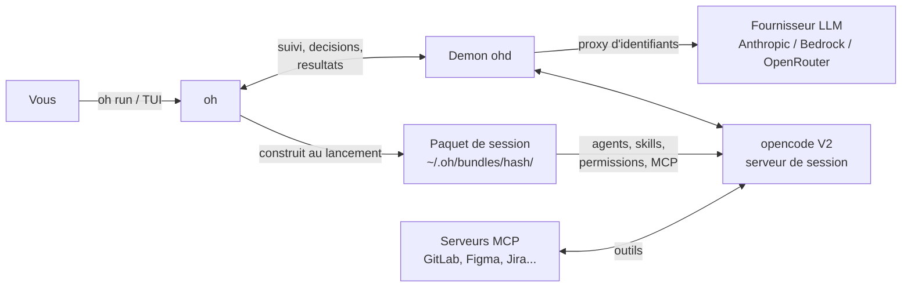

> [Read in English](getting-started.en.md)

# Démarrage rapide

## Qu'est-ce qu'OpenHub ?

OpenHub (`oh`) lance et pilote des sessions d'agents IA de code sur vos projets. Chaque session suit un **workflow** (par exemple `ticket` : implémenter un ticket, `review` : relire une branche) et tourne dans opencode V2. oh est la **tour de contrôle** : il prépare la session, la suit, vous présente les décisions à prendre et récupère les résultats. opencode est la **cabine** : la fenêtre où l'agent travaille. Fermer opencode n'arrête pas la session.



**Concepts clés** (voir le [Glossaire](../reference/glossary.fr.md) complet) :
- **Workflow** -- ce que fait une session : agent d'entrée, agents autorisés, entrées, checkpoints, modes (`manuel`, `semi-auto`, `auto`). 24 workflows sont livrés (voir [Workflows livrés](../reference/workflows.fr.md)).
- **Session** -- une exécution d'un workflow sur un projet. Elle tourne sur un serveur `opencode serve` géré par oh.
- **Paquet de session** -- agents, skills, permissions et MCP d'une session, construits au lancement hors du projet (`~/.oh/bundles/<hash>/`). Rien n'est copié dans le projet. Seuls les agents du paquet sont visibles (« monde fermé »).
- **Décision** -- ce que la session attend de vous : `⏸` checkpoint, `?` question, `!` permission, `$` budget, `✗` erreur.
- **Démon `ohd`** -- tourne en arrière-plan : il garde vos clés LLM sur la machine, suit les sessions et envoie les notifications.

> **Nouveau ici ?** Le [tutoriel](tutorial.fr.md) va de l'installation à un ticket implémenté puis relu.

Vous venez d'une version précédente d'oh ? Lisez d'abord [Migrer vers oh v5](migration-v5.fr.md).

---

## Prérequis

| Outil | Usage | Requis |
|-------|-------|--------|
| **git** | Contrôle de version, worktrees | Oui |
| **opencode V2** (2.0.0 ou plus) | Exécute les sessions | Oui — à installer avec son propre outil ; oh ne l'installe pas |
| **bd** | Tickets Beads (workflow `ticket`, board) | Non |
| **Colima, Podman ou Docker** | Sessions en conteneur | Non |

Le binaire `oh` est autonome (pas de Node.js, Python ni base externe).

## Installation

**Plateformes supportées :** macOS et Linux (amd64 et arm64). Sous Windows, seules les sessions locales sont prises en charge.

### 1. Installer oh

**Homebrew (recommandé) :**

```bash
brew install datichb/tap/openhub
```

**Script curl :**

```bash
curl -fsSL https://raw.githubusercontent.com/datichb/openhub/main/install.sh | bash
```

**Depuis les sources :**

```bash
cd cli && go install .
```

### 2. Installer opencode V2

```bash
brew install anomalyco/tap/opencode    # ou voir https://opencode.ai
opencode --version                     # doit afficher 2.x
```

opencode V1 n'est plus pris en charge : oh refuse de lancer une session avec un message clair. Voir [Migrer vers oh v5](migration-v5.fr.md).

## Configuration initiale : `oh init`

```bash
oh init
```

L'assistant s'ouvre dans le terminal. Le parcours solo tient en **trois écrans** :

1. **Accueil** -- la langue de l'interface (français ou anglais) et le **type d'installation**, sur la même page. La description du type sélectionné reste visible, même sur un petit terminal.
2. **Fournisseur IA** -- Bedrock, Anthropic, OpenRouter ou GitHub Copilot, puis la clé (rangée dans le trousseau système). oh préselectionne le fournisseur détecté (variables d'environnement, identifiants AWS, `gh`). « Ignorer » passe l'écran.
3. **Premier projet** (facultatif) -- nom et chemin, préremplis avec le dossier courant (le nom du dépôt git s'il y a un remote, sinon le nom du dossier). « Ignorer » passe l'écran.

| Type d'installation | Écrans | Ce qui change |
|---------------------|--------|---------------|
| **Développeur solo** (par défaut) | accueil, fournisseur, projet | les fonctions d'équipe sont ignorées et un espace de workflows **solo** est créé pour le projet |
| **Membre d'équipe** | accueil, équipe, projet | le fournisseur IA vient de la configuration de l'équipe |
| **Configuration complète** | accueil, fournisseur, équipe, projet | tout, dans l'ordre (par défaut si une équipe est déjà configurée) |

L'écran **Équipe** n'existe que pour les types « équipe » et « complète » : « Créer une nouvelle équipe », « Rejoindre une équipe existante » (dépôt team-state) ou « Espace solo (workflows locaux) ». Si l'équipe a un tracker, l'assistant propose de le configurer, et le projet peut être rattaché à l'équipe.

Les intégrations MCP (GitLab, Figma, Jira, Google Slides…) ne font plus partie de l'assistant : le récapitulatif final suggère `oh mcp setup`.

Le contenu du hub (agents, skills, workflows) est extrait dans `~/.oh/hub/`. À la fin, vérifiez l'installation :

```bash
oh doctor
```

`oh doctor` contrôle opencode V2, le démon, git, le terminal, le moteur de conteneurs et les restes d'anciens déploiements.

Pour Beads : initialisez les tickets du projet avec oh (`oh project add`, ou la commande `board init` de la TUI), qui lance `bd init --skip-hooks --skip-agents --setup-exclude` : rien n'est ajouté au dépôt du projet (« zéro impact »).

> **`bd init` lancé à la main** (bd 1.3) écrit aussi des fichiers d'agents (`AGENTS.md`, `CLAUDE.md`, les dossiers `.claude/`, `.codex/`, `.cursor/`, `.agents/`), un bloc dans `.gitignore`, des hooks git, et **commite le tout** (« bd init: initialize beads issue tracking »). Quand oh enregistre le projet (`oh project add`, assistant d'init, TUI) ou y initialise Beads, il **affiche ce qu'il propose de retirer et demande confirmation** (fenêtre de confirmation dans la TUI ; sans terminal, rien n'est changé : `oh doctor --fix`). Il retire seulement ce que bd a écrit (blocs gérés par bd dans vos fichiers, ses entrées de hooks, ses propres fichiers) et déplace les lignes du `.gitignore` dans `.git/info/exclude`. **Le commit de bd n'est annulé qu'une fois listé et confirmé dans un terminal** (CLI ou fenêtre de la TUI, `oh doctor --fix` compris) **ou avec `--yes`** (`oh project add --yes`, `oh doctor --fix --yes`) ; sans terminal ni `--yes`, et en mode `auto`, il est gardé. Il est annulé après un `git fetch` des dépôts distants, s'il n'est pas poussé et s'il n'est pas le premier commit du dépôt ; un distant injoignable garde le commit. Un fichier de réglages non suivi par git (`.claude/settings.json`…) peut être le votre : en mode `auto`, il est laissé en place. Un `.beads/` **suivi par git** (tickets partagés par le dépôt) est respecté : ni exclusion, ni déplacement des lignes du `.gitignore`. Ce qui est déjà commité ou poussé est laissé en place et signalé par `oh doctor` ; `oh doctor --fix` le retire des fichiers après confirmation (à commiter ensuite). Réglage `[beads] zero_impact` : `ask` (défaut), `auto` (sans question), `off` (rien) — `oh config set beads.zero_impact auto`. Les hooks de `.beads/hooks` restent : oh les fait passer par sa passerelle. Les sessions d'oh n'ont besoin d'aucun de ces fichiers : les consignes Beads sont dans le paquet de session.

## Enregistrer d'autres projets

```bash
oh project add                                   # assistant
oh project add --name my-app --path ~/workspace/my-app --language typescript
```

## Premier lancement

### En ligne de commande

Depuis le dossier du projet :

```bash
oh run quick -m "Ajoute un test pour parseDate"                    # petite modification, sans checkpoint
oh run feature -m "…"                                              # une fonctionnalite complete : spec et tickets, puis implementation proposee
oh run                                                     # workflow par defaut du projet
oh run feature -m "…" --recap                                      # afficher le recapitulatif, puis confirmer
```

oh résout le workflow (couches hub, équipe, projet), construit le paquet de session, choisit l'emplacement (un worktree automatique si une autre session écrit déjà dans le dossier), démarre le serveur opencode et ouvre la fenêtre de session : nouvel onglet iTerm2 ou Terminal.app, tmux, ou navigateur selon vos Réglages.

```
▸ Préparation du workflow quick…
✔ Session ouverte (iterm) : ses_2f9c1a7b
```

### Depuis la TUI

```bash
oh
```

Sur l'accueil, la section **Démarrer** liste vos workflows épinglés (★), les récents et « Tous les workflows ». `Entree` ouvre la **fiche de lancement** : Entrées → Options → Récap ; `Ctrl+S` va au récap, un second `Ctrl+S` lance. Voir [Utiliser le TUI](tui-usage.fr.md).

## Paquet de session

Plus rien n'est déployé dans le projet (`oh deploy` / `oh sync` supprimés en v5). Pour voir ce qu'une session recevra :

```bash
oh bundle show <workflow>                  # projet detecte depuis le dossier courant
oh bundle show <workflow> -p my-project    # projet explicite
oh bundle show <workflow> --budget         # budget de contexte estime
oh bundle build <workflow>                 # construire le paquet sans lancer
```

Projets déployés avec une version précédente : retirez les restes (`.opencode/agents`, `.opencode/skills`, clés d'oh dans `opencode.json`…) avec `oh migrate deploy-cleanup --dry-run` puis `oh migrate deploy-cleanup`, ou l'écran de nettoyage de la TUI (`cleanup`).

## Suivre la session

La fenêtre opencode s'ouvre à côté : vous y discutez avec l'agent comme d'habitude. Pendant ce temps, oh suit la session :

- **TUI, vue Sessions** (`sessions` dans l'omnibar) : sessions À traiter, En cours, En veille, Terminées. `t` affiche le flux en direct (agent courant, outils, coût). La barre du bas affiche partout `● N ◐ M` : sessions vivantes, décisions en attente.
- **CLI** :

```bash
oh session list                  # sessions en cours, en attente, en veille
oh session follow <id>           # flux en direct, lecture seule (Ctrl+C)
oh session attach <id>           # rouvrir la fenetre opencode (reprend une session en veille)
```

Un identifiant peut être abrege (`oh session attach 2f9c`). Une session sans activité ni décision en attente se met en veille après 5 minutes ; `oh session attach` la reprend sur le même paquet. Voir [Sessions v5](sessions-v5.fr.md).

## Décider

Quand l'agent a besoin de vous, une décision apparaît : notification système, ligne dans « À traiter », badge `⏸`.

| Décision | Exemple | TUI (vue Sessions) | CLI |
|----------|---------|--------------------|-----|
| `⏸` checkpoint | `cp-2 « Commit ou correction »` | `Entree` → fiche → **Décider** : Valider / Corriger d'abord / Autre consigne ; `y` valide | `oh session approve <id>` (`--decision once\|fix\|other\|reject`, `-m "…"`) |
| `?` question | « Périmètre MVP ? » | `Entree` → formulaire | `oh session answer <id> --field cle=valeur` |
| `!` permission | `shell npm run e2e` | `y` une fois, `n` refuser, `Entree` pour la fiche | `oh session approve <id> --decision once\|always\|reject` |
| `$` budget, `✗` erreur, `⊘` coupe-circuit | budget de session atteint | `x` classer | `oh session dismiss <id>` |

```bash
oh session inbox                 # toutes les decisions en attente
```

Vous pouvez aussi répondre dans la fenêtre opencode ou le navigateur : **la première réponse gagne**, oh le signale si la décision est déjà prise.

## Finir

```bash
oh session results <id>          # fichiers modifies, branche, cout
oh session results <id> --mr     # description de merge request (Markdown)
oh session results <id> --patch  # diff complet
oh session stop <id>             # arreter la session
```

Dans la vue Sessions, `o` affiche les résultats et la description de MR, et `e` (**Enchaîner avec…**) propose les workflows qui reprennent les sorties de la session (par exemple `review` sur la branche de travail) ; la fiche de lancement s'ouvre préremplie.

En quittant la TUI pendant qu'une session travaille, oh demande pour chacune : finir l'étape puis veille, arrière-plan, ou arrêter.

## Aller plus loin

### Plusieurs tickets

```bash
oh run ticket --tickets bd-41,bd-42,bd-43    # une session par ticket, un worktree par session, un seul serveur
oh run ticket --tickets bd-41,bd-42 --one-session
```

### Conteneur

```bash
oh run ticket --tickets bd-42 --runtime container
```

Les commandes de l'agent tournent dans une image construite depuis le Dockerfile de dev du projet ; Beads et les clés restent sur la machine. Voir [Sessions en conteneur](container.fr.md).

### Distant (GitLab CI)

```bash
oh remote setup
oh run ticket --tickets bd-42 --runtime remote
oh session fetch <id>      # recuperer le resultat
oh session resolve <id>    # rejouer le journal Beads
```

Voir [Exécution distante](remote-runners.fr.md).

### Workflows d'équipe

Les workflows de l'équipe (ou de votre espace solo) vivent dans le dépôt team-state : `oh workflow new|edit|publish`, ou le catalogue `workflows` de la TUI. Voir [Workflows d'équipe](team-workflows.fr.md) et la [référence des commandes](../reference/cli-workflows.fr.md).

### Restrictions

Désactivées par défaut : sessions actives max, budget par session et journalier, plafond mémoire, modèles autorisés.

```bash
oh budget show
oh budget set session_budget_usd 5
```

Ou **Réglages → Restrictions des sessions** dans la TUI. Voir [Sessions v5 › Restrictions](sessions-v5.fr.md#restrictions).

## Commandes quotidiennes

```bash
oh                           # TUI (tour de controle)
oh run <workflow>            # lancer une session
oh session list              # suivre ses sessions
oh session inbox             # decisions en attente
oh bundle show <workflow>    # inspecter le paquet d'un workflow
oh workflow list             # workflows disponibles pour le projet
oh status                    # etat du hub et du projet courant
oh doctor                    # diagnostic
```

```bash
oh run ticket                # choisir un ticket Beads
oh run audit -i type=security
oh run review -i branch=feat/export
oh run debug -i issue="crash au login"
oh run onboarding            # creer le wiki du projet
oh run libre --agent orchestrator
```

Les anciennes commandes `oh start`, `oh audit`, `oh review` et `oh debug` sont des alias dépréciés de `oh run feature|audit|review|debug`. `feature` est lui-meme un alias : `spec` (sans tickets), puis `implement-spec`, proposé à la fin.

```bash
oh provider setup            # identifiants du fournisseur
oh mcp setup                 # jetons des serveurs MCP
oh config language fr        # langue
oh worktree list             # worktrees actifs
oh team status               # etat de l'equipe
oh daemon status             # etat du demon
```

## Mise à jour

```bash
brew upgrade openhub          # Homebrew
oh upgrade oh                 # hors Homebrew
```

opencode se met à jour avec son propre outil (`oh upgrade opencode` est supprimé en v5).

## Désinstallation

```bash
oh daemon stop
brew uninstall openhub
rm -rf ~/.oh                 # configuration, base et paquets de session
```

## Dépannage

```bash
oh doctor
```

- **opencode introuvable ou en V1** -- installer opencode V2 (voir [Migrer vers oh v5](migration-v5.fr.md)), puis `oh doctor`.
- **Identifiants du fournisseur manquants** -- `oh provider setup`.
- **Erreurs MCP** -- vérifier les jetons avec `oh mcp setup`.
- **Projet non détecté** -- lancer depuis un projet enregistré (`oh project list`) ou ajouter `-p <projet>`.
- **La session ne démarre pas (isolation)** -- un agent hors paquet est visible : `oh doctor`, puis `oh migrate deploy-cleanup` si des restes d'anciens déploiements sont signalés.
- **État corrompu** -- `oh repair`.

Voir aussi [Dépannage](troubleshooting.fr.md).
