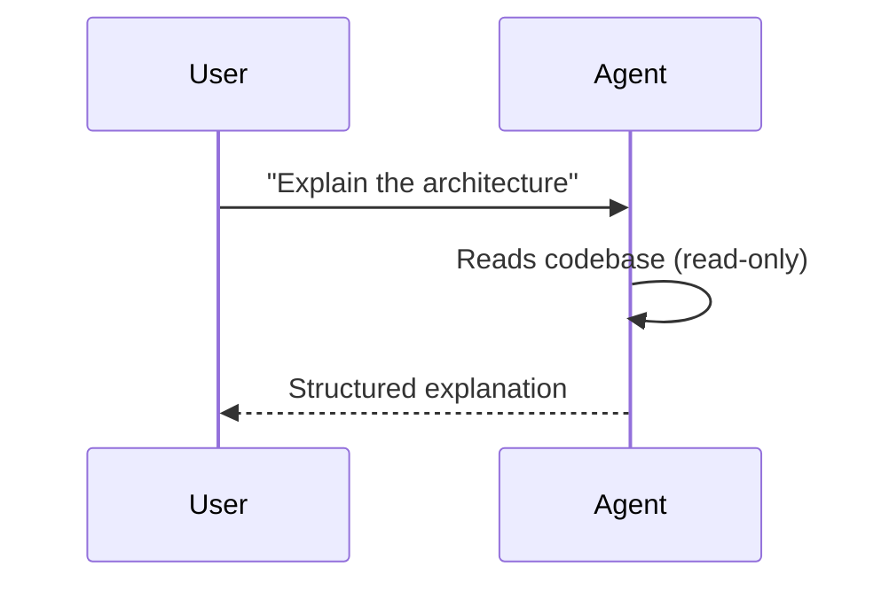
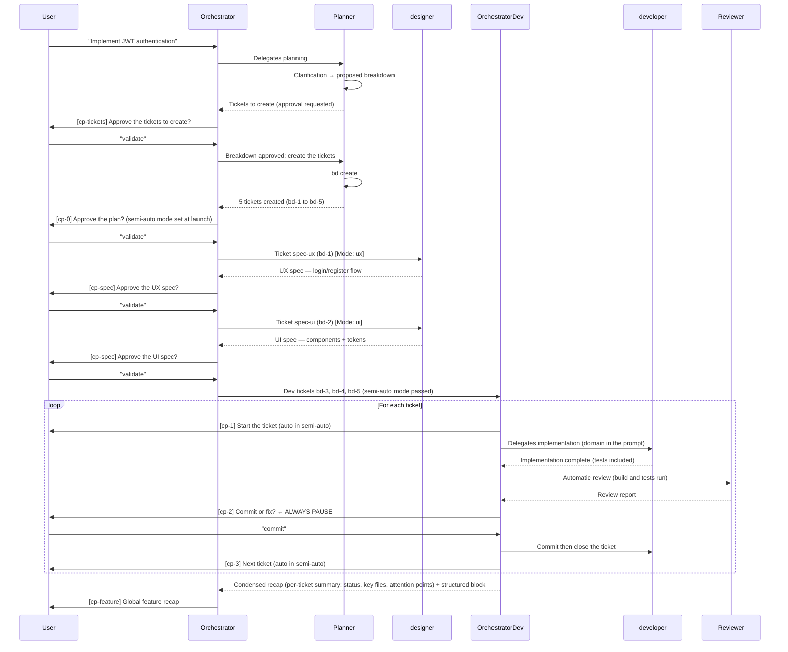
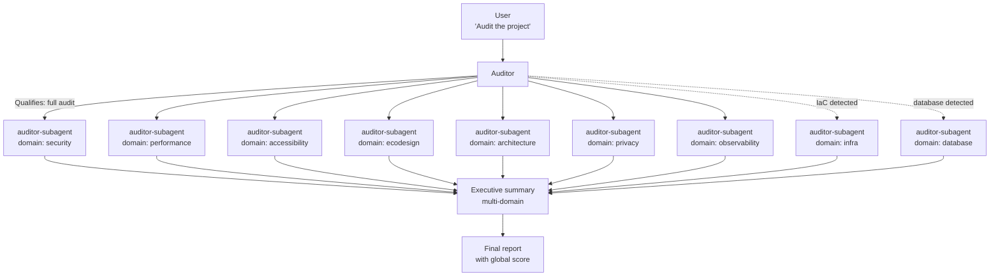
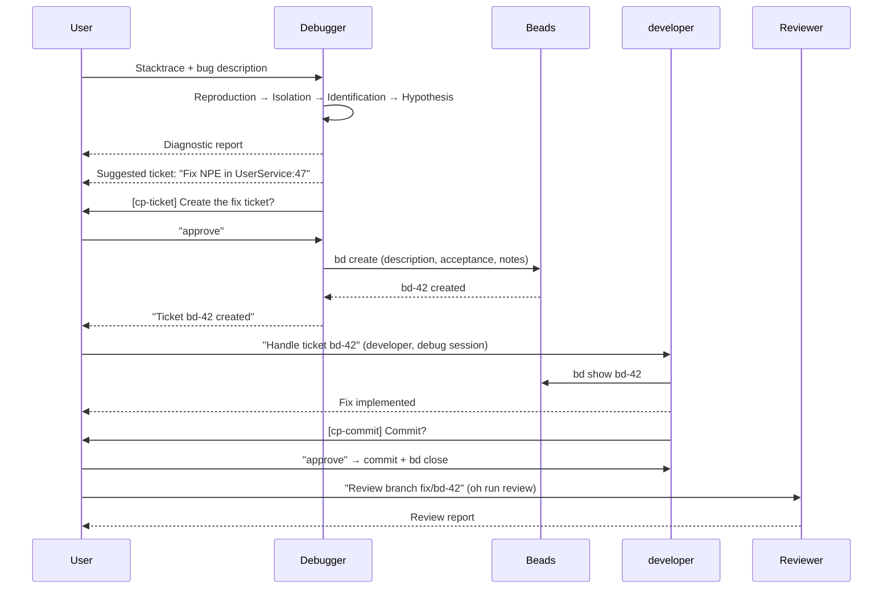
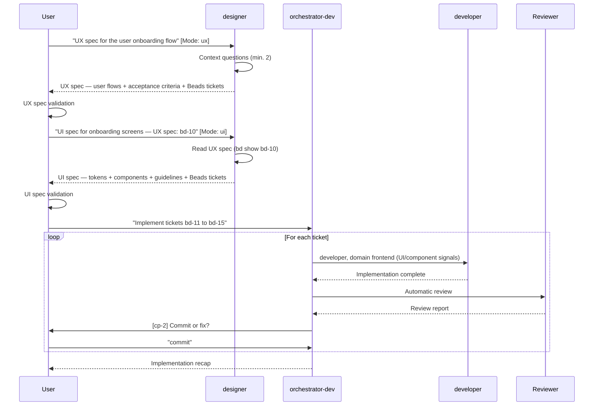
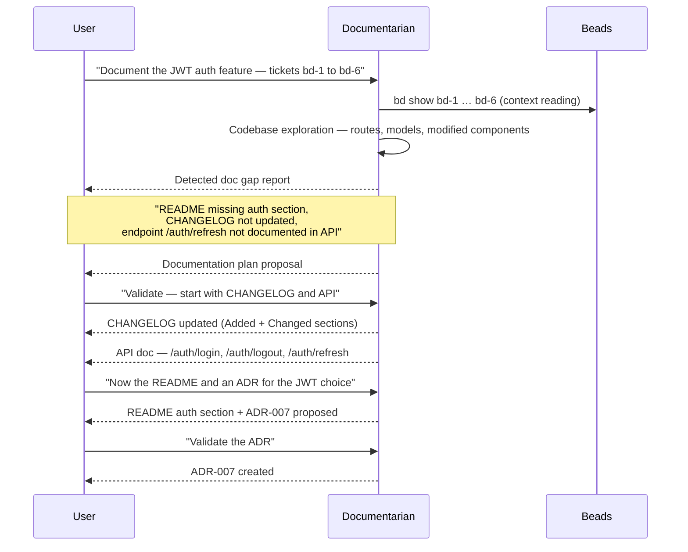
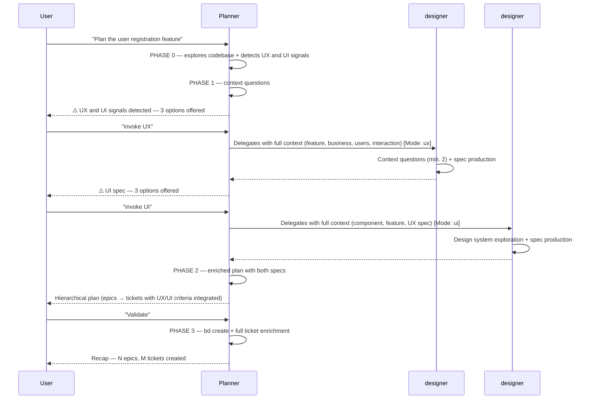

> 🇫🇷 [Lire en français](workflows.fr.md)

# Workflows

This guide illustrates the main usage scenarios for the hub,
end to end, with real prompts and expected outputs.

---

## Choosing your entry point

Before launching a session, identify your situation.

Each session runs a **workflow** (see [Built-in workflows](../reference/workflows.en.md)); the entry agent follows from it.

| Situation | v5 command | Entry agent | Typical prompt |
|-----------|------------|-------------|----------------|
| Feature to design + implement from scratch | `oh run feature` | `orchestrator` | `"Implement [feature]"` |
| Beads tickets already planned, ready to code | `oh run ticket --tickets bd-X,bd-Y` | `orchestrator-dev` | `"Implement tickets bd-X to bd-Y"` |
| UX/UI specifications only, without implementing | `oh run libre --agent designer` | `designer` | `"UX spec for [feature]"` (Mode: ux, ui, or ux+ui) |
| Audit before going to production | `oh run audit` | `auditor` | `"Audit the project"` |
| Apply an infrastructure change already written (Terraform, Kubernetes, Helm) | `oh run infra-change -i target=staging` | `operator` | `"Apply the change of infra/db"` |
| Production bug with stacktrace or logs | `oh run debug` | `debugger` | `"This bug: [stacktrace]"` |
| Measure performance, before/after an optimisation | `oh run benchmark -i target=…` | `benchmarker` | target (URL, endpoint, package, command), `-i baseline=main` |
| Review of a manually developed PR | `oh run review` | `reviewer` | `"Review my PR — branch: [name]"` |
| Specify a feature without implementing it (spec in the wiki, tickets) | `oh run spec` (alias `oh run cadrage`) | `conductor` → `planner` | `"Specify [feature]"` |
| Implement the tickets of a spec, one after the other | `oh run implement-spec` (tickets of the last `spec` session by default) | `orchestrator-dev` | `--tickets bd-X,bd-Y` |
| Plan + delegate UX/UI specs via the planner | `oh run libre --agent planner` | `planner` | `"Plan [feature]"` then `"invoke UX"` / `"invoke UI"` |
| Document a delivered feature or a decision | `oh run libre --agent documentarian` | `documentarian` | `"Document [topic]"` |

**Quick decision rule:**
- You have an idea → `orchestrator` (it orchestrates everything, from spec to merge)
- You have ready tickets → `orchestrator-dev` (direct implementation)
- You have a precise and bounded need → the specialised agent directly

---

## Resuming an existing session

Each session has a `<project> · <workflow>` title (followed by ` · <ticket>` for a per-ticket session). Closing opencode does not stop the session: it keeps running, then goes to sleep after 5 minutes of inactivity with no pending decision.

```bash
oh session list                # running, waiting and sleeping sessions (--all: finished ones too)
oh session attach <session-id> # reopen the interface of a session (resumes a sleeping session)
oh session resume <session-id> # resume a sleeping session without opening an interface
```

In the TUI, the **Sessions** view (omnibar `sessions`) shows the same information. `oh start -r <session-id>` remains a deprecated alias of `oh session attach <session-id>`. Details: [Sessions v5](sessions-v5.en.md).

---

## Scenario 0 — Your first session (single agent)

**Context:** you want to try OpenHub for the first time on an existing project.
No Beads tickets, no complex orchestration -- just a simple interaction with one agent.

**Prerequisites:**
- `oh init` completed (see [Tutorial](tutorial.en.md))
- Provider credentials configured
- No deploy step: the session bundle is built at launch (`oh deploy` removed in v5)

### Simple code explanation

```bash
oh run libre -i request="Explain the architecture of this project"
```

The orchestrator analyzes the codebase structure and provides a high-level explanation.
No delegation, no tickets -- a single agent answering your question.

### Simple code review

```bash
oh run review
```

The reviewer agent analyzes your current branch's diff and produces a structured review report with findings categorized by severity.

### Simple audit

```bash
oh run audit -i type=security
```

The auditor agent delegates to a security-specialized sub-agent that scans your codebase and produces a structured report.

### Diagram



**Key takeaway:** You can use any agent directly for a bounded task. The orchestrator is needed only when you want multi-agent coordination (planning + design + implementation + review).

> **Ready for more?** See Scenario 1 for a full feature workflow with multiple agents.

---

## Scenario 1 — Full feature (orchestrator)

**Context:** you want to implement a new feature from A to Z,
from design to merge, mobilising all necessary agents.

### Diagram



### Detailed steps

#### 1. Launch the `feature` workflow (entry agent: orchestrator)

```bash
oh run feature --mode semi-auto   # workflow mode: manuel, semi-auto (default) or auto
```

```
Prompt: "Implement the JWT authentication feature for our REST API"
```

The orchestrator delegates to `planner` (complex feature) or `pathfinder` (simple or exploratory feature) to break down the feature.

#### 2. The planner breaks it down

The planner explores the codebase (routes, models, components), asks clarification
questions, then proposes a plan:

```
## Breakdown plan — JWT Authentication

### Phase 0 — Specifications
- [ ] UX spec — login / register / reset password flow (label:ux)
- [ ] UI spec — form components + error feedback (label:ui)

### Phase 1 — Implementation
- [ ] User model + migrations
- [ ] JWT service (sign, verify, refresh)
- [ ] Login / logout / refresh endpoints
```

#### 3. [cp-tickets] Tickets to create

No ticket exists yet: the planner asks for approval of the breakdown. The orchestrator does not relay this question, it passes the `cp-tickets` checkpoint (« Approve the tickets to create », mandatory), then relaunches the planner with « Breakdown approved by the user: create the tickets. ». oh refuses any `bd create` before `cp-tickets`. With existing tickets only (`tickets` input), `cp-tickets` just confirms the list (nothing created).

> A security, performance or accessibility audit is not part of `feature` (the `auditor` is not a member): the orchestrator suggests the `audit` workflow (`oh run audit`), whose findings can then be planned as tickets.

#### 4. [cp-0] Plan validation

The orchestrator displays the ticket table **in the discussion**,
then passes the `cp-0` checkpoint (`workflow_checkpoint` tool): you approve the plan from oh or from the tool interface.

> **One checkpoint protocol**: every checkpoint of the workflow goes through the `workflow_checkpoint` tool, whether the agent is the entry agent or a subagent (`orchestrator-dev`, invoked by the orchestrator, calls `cp-1`, `cp-2`, `cp-3` itself). A question asked with the `question` tool that names a checkpoint (`cp-2`, « CP 2 », its label) is closed by oh without effect. One `cp-2` per ticket: there is no grouped approval of several commits.

```
## Planned tickets — JWT Authentication

| ID   | Title                           | Type          | Planned agent         |
|------|---------------------------------|---------------|-----------------------|
| bd-1 | UX spec — auth flow             | spec-ux       | designer              |
| bd-2 | UI spec — auth components       | spec-ui       | designer              |
| bd-3 | User model + migrations         | task          | developer (backend)   |
| bd-4 | JWT service                     | feature       | developer (backend)   |
| bd-5 | Login/logout/refresh endpoints  | feature       | developer (api)       |

ℹ️ Processing order defined by the planner: specs → dev.
```

The workflow mode is not asked again: it is set at launch (`--mode`, or the Mode field of the launch form) and passed to `orchestrator-dev`.

#### 5. Design phase

The orchestrator first handles `spec-*` tickets:

- Invokes `designer` (Mode: ux) → UX spec produced → **[cp-spec]** validate / revise / skip
  - The designer returns a structured block `## Return to orchestrator` with the complete spec, implementation constraints, and open points. The orchestrator validates the presence of this block before proceeding.
- Invokes `designer` (Mode: ui) → UI spec produced → **[cp-spec]** validate / revise / skip

#### 6. Implementation phase via orchestrator-dev

The orchestrator passes dev tickets to `orchestrator-dev` with the chosen mode.
`orchestrator-dev` takes over:

1. Presents each ticket `[cp-1]` (automatic in semi-auto/auto)
2. Picks the domain via the routing matrix and delegates to `developer` (the domain — `backend`, `refactor`, `migration`, `tests`… — is passed in the invocation prompt)
3. Developer returns a structured `## Return to orchestrator-dev` block — files modified, acceptance criteria checked, **points of attention for the review** (fragile zones, technical trade-offs)
4. Launches review automatically — passing the developer's points of attention to the reviewer, which first runs the project's build, tests, lint and type check
5. Reviewer returns a structured block with an **actionable verdict** (`commit` / `corriger` / `corriger-sécurité`), problem summary by severity, and required corrections verbatim
6. Presents the review report and passes `cp-2` (« Commit or fix », one call per ticket) — **always a pause, no exception**; `cp-2` unlocks `commit` and `close`: once approved, the developer commits then closes the ticket
7. If "fix": the corrections are passed verbatim to the developer, who copies them into the Beads comment — no manual summary; routed to `developer` (domain `security`) if the reviewer's routing is `domaine-security`. The developer → reviewer fix rounds are capped by `limits.max_fix_rounds` (3 in `feature`)
8. Moves to the next ticket `[cp-3]` (automatic in semi-auto/auto)
9. After all tickets: `orchestrator-dev` emits a **condensed per-ticket summary** (status, key files, covered criteria, attention points + aggregated global attention points) followed by the **structured** `## Return to orchestrator` **block** (per-ticket detail table, statistics, global status) — the two are complementary; the orchestrator **displays this summary in its discussion thread** before presenting the [cp-feature] to the user

> **Subagent questions:** when a subagent (planner, designer, reviewer…) asks a question,
> it surfaces in the parent session with a context block identifying the agent and current phase —
> e.g. `[Planner — Phase 0 | Feature: JWT authentication]`. No need to navigate to the child session.

> **Missing agent:** if a required agent is not part of the session (the agents of a session are those
> of its workflow), the orchestrator displays a structured question: use a substitute (table by domain) /
> skip the ticket. To make the agent available, add it to the workflow and relaunch the session
> (`oh deploy` removed in v5). Never falls back silently.

#### 7. [cp-feature] Global recap

```
## Feature recap — JWT Authentication

| ID   | Title                           | Phase  | Agent               | Status        |
|------|---------------------------------|--------|---------------------|---------------|
| bd-1 | UX spec — auth flow             | design | designer            | ✅ Validated   |
| bd-2 | UI spec — auth components       | design | designer            | ✅ Validated   |
| bd-3 | User model + migrations         | dev    | developer (backend) | ✅ Committed   |
| bd-4 | JWT service                     | dev    | developer (backend) | ✅ Committed   |
| bd-5 | Login/logout/refresh endpoints  | dev    | developer (api)     | ✅ Committed   |

- Tickets handled: 5 / 5
- Review cycles: 6
- Corrections requested: 1 (bd-5, CORS misconfigured)
```

---

## Scenario 2 — Multi-domain audit

**Context:** you want a complete audit of the project before going to production.

### Diagram



### Detailed steps

#### 1. Full audit

```
Prompt: "Audit the project"
```

The auditor qualifies the request as a **full audit** and delegates to `auditor-subagent` for each relevant domain (up to 9: `infra` and `database` only when the project has IaC or a database; one invocation per domain, domain + native_skill passed in the prompt).

#### 2. Targeted audit

```
Prompt: "Audit security and check GDPR compliance"
```

The auditor delegates only to `auditor-subagent` with domains `security` and `privacy`.

#### 3. Express audit (quick audit)

```
Prompt: "Quick audit"
```

The auditor delegates to `auditor-subagent` for the `security`, `accessibility`, `performance` domains.

#### 4. Synthesis report format

```
## Multi-domain Audit Summary — my-project

### Overview

| Domain        | Score | Level | Criticals |
|---------------|-------|-------|-----------|
| Security      | 6/10  | 🟠    | 2         |
| Performance   | 8/10  | ✅    | 0         |
| Accessibility | 5/10  | 🟠    | 1         |
| Ecodesign     | 7/10  | 🟡    | 0         |
| Architecture  | 7/10  | 🟡    | 0         |
| Privacy (GDPR)| 9/10  | ✅    | 0         |
| Observability | 6/10  | 🟠    | 1         |

### Estimated global score
6.7/10 — Fair — 4 critical issues to resolve before production

### Top 5 priority actions
1. [Security 🔴] Possible SQL injection — src/controllers/user.controller.ts:34
2. [Security 🔴] Secret exposed in code — config/database.ts:12
3. [Accessibility 🔴] Images without alt attribute — src/components/Gallery.vue
4. [Observability 🔴] No SLO defined — no error budget or actionable alerting
5. [Security 🟠] Misconfigured CORS — src/middleware/cors.ts
```

#### 5. Living docs enrichment (Phase 4)

After the executive summary, the auditor consolidates the `### Findings to document` sections
surfaced by subagents and proposes to the user to capitalize the relevant discoveries.

```
## 💾 Wiki enrichment — Findings to capitalize

### Proposed enrichments for `docs/wiki/index.md`
| Section | Action | Proposed content | Confidence |
|---------|--------|-----------------|------------|
| `## Active critical points 🔴` | Add | "SQL injection possible in UserController" | `CONFIRMÉ` · src/controllers/user.controller.ts:34 |

### Proposed enrichments for `docs/wiki/technical/stack.md`
| Section | Action | Proposed content | Confidence |
|---------|--------|-----------------|------------|
| `## Key libraries` | Add "Do not use" | "lodash 4.17.20 — CVE-2024-1234: prototype pollution" | `CONFIRMÉ` · package.json |
```

The `audit` workflow is read-only: the `documentarian` (which writes) is not part of it.
The auditor therefore lists the enrichments in `### Enrichissements wiki proposés` of its report,
without delegation; apply them afterwards with `oh run libre --agent documentarian`
(see skill `living-docs-enrichment`).

---

## Scenario 3 — Debug → fix cycle

**Context:** a bug is reported in production, you have a stacktrace.

### Diagram



### Detailed steps

#### 1. Submit the bug to the debugger

```
Prompt:
"This bug has been happening in prod since this morning:

TypeError: Cannot read properties of null (reading 'email')
    at UserService.findById (src/services/user.service.ts:47:20)
    at AuthController.login (src/controllers/auth.controller.ts:23:35)
    at Layer.handle [as handle_request] (express/lib/router/layer.js:95:5)

Context: occurs when a user tries to log in with a non-existent
email. Frequency: systematic."
```

#### 2. Diagnostic report

```
## Diagnostic — TypeError null email in UserService

### Symptom
Login with non-existent email throws a TypeError in production.
Expected behaviour: return an explicit 401 error.
Frequency: systematic.

### Root cause
Method `findById` returns `null` when the user doesn't exist,
but line 47 directly accesses `.email` without prior null guard.

Certainty level: confirmed
Causal chain:
1. Login request with non-existent email
2. `UserRepository.findByEmail` returns `null`
3. `UserService.findById` accesses `.email` on the null value → TypeError

### Explored hypotheses
- Race condition in the repository: eliminated — error is systematic, not intermittent
- Missing null guard before line 47: confirmed — no guard found in the call chain

### Impact and potential regressions
- All login attempts with non-existent email result in an unhandled TypeError
- The error propagates to the HTTP layer as a 500 rather than a clean 401

### Suggested correction ticket
Title: Fix missing null guard in UserService.findById
Type: bug | Priority: P0
```

#### 3. Ticket creation

In the `debug` workflow, the creation goes through the `cp-ticket` checkpoint (« Create the fix ticket », paused in every mode): oh refuses `bd create` before it is approved. In a `libre` session, the debugger asks with the `question` tool.

```
⏸️ cp-ticket — Create the fix ticket (diagnosis + proposed ticket)
→ approved

bd create "Fix missing null guard in UserService.findById" -p 0 -t bug --json
→ Ticket bd-42 created
```

#### 4. Living docs enrichment (Phase 5)

After ticket creation, the debugger identifies findings worth capitalizing:

```
## 💾 Wiki enrichment — Findings to capitalize

### Proposed enrichments for `docs/wiki/index.md`
| Section | Action | Proposed content | Confidence |
|---------|--------|-----------------|------------|
| `## Blind spots` | Add | "UserService.findById does not return explicit 401 — returns null without guard" | `CONFIRMÉ` · src/services/user.service.ts:47 |

### Proposed enrichments for `docs/wiki/technical/conventions.md`
| Section | Action | Proposed content | Confidence |
|---------|--------|-----------------|------------|
| `## Team-specific patterns` | Add | "Always check for null before accessing a repository return value property" | `CONFIRMÉ` · src/services/user.service.ts:47 |

→ question: Delegate writing to the documentarian?
```

If the user accepts, the debugger invokes the `documentarian` via `task` (member of the `debug` workflow,
skill `living-docs-enrichment`) to enrich the wiki incrementally.

#### 5. Fix and review

The developer receives ticket bd-42, reads the diagnostic in the notes,
implements the targeted fix, and the reviewer checks the PR.

---

## Scenario 4 — Feature implementation → living wiki (developer)

**Context:** a developer completes ticket bd-15 (implement user filtering feature).

> **`oh run ticket`** (deprecated alias: `oh start --dev`) picks an epic/ticket and auto-transitions its claim status from `planned` → `in_progress`.
> After team setup, run `oh team sync-tracker` to push claim `ExternalIID` links back to the external tracker (Jira, Linear, GitLab Issues).

#### Living wiki enrichment (post-ticket)

After `bd close bd-15`, the developer identifies discoveries worth capitalizing:

```
## 💾 Wiki enrichment — Findings to capitalize

### Proposed enrichments for `docs/wiki/technical/conventions.md`
| Section | Action | Proposed content | Confidence |
|---------|--------|-----------------|------------|
| `## Team-specific patterns` | Add | "Filtering logic is always co-located in a dedicated `<feature>/filters/` folder" | `CONFIRMÉ` · src/users/filters/ · ticket bd-15 |
| `## Team-specific patterns` | Add | "Always use TanStack Query with a `staleTime: 60_000` default for list endpoints" | `CONFIRMÉ` · src/users/hooks/useUsers.ts:12 |

→ question: Delegate writing to the documentarian?
```

If the user accepts, the developer invokes the `documentarian` via `task`
(skill `shared/living-docs-enrichment`) to enrich the wiki incrementally.

---

## Scenario 5 — Code review → living wiki (reviewer)

**Context:** a reviewer analyses the diff for branch `feat/bd-15-user-filters`.

#### Mode selection (standalone)

When invoked directly (via `oh run review` or as a primary agent), the reviewer proposes mode selection:

```
? Review mode:
  ❯ Standard (classical 6-category checklist)
    Adversarial (critical — max skepticism, min. 10 findings)
    Edge-case (unhandled execution paths)
    Standard + Adversarial (parallel sessions + unified report)
    Standard + Adversarial + Edge-case (maximum coverage)
```

For combined modes, the reviewer launches **parallel independent sessions** (context isolation) and merges results via the `review-merge` skill.

#### Living wiki enrichment (post-report)

After producing the review report, the reviewer identifies conventions worth capitalizing:

```
## 💾 Wiki enrichment — Findings to capitalize

### Proposed enrichments for `docs/wiki/technical/conventions.md`
| Section | Action | Proposed content | Confidence |
|---------|--------|-----------------|------------|
| `## Naming` | Add | "Filter composables are always named `use<Entity>Filters`" | `CONFIRMÉ` · src/users/hooks/useUserFilters.ts:1 |
```

The `review` workflow is read-only: the `documentarian` is not part of it. The reviewer
lists the enrichments in `### Enrichissements wiki proposés` of its report, without delegation;
apply them afterwards with `oh run libre --agent documentarian` (skill `shared/living-docs-enrichment`).
In `feature` or `ticket`, where the `documentarian` is available, the coordinator may delegate them to it.

---

## Scenario 6 — Review only

**Context:** you developed a feature manually and want a review
before merging.

```
Prompt: "Review my PR — branch: <branch name>"
```

Or with Beads context:

```
Prompt: "Review branch feat/user-profile — ticket bd-28"
```

The reviewer reads ticket bd-28 for context, applies its systematic
checklist, and produces a structured report.

**CLI shortcut with mode selection:**

```bash
oh run review -i review_mode=adversarial   # adversarial review directly
oh run review -i review_mode=all           # all 3 modes in parallel
oh run review                              # the reviewer proposes mode selection
```

---

## Scenario 7 — Standalone design (designer — modes: ux, ui, ux+ui)

**Context:** you want to design the experience and interface of a feature
before coding, without going through the full orchestrator. Useful when specs
must be validated by a team or client before any development.
Invoke `designer` with Mode: ux, ui, or ux+ui depending on what you need.

### Diagram



### Detailed steps

#### 1. UX spec

```
Prompt: "UX spec for the user onboarding flow —
our app is a B2B SaaS project management platform"
[Mode: ux]
```

The `designer` asks at least 2 context questions before producing:

```
Questions:
1. What is the profile of the user signing up
   (company admin, invited team member, both)?
2. What information is required at account creation?
```

Then produces the UX spec with:
- Nominal + alternative + error user flows
- Acceptance criteria per step
- Identified friction points and recommendations
- Suggested Beads tickets (with `label:ui` for screens to specify)

#### 2. UI spec

```
Prompt: "UI spec for onboarding screens — UX spec available in bd-10"
[Mode: ui]
```

The `designer` reads the UX spec via `bd show bd-10`, then produces:
- Design tokens used (colours, typography, spacing)
- Component specification (variants, states, do/don't)
- Flow-specific visual guidelines
- Beads tickets updated with UI constraints

#### 3. Implementation via orchestrator-dev

Once specs are validated, launch `orchestrator-dev` directly on development
tickets (spec tickets are already closed):

```
Prompt: "Implement tickets bd-11 to bd-15 — semi-auto mode"
```

---

## Scenario 8 — Documenting a delivered feature

**Context:** a feature has just been merged. You want to document what changed:
README, user guides, ADR if an architectural decision was made, CHANGELOG,
or API documentation if new endpoints were created.

### Diagram



### Detailed steps

#### 1. Launch the documentarian with context

```
Prompt: "Document the JWT authentication feature delivered in tickets bd-1 to bd-6"
```

The `documentarian` starts by exploring before writing:
1. Reads Beads tickets to understand the scope
2. Explores the codebase (new files, modified routes, added models)
3. Inspects existing documentation (README, `docs/`, CHANGELOG, API spec)

#### 2. Gap report

```
## Documentation gaps detected — JWT Auth Feature

| Document              | Status   | Recommended action                                  |
|-----------------------|----------|-----------------------------------------------------|
| README.md             | Partial  | Add "Authentication" section with examples          |
| CHANGELOG.md          | Missing  | Add Added + Changed entries for the release         |
| docs/api/auth.md      | Missing  | Create OpenAPI doc for /auth/* (3 endpoints)        |
| ADR                   | Missing  | Propose ADR-007 — JWT vs sessions choice            |
| docs/guides/          | Compliant| No modification needed                              |

Where to start? (or "all" to let the documentarian decide the order)
```

#### 3. Writing by validated sections

The `documentarian` **never modifies a format without confirmation**. For each
document:
- It detects the existing format and adapts to it
- It proposes content before writing if the document is new
- It never changes format (e.g.: switching from Nygard to MADR for ADRs)
  without explicit confirmation

#### 4. Example — generated CHANGELOG entry

```markdown
## [1.2.0] — 2026-03-30

### Added
- JWT authentication: endpoints `/auth/login`, `/auth/logout`, `/auth/refresh`
- `User` model with `email`, `password_hash`, `refresh_token` fields
- `JwtService` — sign, verify, refresh with token rotation

### Changed
- `AuthController`: migration from cookie sessions to JWT Bearer
```

---

## Scenario 9 — Planning with design delegation (planner → designer)

**Context:** you want to plan a feature that involves a user journey or new visual
components, and want the planner to handle delegation to design agents — without
having to open sessions manually.

### Diagram



### Detailed steps

#### 1. Launch the planner

```
Prompt: "Plan the user registration feature"
```

The planner explores the codebase, detects design signals (new multi-step flow → UX,
new form component → UI) and presents them in its context summary (PHASE 0).

#### 2. [PHASE 1.5] The planner proposes UX delegation

```
## ⚠️ UX spec recommended before planning

This feature introduces a multi-step flow (email entry → verification → profile).
...

### How would you like to proceed?

Option A — I invoke it directly (recommended)
> Type "invoke UX"

Option B — You invoke it yourself
> ...

Option C — Continue without UX spec
> Type "continue without UX"
```

#### 3. Direct invocation of designer — Mode: ux (Option A)

```
Prompt: "invoke UX"
```

The planner announces the invocation and passes the full context to `designer` (Mode: ux).
`designer` asks its questions, produces the spec, and returns it to the planner
in the standardized format:

```
## SPEC UX — User Registration

### Nominal user flow
1. User enters their email
2. They receive a verification email
3. They click the link → redirected to profile completion page
4. They enter name, surname, password
5. They are redirected to their dashboard

### Alternative flows
- Email already exists → inline error + "login" link
- Expired link → error page with "resend email" button

### Error states
- Invalid email → inline validation (format)
- Password too weak → strength indicator + rules displayed

### UX acceptance criteria
- Nominal flow completes in ≤ 4 steps without forced backtracking
- Every error is explained with a clear corrective action
- Verification email arrives in < 30s
```

#### 4. Direct invocation of designer — Mode: ui (Option A)

Same mechanism for UI — the planner proposes, the user confirms with `"invoke UI"`.
`designer` (Mode: ui) receives the component context + the already-produced UX spec,
and returns the UI spec in the standardized format:

```
## SPEC UI — RegistrationForm

### Design system components used
- DsfrInput — floating label variant
- DsfrButton — primary variant (submit) + secondary (cancel)
- DsfrAlert — error variant (inline)

### Visual states
- Default: empty field, label visible
- Focus: outline 2px token.color.focus
- Error: border token.color.error + inline message
- Loading: disabled button + spinner

### Tokens used
- color.primary.main: submit button background
- color.error.main: border + error text

### Accessibility
- aria-describedby on each field → linked to error message
- Keyboard navigation: Tab between fields, Enter submits the form
- Contrast: 4.5:1 minimum (WCAG AA)
```

#### 5. Enriched plan + ticket creation

The planner integrates both specs into its plan (PHASE 2) and creates tickets (PHASE 3)
with UX acceptance criteria and the `--design` field fully populated from the start.

```
bd-12  P1  feature  ~3h   Registration form implementation
       → design: full RegistrationForm spec (DSFR tokens, states, a11y)
       → acceptance: nominal flow ≤ 4 steps, errors with corrective action, ...

bd-13  P1  feature  ~2h   Email verification service
       → acceptance: email sent < 30s, link expires after 24h, ...
```

---

## Scenario 10 — Before/after benchmark (benchmarker)

**Context:** you optimised an endpoint and want to measure the gain against `main`.

```bash
oh run benchmark -i target="GET /api/users on http://localhost:3000" -i mode=api -i baseline=main
```

1. The `benchmarker` picks the scenario (k6 smoke then load) and the baseline (`main`, or the latest report in `reports/benchmarks/` without `baseline`).
2. **`cp-target`** (paused in every mode): it presents the target, the environment, the load profile and the duration. No measurement or request to the target before you approve; a production target needs an explicit confirmation.
3. It measures, compares and writes the report in `reports/benchmarks/` (the only directory it writes to), then passes `cp-recap`:

```
## Benchmark — GET /api/users
- Mode: api · environment: local
- Baseline: main
- Regression: no (p95 412 ms → 268 ms, −35%)
- Report: reports/benchmarks/api-20261012-143000.md
- Suggested follow-up: none
```

The code is never modified: an optimisation to make becomes a recommendation for the `developer`. In a `libre` session (`oh run libre --agent benchmarker`), the target is confirmed with the `question` tool.

---

## Scenario 11 — Infrastructure change (operator)

**Context:** a Terraform change is merged on `main` and must reach `staging`. The code is already written (by you or a `developer` session); the session only plans, gets approval and applies.

```bash
oh run infra-change -i target=staging -i request="Apply the new RDS instance class of infra/db (commit a1b2c3d)"
```

1. The `operator` checks the real context (`terraform workspace show`, `aws sts get-caller-identity`) against `staging` and stops on a mismatch.
2. It runs `terraform plan -out=…` and presents **`cp-plan`**: changes to create / modify / destroy (each replacement named), cost delta (`infracost` when installed), risks, rollback.
3. You approve; it presents **`cp-apply`** with the target and the plan file. Until then oh refuses `terraform apply` and every other change.
4. After approval it runs `terraform apply <planfile>` (each change command asked), checks the result (`terraform plan` without changes) and reports.

To review the same code without applying anything: `oh run audit -i type=infra`.
