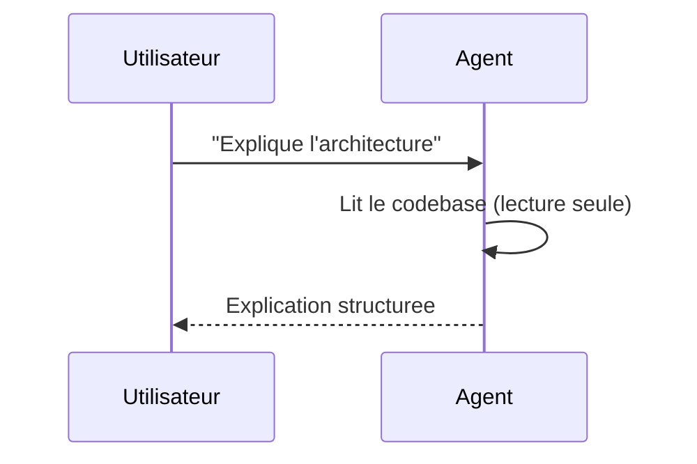
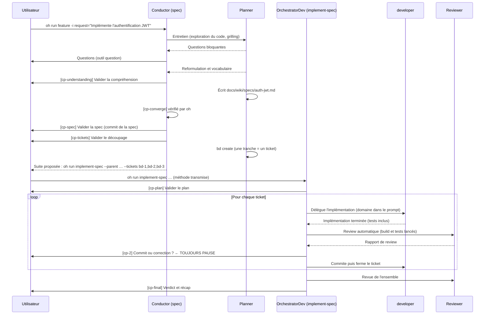
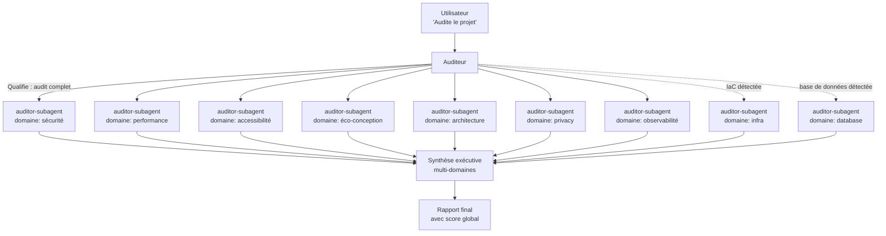
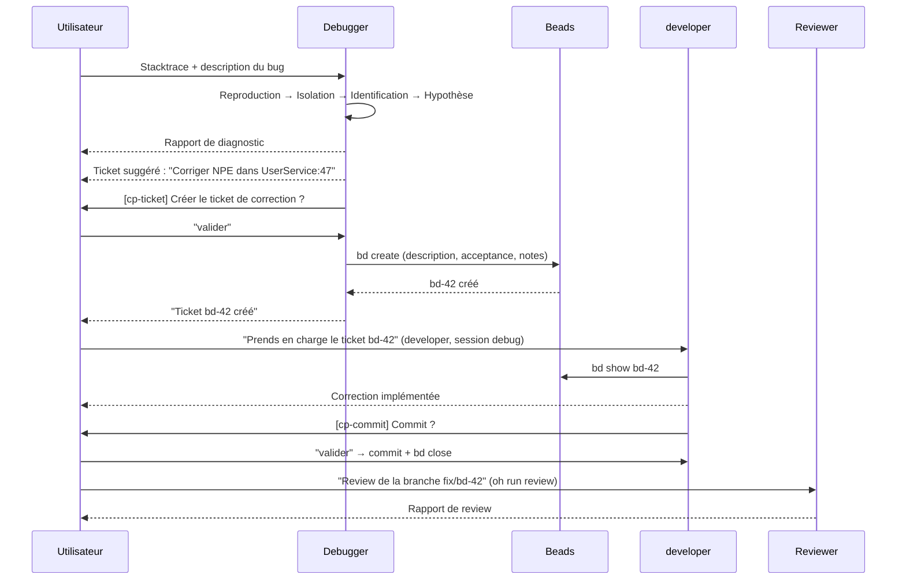
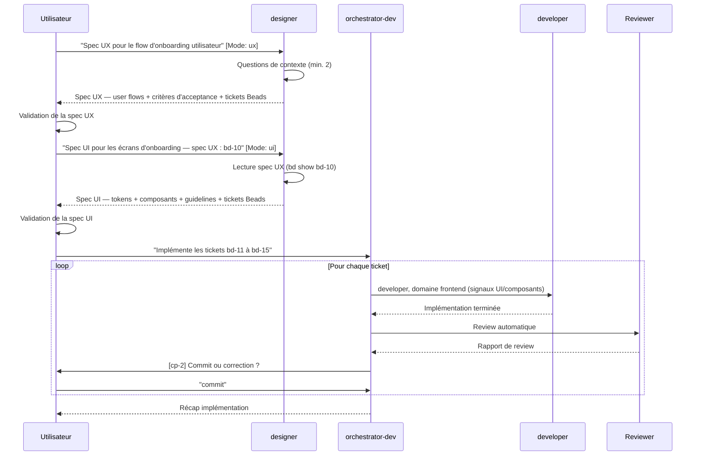
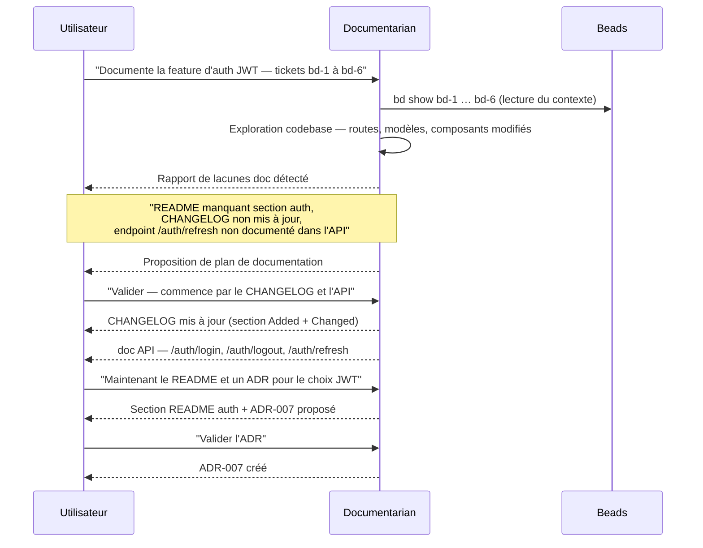
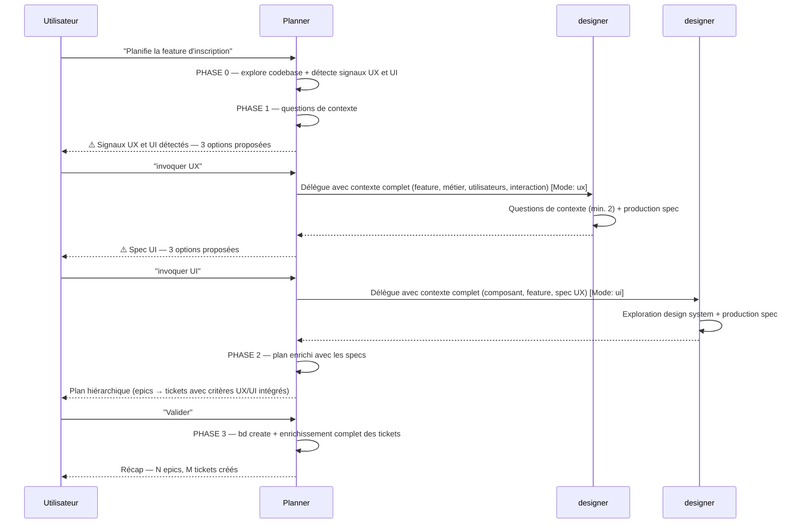

> 🇬🇧 [Read in English](workflows.en.md)

# Workflows

Ce guide illustre les scénarios principaux d'utilisation du hub,
de bout en bout, avec les prompts réels et les sorties attendues.

---

## Choisir son point d'entrée

Avant de lancer une session, identifiez votre situation.

Chaque session lance un **workflow** (voir [Workflows livrés](../reference/workflows.fr.md)) ; l'agent d'entrée en découle.

| Situation | Commande v5 | Agent d'entrée | Prompt type |
|-----------|-------------|----------------|-------------|
| Feature à concevoir + implémenter de zéro | `oh run feature` (alias : `spec`, puis `implement-spec` proposé) | `conductor` → `planner`, puis `orchestrator-dev` | `"Implémente [feature]"` |
| Tickets Beads déjà planifiés, prêts à coder | `oh run ticket --tickets bd-X,bd-Y` | `orchestrator-dev` | `"Implémente les tickets bd-X à bd-Y"` |
| Spécifications UX/UI uniquement, sans implémenter | `oh run libre --agent designer` | `designer` | `"Spec UX pour [feature]"` (Mode : ux, ui ou ux+ui) |
| Audit avant mise en production | `oh run audit` | `auditor` | `"Audite le projet"` |
| Appliquer un changement d'infrastructure déjà écrit (Terraform, Kubernetes, Helm) | `oh run infra-change -i target=staging` | `operator` | `"Applique le changement d'infra/db"` |
| Bug en production avec stacktrace ou logs | `oh run debug` | `debugger` | `"Ce bug : [stacktrace]"` |
| Mesurer les performances, avant/après une optimisation | `oh run benchmark -i target=…` | `benchmarker` | cible (URL, endpoint, package, commande), `-i baseline=main` |
| Review d'une PR développée manuellement | `oh run review` | `reviewer` | `"Review de ma PR — branche : [nom]"` |
| Spécifier une feature sans l'implémenter (spec dans le wiki, tickets) | `oh run spec` (alias `oh run cadrage`) | `conductor` → `planner` | `"Spécifie [feature]"` |
| Implémenter les tickets d'une spec, l'un après l'autre | `oh run implement-spec` (tickets de la dernière session `spec` par défaut) | `orchestrator-dev` | `--tickets bd-X,bd-Y` |
| Planifier + déléguer les specs UX/UI au planner | `oh run libre --agent planner` | `planner` | `"Planifie [feature]"` puis `"invoquer UX"` / `"invoquer UI"` |
| Documenter une feature livrée ou une décision | `oh run libre --agent documentarian` | `documentarian` | `"Documente [sujet]"` |

**Règle de décision rapide :**
- Tu as une idée → `oh run feature` (la spec et ses tickets, puis leur implémentation, proposée par oh)
- Tu as des tickets prêts → `orchestrator-dev` (implémentation directe)
- Tu as un besoin précis et délimité → l'agent spécialisé directement

---

## Reprendre une session existante

Chaque session porte un titre `<projet> · <workflow>` (suivi de ` · <ticket>` pour une session par ticket). Fermer opencode n'arrête pas la session : elle continue, puis passe en veille après 5 minutes d'inactivité sans décision en attente.

```bash
oh session list                # sessions en cours, en attente, en veille (--all : aussi les terminées)
oh session attach <session-id> # rouvrir l'interface d'une session (reprend une session en veille)
oh session resume <session-id> # reprendre une session en veille sans ouvrir d'interface
```

Dans la TUI, la vue **Sessions** (omnibar `sessions`) regroupe les mêmes informations. `oh start -r <session-id>` reste un alias déprécié de `oh session attach <session-id>`. Détails : [Sessions v5](sessions-v5.fr.md).

---

## Scenario 0 — Votre premiere session (agent simple)

**Contexte :** vous voulez essayer OpenHub pour la premiere fois sur un projet existant.
Pas de tickets Beads, pas d'orchestration complexe -- juste une interaction simple avec un agent.

**Prerequis :**
- `oh init` complete (voir [Tutoriel](tutorial.fr.md))
- Credentials provider configures
- Aucune etape de deploy : le paquet de session est construit au lancement (`oh deploy` supprime en v5)

### Explication de code simple

```bash
oh run libre -i request="Explique l'architecture de ce projet"
```

L'orchestrateur analyse la structure du codebase et fournit une explication de haut niveau.
Pas de delegation, pas de tickets -- un seul agent qui repond a votre question.

### Revue de code simple

```bash
oh run review
```

L'agent reviewer analyse le diff de votre branche courante et produit un rapport de revue structure avec des constats categorises par severite.

### Audit simple

```bash
oh run audit -i type=security
```

L'agent auditor delegue a un sous-agent specialise securite qui scanne votre codebase et produit un rapport structure.

### Diagramme



**Point cle :** Vous pouvez utiliser n'importe quel agent directement pour une tache delimitee. L'orchestrateur n'est necessaire que lorsque vous voulez une coordination multi-agents (planification + design + implementation + review).

> **Pret pour la suite ?** Voir le Scenario 1 pour une feature complète (`spec`, puis `implement-spec`).

---

## Scenario 1 — Feature complète (`spec` → `implement-spec`)

**Contexte :** vous voulez implémenter une nouvelle feature de A à Z,
de la spécification jusqu'aux commits. `oh run feature` est un alias : sans tickets, il lance `spec` ;
à la fin, oh propose `implement-spec` sur les tickets créés (voir [`feature`](../reference/workflows.fr.md#feature-alias-de-spec--implement-spec)).

### Diagramme



### Étapes détaillées

#### 1. Lancer `feature` (alias de `spec`)

```bash
oh run feature -i request="Implémente l'authentification JWT pour notre API REST"   # mode : --mode manuel|semi-auto|auto
oh run feature -i method=tdd -i request="…"                                        # l'implémentation qui suivra sera en TDD
```

oh annonce la redirection (`feature → spec`). Sans demande (`oh run feature`, `oh start`), la session vous la demande au début. Avec des tickets déjà créés, `oh run feature --tickets bd-1,bd-2` lance directement `implement-spec` (étape 5).

#### 2. Entretien et compréhension

Le `conductor` lance le `planner`, qui explore le code et pose ses questions bloquantes (une par décision) ; le conductor vous les pose avec l'outil `question`. Quand la demande compare des conceptions, le `pathfinder` explore d'abord. Le planner rend sa reformulation et le vocabulaire (chaque mot de la demande en face des noms du code), présentés à **`cp-understanding`**.

#### 3. Spec et découpage

Une fois la compréhension validée (avant, oh refuse l'écriture), le planner écrit `docs/wiki/specs/<slug>.md` : objectif, glossaire, critères d'acceptation avec leur point de test, découpage en tranches verticales. oh vérifie la convergence (**`cp-converge`**, sans pause), puis vous validez la spec à **`cp-spec`** (le planner la commite seule) et le découpage à **`cp-tickets`** (le planner crée un ticket par tranche ; oh refuse tout `bd create` avant). Une spec UX/UI, si la feature a une interface, est produite par le `designer`, appelé par le planner.

> Un audit de sécurité, de performance ou d'accessibilité ne fait pas partie de `spec` ni d'`implement-spec` : proposez le workflow `audit` (`oh run audit`), dont les constats peuvent ensuite être traités par `security-fix`.

#### 4. Suite proposée

À la fermeture du client, oh affiche les sorties relevées (`spec`, `tickets`, `method`) et la commande de la suite, sans la lancer :

```
→ Suite proposée : implement-spec — Implémenter une spec
    oh run implement-spec --parent ses_… --tickets bd-1,bd-2,bd-3 -i method=tdd -i spec=docs/wiki/specs/auth-jwt.md
```

`oh session next <id>` la redonne ; dans la TUI, elle est en tête de « Enchaîner avec… ».

#### 5. [cp-plan] Validation du plan

L'`orchestrator-dev` d'`implement-spec` lit les tickets (`bd show`), fixe l'ordre (dépendances, puis priorité), affiche le tableau des tickets **dans la discussion**, puis passe **`cp-plan`** (outil `workflow_checkpoint`) : vous validez le plan depuis oh ou l'interface de l'outil. Rien n'est délégué avant.

> **Un seul protocole de checkpoint** : chaque checkpoint du workflow passe par l'outil `workflow_checkpoint`. Une question posée avec l'outil `question` qui nomme un checkpoint (`cp-2`, « CP 2 », son libellé) est fermée par oh sans effet. Un `cp-2` par ticket : il n'y a pas de validation groupée de plusieurs commits.

#### 6. Implémentation, ticket par ticket

1. Présente chaque ticket `[cp-1]` (automatique en semi-auto/auto) ; en méthode `tdd`, le developer passe `cp-seams` puis `cp-red`
2. Choisit le domaine via la matrice de routing et délègue au `developer` (le domaine — `backend`, `refactor`, `migration`, `tests`… — passe dans le prompt d'invocation)
3. Le developer retourne un bloc structuré `## Retour vers orchestrator-dev` — fichiers modifiés, critères d'acceptance cochés, **points d'attention pour la review**
4. Lance la review automatiquement — le reviewer lance d'abord le build, les tests, le lint et le contrôle de types du projet
5. Le reviewer retourne un **verdict actionnable** (`commit` / `corriger` / `corriger-sécurité`) et les corrections requises verbatim
6. Passe `cp-2` (« Commit ou correction », un appel par ticket) — **toujours une pause** ; oh vérifie d'abord le build et les tests ; `cp-2` déverrouille `commit` et `close` : le developer commite puis ferme le ticket
7. Si « corriger » : corrections transmises verbatim au developer ; les tours developer → reviewer sont plafonnés par `limits.max_fix_rounds` (3)
8. Passe au ticket suivant `[cp-3]` (automatique en semi-auto/auto)

> **Questions des sous-agents :** un sous-agent n'a pas l'outil `question` ; ses questions bloquantes remontent dans son bloc de retour et l'agent d'entrée vous les pose.

#### 7. [cp-final] Revue de l'ensemble et récap

Tous les tickets traités, le `reviewer` fait une review adversariale de tous les commits de la session ; **`cp-final`** présente son verdict, les tickets traités et leurs commits, et les points ouverts : vous décidez d'un tour de correction ou de vous arrêter.

---

## Scénario 2 — Audit multi-domaines

**Contexte :** vous voulez un audit complet du projet avant une mise en production.

### Diagramme



### Étapes détaillées

#### 1. Audit complet

```
Prompt : "Audite le projet"
```

L'auditeur qualifie la demande comme un **audit complet** et délègue à `auditor-subagent` pour chaque domaine pertinent (jusqu'à 9 : `infra` et `database` seulement si le projet contient de l'IaC ou une base de données ; une invocation par domaine, domaine + native_skill transmis dans le prompt).

#### 2. Audit ciblé

```
Prompt : "Audite la sécurité et vérifie le RGPD"
```

L'auditeur délègue uniquement à `auditor-subagent` avec les domaines `sécurité` et `privacy`.

#### 3. Audit express (quick audit)

```
Prompt : "Quick audit"
```

L'auditeur délègue à `auditor-subagent` pour les domaines `sécurité`, `accessibilité`, `performance`.

#### 4. Format du rapport de synthèse

```
## Synthèse Audit Multi-domaines — mon-projet

### Vue d'ensemble

| Domaine        | Score | Niveau | Critiques |
|----------------|-------|--------|-----------|
| Sécurité       | 6/10  | 🟠     | 2         |
| Performance    | 8/10  | ✅     | 0         |
| Accessibilité  | 5/10  | 🟠     | 1         |
| Éco-conception | 7/10  | 🟡     | 0         |
| Architecture   | 7/10  | 🟡     | 0         |
| Privacy (RGPD) | 9/10  | ✅     | 0         |
| Observabilité  | 6/10  | 🟠     | 1         |

### Score global estimé
6.7/10 — Passable — 4 problèmes critiques à résoudre avant mise en production

### Top 5 des actions prioritaires
1. [Sécurité 🔴] Injection SQL possible — src/controllers/user.controller.ts:34
2. [Sécurité 🔴] Secret exposé dans le code — config/database.ts:12
3. [Accessibilité 🔴] Images sans attribut alt — src/components/Gallery.vue
4. [Observabilité 🔴] Aucun SLO défini — pas d'error budget ni d'alerting actionnable
5. [Sécurité 🟠] CORS mal configuré — src/middleware/cors.ts
```

#### 5. Enrichissement des documents vivants (Phase 4)

Après la synthèse exécutive, l'auditeur consolide les sections `### Découvertes à documenter`
remontées par les sous-agents et propose à l'utilisateur de capitaliser les découvertes pertinentes.

```
## 💾 Enrichissement du wiki documentaire — Découvertes à capitaliser

### Enrichissements proposés pour `docs/wiki/index.md`
| Section | Action | Contenu proposé | Confiance |
|---------|--------|-----------------|-----------|
| `## Points critiques actifs 🔴` | Ajouter | "Injection SQL possible dans UserController" | `CONFIRMÉ` · src/controllers/user.controller.ts:34 |

### Enrichissements proposés pour `docs/wiki/technical/stack.md`
| Section | Action | Contenu proposé | Confiance |
|---------|--------|-----------------|-----------|
| `## Librairies clés` | Ajouter "À ne pas utiliser" | "lodash 4.17.20 — CVE-2024-1234 : prototype pollution" | `CONFIRMÉ` · package.json |
```

Le workflow `audit` est en lecture seule : le `documentarian` (qui écrit) n'en fait pas partie.
L'auditeur liste donc les enrichissements dans `### Enrichissements wiki proposés` de son rapport,
sans délégation ; applique-les ensuite avec `oh run libre --agent documentarian`
(voir skill `living-docs-enrichment`).

---

## Scénario 3 — Cycle debug → fix

**Contexte :** un bug est signalé en production, vous avez une stacktrace.

### Diagramme



### Étapes détaillées

#### 1. Soumettre le bug au debugger

```
Prompt :
"Ce bug arrive en prod depuis ce matin :

TypeError: Cannot read properties of null (reading 'email')
    at UserService.findById (src/services/user.service.ts:47:20)
    at AuthController.login (src/controllers/auth.controller.ts:23:35)
    at Layer.handle [as handle_request] (express/lib/router/layer.js:95:5)

Contexte : se produit quand un utilisateur essaie de se connecter avec un
email inexistant. Fréquence : systématique."
```

#### 2. Rapport de diagnostic

```
## Diagnostic — TypeError null email dans UserService

### Symptôme
Login avec email inexistant lève une TypeError en production.
Comportement attendu : retourner une erreur 401 explicite.
Fréquence : systématique.

### Cause racine
La méthode `findById` retourne `null` quand l'utilisateur n'existe pas,
mais la ligne 47 accède directement à `.email` sans guard null préalable.

Niveau de certitude : confirmé
Chaîne causale :
1. Requête de login avec email inexistant
2. `UserRepository.findByEmail` retourne `null`
3. `UserService.findById` accède à `.email` sur la valeur null → TypeError

### Hypothèses explorées
- Race condition dans le repository : écartée — l'erreur est systématique, pas intermittente
- Guard null manquant avant la ligne 47 : confirmée — aucun guard dans la chaîne d'appel

### Impact et régressions potentielles
- Toutes les tentatives de login avec email inexistant génèrent une TypeError non gérée
- L'erreur se propage vers la couche HTTP comme un 500 au lieu d'un 401 propre

### Ticket de correction suggéré
Titre : Corriger l'absence de guard null dans UserService.findById
Type : bug | Priorité : P0
```

#### 3. Création du ticket

Dans le workflow `debug`, la création passe par le checkpoint `cp-ticket` (« Créer le ticket de correction », en pause dans tous les modes) : oh refuse `bd create` avant sa validation. Dans une session `libre`, le debugger pose la question avec l'outil `question`.

```
⏸️ cp-ticket — Créer le ticket de correction (diagnostic + ticket proposé)
→ validé

bd create "Corriger l'absence de guard null dans UserService.findById" -p 0 -t bug --json
→ Ticket bd-42 créé
```

#### 4. Enrichissement des documents vivants (Phase 5)

Après la création du ticket, le debugger identifie les découvertes à capitaliser :

```
## 💾 Enrichissement du wiki documentaire — Découvertes à capitaliser

### Enrichissements proposés pour `docs/wiki/index.md`
| Section | Action | Contenu proposé | Confiance |
|---------|--------|-----------------|-----------|
| `## Zones d'ombre` | Ajouter | "UserService.findById ne retourne pas d'erreur 401 — retourne null sans guard" | `CONFIRMÉ` · src/services/user.service.ts:47 |

### Enrichissements proposés pour `docs/wiki/technical/conventions.md`
| Section | Action | Contenu proposé | Confiance |
|---------|--------|-----------------|-----------|
| `## Patterns spécifiques à l'équipe` | Ajouter | "Toujours vérifier le null avant d'accéder à une propriété de retour de repository" | `CONFIRMÉ` · src/services/user.service.ts:47 |

→ question : Déléguer l'écriture au documentarian ?
```

Si l'utilisateur accepte, le debugger invoque le `documentarian` via `task` (membre du workflow `debug`,
skill `living-docs-enrichment`) pour enrichir le wiki de manière incrémentale.

#### 5. Correction et review

Le developer reçoit le ticket bd-42, lit le diagnostic dans les notes,
implémente la correction ciblée, et le reviewer vérifie la PR.

---

## Scénario 4 — Implémentation feature → docs vivants (developer)

**Contexte :** un développeur vient de clore le ticket bd-15 (implémentation filtrage utilisateurs).

> **`oh run ticket`** (alias déprécié : `oh start --dev`) sélectionne un epic/ticket et fait passer automatiquement le statut du claim de `planned` → `in_progress`.
> Après configuration de l'équipe, lancez `oh team sync-tracker` pour renvoyer les liens `ExternalIID` des claims vers le tracker externe (Jira, Linear, GitLab Issues).

#### Enrichissement des documents vivants (post-ticket)

Après `bd close bd-15`, le developer identifie des découvertes à capitaliser :

```
## 💾 Enrichissement du wiki documentaire — Découvertes à capitaliser

### Enrichissements proposés pour `docs/wiki/technical/conventions.md`
| Section | Action | Contenu proposé | Confiance |
|---------|--------|-----------------|-----------|
| `## Patterns spécifiques à l'équipe` | Ajouter | "La logique de filtrage est toujours co-localisée dans un dossier `<feature>/filters/` dédié" | `CONFIRMÉ` · src/users/filters/ · ticket bd-15 |
| `## Patterns spécifiques à l'équipe` | Ajouter | "Toujours utiliser TanStack Query avec un `staleTime: 60_000` par défaut pour les endpoints de liste" | `CONFIRMÉ` · src/users/hooks/useUsers.ts:12 |

→ question : Déléguer l'écriture au documentarian ?
```

Si l'utilisateur accepte, le developer invoque le `documentarian` via `task`
(skill `shared/living-docs-enrichment`) pour enrichir le wiki de manière incrémentale.

---

## Scénario 5 — Code review → wiki documentaire (reviewer)

**Contexte :** un reviewer analyse le diff de la branche `feat/bd-15-user-filters`.

#### Sélection du mode (standalone)

Quand invoqué directement (via `oh run review` ou comme agent primaire), le reviewer propose le choix du mode :

```
? Mode de review :
  ❯ Standard (checklist classique 6 catégories)
    Adversarial (critique — scepticisme maximal, min. 10 findings)
    Edge-case (chemins d'exécution non gérés)
    Standard + Adversarial (sessions parallèles + rapport unifié)
    Standard + Adversarial + Edge-case (couverture maximale)
```

Pour les modes combinés, le reviewer lance des **sessions parallèles indépendantes** (isolation contextuelle) et fusionne les résultats via le skill `review-merge`.

#### Enrichissement du wiki documentaire (post-rapport)

Après avoir produit le rapport de review, le reviewer identifie des conventions à capitaliser :

```
## 💾 Enrichissement du wiki documentaire — Découvertes à capitaliser

### Enrichissements proposés pour `docs/wiki/technical/conventions.md`
| Section | Action | Contenu proposé | Confiance |
|---------|--------|-----------------|-----------|
| `## Nommage` | Ajouter | "Les composables de filtrage sont toujours nommés `use<Entité>Filters`" | `CONFIRMÉ` · src/users/hooks/useUserFilters.ts:1 |
```

Le workflow `review` est en lecture seule : le `documentarian` n'en fait pas partie. Le reviewer
liste les enrichissements dans `### Enrichissements wiki proposés` de son rapport, sans délégation ;
applique-les ensuite avec `oh run libre --agent documentarian` (skill `shared/living-docs-enrichment`).
Dans `implement-spec` ou `ticket`, où le `documentarian` est disponible, le coordinateur peut les lui déléguer.

---

## Scénario 6 — Review seule

**Contexte :** vous avez développé une feature manuellement et voulez une review
avant de merger.

```
Prompt : "Review de ma PR — branche : <nom de la branche>"
```

Ou avec contexte Beads :

```
Prompt : "Review de la branche feat/user-profile — ticket bd-28"
```

Le reviewer lit le ticket bd-28 pour contextualiser, applique sa checklist
systématique, et produit un rapport structuré.

**Raccourci CLI avec sélection de mode :**

```bash
oh run review -i review_mode=adversarial   # review adversariale directement
oh run review -i review_mode=all           # les 3 modes en parallèle
oh run review                              # le reviewer propose le choix du mode
```

---

## Scénario 7 — Design standalone (designer — modes : ux, ui, ux+ui)

**Contexte :** vous voulez concevoir l'expérience et l'interface d'une feature
avant de coder, sans passer par l'agent orchestrator complet. Utile quand les specs
doivent être validées par une équipe ou un client avant tout développement.
Invoquez `designer` avec Mode : ux, ui ou ux+ui selon votre besoin.

### Diagramme



### Étapes détaillées

#### 1. Spec UX

```
Prompt : "Spec UX pour le flow d'onboarding utilisateur —
notre app est une plateforme B2B SaaS de gestion de projets"
[Mode: ux]
```

Le `designer` pose au minimum 2 questions de contexte avant de produire :

```
Questions :
1. Quel est le profil de l'utilisateur qui s'inscrit
   (admin entreprise, membre d'équipe invité, les deux) ?
2. Quelles informations sont obligatoires à la création de compte ?
```

Puis produit la spec UX avec :
- User flow nominal + alternatifs + cas d'erreur
- Critères d'acceptance par étape
- Points de friction identifiés et recommandations
- Tickets Beads suggérés (avec labels `label:ui` pour les écrans à spécifier)

#### 2. Spec UI

```
Prompt : "Spec UI pour les écrans d'onboarding — spec UX disponible dans bd-10"
[Mode: ui]
```

Le `designer` lit la spec UX via `bd show bd-10`, puis produit :
- Tokens de design utilisés (couleurs, typographie, espacement)
- Spécification des composants (variants, états, do/don't)
- Guidelines visuelles spécifiques au flow
- Tickets Beads mis à jour avec les contraintes UI

#### 3. Implémentation via orchestrator-dev

Une fois les specs validées, lancer `orchestrator-dev` directement sur les tickets
de développement (les tickets spec sont déjà clôturés) :

```
Prompt : "Implémente les tickets bd-11 à bd-15 — mode semi-auto"
```

---

## Scénario 8 — Documentation d'une feature livrée

**Contexte :** une feature vient d'être mergée. Vous voulez documenter ce qui a changé :
README, guides utilisateur, ADR si une décision architecturale a été prise, CHANGELOG,
ou documentation API si de nouveaux endpoints ont été créés.

### Diagramme



### Étapes détaillées

#### 1. Lancer le documentarian avec le contexte

```
Prompt : "Documente la feature d'authentification JWT livrée dans les tickets bd-1 à bd-6"
```

Le `documentarian` commence par explorer avant d'écrire :
1. Lit les tickets Beads pour comprendre le périmètre
2. Explore la codebase (nouveaux fichiers, routes modifiées, modèles ajoutés)
3. Inspecte la documentation existante (README, `docs/`, CHANGELOG, spec API)

#### 2. Rapport de lacunes

```
## Lacunes documentaires détectées — Feature Auth JWT

| Document              | Statut   | Action recommandée                              |
|-----------------------|----------|-------------------------------------------------|
| README.md             | Partiel  | Ajouter section "Authentification" avec exemples|
| CHANGELOG.md          | Absent   | Ajouter entrées Added + Changed pour la release |
| docs/api/auth.md      | Absent   | Créer doc OpenAPI pour /auth/* (3 endpoints)    |
| ADR                   | Absent   | Proposer ADR-007 — Choix JWT vs sessions        |
| docs/guides/          | Conforme | Aucune modification nécessaire                  |

Par quoi commencer ? (ou "tout" pour laisser le documentarian décider de l'ordre)
```

#### 3. Écriture par sections validées

Le `documentarian` **ne modifie jamais un format sans confirmation**. Pour chaque
document :
- Il détecte le format existant et s'y adapte
- Il propose le contenu avant d'écrire si le document est nouveau
- Il ne change jamais de format (ex : passer de Nygard à MADR pour les ADR)
  sans confirmation explicite

#### 4. Exemple — entrée CHANGELOG générée

```markdown
## [1.2.0] — 2026-03-30

### Added
- Authentification JWT : endpoints `/auth/login`, `/auth/logout`, `/auth/refresh`
- Modèle `User` avec champs `email`, `password_hash`, `refresh_token`
- Service `JwtService` — sign, verify, refresh avec rotation des tokens

### Changed
- `AuthController` : migration de sessions cookie vers JWT Bearer
```

---

## Scénario 9 — Planification avec délégation design (planner → designer)

**Contexte :** vous voulez planifier une feature qui implique un parcours utilisateur
ou de nouveaux composants visuels, et souhaitez que le planner prenne en charge la
délégation aux agents de design — sans avoir à ouvrir des sessions manuellement.

### Diagramme



### Étapes détaillées

#### 1. Lancer le planner

```
Prompt : "Planifie la feature d'inscription utilisateur"
```

Le planner explore la codebase, détecte les signaux design (nouveau parcours multi-étapes → UX,
nouveau composant formulaire → UI) et les présente dans son résumé de contexte (PHASE 0).

#### 2. [PHASE 1.5] Le planner propose la délégation UX

```
## ⚠️ Spec UX recommandée avant planification

Cette feature introduit un flow multi-étapes (saisie email → vérification → profil).
...

### Comment souhaitez-vous procéder ?

Option A — Je l'invoque directement (recommandé)
> Tapez "invoquer UX"

Option B — Vous l'invoquez vous-même
> ...

Option C — Continuer sans spec UX
> Tapez "continuer sans UX"
```

#### 3. Invocation directe de designer — Mode : ux (Option A)

```
Prompt : "invoquer UX"
```

Le planner annonce l'invocation et transmet le contexte complet à `designer` (Mode : ux).
`designer` pose ses questions, produit la spec, et la retourne au planner
au format standardisé :

```
## SPEC UX — Inscription utilisateur

### User flow nominal
1. L'utilisateur saisit son email
2. Il reçoit un email de vérification
3. Il clique sur le lien → redirigé vers la page de complétion de profil
4. Il saisit nom, prénom, mot de passe
5. Il est redirigé vers son tableau de bord

### Flows alternatifs
- Email déjà existant → message d'erreur inline + lien "connexion"
- Lien expiré → page d'erreur avec bouton "renvoyer l'email"

### États d'erreur
- Email invalide → validation inline (format)
- Mot de passe trop faible → indicateur de force + règles affichées

### Critères d'acceptance UX
- Le flow nominal s'effectue en ≤ 4 étapes sans retour en arrière forcé
- Chaque erreur est expliquée avec une action corrective claire
- L'email de vérification arrive en < 30s
```

#### 4. Invocation directe de designer — Mode : ui (Option A)

Même mécanique pour l'UI — le planner propose, l'utilisateur confirme avec `"invoquer UI"`.
`designer` (Mode : ui) reçoit le contexte composant + la spec UX déjà produite,
et retourne la spec UI au format standardisé :

```
## SPEC UI — FormulaireInscription

### Composants design system utilisés
- DsfrInput — variante avec label flottant
- DsfrButton — variante primary (soumission) + secondary (annuler)
- DsfrAlert — variante error (inline)

### États visuels
- Default : champ vide, label visible
- Focus : outline 2px token.color.focus
- Error : bordure token.color.error + message inline
- Loading : bouton disabled + spinner

### Tokens utilisés
- color.primary.main : fond bouton de soumission
- color.error.main : bordure + texte d'erreur

### Accessibilité
- aria-describedby sur chaque champ → lié au message d'erreur
- Navigation clavier : Tab entre champs, Entrée soumet le formulaire
- Contraste : 4.5:1 minimum (WCAG AA)
```

#### 5. Plan enrichi + création des tickets

Le planner intègre les deux specs dans son plan (PHASE 2) et crée les tickets (PHASE 3)
avec les critères d'acceptance UX et le champ `--design` complet directement renseigné.

```
bd-12  P1  feature  ~3h   Implémentation formulaire d'inscription
       → design : spec complète FormulaireInscription (tokens DSFR, états, a11y)
       → acceptance : flow nominal ≤ 4 étapes, erreurs avec action corrective, ...

bd-13  P1  feature  ~2h   Service de vérification email
       → acceptance : email envoyé < 30s, lien expire après 24h, ...
```

---

## Scénario 10 — Benchmark avant/après (benchmarker)

**Contexte :** vous avez optimisé un endpoint et voulez mesurer le gain par rapport à `main`.

```bash
oh run benchmark -i target="GET /api/users sur http://localhost:3000" -i mode=api -i baseline=main
```

1. Le `benchmarker` identifie le scénario (k6 smoke puis load) et la référence (`main`, ou le dernier rapport de `reports/benchmarks/` sans `baseline`).
2. **`cp-target`** (en pause dans tous les modes) : il présente la cible, l'environnement, le profil de charge et la durée. Aucune mesure ni requête vers la cible avant votre validation ; une cible de production demande une confirmation explicite.
3. Il mesure, compare et écrit le rapport dans `reports/benchmarks/` (seul répertoire où il écrit), puis passe `cp-recap` :

```
## Benchmark — GET /api/users
- Mode : api · environnement : local
- Référence : main
- Régression : non (p95 412 ms → 268 ms, −35 %)
- Rapport : reports/benchmarks/api-20261012-143000.md
- Suite proposée : aucune
```

Le code n'est jamais modifié : une optimisation à faire devient une recommandation pour le `developer`. Dans une session `libre` (`oh run libre --agent benchmarker`), la confirmation de la cible passe par l'outil `question`.

---

## Scénario 11 — Changement d'infrastructure (operator)

**Contexte :** un changement Terraform est fusionné sur `main` et doit arriver en `staging`. Le code est déjà écrit (par vous ou une session `developer`) ; la session se contente de planifier, faire valider et appliquer.

```bash
oh run infra-change -i target=staging -i request="Appliquer la nouvelle classe d'instance RDS d'infra/db (commit a1b2c3d)"
```

1. L'`operator` vérifie le contexte réel (`terraform workspace show`, `aws sts get-caller-identity`) par rapport à `staging` et s'arrête en cas d'écart.
2. Il lance `terraform plan -out=…` et présente **`cp-plan`** : changements à créer / modifier / détruire (chaque remplacement nommé), delta de coût (`infracost` s'il est installé), risques, retour arrière.
3. Vous validez ; il présente **`cp-apply`** avec la cible et le fichier de plan. Jusque-là, oh refuse `terraform apply` et toute autre modification.
4. Après validation, il lance `terraform apply <fichier de plan>` (chaque commande de modification demandée), vérifie le résultat (`terraform plan` sans changement) et rend compte.

Pour relire le même code sans rien appliquer : `oh run audit -i type=infra`.
