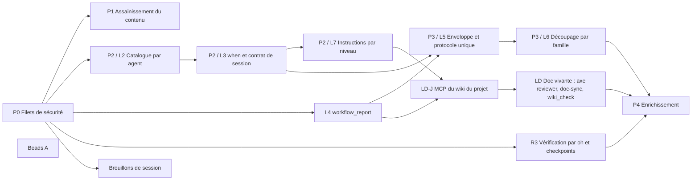

# Plan d'exécution : modernisation d'oh (allègement, documentation vivante, checkpoints, enrichissement)

> Rédigé le 12 octobre 2026, à partir du rapport `docs/dev/rapport-modernisation-2026-10.md` (décisions arrêtées en section 12).
> Démarrage du développement : 13 octobre 2026.
> Point de départ : `main` après la consolidation C0 à C4 (dernier commit `d7ef88e7` + rapport non commité).

---

## 0. Règles du jeu (valables pour tous les lots)

### 0.1 Organisation du travail
- **Un lot = une branche** `feat/<lot>` et, si le lot tourne en parallèle, **un worktree** dans `../openhub-wt/<lot>`.
- **Propriété des fichiers** : chaque piste parallèle possède ses fichiers (section 2). Une piste ne touche pas aux fichiers d'une autre ; si c'est nécessaire, elle le signale au lieu de le faire.
- **Merge** dans `main` avec `git merge --no-ff -m "Merge feat/<lot>: <résumé>"`, puis suppression du worktree et de la branche. Pas de push sans accord.
- **Goldens** : on ne les fusionne jamais à la main. Après chaque merge, on les régénère :
  ```
  cd cli && go test ./internal/bundle -run 'ShippedWorkflow|Capabilit|Budget|RuleLedger' -update
  ```
  puis on relit le diff de `testdata/`. (`RuleLedger` ajouté le 13/10 : `-update` refuse de réécrire le `.tsv` d'un agent dont un retrait n'est pas justifié dans `.moved`.)
- **CHANGELOG** : une entrée `[Unreleased]` par lot, écrite au merge (pas dans les branches parallèles, pour éviter les conflits).
- **Commits** : en anglais, au format conventionnel, avec le suffixe `(modernisation <lot>)`.
- **Contenu** (skills, agents, prompts, docs) : **en français**, avec les accents. Docs en paires `.fr.md` / `.en.md`.

### 0.2 Vérifications avant chaque merge
1. Resynchroniser la copie embarquée (remplacée par `make sync-content` après P0.6) :
   ```
   rm -rf cli/internal/hubcontent/hub && mkdir -p cli/internal/hubcontent/hub && cp -r agents skills permissions workflows cli/internal/hubcontent/hub/
   ```
2. `go test -count=1 ./internal/bundle/ ./internal/workflow/... ./internal/bricks/...`
3. `go test -timeout 40m ./...`
4. `GOLANGCI_LINT_CACHE=$(mktemp -d) golangci-lint run ./...` : **0 problème**.
5. À partir de P0 : `TestRuleLedger` vert, et `budget.golden` régénéré, avec une justification de toute hausse.
6. Pour les lots marqués « éval » : `make test-eval` sur Haiku ×3 ; sur Sonnet ×1 pour L3, L5 et L6.

### 0.3 Définition de « terminé » pour un lot
- [ ] Tests et lint verts.
- [ ] Goldens régénérés et relus.
- [ ] Registre des règles à jour : chaque règle supprimée est justifiée dans `.moved`.
- [ ] Docs (`.fr.md` et `.en.md`) à jour pour tout comportement visible.
- [ ] Entrée de CHANGELOG.
- [ ] Gain mesuré dans `budget.golden` comparé au gain attendu.

---

## 1. Vue d'ensemble



| Phase | Lots | Mode | Gain attendu |
|---|---|---|---|
| P0 | P0.1 à P0.7 | parallèle | Filets de sécurité |
| P1 | P1.1 à P1.6 et Beads A | parallèle | Environ −56 000 tokens sur la somme des prompts |
| P2 | L2 → L3 → L7 (séquentiel) ; L4, R3, SCR (parallèle) | mixte | Catalogues −92 %, −38 000 tokens, rapports stockés, vérification réelle |
| P3 | L5 → L6 (par famille) ; LD-J, puis LD | mixte | −60 000 à −117 000 tokens, wiki capitalisé partout |
| P4 | R1, R4, R7, R13, puis R5, R6, R8, puis R9 | parallèle par piste | Nouvelles capacités |

---

## 2. Pistes parallèles et propriété des fichiers

| Piste | Lots | Possède | Ne touche pas |
|---|---|---|---|
| **T-eval** | P0.1, P0.3, P0.5 | `cli/internal/bundle/*_test.go` (nouveaux), `testdata/rules/`, `testdata/golden/prompts/`, `cli/cmd/eval.go`, `cli/internal/evalrun/`, `evals/`, `Makefile` (cible `test-eval`) | Contenu, code produit hors `evalrun` |
| **T-trace** | P0.4 | `cli/cmd/session_trace*.go`, `cli/internal/services/session/trace*.go` | `bundle/` |
| **T-hygiène** | P0.6, P0.7 | `cli/Makefile`, tests instables (fichiers cités), `docs/diagrams/`, `docs/guides/contributing.*` | Contenu |
| **T-contenu** | P1.1 à P1.4, puis L5 et L6 | `skills/**`, corps des `agents/**`, prompts `workflows/prompts/*` | Go |
| **T-divers** | P1.5 | Fichiers cités en P1.5 | — |
| **T-beads** | Beads A | `cli/internal/beads/clean*.go`, `cli/cmd/doctor*`, leurs tests | — |
| **T-bundle** | L2, L3, L7 (séquentiel), LD (partie bundle) | `cli/internal/bundle/**` (hors tests de T-eval), `sessionspec/spec.go`, `adapters/opencodev2/render.go`, `attest.go`, `bricks/frontmatter.go`, `workflow/schema.go`, `workflow/validate_spec.go`, YAML `workflows/*.yaml` (champs de schéma) | Texte des skills |
| **T-report** | L4 | `cli/internal/mcp/workflow/`, `cli/internal/daemon/` (routes rapports), `cli/internal/services/report/` (nouveau), `storage/sqlite` (migration), vue TUI de checkpoint, `cli/cmd/session*`, `gc/`, `remote/` | `bundle/**`, sauf `checkpoints.go:30-36` et `globalguard.go:31`, à coordonner |
| **T-verify** | R3 | `cli/internal/services/checkpoint/` (vérification, preuves, limites), `bricks/verify_commands.go`, `bundle/checkpoints.go` (fenêtres), lint du budget de pauses | Contenu |
| **T-scratch** | SCR | `bundle/globalguard.go` (règle scratch), `workflow/schema.go` (champ `scratch`), `gc/` | — |
| **T-wiki** | LD-J, LD | `cli/internal/mcp/wiki/` (nouveau), `cli/internal/services/wiki/` (nouveau), daemon (routes wiki), TUI (propositions dans la carte) | — |

**Points de rendez-vous :**
- `bundle/checkpoints.go` : T-verify et T-report y touchent. **T-verify merge d'abord**, puis T-report se rebase.
- `globalguard.go` : T-scratch et T-report y ajoutent chacun une règle. **T-scratch merge d'abord.**
- `workflow/schema.go` : T-bundle (`by:`, `when:`), T-scratch (`scratch:`) et T-verify (`verify:`, limites). **L'ordre de merge suit l'ordre de fin.** Chaque piste ajoute ses champs dans des blocs séparés.

---

## 3. Démarrage : jour 1 (13 octobre)

Lancer **en parallèle**, en 6 worktrees :

| Worktree | Lot | Pourquoi maintenant |
|---|---|---|
| `p0-ledger` | P0.1 Registre des règles et P0.3 snapshots des prompts | C'est le filet de sécurité de tout le reste |
| `p0-hygiene` | P0.6 Hygiène des tests et P0.7 Mermaid | Pour que les autres pistes aient des tests fiables |
| `p0-trace-eval` | P0.4 Trace et P0.5 `oh eval` de base | Nécessaires pour valider L3 et la suite |
| `p1-contradictions` | P1.1 Contradictions et P1.4 lint des identifiants de checkpoint | Gain immédiat, sans code |
| `p1-catalogue` | P1.2 Skills à la demande, `mcp: team`, P1.3 descriptions | Gain immédiat |
| `beads-a` | Beads A | Petit, indépendant, gêne au quotidien |

Puis **P1.5** dès qu'un worktree se libère.

**Pré-requis local** (à faire une fois) : `echo '/.beads.gate.lock' >> .git/info/exclude`.

### 3.1 Décisions de lancement (13 octobre)
- Rapport : commiter le `.md` seul sur `main` avant les worktrees (`docs(dev): modernisation report and decisions (2026-10)`) ; le `.html` reste hors git.
- P0.2 intégré à `p0-ledger`.
- P0.5 : la mesure de référence Haiku ×3 se fait dans le lot.
- **Ordre de merge imposé** : `p0-ledger` merge avant `p1-contradictions` et `p1-catalogue`. Ces deux pistes se rebasent ensuite et écrivent leurs `.moved` (registre des règles). `p1-contradictions` merge avant `p1-catalogue` (P1.3 réécrit les frontmatters, P1.1 les corps).
- `cli/Makefile` : `p0-hygiene` (test, sync-content) et `p0-trace-eval` (test-eval) y touchent ; blocs séparés, `p0-hygiene` merge d'abord.
- `p1-catalogue` touche du Go (`oh skill check` : `description_not_trigger`, `long_description` à 200) : exception admise à la propriété T-contenu.
- Sources : `lightening2/report.md` n'existe plus. Utiliser `lightening2/part3.md` §3.1 (22 contradictions), `part1.md` et `part2.md` (classement des sections, dossiers par agent), `desc.md` / `desc.py` / `desc_table.md` (descriptions) et `ledger.py` (extraction, base de P0.1).

---

## 4. P0 : filets de sécurité

### P0.1 Registre des règles (`TestRuleLedger`)
- **But :** aucune règle normative ne disparaît sans justification pendant l'allègement.
- **Fichiers :**
  - `cli/internal/bundle/rule_ledger_test.go` (nouveau) ;
  - `cli/internal/bundle/testdata/rules/<agent>.tsv` ;
  - `cli/internal/bundle/testdata/rules/<agent>.moved`.
- **Tâches :**
  1. Pour chaque agent, collecter le texte qu'il peut voir : son corps, les skills inlinées, les skills à la demande qu'il peut atteindre (natives, mentions, closure `requires`), dans les workflows livrés.
  2. Extraire les lignes normatives (JAMAIS, TOUJOURS, NE … PAS, DOIT, OBLIGATOIRE, ❌, ✅, ⛔, MUST, NEVER, interdit), normalisées (espaces, marqueurs de liste).
  3. Écrire une ligne par règle : `<skill ou agent>\t<titre de section>\t<texte normalisé>`.
  4. `.moved`, une ligne par règle retirée : `<texte>\t<moved:<cible>|guard:<garde>|merged:<texte>|dropped:<raison>>`.
  5. Le test échoue si une ligne du golden disparaît sans entrée `.moved`, ou si une entrée `.moved` est obsolète. `-update` réécrit les `.tsv`, jamais les `.moved`.
- **Tests :** un test unitaire de l'extraction (lignes négatives, listes, tableaux).
- **Acceptation :** 16 fichiers `.tsv` générés, environ 4 173 lignes au total ; test vert.

### P0.2 Budget par agent, à resserrer
- **But :** préparer `budget.golden` pour les lots suivants.
- **Fichiers :** `cli/internal/bundle/budget_test.go`.
- **Tâches :**
  1. Ajouter une colonne « skills atteignables par l'agent » (natives, mentions, `requires`), à côté de « catalogue visible ».
  2. Seuil de hausse configurable : 10 % aujourd'hui, 2 % à partir de la fin de P1.
- **Acceptation :** golden régénéré, nouvelle colonne présente.

### P0.3 Snapshots des prompts composés
- **But :** relire en diff ce qui change réellement dans les prompts.
- **Fichiers :** `cli/internal/bundle/prompt_snapshot_test.go`, `testdata/golden/prompts/<workflow>/<agent>.md`.
- **Périmètre :** `feature`, `ticket`, `audit`, `review`, `quick` (tous les agents de ces workflows).
- **Acceptation :** les snapshots existent, et `-update` les régénère.

### P0.4 Export de la trace d'une session (E11)
- **But :** fournir la base des évaluations et de `retro`.
- **Commande :** `oh session trace <session> [--json]`.
- **Contenu :** prompts, appels d'outils, permissions accordées ou refusées, sous-agents, checkpoints, vérifications, sorties, coûts et tokens, avec les secrets masqués.
- **Fichiers :** `cli/cmd/session_trace.go`, `cli/internal/services/session/trace.go`, i18n.
- **Sources :** timeline du démon, décisions, événements de session déjà stockés (`domain/session*.go`).
- **Tests :** sur une session factice, vérifier que le JSONL est complet et que les secrets sont masqués.

### P0.5 `oh eval`, version de base (niveaux 1 à 3)
- **But :** mesurer le comportement avec un vrai modèle, avant et après chaque lot.
- **Fichiers :**
  - `cli/cmd/eval.go`, `cli/internal/evalrun/` ;
  - `evals/<cible>/<cas>/{case.yaml, fixture/, hidden_tests/}` ;
  - `Makefile`, cible `test-eval`.
- **Fonctionnement :**
  1. Lancement sans interface (`runsvc`) dans un `OH_HOME` temporaire et un clone jetable.
  2. Réponses aux checkpoints données par le cas, via l'API de décisions du démon (comme `TestE2EHeadlessDecisions`).
  3. Trace récupérée (P0.4), puis assertions.
  4. Rapport JSON et Markdown.
- **Assertions disponibles :**
  - `ran` (commande vue avant un événement) ;
  - `checkpoint_order` ;
  - `no_question_in_subagent` ;
  - `skill_loaded_before` ;
  - `changed_within` ;
  - `hidden_tests` ;
  - `no_denied_loop`.
- **Cas de départ :**

  | Cas | Workflow | Ce qui est vérifié |
  |---|---|---|
  | S1 | review | La vérification passe en premier ; verdict « corriger » sur un bug semé |
  | S2 | ticket | Developer et reviewer n'appellent jamais `question` ; pas de commit avant `cp-2` |
  | S3 | feature | Le pathfinder renvoie son bloc sans poser de question ; une question bloquante est relayée |
  | S4 | audit | Chaque skill de phase est chargé avant sa phase |
  | S5 | cadrage | Le planner suit la variante sous-agent |
  | S6 | debug | Skill de phase chargé avant chaque phase |
  | S7 | quick | Un skill hors périmètre est signalé absent, sans boucle |
  | S8 | ticket | Sans démon : retour au rapport complet inclus dans le bloc (actif après L4) |
  | S9 | sweep | Les retours de developer et reviewer s'adressent à `conductor` |
  | S10 | quick | Une décision sur les données est posée en « Questions bloquantes », pas via `question` |
- **Budget :** plafond par passage via le proxy d'identifiants. Haiku par défaut, Sonnet en option (`OH_EVAL_MODELS`).
- **Acceptation :** `make test-eval OH_EVAL_REPS=3` produit un rapport ; **mesure de référence enregistrée** dans `testdata/evals/baseline.json`.

### P0.6 Hygiène des tests (Q29)
| Tâche | Détail |
|---|---|
| `make test` | `-timeout 40m` |
| `make sync-content` | Copie `agents`, `skills`, `permissions` et `workflows` dans `internal/hubcontent/hub` sans recompiler bd |
| Test de dérive | Un test échoue si la copie embarquée diffère des sources (en dev, quand le dossier existe) |
| Tests instables | `TestResolveBase`, `TestCheckHookCallerRealGit`, la passerelle « bd where … 503 », le test de PID du démon : délais, attentes actives, ports libres, isolation |
| Cache de lint | Documenter `GOLANGCI_LINT_CACHE` par worktree dans `docs/guides/contributing.*` |

**Acceptation :** 3 passages consécutifs de `go test -timeout 40m ./...` sans échec, en parallèle de 2 autres suites.

### P0.7 Diagrammes en Mermaid intégré (Q30)
- Remplacer chaque `` des docs par le bloc ` ```mermaid ` de la source.
- Supprimer les `.svg` de `docs/diagrams/` et garder les `.mermaid` comme source, ou les intégrer directement (au choix pendant le lot).
- Ajouter un test (script Node en CI, ou test Go qui appelle `mmdc` s'il est présent) : chaque bloc Mermaid des docs s'affiche sans erreur.
- **Acceptation :** plus aucun SVG périmé ; test vert.

---

## 5. P1 : assainissement du contenu

### P1.1 Les 22 contradictions
Source : rapport d'analyse, section 3.1. Une ligne par contradiction, avec sa résolution :

| Id | Fichiers | Résolution |
|---|---|---|
| C-1 | `dev-standards-universal.md:66`, `dev-standards-simplicity.md:59-66`, `review-protocol.md:97` | Règle de trois. 🟠 seulement à partir de 3 copies, ou de plus de 10 lignes identiques ajoutées par le diff |
| C-2 | `simplicity.md:93`, `review-protocol.md:109`, `audit-architecture.md:29,172` | Une seule table de seuils de longueur de fonction : 20 / 30 / 50 |
| C-3 | `universal.md:86,107`, `testing.md:429`, `developer.md` étape 6 | Une seule « gate » de complétion du developer |
| C-4 | `onboarder-phase-5.md:160`, `planner-phase-3-4.md:149`, `living-docs-enrichment.md:22` | `docs/wiki/decisions/decisions-rejetees.md` (décision 4) |
| C-5 | `doc-wiki-protocol.md:532` | Supprimer l'étape `.git/info/exclude` |
| C-6 | `universal.md:17-58`, `living-docs-enrichment`, `expert-posture`, `tool-question.md:40-66` | Pas de `question` en sous-agent : passer par « Questions bloquantes » (la variante complète arrive en L3) |
| C-7 | `orchestrator-dev-edge-cases.md:75-93`, `orchestrator-handoff-format.md:29`, `retranscription-coordinateur.md:101`, `beads-dev.md:86`, `orchestrator-dev-ticket-workflow.md:162` | Suivre `limits.max_fix_rounds` ; supprimer l'option « Continuer » au-delà de la limite |
| C-8 | `beads-dev.md:9,234` | Le ticket est celui donné dans le prompt (fin de `ai-delegated`) |
| C-9 | `beads-dev.md:60-66` | Le developer liste les enrichissements, le coordinateur les propose |
| C-10 | `universal.md:49-51` | Supprimer la promesse `git restore` |
| C-11 | `coordination-only.md:40` | « Lis seulement ce que tes permissions autorisent » |
| C-12 | `concision-posture.md:12` | Choisir la posture selon le rôle (provisoire jusqu'à L3) |
| C-13 | Liste des statuts de `developer-handoff-format` | Une seule liste, avec `BLOCKED_ARCHITECTURE` |
| C-14 | `developer-handoff-format.md:59`, template `:20` | `git diff --stat` et `git status --porcelain` à la place de `HEAD~1` |
| C-15 | `auditor-workflow.md:748-766` | Supprimer la vérification visuelle contradictoire |
| C-16 | `CP-path`, `CP-onboard`, `CP-audit`, `CP-0`, `CP-1`, `CP-spec` dans les skills | Utiliser les vrais identifiants, plus le lint P1.4 |
| C-17 | `brief-enricher.md` et note de rôle | Clé `headless` (code en L3 ; texte maintenant) |
| C-18 | « Découvertes à documenter » | « Enrichissements wiki proposés » partout |
| C-19 | `universal-guardrails` (`pkill -f`) | `kill %<job>` |
| C-20 | Question de parallélisme dans `orchestrator-dev-protocol` | Seulement quand l'agent est l'agent d'entrée (marqueur en L3, texte maintenant) |
| C-21 | `wiki-navigation.md:11` | Reformuler : fichiers projet injectés, wiki lu à la demande |
| C-22 | `websearch-usage` inliné sans websearch | Retirer l'inlining dans le pathfinder ; à la demande |

Supprimer aussi :
- le marqueur mort `CONTEXTE = orchestrator_feature` (31 occurrences, 15 skills) ;
- les sections « Relation », « Injection » et « Exemples pour humains » marquées obsolètes dans le rapport d'analyse.

- **Tests :** registre des règles avec chaque suppression justifiée ; content-lints ; extension de `content_rules_test.go:107` (C-5).
- **Gain attendu :** environ −24 000 tokens sur la somme des prompts.
- **Éval :** S2 et S10.

### P1.2 Skills passées à la demande et `mcp: team`
- **À la demande** (retirer de `skills:` et mettre dans `native_skills:`) :
  - `debugger-forensic`, `debugger-report-templates` (debugger) ;
  - `quick-fix` (developer) ;
  - `design-planner-format` (planner) ;
  - `dev-standards-universal` (reviewer) ;
  - `dev-standards-git` (documentarian) ;
  - partie écriture de `beads-plan` (pathfinder) : garder seulement la partie lecture inlinée, ou rendre tout le skill à la demande.
- **`mcp: team`** sur `team-awareness`, `team-policies-enforcement`, `team-coordination` et `takeover-context-protocol`.
- **Tests :** transitivité des skills ; budget.
- **Gain attendu :** environ −32 000 tokens.
- **Éval :** S4 et S6.

### P1.3 Les 183 descriptions
- Appliquer les descriptions proposées (rapport d'analyse §4.3, script `desc.md`), en français, en déclencheurs « Utiliser quand… », 200 caractères au plus.
- `oh skill check` : nouvelle règle `description_not_trigger` (avertissement) et `long_description` abaissée à 200 caractères pour les skills du hub, en erreur pour le hub et en avertissement pour l'équipe (1024 reste la limite du standard).
- **Acceptation :** `TestCheckSkillsHubIsClean` vert ; catalogue −45 % en caractères.

### P1.4 Lint des identifiants de checkpoint
- Test : tout `cp-…` ou `CP-…` cité dans le contenu existe dans au moins un workflow livré (et, dans un agent livré, dans ses workflows). Le marqueur `<!-- capability: optional -->` est accepté.

### P1.5 Points divers décidés
| Point | Tâche |
|---|---|
| Q24 | Créer `skills/developer/stacks/dev-standards-java.md` ; le signal `java` y mène (`bricks/stack_skills.go`) |
| Q32 | Supprimer `prompt.DetectStack`/`BuildContext` (sans appelant) et `HasGitHubActions`/`HasGitLabCI` |
| Q20 | `infra-change.yaml` : `modes: { default: manuel, allowed: [manuel] }` |
| Onboarder | Ajouter `"bd show*": allow` |
| Q26 | `oh skill check` sur le catalogue d'équipe : même règle `unknown_key` |
| Q35 | Vérifier si OpenCode charge un `AGENTS.md` du projet dans les sessions oh. Si oui : le neutraliser (configuration de l'adaptateur) ou le signaler dans `oh doctor` |
| Divers | Accents de `team-policies-enforcement.md` ; lignes `operator`, `benchmarker` et `auditor-subagent` dans sa matrice ; ligne de `orchestrator-protocol` qui délègue au `debugger` absent de `feature` |
| Q44 | Docs des modes : « auto = tout sauf les décisions obligatoires » (l'affichage dans la TUI vient avec R3) |

### Beads A (Q31)
- `cli/internal/beads/clean.go`, fonction `exclude()` : garantir `/.beads.gate.lock` dans `.git/info/exclude` quand `.beads/` y est.
- `oh doctor` : vérification « Beads zero-impact » et réparation avec `--fix`.
- Si `.beads/` est partagé dans git : avertir que `.beads.gate.lock` doit être dans le `.gitignore` de l'équipe (sans écrire dedans).
- **Tests :** `clean_n17_test.go`, test de doctor.

---

## 6. P2 : mécanismes

### L2 Catalogue par agent (T-bundle, en premier)
- **But :** chaque agent ne voit que ses skills.
- **Fichiers :**
  - `sessionspec/spec.go` : `AgentDef.Skills []string` ;
  - `bricks/frontmatter.go` : `stack_skills: bool`, `skills_from_callers: bool` ;
  - `bundle/build.go:179-247` ;
  - `bundle/mentions.go` : ignorer les mentions des sections consommateur, « Relation » et « Injection » ;
  - `adapters/opencodev2/render.go:162-178` ;
  - `report.go:124` ;
  - `attest.go:193-196`.
- **Règle de calcul, par agent :**
  - skills natives ;
  - mentions livrables ;
  - closure `requires` ;
  - skills de stack seulement si `stack_skills` (developer, reviewer, debugger, operator) ;
  - `ExtraSkills` et skills nommées dans le prompt, pour l'agent d'entrée ;
  - skills nommées par un appelant dans ses prompts de délégation, pour les agents qui l'acceptent.
- **Compatibilité :** `Skills == nil` garde le comportement actuel (anciens paquets).
- **Tests :**
  - `TestAgentSkillReachability` : tout skill qu'un agent est invité à charger est dans sa liste ;
  - `TestNoSpuriousCatalogue` ;
  - tests du rendu ;
  - e2e `TestE2EModelSeesOnlyBundleSkills`, étendu à « seulement ses skills ».
- **Gain attendu :** somme des catalogues d'environ 158 000 à environ 17 000.
- **Éval :** S7.

### L3 Variantes `when:` et contrat de session (T-bundle, après L2)
- **`when:`, au niveau du skill** (`skills.go`, `skillFront.When`, `hubSkillKeys`, `CheckSkills`) :
  - conditions possibles : `role`, `websearch`, `mcp`, `plugin`, `beads_write`, `ticket`, `wiki`, `shell`, `headless` ;
  - filtre dans `keepRoots`.
- **Marqueurs dans le texte** (nouveau `bundle/when.go`) :
  - syntaxe : `<!-- oh:when role=subagent -->…<!-- /oh:when -->` ;
  - **skills inlinées** : filtrées avant l'inlining ;
  - **skills à la demande** : filtrées sur l'union des agents qui peuvent les atteindre, ou découpées en deux fichiers quand les rôles divergent ;
  - le scan des mentions se fait **après** le filtrage.
- **Contrat de session :**
  - `CheckpointSpec.By []string` (`workflow/schema.go:248`), validé dans `validate_spec.go` ;
  - le champ est rempli explicitement dans les YAML livrés, et déduit du graphe sinon ;
  - un nouveau template `bundle/templates/session-contract.md.tmpl` remplace `sessionRoleNote` (`graph.go:153`). Il donne :
    - rôle, appelants, agents appelables ;
    - titre de retour par appelant ;
    - **seulement ses checkpoints** (CP-R11) ;
    - `max_fix_rounds` ;
    - `question` autorisé ou non ;
    - disponibilité de `workflow_report` et du MCP du wiki ;
    - `headless` ;
  - runtime : `CheckpointDef.By`, avertissement dans `checkpoint.Service.Reached` si un autre agent passe le checkpoint.
- **Contenu :** marquer les sections selon le rôle dans les skills partagés (tool-question, concision, universal-guardrails, execution-modes) ; supprimer la prose de détection de rôle et les blocs `orchestrator_feature`.
- **Tests :**
  - goldens des contrats par agent et par workflow ;
  - `TestCheckpointByMembers` ;
  - marqueurs équilibrés ;
  - pas de `question(` dans une branche sous-agent ;
  - pas de bloc sous-agent chez un agent toujours d'entrée.
- **Gain attendu :** environ −38 000 tokens.
- **Éval :** S2, S3, S5, S9 ; Sonnet ×1 avant le merge.

### L7 Instructions projet par niveau (T-bundle, après L3)
- `project_instructions: full | index | none` dans le frontmatter des agents.
- `readInstructions` (`build.go:422`) renvoie les fichiers avec leurs titres ; `agentDef` (`:374`) les rend selon le niveau.
- **`index`** = la liste des fichiers avec leurs titres, plus **l'index du wiki et ses god nodes** (via le service wiki de LD-J quand il existe ; lecture directe de `docs/wiki/index.md` avant cela).
- **Niveaux :**
  - `none` : orchestrator, conductor ;
  - `index` : orchestrator-dev, auditor, pathfinder, planner, designer, documentarian, onboarder ;
  - `full` : les autres.
- **Tests :** golden sur un projet factice qui contient des instructions.
- **Gain attendu :** environ −22 000 tokens par exécution de `feature` avec un projet de 4 000 tokens d'instructions.

### L4 `workflow_report` (T-report, en parallèle dès la fin de P0)
- **Outils du serveur `workflow`** : `report`, `report_get(id, section)`, `reports`.
- **Fichiers :**
  - `mcp/workflow/server.go:48-81` (outils) et l'interface `Backend` ;
  - `daemon/handlers.go:33-35` (routes), `daemon/workflow.go` ;
  - `authorizeWorkflow` ; auteur pris dans `watch.go:530` ;
  - `services/report/` (nouveau) : identifiants `rp-<n>`, limites (64 Ko par rapport, 100 rapports et 4 Mo par session), caractères de contrôle supprimés ;
  - `storage/sqlite` : migration 44, table `session_reports` ; corps des rapports dans `~/.oh/sessions/<racine>/reports/` (mode 0600) ;
  - `globalguard.go:31` : refuser `*.oh/sessions*` à tous les agents (on ne lit ni ne forge un rapport stocké) ;
  - `checkpoint.Call.Reports` ; rapports rattachés automatiquement depuis le dernier passage ; entrée de timeline `report` ;
  - TUI `sessions_checkpoint.go` : liste des rapports, lecteur défilant, texte échappé ;
  - `oh session report <session> [rp-id] [--json]` ;
  - `gc` ; mode distant (`PipelineSchema` 5, artefacts, import au fetch) ;
  - sans démon : réponse « non enregistré », et l'agent revient au rapport inclus dans son bloc.
- **Tests :** serveur, autorisation et auteur, stockage, carte, gc, aller-retour distant, e2e `TestE2EReviewStoresReport`, `TestE2ETicketCardShowsReport`.
- **Éval :** S8, S1, S2.

### R3 Vérification par oh et checkpoints (T-verify, en parallèle)
| Tâche | Détail |
|---|---|
| **E1** `verify:` sur `CheckpointSpec` | `from: stack`, `kinds`, `cmd` (seulement depuis le document du workflow), `expect: pass\|fail`, `in`, `timeout`, `must_touch`. Branché dans `tryPass` (`services/checkpoint/state.go:227`) avant l'ouverture des déverrouillages. Commandes issues de `bricks.VerifyCommands`. Environnement nettoyé, délai et sortie bornés, `ask` en `risk: read`. En cas d'échec, `ErrVerifyFailed` avec un extrait ; au checkpoint en pause, passer outre est possible et tracé. Supprimer une vérification est un assouplissement |
| **E2** preuves | `workflow_checkpoint` accepte `evidence: [{cmd, exit}]`, recoupé avec les appels observés (`OnCall`) ; « preuve non observée » sinon |
| **E5** limite des tours | Comptage des paires developer→reviewer par ticket dans `OnCall` ; à la limite, verrouillage des délégations au developer et checkpoint de commit marqué « non résolu » |
| **CP-R2** budget de pauses | Lint `TestCheckpointPauseBudget` sur les workflows livrés (erreur) et avertissement `pause_budget_exceeded` dans `oh workflow validate` pour les workflows d'équipe |
| **CP-R5** carte (partie vérification) | Résultat de la vérification et preuves dans la carte |
| **CP-R7 / E6** conditions | `when:` sur un checkpoint (entrée, label, chemins modifiés, sortie déclarée) ; ne peut qu'ajouter une pause, jamais en retirer une obligatoire |
| **CP-R8** fenêtres | La fenêtre `create` se referme au checkpoint obligatoire suivant ; la fenêtre `commit` au commit |
| **CP-R10** affichage | La TUI et `oh run` affichent au lancement le nombre de pauses prévues pour le mode choisi |

- **YAML :** `verify: { from: stack, expect: pass }` sur `cp-2` (ticket, feature, review-feedback) et sur `cp-commit` (quick, debug, sweep).
- **Tests :** `state_test.go` (vérification qui passe, qui échoue, passer outre), budget, conditions, fenêtres, e2e `TestE2ETicketCommitGate` étendu.

### SCR Brouillons de session (T-scratch, en parallèle)
- **Schéma :** `agents.<id>.scratch: { readers: [<agent>] }` dans le workflow. Par exemple, dans `debug.yaml` : `debugger: { scratch: { readers: [developer] } }`.
- **Gardes (`globalguard.go`), dans cet ordre :**
  1. refus global de `*.oh/sessions/*/scratch/*` (lecture, écriture, shell) ;
  2. pour le propriétaire : autorisation de `~/.oh/sessions/<cette session>/scratch/<agent>/` ;
  3. pour les lecteurs déclarés : lecture seule de ce même dossier. Jamais pour une autre session, ce qui couvre les sessions parallèles.
- **Wiki :** `wiki_propose` (LD-J) refuse tout contenu qui cite un chemin de brouillon. Avant LD-J : lint de contenu.
- **gc :** supprimés avec la session.
- **Contenu :** debugger, phase de reproduction : écrire dans le brouillon, mettre le test de reproduction en texte dans le ticket ; le developer, lecteur déclaré, le rend définitif.
- **Tests :**
  - le propriétaire écrit, le lecteur lit, un autre agent est refusé ;
  - une autre session est refusée, même pour le lecteur ;
  - les gardes passent après les règles de l'agent ;
  - gc.

---

### R3-remote Vérification dans les sessions distantes (T-verify, juste après L4)
- **Problème** (limite connue de R3) : dans une session distante, l'emplacement de travail n'est pas sur la machine ; la vérification répond « rien à vérifier » et le checkpoint passe sans vérification.
- **Attendu** : la vérification tourne là où le travail est (runner distant / conteneur), ou, à défaut, le checkpoint vérifié **ne passe pas** en silence : pause avec « vérification impossible à distance », passer outre tracé. Jamais de passage automatique sans vérification.
- **Tests** : session distante simulée — vérification lancée côté distant, ou refus tracé ; e2e distant si possible.

---

## 7. P3 : handoffs et documentation vivante

### L5 Enveloppe, protocole unique, fin de la retranscription (T-contenu, après L3 et L4)
- **Nouveaux skills :**
  - `shared/execution-protocol`, avec une section par rôle via `when:` ;
  - `shared/handoff-envelope` (15 lignes au plus : titre `## Retour vers <appelant>`, agent, statut, rapport `rp-…`, `### Questions bloquantes`, `### Suite proposée`, `### Résumé`, `task_id`) ;
  - postures `core`, `coordinator`, `user-facing`, `subagent` ;
  - **un payload par agent** : statuts et titres de son rapport (200 à 400 tokens).
- **Supprimés :**
  - les 5 `*-execution-modes`, les 3 paires standalone/subagent ;
  - `phase-0-validation-loop` (fusionné) ;
  - `handoff-bloc-unique-rule`, `retranscription-coordinateur` ;
  - les 11 `*-handoff-format` (remplacés par les payloads), les templates devenus inutiles.
- **Consommateurs :** table générée des statuts des agents qu'ils appellent (dans le contrat de session).
- **Tests :** lints d'enveloppe et de payload, registre des règles (chaque suppression justifiée), titres de retour.
- **Gain attendu :** environ −62 000 tokens.
- **Éval :** S1 à S5 et S9, Haiku ×3 et Sonnet ×1. **C'est le lot le plus risqué.**

### L6 Découpage par phase et par annexes (T-contenu, un worktree par famille, après L5)
| Famille | Travail | Gain attendu |
|---|---|---|
| audit (peut démarrer après L3) | `auditor-workflow` en un cœur (~1 500) et trois phases à la demande ; `audit-protocol-light` côté consommateur | auditor −6 000 |
| planning | `planner-execution-modes`, `planner-phase-2`, fusion de `planner-phase-5-6` et `planner-beads-templates` | planner −2 000 à charger |
| dev et review | `review-protocol` (−2 000) ; `orchestrator-dev-protocol` (−1 900) ; routage en annexe ; `beads-dev` | reviewer −2 000, orchestrator-dev −1 900 |
| design et doc | `doc-wiki-protocol`, avec les templates de pages en annexes ; `doc-slides`, `ui-protocol` | — |
| commun | `wiki-navigation` (cœur de ~350), `living-docs-enrichment` (réduit à l'usage de `wiki_propose`) | −1 250 × 8 |

- **Tests :** lint « chaque skill de phase a une phrase de déclenchement » ; budget.
- **Éval :** S4, S6.

### LD-J MCP du wiki du projet (T-wiki, après L4 et L7)
- **Serveur :** `cli/internal/mcp/wiki/` (ou capacité du serveur `workflow`), servi par le démon, sur le modèle de `mcp/team` (`wiki_*`).
- **Outils :**
  - `wiki_index` : index et god nodes **calculés par oh** ;
  - `wiki_read(page, section)` ;
  - `wiki_propose(page, contenu, tag, source)` : refuse les chemins de brouillon ; contenu échappé ;
  - `wiki_pending` ;
  - `wiki_apply(ids)` : **documentarian seulement**, règle de permission ;
  - `wiki_check` : frontmatter, liens, tags, fraîcheur (page plus vieille que les fichiers qu'elle cite), god nodes.
- **Stockage :** propositions en SQLite (par projet), avec auteur fixé par oh, session, tag, source et statut.
- **Carte de commit (CP-R4, CP-R5) :** les propositions de la session s'affichent avec une case accepter / modifier / refuser. Une fois validées, oh lance le documentarian pour `wiki_apply`.
- **Workflows sans commit** (audit, review, benchmark, infra-change) : les propositions restent en file pour `doc-sync`.
- **Contenu :** `living-docs-enrichment`, `wiki-navigation` et `doc-wiki-protocol` passent aux outils ; les promesses de délégation directe au documentarian sont supprimées.
- **CLI :** `oh wiki check [--fix]`, `oh wiki pending`.
- **Tests :**
  - serveur ;
  - permissions (seul le documentarian applique) ;
  - refus des chemins de brouillon ;
  - god nodes ;
  - fraîcheur ;
  - e2e : une proposition faite dans `review` reste en file, une proposition validée dans `ticket` est appliquée.

### LD Documentation vivante : le reste
| Tâche | Détail |
|---|---|
| LD-H | Reviewer, troisième axe « documentation » : un changement qui touche un god node ou une page `CONFIRMÉ` non mise à jour donne un finding 🟡 (via `wiki_check` sur les fichiers modifiés) |
| LD-D | Workflow `doc-sync` : commits depuis la dernière synchronisation, pages concernées, propositions en file, carte, documentarian |
| LD-F | Arborescence : `docs/wiki/specs/`, `glossary.md`, `decisions/`, `postmortems/` ; mise à jour de `doc-wiki-protocol` et de l'onboarder |
| LD-I | Métriques dans la TUI : couverture des domaines, âge médian des pages, part de `INCERTAIN`, propositions en attente |

---

## 8. P4 : enrichissement

**Règle :** tout nouveau skill est **à la demande**, en français, **inspiré** et jamais repris tel quel. Il est **gardé seulement si une évaluation avec et sans le skill montre un gain**.

| Lot | Contenu | Dépend de |
|---|---|---|
| **R1** Skills | grilling, domain-modeling, spec-writing, tdd, verification-before-completion, diagnosing-bugs (réécriture de debugger-phase-2-3), revue sur deux axes (dans review-protocol), codebase-design, research (fusion avec websearch-stack-research), prototype-logic, handoff, retro, triage, writing-for-agents, skill-authoring (remplace skill-authoring-protocol), release-management, pr-description, incident-response, postmortem, resolving-merge-conflicts | P3 |
| **R4** Workflow `spec` | E8 `writes:` (chemins de documentation, en réduction seulement) ; `spec.yaml` avec les checkpoints cp-understanding, cp-spec (avec les points de test, CP-R1) et cp-tickets ; alias `cadrage` ; passe de convergence ; spec dans `docs/wiki/specs/` | R1, LD-J |
| **R7** Mode TDD | `method: tdd` ; `cp-seams` ; `cp-red` (vérification `expect: fail`, `must_touch` sur les fichiers de test) | R3 |
| **R13** Fraîcheur des stacks | Métadonnées de versions, `oh skill check --stale`, tâche mensuelle, workflow `skill-refresh` | P0.5 |
| **R5** Composition | E4 `next:` ; sources `session.output()` et `session.trace()` ; sorties stockées par oh ; `feature` = `spec` → `implement-spec` ; retrait d'`orchestrator` | R4 |
| **R6** Fan-out | E3 (séquentiel, puis parallèle à 3) ; opération `merge` ; agent `merger` ; `implement-spec` ; `sweep` migré ; budget global (F-04) ; **CP-R3 avec ses garde-fous** (déclaration par la couche hub seulement, `cp-merge` obligatoire avec vérification, enfant sans push, merge ni close, merge par oh, traçabilité, drapeau expérimental, tests de contournement) ; **CP-R6** validation par lot | R3, R5 |
| **R8** Release | E7 préconditions (git propre, branche) ; E9 `tag`, `mr` ; `release-manager` ; `risk: publish` avec `remote: forbid` ; test sur oh lui-même (tag v5) | R3 |
| **R9** Workflows qui bouclent la boucle | security-fix (sortie `findings` d'audit, nouvelle analyse), incident, spike, retro (sur la trace, P0.4), triage (après les correctifs S-13, S-31, S-32), skill-author (avec `oh eval`), agent `grader` | R5, P0.5 |

**Budget de pauses :** chaque nouveau workflow respecte CP-R2 (lint), et chacun reçoit au moins 3 cas d'évaluation.

---

## 9. Backlog (hors de ce plan)

| Sujet | Raison |
|---|---|
| Beads B : base hors du dépôt (`~/.oh/beads/<projet>` et `.beads/redirect`) | Décision : backlog |
| `oh brick import` (ADR-053) | Aucun skill repris tel quel |
| Publication des skills, `npx skills`, skills.sh | Pas de publication |
| Adaptateur Claude Code | Pas d'actualité |
| `AGENTS.md` généré | Retiré (ADR-043) |
| `approver:` par checkpoint en équipe (CP-R9) | Après P4 |
| Correctifs audit-v5 encore ouverts hors du périmètre | Suivi dans `docs/dev/audit-v5.md` |

---

## 10. Suivi

| Lot | Branche | Piste | État | Gain mesuré |
|---|---|---|---|---|
| eval-parallel (`oh eval --parallel N`, plafond global, Sonnet 2,50 $/passage) | `feat/eval-parallel` | T-eval | **mergé** 13/10 | ×2,5 plus rapide à 4 en parallèle (S7+S10 ×2 : 77 s contre ≈ 186 s) |
| P0.2 bis (seuil 10 % → 2 %) | `main` (`98a7f7a8`) | T-eval | **fait** 13/10 | — |
| P0.1 + P0.2 + P0.3 | `feat/p0-ledger` | T-eval | **mergé** 13/10 (`4d40445d`) | Neutre (filet) : 4 142 règles sur 16 agents ; colonnes `rch`/`rch_tk` ajoutées, chiffres existants inchangés |
| P0.4 + P0.5 | `feat/p0-trace-eval` | T-eval / T-trace | **mergé** 13/10 | Référence Haiku ×3 (contenu d'avant P1, 4,93 $) : S1 3/3, S2 3/3, S3 3/3, S4 1/3, S5 3/3, S6 1/3, S7 3/3, S9 0/3, S10 0/3 |
| P0.6 + P0.7 | `feat/p0-hygiene` | T-hygiène | **mergé** 13/10 (`70f7aa27`, correctif `efd93129`) | — (3 suites complètes vertes sous charge ; correctifs d'instabilité non prouvés faute d'échec reproduit) |
| P1.1 + P1.4 | `feat/p1-contradictions` | T-contenu | **mergé** 13/10 (après P1.2/P1.3) | Somme des prompts 438 892 → 412 909 (−25 983, attendu ≈ −24 000) ; 350 retraits justifiés dans `.moved` |
| P1.2 + P1.3 | `feat/p1-catalogue` | T-contenu | **mergé** 13/10 (avant P1.1, prêt en premier) | Somme des prompts 475 642 → 438 892 (−36 750, attendu ≈ −32 000) ; catalogue 29 747 → 14 818 tokens (−50 %), descriptions −45,7 % de caractères |
| P1.5 | `feat/p1-divers` | T-divers | **mergé** 13/10 | +34 tokens (412 909 → 412 943 : ligne debugger de l'orchestrator) ; Q35 : `AGENTS.md` racine jamais chargé, sous-dossiers et global signalés par `oh doctor` |
| Frontière de confiance | `main` (`16a106de`) | T-contenu | **fait** 13/10 | +4 271 tokens (412 943 → 417 214) : règle « contenu lu = donnée » dans `universal-guardrails` |
| Éval après P1 | — | T-eval | **faite** 13/10 (5,02 $) | S1 1/3 ▼ (3/3), S2 3/3, S3 3/3, S4 1/3, S5 3/3, S6 0/3 ▼ (1/3), S7 3/3, S9 2/3 ▲ (0/3), S10 0/3 ; S1 : bruit + fragilité (refus `| head`) ; S6 : saut des skills de phase ; correctifs de contenu `13259829` |
| Beads A | `feat/beads-a` | T-beads | **mergé** 13/10 (`50f2f768`) | — (hors budget) |
| L2 | `feat/l2-agent-catalogue` | T-bundle | **mergé** 13/10 | Somme des catalogues par agent 77 959 → 23 046 tokens (−70 %, attendu −89 %) ; S7 3/3 |
| L3 | `feat/l3-when-contract` | T-bundle | **mergé** 13/10 | Somme des prompts 423 253 → 342 970 (−19 %, attendu ≈ −38 000) ; avec wiki −11,7 % ; Haiku S2 3/3, S3 3/3, S5 3/3, S9 3/3 puis 2/3, S10 2/3 (cas redéfini) ; Sonnet 5/5 (plafond 2,50 $/passage) |
| L7 | `feat/l7-instructions` | T-bundle | **mergé** 13/10 | `feature` sur un projet de 3 928 tokens d'instructions : 105 497 → 83 564 (−21 933, attendu ≈ −22 000) ; −91 258 sur tous les workflows ; inchangé sans instructions |
| L4 | `feat/l4-workflow-report` | T-report | **mergé** 13/10 | +1,2 % (consigne de dépôt dans les 9 formats de retour) ; S8 3/3+2/2, S2 3/3+2/2, S1 2/3+1/2 ; adoption de l'outil faible (1 passage sur 4) → L5 |
| R3 | `feat/r3-verify-checkpoints` | T-verify | **mergé** 13/10 | +8 à +38 tokens par workflow ; S2 3/3 ; `cp-feature` auto en semi-auto (validé) |
| R3-remote | `feat/r3-remote-verify` | T-verify | **mergé** 13/10 | Vérification dans le job (compte `oh`), statut `unavailable` (pause partout, passer outre tracé) ; recette sur un vrai runner à faire |
| R3-remote-git | `feat/r3-remote-git` | T-verify | **mergé** 13/10 | git sous le compte propriétaire du clone, fermé en cas d'échec ; restent : recette runner réel, `bd show` en root (lot Beads) |
| SCR | `feat/scr-scratch` | T-scratch | **mergé** 13/10 (`100fcdcf`) | +124 tokens (debug : ligne de prompt sur les brouillons) ; `sessionDataDeny` réservé pour L4 |
| L5 | `feat/l5-envelope` | T-contenu | **mergé** 13/10 | Somme des prompts 342 970 → 277 378 (−19,1 %, attendu ≈ −62 000) ; Haiku S1 2/3, S2–S5 3/3, S8 3/3, S9 3/3 ; Sonnet 6/7 (S1) ; dépôt de rapport ≈ 73 % |
| L6 audit | `feat/l6-audit` | T-contenu | **mergé** 13/10 | auditor 11 454 → 3 423 (attendu −6 000) ; somme 277 663 → 269 040 ; S4 3/3 |
| L6 planning | `feat/l6-planning` | T-contenu | **mergé** 13/10 | Phases du planner 19 692 → 11 171 tokens à charger (attendu −2 000) ; prompt −495 ; somme → 267 555 ; S3 3/3, S5 3/3 |
| L6 dev-review (+ correctif S1) | `feat/l6-dev-review` | T-contenu | **mergé** 13/10 | reviewer −2 914, orchestrator-dev −2 712, developer −1 251 ; S1 3/3 Haiku et 1/1 Sonnet, S2 3/3 |
| L6 design-doc | `feat/l6-design-doc` | T-contenu | **mergé** 13/10 | −1 980 / −1 070 / −620 tokens à charger (doc-wiki-protocol, doc-slides, ui-protocol) ; S3 3/3, S5 3/3 (designer non exercé) |
| L6 commun | `feat/l6-common` | T-contenu | **mergé** 13/10 | ≈ −1 000 par agent qui voit le wiki ; projet instruct −25 000 ; S2 3/3, S3 3/3, S9 2/3 (coverage.out) |
| L6 cleanup | `feat/l6-cleanup` | T-contenu / T-eval | **mergé** 13/10 | `libre` : membres en sous-agents (bug) ; `subagent-posture` supprimée ; cas S13–S15 ; Haiku S9 3/3, S13 3/3, S14 3/3, S15 3/3, S1 3/3, S2 3/3 |
| L6 onboarder | `feat/l6-onboarder` | T-contenu | **mergé** 13/10 | Phases en sous-agent 11 536 → 8 487 ; somme des prompts → 225 194 (instruct 321 964) ; S5 3/3 |
| LD-J | `feat/ldj-wiki-mcp` | T-wiki | **mergé** 13/10 | +285 tokens (+0,1 %) ; `feature` projet instruct +0,83 % ; e2e wiki et L4 verts ; S2 2/2, S3 2/2 |
| LD | `feat/ld-living-docs` | T-wiki / T-bundle | **mergé** 13/10 | `doc-sync` +3 847 ; reviewer +0,1 % (+0,9 % avec wiki) ; S1 3/3, S11 3/3, S12 3/3 |
| Référence après L6/LD (`OH_EVAL_RECORD=1`, fin de `notInBaseline`, assertions de phase S4, S6) | `feat/eval-baseline-2` | T-eval | **mergé** 13/10 (`9a0c16ac`) | 7,77 $ : S1 2/3 ▼, S2 3/3, S3 1/3 ▼, S4 2/3 ▲, S5 3/3, S6 3/3 ▲, S7 3/3, S8 3/3, S9 3/3 ▲, S10 2/3 ▲, S11–S15 3/3 ; S3 : pathfinder relancé pour créer avant `cp-tickets` → refus → `question` (correctif `s3-pathfinder`) |
| Restes L6/LD (§11 « Petits restes ») | `feat/p3-leftovers-content` (A), `-bundle` (B), `-wiki` (C), `feat/p3-remote-wiki` (D), `feat/p3-doc-links` | T-contenu / T-bundle / T-wiki | **mergés** 13/10 | Somme des prompts 226 629 → ≈ 220 640 (−2,6 % : debugger −785, developer −576) ; S6 3/3, S2 3/3, S13 3/3, S14 3/3 ; S1 4/6 (B, bruit) ; wiki distant sans changement de PipelineSchema ; tests instables corrigés (Stash : vrai bug) |
| s3-pathfinder (correctif S3 trouvé par la référence 2) | `feat/s3-pathfinder` | T-contenu | **mergé** 13/10 | S3 1/3 → 3/3, S5 3/3 ; pathfinder +34 tokens (+0,7 %) |
| Recette runner distant réel, `bd show` en root dans le job | — / lot Beads | T-verify / T-beads | à faire (manuel) | — |
| eval-ab (niveau 5 : avec et sans un skill, verdict selon le critère de gain) | `feat/eval-ab` | T-eval | **mergé** 13/10 | 1,90 $ ; sans `debugger-phase-2-3` (S6) ou `auditor-phase-3` (S4) : résultat métier inchangé 3/3, coût −17 à −19 % ; correctif : un chargement en échec ne compte plus |
| R13 | `feat/r13-stack-freshness` | T-bricks / contenu | **mergé** 13/10 | Budget existant inchangé ; `skill-refresh` 3 851 tokens ; S16–S18 3/3 (3,19 $, hors référence : `notInBaseline` remis) ; Cypress et Kubernetes périmées |
| R7 (partie Go) | `feat/r7-tdd` | T-verify | **mergé** 13/10 | Sessions `standard` identiques (0 octet) ; TDD +392 (`ticket`), +391 (`feature`) ; règle CP-R2 : +1 pause par méthode (à valider) ; contenu → R1-b |
| R1-a cadrage (grilling, domain-modeling, spec-writing ; S19–S21) | `feat/r1a-cadrage` | T-contenu | **mergé** 14/10 | 11,02 $ ; `grilling` gardé (S19 2/3 contre 0/3, planner +1,2 %) ; `domain-modeling` et `spec-writing` retirés (jamais ou peu chargés, 0/3 = 0/3) ; S20, S21 à 0/3 → cibles de R4 ; chargement à la demande peu fiable chez le planner Haiku |
| R1-b dev (tdd, verification-before-completion, diagnosing-bugs, resolving-merge-conflicts ; S22–S25) | `feat/r1b-dev` | T-contenu | **mergé** 14/10 | 11,65 $ ; gardés : `verification-before-completion` (S23 3/6 contre 1/6), `resolving-merge-conflicts` (S25 2/6 contre 0/6), `debugger-phase-2-3` réécrit (S24 3/3 contre 0/3) ; `tdd` retiré (S22 3/6 = 3/6), consignes TDD inline (`when: method`) ; developer +0,4 % |
| R1-c revue et conception (revue deux axes, codebase-design, prototype-logic, writing-for-agents, skill-authoring, research ; S26–S29) | `feat/r1c-review-design` | T-contenu | **mergé** 14/10 | 10,02 $ ; gardés : revue deux axes (S26 3/3 contre 0/3, reviewer +1,9 %), `codebase-design` (S27 2/3 contre 0/3), `research` (fusion sans perte) ; retirés : `writing-for-agents`, `skill-authoring` ; `prototype-logic` non créé (→ R9 `spike`) ; S1 4/6 (rapport du reviewer en enveloppe) ; `skill-authoring-protocol` inexact (1 024 contre 200 caractères) |
| p4-leftovers (rapport du reviewer, skill-authoring-protocol, grilling au pathfinder, liens documentarian, TestMain gittest) | `feat/p4-leftovers` | T-contenu / T-hygiène | **mergé** 14/10 | 3,39 $ ; rapport complet du reviewer 6/6 contre 1/6 (S1 6/6) ; somme des prompts −2,0 % (220 995) ; `grilling` au pathfinder sans gain, annulé ; S26 : `bd show` parfois inaccessible |
| R4 workflow `spec` (writes:, cp-understanding, cp-spec vérifié, cp-tickets, convergence ; S29–S32) | `feat/r4-spec` | T-bundle / T-contenu | **mergé** 14/10 | 9,96 $ ; S20 0/3 → 2/3, S21 0/3 → 3/3 (sur `spec`), S29 2/3, S30 2/3, S31 3/3 ; `cadrage` gardé (alias → R5), S19 1/3 contre 2/3 (ambigu, à remesurer) ; `spec` 13 290 tokens ; planner sous-agent appelle parfois `question` |
| R8 release (préconditions, tag/mr, risk publish, release-manager, release-management, pr-description ; S33–S36) | `feat/r8-release` | T-verify / T-contenu | **mergé** 14/10 | 8,88 $ ; `release-management` gardé (S34 16/18 contre 0/9), `pr-description` gardé (S36 8/9 contre 0/6) ; clone d'oh jusqu'au tag local `v5.0.0` ; 2 bugs trouvés (tag bloqué après redemande, corrigé ; faux positif `git … clean*` de la garde globale, contourné) ; Haiku rate la version majeure sur un gros dépôt |
| R5 composition (next:, sorties, implement-spec séquentiel, feature = spec → implement-spec, retrait d'orchestrator, alias cadrage ; S37–S40) | `feat/r5-composition` | T-bundle / T-contenu | **mergé** 14/10 (partiel) | 7,82 $ ; `next:`, sorties relevées, `session.output`/`session.trace`, alias (`cadrage` → `spec`), `implement-spec` séquentiel faits ; `feature` → enchaînement et retrait d'`orchestrator` **non faits** (conception) ; S27 0/3 (spec écrite avant `cp-understanding`), S39 1/3, S37 2/3 (`cd … && bd show` refusé à orchestrator-dev) |
| p4-fixes (garde `git … clean`, `question` refusé aux sous-agents purs, garde de commit `writes:`, `bd show` S26) | `feat/p4-fixes` | T-bundle | **mergé** 14/10 | 3,07 $ ; S26 0/3 → 3/3 ; aucune question de sous-agent sur S2, S3, S5, S29 ; reviewer +0,9 % ; incohérence : developer de `quick` agent d'entrée mais `question: deny` dans `developer-rw` |
| R6 fan-out (E3, merge, merger, CP-R3 + garde-fous, CP-R6, budget global, implement-spec en fan-out, sweep ; S52–S53) | `feat/r6-fanout` | T-verify / T-bundle | **mergé** 14/10 | 7,45 $ ; S52 2/2 Haiku et 1/1 Sonnet, S53 2/2 ; CP-R3 avec tous ses garde-fous et tests de contournement ; non faits : CP-R6 dans la TUI (CLI faite), migration de `sweep` (conception) ; correctif de l'empreinte git par worktree |
| r5-fixes (writes: après cp-understanding, `cd … && bd` d'orchestrator-dev, cp-understanding sauté) | `feat/r5-fixes` | T-bundle | **mergé** 14/10 | 2,72 $ ; `writes_after`, `after:` de checkpoint ; S27 « aucun fichier » 2/2, S39 2/2, S37 2/2 ; le planner enchaîne aussi des commandes refusées (`| head`, `echo`) : règle commune à faire |
| R9-b (retro, triage, skill-author, grader), `feature` → spec + implement-spec | `feat/r<n>-…` | selon le lot | à faire (après R6) | — |
| R9-a (incident, security-fix, spike + incident-response, postmortem, prototype-logic ; S41–S46, S49–S51) | `feat/r9a-incident` | T-contenu | **mergé** 14/10 | 7,56 $ ; `postmortem` gardé (S42 2/3 contre 0/3), `incident-response` et `prototype-logic` retirés ; S42 1/3, S44 0/3 (variante `/\hôte`) ; ⚠ S50–S51 pris par R9-a : renuméroter les cas de R6 au merge |
| p4-debts (question du developer de quick, git_clean en publish, fenêtre du tag, frontmatter des specs) | `feat/p4-debts` | T-bundle / T-verify | **mergé** 14/10 | 2,19 $ ; S10, S7, S2, S30 3/3 ; planner de `spec` +0,4 % ; clés du frontmatter vérifiées seulement par `verify.spec` (pas `wiki_check`, à décider) |
| onboarding-refresh (refresh par wiki_propose, S47–S48) | `feat/onboarding-refresh` | T-contenu | **mergé** 14/10 | 2,99 $ ; S47 0/1 → 3/3 ×2, S48 3/4, S13 2/2 (S14 non mesuré) ; nouveau `cp-wiki` (aussi à la création : commit du wiki par l'onboarder) ; onboarder −1,1 % ; `wiki_propose` n'ajoute qu'en fin de section (pas de remplacement de ligne) |
| Référence 3 (après la vague 2) | `feat/eval-baseline-3` | T-eval | **mergé** 14/10 | 18,63 $ ; S1–S14 3/3, S15 2/3 ; faibles : S19 1/3, S20 0/3, S21 1/3, S26 0/3, S27 1/3, S28 0/3, S31 0/3 ; correctif de `ran` (commandes sur plusieurs lignes) |

---

## 11. Bilan au 13 octobre 2026 (fin de session) et reprise

### État
- `main` = `080013aa` (le plan est hors du dépôt). Aucun worktree, aucune branche `feat/*`. Dossiers `ohe-*` temporaires supprimés.
- Poussé : `origin` (Bitbucket) et `github` jusqu'à `ae89cbab` ; **8 commits locaux non poussés** (L6 dev-review → L6 cleanup).
- Fichier non suivi laissé tel quel : `docs/dev/rapport-modernisation-2026-10.html`.
- Dernière vérification : suite complète verte sur la branche L6 cleanup (2ᵉ passage ; `TestSessionBudgetDecisionAndHold` instable une fois sous charge, vert ×3 seul) ; sur `main` après merge : bundle, workflow, bricks, evalrun, hubcontent, docstest verts ; lint 0.

### Chiffres (budget.golden, projet sans instructions)
| Mesure | 13/10 matin | Fin de session |
|---|---:|---:|
| Somme des prompts (tous workflows) | 475 642 | 226 629 (−52,4 %, dont +3 847 du nouveau workflow `doc-sync`) |
| Somme des catalogues par agent | 77 959 (après P1) | 17 621 |
| Projet avec instructions et wiki (`instruct`) | 548 014 (L7, tout en `full`) | 324 414 |
| Skills du hub | 184 | 172 (+ 11 annexes) |

Évals Haiku (dernière mesure de chaque cas) : S1 3/3, S2 3/3, S3 3/3, S4 3/3, S5 3/3, S6 0/3 (dernière mesure après P1 ; correctif de contenu `13259829` non remesuré), S7 3/3, S8 3/3, S9 3/3, S10 2/3 (cas redéfini), S11 3/3, S12 3/3, S13 3/3, S14 3/3, S15 3/3. Coût total des évals du jour ≈ 45 $.

### Ce qui reste (ordre conseillé)
1. **Nouvelle mesure de référence** : `make test-eval OH_EVAL_REPS=3 OH_EVAL_PARALLEL=4 OH_EVAL_RECORD=1 OH_EVAL_NOTE="après L6/LD"` (≈ 6 $, ≈ 20 min) ; puis retirer `notInBaseline` (S8, S11–S15) et ajouter les assertions de phase à S4 (proposées par L6 audit). Remesurer S6 au passage.
2. **Petits restes** :
   - `documentarian: allow` subsiste chez planner, pathfinder, debugger, reviewer, benchmarker, orchestrator, orchestrator-dev (LD-J a fait passer le wiki par `wiki_propose`) ; paragraphe « Agents qui délèguent l'écriture documentaire » de `docs/architecture/agents.*` périmé ;
   - onboarder : `beads-plan` et `dev-standards-git` alors qu'il est en lecture seule ; découpage de `onboarder-phase-5` (création du wiki / re-onboarding) ;
   - « Règles transverses par domaine » du developer (≈ 830 tokens) vers les `dev-standards-*` ;
   - note « Skills absentes » pour les skills citées dans une skill à la demande (bundle) ; un developer ne reçoit pas les skills que son appelant cite dans une skill à la demande ;
   - découpage d'une skill à la demande en deux fichiers quand les rôles divergent (non fait en L3) ;
   - texte « commit, puis fermeture du ticket » de la réponse de checkpoint quand seul le commit est déverrouillé ;
   - wiki : pas servi en session distante ; « modifier » sur une ligne dans la TUI ; pas de `oh wiki decide` ; vue « Wiki » de la TUI non testée à la main ;
   - tests instables à surveiller : `TestSessionBudgetDecisionAndHold`, `TestQueryRealBd`, `TestMermaidRenders`, `TestStash`, `TestPublishLifecycle`, `TestValidatePattern` (nettoyage de dossiers temporaires sous charge) ;
   - dettes : `prompt/onboard.go` sans appelant, `SkillCheckOptions.Team` inutilisé, `docs/dev/architecture.md` périmé, `.goreleaser.yml` qui pourrait appeler `make sync-content`, `FreePort` (course théorique), journal des 429 dans `credproxy`, commentaire « before LD-J » de `scratch_content_test.go`.
3. **Recettes manuelles** : runner distant réel (R3-remote, R3-remote-git : compte `oh`, HOME, caches) ; `bd show` encore en root dans le job (lot Beads) ; `oh remote setup` à relancer (PipelineSchema 5, L4).
4. **P4 — enrichissement** (§8) : R1 (skills, gardés seulement si une éval montre un gain), R4 (`spec`), R7 (TDD), R13 (fraîcheur des stacks), puis R5, R6 (CP-R3 avec garde-fous), R8, puis R9.
5. **Backlog** (§9) inchangé : Beads B, `oh brick import`, publication des skills, adaptateur Claude Code, `approver:`.

### Décisions de la session 2 (13 octobre, reprise)
- Référence 2 : assertions de phase de S4 ajoutées **avant** la mesure (pas de `--rescore`).
- Pas de push : l'utilisateur le fera lui-même.
- Wiki en session distante : lot D `feat/p3-remote-wiki`, maintenant, en parallèle de A (contenu), B (bundle), C (wiki/TUI/hygiène).
- Critère de gain R1 : ≥ +1/3 sur le cas ciblé sans recul ailleurs, ou réussite égale et coût −10 % ; cas ambigu (écart 1/3) → ×3 de plus.
- P4 exige un lot préalable `eval-ab` (niveau 5 : avec et sans un skill), absent de P0.5.
- Budget des évals : référence 8 $, restes 3 $/lot, eval-ab 5 $, R1 12 $/lot (4 lots), R4/R7/R8/R5/R9 5 $/lot, R6 10 $ ; ≈ 110 $ au plus ; arrêt et question si un lot approche son plafond.

### Décisions de la session 2 (suite, 14 octobre)
- Règle CP-R2 de R7 gardée (+1 pause au plus par méthode, dans ses seules sessions) ; `when: method=` (R1-b) gardé.
- Mesure de référence 3 : après la vague 2 (inclura S16–S28 et les cas de R4/R8).
- Lot `p4-leftovers` avant la vague 2 : rapport du reviewer (enveloppe au lieu du rapport, S1), `skill-authoring-protocol` (200 caractères, « Utiliser quand… »), `grilling` au pathfinder (mesuré), liens documentarian (`developer-rw.yaml`, `debug.yaml`), `TestMain` gittest (cmd, runsvc).
- Vague 2 : R4 et R8 en parallèle (≈ 10 $ par lot) ; skills de cycle de vie : `release-management`, `pr-description` → R8 ; `incident-response`, `postmortem`, `retro`, `triage`, `handoff` → R9 ; `prototype-logic` → R9 (`spike`).
- Plafond global des évals porté à 130 $ (≈ 72 $ dépensés au 14/10 après R8). Référence 3 maintenant (plafond 18 $), lot `p4-fixes` en parallèle (garde `git … clean*`, `question` refusé aux sous-agents purs, garde de commit `writes:`, `bd show` dans S26 ; 3 $), puis R5 (8 $).
- 14/10 (suite) : en parallèle de R5 : R9-a (security-fix, incident, spike + incident-response, postmortem, prototype-logic ; 8 $ ; S41–S46), lot `p4-debts` (question du developer de `quick`, `git_clean` non désactivable en `publish`, fenêtre du tag, frontmatter des specs ; 2 $), lot `onboarding-refresh` (mode refresh par `wiki_propose`, cas de re-onboarding S47 ; 3 $). R9 découpé : R9-b (retro sur `session.trace`, triage, skill-author, grader) après R5. Plafond global gardé à 130 $ (≈ 94 $ dépensés) : R9-b et la référence 4 dépasseront, à redécider.
- **Économies d'évals (décision du 14/10)** : (1) **référence par niveaux** : les cas restés 3/3 sur les deux dernières mesures passent ×1 dans la référence, ×3 seulement s'ils échouent (outil à faire : `oh eval` et `TestShippedBaseline` acceptent des répétitions par cas) ; (2) **avec et sans par étapes** : ×2 d'abord, ×3/×6 seulement si l'écart est ambigu, un seul témoin par lot ; (3) **`--rescore` systématique** quand seule une assertion ou un cas change. S'applique aux lots lancés après le 14/10 et aux retours des lots en cours.
- 14/10 (soir) : `feature` → `spec` puis `implement-spec` reporté après R6 (migration une seule fois). Lot `r5-fixes` (writes: ouvert seulement après cp-understanding, `cd … && bd` d'orchestrator-dev, cp-understanding sauté ; 2,5 $) et R6 (9 $ dont Sonnet) en parallèle, plafond global 130 $ maintenu (≈ 107 $ dépensés + R9-a en cours).
- 14/10 (soir, suite) : **plafond global des évals porté à 140 $** (≈ 107 $ dépensés avant R6, r5-fixes, R9-a).

### Règles apprises pendant la session (à garder)
- Les sous-agents ne reçoivent pas les notifications des commandes en arrière-plan : toujours « au premier plan » dans les consignes.
- Un lot de contenu parallèle met ses changements de skills dans un **commit final séparé** ; je rebase moi-même les conflits de goldens / `.moved` (concaténer les `.moved`, reprendre les goldens de `main`, régénérer avec `-run 'ShippedWorkflow|Capabilit|Budget|RuleLedger' -update`), et je renvoie au sous-agent les conflits de contenu.
- Outil temporaire pour lister les règles perdues : `…/T/opencode/ledgertool/zz_ledger_dump_test.go` (à copier dans `cli/internal/bundle/`, `LEDGER_DUMP=<fichier> go test -run TestZZLedgerDump`, puis supprimer).
- Évals : `OH_EVAL_PARALLEL=4`, `OH_EVAL_BUDGET_TOTAL` ; Sonnet = 2,50 $/passage par défaut.
- GitHub : protection anti-secrets active sur `datichb/openhub` ; ne jamais écrire de fausse clé au format réel dans un test (découper la chaîne).

---

## 12. Bilan au 14 octobre 2026 (fin de session 2) et reprise

### État
- `main` = `ee5c4b31` (R6 mergé, puis le HTML du rapport retiré de l'index : il avait été commité par erreur au merge de R1-c). **141 commits non poussés** (l'utilisateur pousse lui-même : `git push`, puis `git push github main`).
- Aucun worktree, aucune branche `feat/*`.
- Fichier non suivi laissé tel quel (décision) : `docs/dev/rapport-modernisation-2026-10.html`. Attention aux `git add -A docs` au merge : ils le reprennent.
- **Suite finale** sur `main` (`a3354dfa`, après R6) : `go test -timeout 40m ./...` vert (exit 0), golangci-lint 0 problème sans tags et avec `integration,e2e`.

### Chiffres (budget.golden, projet sans instructions)
| Mesure | 13/10 matin | 13/10 soir | 14/10 soir |
|---|---:|---:|---:|
| Somme des prompts (tous workflows) | 475 642 (15 workflows) | 226 629 | 284 131 (22 workflows : + `doc-sync`, `skill-refresh`, `spec`, `release`, `implement-spec`, `incident`, `security-fix`, `spike`, `merge-conflicts` ; `cadrage` devenu alias) |
| Projet avec instructions et wiki | 548 014 | 324 414 | 419 802 |
| Agents | 16 | 16 | 18 (+ `release-manager`, `merger`) |
| Cas d'évaluation | 9 | 15 | 52 (dont 17 hors référence : S37–S53 dans `notInBaseline` ; S32 n'existe pas) |
| Coût des évals | — | ≈ 45 $ | session 2 ≈ 126 $ (plafond 140 $) |

### Lots de la session 2 (tous mergés)
eval-baseline-2, s3-pathfinder, p3-leftovers A/B/C, p3-remote-wiki (D), p3-doc-links, eval-ab, R13, R7 (Go), R1-a, R1-b, R1-c, p4-leftovers, R4, R8, eval-baseline-3, p4-fixes, R5 (partiel), p4-debts, onboarding-refresh, R9-a, r5-fixes, R6. Détail : §10 et CHANGELOG `[Unreleased]`.
Skills P4 gardés sur gain mesuré : `grilling`, revue sur deux axes, `codebase-design`, `research` (fusion), `verification-before-completion`, `resolving-merge-conflicts`, `debugger-phase-2-3` réécrit, `release-management`, `pr-description`, `postmortem`. Retirés : `domain-modeling`, `spec-writing`, `writing-for-agents`, `skill-authoring`, `tdd`, `incident-response`, `prototype-logic`.

### Ce qui reste (ordre conseillé)
1. **Restes de R6** : validation par lot dans la TUI (CLI faite) ; migration de `sweep` (conception dans `docs/reference/workflows.*`) ; tour de correction dans la parente ; nettoyage des worktrees et branches `oh/fanout/…` ; fan-out en conteneur/distant ; entrées transmises aux enfants limitées à `method` ; enfant « terminé » après 20 s d'inactivité.
2. **Lot de corrections regroupées** : règle commune pour les agents au shell restreint qui enchaînent des commandes refusées (`| head`, `echo`, `| jq` ; planner, orchestrator-dev, doc-sync) ; contrat générique « developer → reviewer » de `security-fix` ; debugger qui appelle `workflow_outputs` sans sortie ; petites dettes (`cmd/integration_test.go` `defer` sous `os.Exit`, `[wp-a]` non échappé dans la TUI, accents de `troubleshooting.fr.md`, `projects.md` du guide d'onboarding, arêtes `release-manager`/`merger` du diagramme) ; **docs de synthèse** (`docs/architecture/*`, README, diagrammes) à jour des 21 workflows et 17 agents.
3. **Migration de `feature`** → `spec` puis `implement-spec` (alias routé `with: tickets`, transmission de `method`, migration des couches d'équipe `hub:feature` et `hub:cadrage`, S3 réécrit, place de l'`orchestrator` dans `libre`/S14).
4. **Branchements** : `audit → security-fix` (`findings`, `next:`), sorties `postmortem` d'`incident` et `decision` de `spike`, tickets des constats écartés de `security-fix`.
5. **Outil de référence par niveaux** (`oh eval` et `TestShippedBaseline` : répétitions par cas), puis **référence 4** (≈ 9 $ ; S37–S51 entrent ; remesurer S5, S15, S19, S27 dont les assertions ont changé ; confirmations ×3 : S19 `grilling`, S24, S26, S42 `postmortem`, S48, S14).
6. **R9-b** : `retro` (sur `session.trace`), `triage` (après S-13, S-31, S-32 de l'audit v5), `skill-author` (avec `oh eval --variant`), agent `grader` ; skills reportés `handoff`, `retro`, `triage`.
7. **Décisions prises le 14/10** : `auditor-phase-3` **gardé tel quel** (pas de nouvelle mesure) ; clés du frontmatter : **`wiki_check` signale en avertissement** toute clé hors `updated`, `confidence`, `agents` (et `synced` dans `index.md`) sur toutes les pages, les specs restent en erreur (à faire dans le lot de corrections regroupées). **Décisions en attente** : second checkpoint de commit (`unlock_duplicate`, utile à `incident`) ; `wiki_propose` qui remplace une ligne. (Budget de la session 3 : 25 $ ; fichier HTML : laissé tel quel.)
8. **Dettes de mécanique connues** (accepter ou traiter) : `writes:` un chemin par commit et seulement sous `docs/` ; gardes sur le texte (`git 'clean'`) ; pas de message de refus pour `question` (limite d'opencode 2.0.20) ; préconditions lues sur le dossier du projet, pas le worktree `--location new` ; MR seulement si la branche est sur le dépôt distant ; éditeur TUI sans message propre à `publish` ; identifiants `wp-…` de la transcription distante non renumérotés ; délai entre création de session et règles.
9. **Cas faibles sur Haiku à suivre** : S19, S20, S21, S27, S29, S31 (spec), S28 (recopie de la source), S42 (question en texte du debugger), S44 (`/\hôte`), S48 ; pathfinder qui confond deux décisions ; version majeure manquée par `release` sur un gros dépôt ; chargement à la demande peu fiable chez le planner (parade : contenu dans le prompt + vérification par oh).
10. **Côté utilisateur** : push ; recettes manuelles (runner distant réel avec compte `oh` et wiki ; `bd show` en root dans le job ; `oh remote setup` ; TUI et CLI du wiki ; `release` sur un clone ; `spec`, `implement-spec`, alias `cadrage` ; `incident`, `security-fix`, `spike` ; re-onboarding) ; premier `oh run skill-refresh` (Cypress, Kubernetes périmées ; job CI `skill-freshness` jamais lancé).
11. **Backlog** (§9) inchangé.

### Règles apprises pendant la session 2 (à garder)
- **Économies d'évals** : ×2 d'abord, ×3/×6 seulement si ambigu, un seul témoin par lot ; `--rescore` dès que seule une assertion change ; référence par niveaux une fois l'outil fait.
- **Comparer un correctif Go** : la variante `ancien=<instantané du hub>` ne change que le contenu, pas le binaire ; pour un changement dans le bundle, comparer au binaire de `main` (ou à une mesure récente).
- **Numéros de cas** : attribuer des plages disjointes aux lots parallèles et les noter ici (S1–S53 pris, S32 libre ; prochain lot : S54+) ; `notInBaseline` remis temporairement, un commit qui ne contient que `evalrun_test.go`, résolu au merge (union triée).
- **Plage horaire du fournisseur** : `BedrockOfficeHoursDenyPolicy` coupe l'accès le soir (≈ 23 h) ; un sous-agent interrompu se relance avec son `sessionID` ; « model identifier invalid » : relancer dans une nouvelle session.
- **S28** a besoin de `PATH=$PWD/bin:$PATH` pour `oh skill check` dans ses tests cachés.
- **Assertion `ran`** : depuis eval-baseline-3, elle voit les commandes sur plusieurs lignes ; vérifier les traces avant de croire un 0/3.
- **Conflits au merge** : reprendre `budget.golden`, `capabilities.golden`, `rules/*.tsv` et les goldens de `main`, puis régénérer avec `-run 'ShippedWorkflow|Capabilit|Budget|RuleLedger|Contract' -update` ; unir `capability_allow.yaml` et les listes de cas.
- **Plafond des évals de la session 3 : 25 $** (décision du 14/10). Ordre : celui du §12 « Ce qui reste ». Fichier HTML non suivi : laissé tel quel.

### Invite de reprise (à coller dans une nouvelle session)
> Reprise de la modernisation d'oh, session 3. Dépôt `/Users/benjamin.datiche/workspace/openhub`. Lis d'abord `/Users/benjamin.datiche/.opencode/plan/oh-modernisation-plan.md` (§12 fait foi, puis §10, §0, §2, §8), puis le haut de `CHANGELOG.md` `[Unreleased]`. Vérifie l'état (`git log -1`, `git worktree list`, R6 mergé ou non), relance la suite complète et le lint sur `main`, puis propose-moi l'ordre du §12 « Ce qui reste » en lots parallèles avant de lancer. Mêmes règles qu'en session 2 (§0, §11, §12) : un lot = une branche + un worktree, sous-agents au premier plan, merges et CHANGELOG par moi, pas de push sans accord, économies d'évals, plafond à fixer avec moi. Questions avec l'outil dédié.

---

## 13. Session 3 (14 octobre 2026) : décisions et suivi

### État au démarrage
- `main` = `ee5c4b31` (R6 mergé), aucun worktree, aucune branche `feat/*`. Suite complète verte (`go test -timeout 40m ./...`, exit 0), golangci-lint 0 sans tags et avec `integration,e2e`.

### Décisions
- **Évals toutes à la fin** : aucun lot ne lance d'éval ; validation par tests Go, goldens et lint. Une seule campagne finale : référence 4 par niveaux (outil A4) + cas des lots (S3, S14, S27, S37–S39, S52, S53, nouveaux cas) ; ≈ 14 $.
- **Plafond des évals de la session 3 : 25 $.** Le reste après la campagne (≈ 11 $) va à R9-b réduit (`retro`, `triage`) ; `skill-author` et `grader` reportés. Les skills de R9-b restent en branche jusqu'à leur éval (règle du §8).
- `unlock_duplicate` (second checkpoint de commit, utile à `incident`) : **fait**, dans A3.
- `wiki_propose` **remplace une ligne** (ancienne et nouvelle ligne, vérification de présence à l'application, avant/après sur la carte) : dans A3 (sorti en lot à part si trop gros).
- Fan-out en conteneur ou distant : backlog. §12.8 (dettes de mécanique) et §12.9 (cas faibles) : seulement s'ils touchent un lot.

### Lots
| Vague | Lot | Branche | Contenu | Dépend de |
|---|---|---|---|---|
| A | A1 | `feat/r6-leftovers` | Validation par lot dans la TUI, nettoyage des worktrees et branches `oh/fanout/…`, entrées transmises aux enfants au-delà de `method`, fin d'un enfant (au lieu de 20 s d'inactivité), tour de correction dans la parente | — |
| A | A2 | `feat/feature-migration` | `feature` = `spec` → `implement-spec` (alias `with: tickets`, `method`, couches `hub:feature` / `hub:cadrage`, S3 réécrit, `orchestrator` dans `libre` / S14) | — |
| A | A3 | `feat/p5-fixes` | Règle commune des commandes enchaînées refusées, debugger et `workflow_outputs`, petites dettes du §12.2, avertissement `wiki_check` sur les clés de frontmatter, `unlock_duplicate`, remplacement de ligne par `wiki_propose` | — |
| A | A4 | `feat/eval-tiered` | Répétitions par cas dans `oh eval` et `TestShippedBaseline` (référence par niveaux) | — |
| B | B1 | `feat/branchements` | `audit → security-fix`, sorties `postmortem` / `decision`, tickets des constats écartés, contrat developer → reviewer de `security-fix` | A2 |
| B | B2 | `feat/sweep-fanout` | Migration de `sweep` sur le fan-out | A1, A2 |
| B | B3 | `feat/docs-synthesis` | `docs/architecture/*`, README, diagrammes à jour | A2, B2 |
| C | R9-b réduit | `feat/r9b-retro-triage` | `retro` (sur `session.trace`), `triage` | B |
| C | Référence 4 + cas des lots | `feat/eval-baseline-4` | Campagne finale | tout |

Plages de cas : A2 garde S3/S14 (réécriture) ; A3 S54–S57 ; B1 S58–S61 ; R9-b S62+.

### Suivi
| Lot | État | Notes |
|---|---|---|
| A4 eval-tiered | **mergé** 14/10 | `--tiered`, escalade, historique dans `baseline.json`, `--plan` ; référence 4 estimée ≈ 28,6 $ avec la règle des deux mesures, 13,6 $ (≈ 18,4 $ avec escalades probables) avec `--stable-measures 0` |
| A1 r6-leftovers | **mergé** 14/10 | TUI `B`, `fanout.fix` (session `quick` rôle `fixer`, pas un sous-agent de la parente), nettoyage (`oh fanout clean`, gc), `fanout.inputs`, fin d'enfant par signal (garde-fou 10 min) ; aucune migration ; cas S70, S71 |
| A3 p5-fixes | **mergé** 14/10 | Ligne « Shell » générée (+0,95 %), `workflow_outputs` retiré sans sortie, `wiki_check` (clé inconnue en erreur dans `specs/`), `unlock_again` (incident : 2 commits), `wiki_propose replaces` (migration v48) ; cas S54 ; message de refus personnalisé impossible (opencode 2.0.20) |
| A2 feature-migration | **mergé** 14/10 | `feature.yaml` retiré, alias ; couches `hub:feature`/`hub:cadrage` : erreur `extends_alias` ; `orchestrator` gardé pour `libre` ; somme des prompts après la vague A 284 131 → 242 086 (instruct 365 899) ; ⚠ `oh run feature` sans demande échoue |
| Suite après vague A | **verte** 14/10 | `main` `42e8e9d0` : `go test ./...` exit 0, lint 0 (sans tags et `integration,e2e`) |

### Décisions (suite, 14/10)
- **Référence 4 : tous les cas ×1 + escalade** (`--stable-measures 0`), S3, S14, S5, S15, S19, S27 imposés ×3 ; plafond total 25 $ maintenu ; R9-b dans ce qui reste (≈ 7 $, `retro` seul probablement).
- `oh run feature` / `oh start` sans demande : la demande devient facultative, **la session la demande** (comme l'ancien `feature`) → lot B1.
| B1 branchements | **mergé** 14/10 | `record: written` (`paths`, `match`), `when.equals`, `audit → security-fix` (contenu du rapport), `incident`/`spike` → `spec` (entrée `source`), constats écartés → tickets (`deferred`), contrat `F<n>`, `spec` sans demande (question du conductor) ; +0,12 % ; S58–S61 ; `developer-payload` à 399/400 tokens |
| B2 sweep-fanout | **mergé** 14/10 | `tasks:` relevé et vérifié par oh à `cp-plan` (aussi en séquentiel), `sweep-task`, périmètre imposé aux enfants ; +2,8 % (somme 249 256, instruct 377 546) ; S72–S74 ; `TestDriverChildEndSignal` instable sous charge |
| Suite après vague B | **verte** 14/10 | `main` `e604711e` : `go test ./...` exit 0, lint 0 (sans tags et `integration,e2e`) |

### Décisions (point sur les dettes, 14/10 soir)
- **Lot `p6-debts` avant la campagne d'évals** (la campagne mesure l'état final).
- **Faille du délai d'adoption des sous-agents du hub** (session créée par l'outil `task` d'opencode, règles de session posées par le démon seulement à `session.created` ; verrous de checkpoint absents pendant ce délai, illimité si le démon est coupé ; `ImportSession` recréée sans permissions, à vérifier) : **fermer par défaut**, en tête de `p6-debts`. Les agents natifs d'opencode sont désactivés (`render.go`), ce ne sont que des agents du hub.
- **`writes:` assoupli** : plusieurs chemins déclarés dans un commit et plusieurs `-m` ; le planner de `spec` reçoit `docs/wiki/index.md`. **Liste blanche de fichiers racine** nommés (`ONBOARDING.md`, `CONVENTIONS.md`, `README.md`, `CHANGELOG.md`), jamais de dossier ni de code ; l'onboarder commite `ONBOARDING.md` et `CONVENTIONS.md`.
- Dettes A1–A7 (security-fix type security, `unlock_again` par chemins, relance du pilote, garde-fou du merger, `wiki.json` schéma 2, préconditions dans le worktree, périmètre de `sweep-task` à la main) : dans `p6-debts`. `developer-payload` raccourci (marge sous 400).
- Accepté et documenté (limites connues) : gardes sur le texte, pas de message de refus personnalisé (opencode 2.0.20), MR seulement si la branche est poussée, 2 pauses par tour de correction, petites limites TUI et distant.
- Fan-out : **expérimental jusqu'à la recette réelle**. `wiki_check` : clé inconnue dans `specs/` **en erreur** (gardé). `skill-author` et `grader` : **backlog**.
- **Arrêt de la session 3 après B3, R9-b et p6-debts** : pas de campagne d'évals en session 3 (0 $ dépensé sur 25 $). **R9-b mergé en entier, skills `retro` et `triage` compris** (exception à la règle du §8, décidée par l'utilisateur) : ils seront retirés en session 4 si l'éval avec et sans ne montre pas de gain.
| B3 docs-synthesis | **mergé** 14/10 | Architecture, README, diagrammes (`workflow-composition`, `fanout-flow`) ; `TestDriverChildEndSignal` déterministe ; à suivre : `-m` absent d'`oh run` (docs en `-i request=`), pas de `TestDocLinks`, `merger` sans `team-awareness`/`team-policies-enforcement`, frontmatter ancien de `docs/wiki/stack.*`, auto-délégation du reviewer dans `libre` (profondeur 3) ; décompte « 22 workflows » à revoir après R9-b |
| p6-debts | **interrompu** 14/10 soir (plage horaire du fournisseur) | Faille commitée (`83ed4e0c`, opérations verrouillées retenues tant qu'oh n'a pas confirmé les règles) ; `writes:` en cours, non commité dans le worktree ; **reprendre avec le sous-agent `ses_ec3d221b4ffeggwk65tpTsJTJd`** |
| R9-b retro-triage | en cours au moment de la coupure | 10 commits (workflows, skills `retro`/`triage` en commits séparés, S62–S67, docs), 4 fichiers non commités ; si interrompu : **reprendre avec `ses_ec3e75bbeffeTGsOSGmFOT2W4I`** |
| R9-b retro-triage | **mergé** 15/10 (skills compris, décision) | `retro` (debugger, `writes: docs/wiki/retros/**`), `triage` (planner, verrou `update`, `record: updated`), `session.traces` ; +2,7 % (somme 256 032, instruct 389 197) ; S62–S67 (S68, S69 libres) ; évals à faire ≈ 3,7 $ (commandes dans le compte rendu : `-skill:retro`, `-skill:triage` ×2, S64, S66, témoin S41) ; S-13/S-31/S-32 ouverts sans effet |

### Commandes d'évals de R9-b (session 4, depuis `cli/`, ≈ 3,7 $)
```
make test-eval OH_EVAL_CASES=S62,S63 OH_EVAL_REPS=2 OH_EVAL_PARALLEL=4 OH_EVAL_BUDGET_TOTAL=2.5 OH_EVAL_VARIANTS="base sans-retro=-skill:retro"
make test-eval OH_EVAL_CASES=S65,S67 OH_EVAL_REPS=2 OH_EVAL_PARALLEL=4 OH_EVAL_BUDGET_TOTAL=2.5 OH_EVAL_VARIANTS="base sans-triage=-skill:triage"
make test-eval OH_EVAL_CASES=S64,S66 OH_EVAL_REPS=2 OH_EVAL_BUDGET_TOTAL=1
make test-eval OH_EVAL_CASES=S41 OH_EVAL_REPS=1 OH_EVAL_BUDGET_TOTAL=0.5
```
Sans le skill, `skill_loaded_before` échoue par construction : trancher sur « Résultat hors chargement des skills ». Clé d'évals : `OH_EVAL_BEDROCK_TOKEN` (d'un autre utilisateur IAM que `BedrockAPIKey-e1ez` pour échapper à `BedrockOfficeHoursDenyPolicy`).
| p6-debts | **mergé** 15/10 | Faille fermée (plugin relaie, démon relie, refus sans réponse ; `ImportSession` corrigé), `writes:` multi-chemins + fichiers racine, `from_equals`, `unlock_again` par chemins, relance du pilote, merger 2 min, `wiki.json` v2, préconditions dans le worktree, `scope` de `sweep-task`, `developer-payload` ≈ 366 ; somme 255 921 ; cas S75–S77 **à écrire** |

---

## 14. Bilan au 15 octobre 2026 (fin de session 3) et reprise

### État
- `main` = `79522bee` (tous les lots de la session 3 mergés). Aucun worktree, aucune branche `feat/*`. **85 commits non poussés** (`git push`, puis `git push github main` : l'utilisateur pousse lui-même).
- Fichier non suivi laissé tel quel : `docs/dev/rapport-modernisation-2026-10.html` (repris par `git add -A docs` : le retirer de l'index à chaque merge).
- **Suite finale** sur `79522bee` : `go test -timeout 40m ./...` vert (exit 0), golangci-lint 0 problème sans tags et avec `integration,e2e`.

### Chiffres (budget.golden, projet sans instructions)
| Mesure | 13/10 matin | Fin session 2 | Fin session 3 |
|---|---:|---:|---:|
| Somme des prompts | 475 642 (15 workflows) | 284 131 (22) | 255 921 (24 + alias `feature`, `cadrage`) |
| Projet avec instructions et wiki | 548 014 | 419 802 | ≈ 389 000 |
| Agents | 16 | 18 | 18 |
| Coût des évals | — | ≈ 126 $ | **0 $** (plafond 25 $ non entamé) |

### Lots de la session 3 (tous mergés, aucune éval)
A4 eval-tiered, A1 r6-leftovers, A3 p5-fixes, A2 feature-migration, B1 branchements, B2 sweep-fanout, B3 docs-synthesis, R9-b (retro, triage, skills compris), p6-debts. Détail : §13 et CHANGELOG `[Unreleased]`.

### Ce qui reste (ordre conseillé)
1. **Campagne d'évals** (tout ce qui a changé depuis la référence 3 n'est mesuré que par les tests Go) :
   - écrire d'abord les cas S75–S77 (p6-debts) ;
   - **référence 4** : `make test-eval OH_EVAL_TIERED=1 OH_EVAL_STABLE_MEASURES=0 OH_EVAL_REPS_CASE=S3=3,S14=3,S5=3,S15=3,S19=3,S27=3 OH_EVAL_PARALLEL=4 OH_EVAL_RECORD=1 OH_EVAL_BUDGET_TOTAL=<plafond> OH_EVAL_NOTE="après session 3"` (lancer d'abord avec `OH_EVAL_PLAN=1` ; ≈ 18 $ probables avant les cas ajoutés) ; les cas hors référence S37–S77 entrent (retirer `notInBaseline`) ;
   - **skills `retro` et `triage`** : avec et sans ×2 (commandes ci-dessus, ≈ 3,7 $) ; **retirés si pas de gain** (mergés avant mesure, décision de la session 3) ;
   - cas à surveiller : S3, S14 (réécrits), S27, S29, S39 (gabarit de tickets, index du wiki), S41–S43 (`unlock_again`), S44–S46, S58–S61 (security-fix), S47, S48, S54 (re-onboarding, commit d'`ONBOARDING.md`), S52, S53, S70–S74 (fan-out), S1, S26 (ligne Shell du reviewer) ;
   - clé d'évals : `OH_EVAL_BEDROCK_TOKEN` d'un autre utilisateur IAM (sinon coupure du soir) ; plafond à fixer avec l'utilisateur.
2. **Suites de la campagne** : correctifs des reculs (×3 seulement si ambigu).
3. **Petits restes** : `-m` pour `oh run` (à décider) ; `TestDocLinks` ; `merger` sans `team-awareness`/`team-policies-enforcement` ; frontmatter ancien de `docs/wiki/stack.*` ; auto-délégation du reviewer dans `libre` (profondeur 3) ; docs fr sans accents (`providers.fr.md`…) ; `TestDriverChildEndSignal` encore sensible sous forte charge ; versions d'oh déjà livrées qui ignorent le schéma de `wiki.json`.
4. **Côté utilisateur** : push ; recettes réelles (runner distant avec compte `oh` et wiki, `bd show` en root, `oh remote setup` ; **fan-out réel** sur `implement-spec` et `sweep` puis décision « par défaut » ; validation par lot dans la TUI ; `spec` sans demande, alias `feature` ; `incident` avec ses deux commits ; `security-fix` après un audit ; `retro`, `triage` ; re-onboarding ; démon arrêté = opérations verrouillées refusées) ; premier `oh run skill-refresh` ; réécrire les couches d'équipe sur `hub:feature`/`hub:cadrage` (`oh doctor`).
5. **Backlog** (§9) + `skill-author`, agent `grader`, fan-out en conteneur/distant, S-13/S-31/S-32 de l'audit v5.

### Règles apprises pendant la session 3 (à garder)
- **Coupure du fournisseur** : un sous-agent interrompu se reprend avec son `sessionID` (« reprends où tu en étais, vérifie git status ») ; noter les `sessionID` dans le suivi avant la soirée.
- **Conflits au merge** : au-delà des goldens, `capability_allow.yaml` s'**unit** (ne jamais prendre un côté : on perd les entrées de l'autre lot, `TestCapabilities` échoue) ; deux tests ajoutés au même endroit d'un fichier se recomposent (garder les deux fonctions).
- **Évals toutes à la fin** : moins cher (cas partagés) mais il faut écrire les cas des lots au fil de l'eau, et les skills nouveaux restent à confirmer.

### Décisions de fin de session 3 (15/10, sur les restes et le backlog)
- **Lot `p7-leftovers`** (session 4, **avant** la campagne d'évals) : `-m` pour `oh run` (raccourci de `-i request=`, seulement si le workflow a cette entrée) ; `TestDocLinks` (liens relatifs et ancres, fr/en) ; `team-awareness` et `team-policies-enforcement` au `merger` ; frontmatter de `docs/wiki/stack.*` au format actuel ; pas d'auto-délégation déduite dans `libre` (un agent ne s'appelle pas lui-même) ; accents des docs fr ; `TestDriverChildEndSignal` par condition. Accepté : anciennes versions d'oh qui ignorent le schéma de `wiki.json`.
- **`oh brick`, partie 1** (ADR-051, nouvel ADR) : commande du catalogue d'équipe (`list [--agents|--skills] [--origin]`, `show`, `new`, `edit`, `publish`, `history`) sur le modèle de `oh workflow`, même gouvernance et contrôle d'intégrité. **Import externe : backlog** (règle « aucun skill repris tel quel »).
- **`approver:` (CP-R9), étape 1** : déclaration en couche d'équipe seulement, valideur affiché sur la carte, identité de qui a validé tracée (identité Beads, ADR-052), avertissement en local. Étape 2 (blocage réel en session distante) : plus tard.
- **`grader`** : backlog, **revu après la campagne** de la session 4 (si les assertions jugent mal S28, S42, S62, S63).
- **Fan-out en conteneur : lot en session 4** (worktrees dans le dépôt monté, enfants et merger lancés dans le conteneur, budget partagé, CP-R3 inchangé, tests de contournement). **Distant : backlog.**
- Ordre proposé pour la session 4 : vague 1 en parallèle `p7-leftovers`, `brick-catalog`, `approver-1`, `fanout-container` (+ cas S75–S77 dans `p7-leftovers`) ; puis campagne d'évals (référence 4, `retro`/`triage`, cas des lots) ; puis correctifs.

### Invite de reprise (à coller dans une nouvelle session)
> Reprise de la modernisation d'oh, session 4. Dépôt `/Users/benjamin.datiche/workspace/openhub`. Lis d'abord `/Users/benjamin.datiche/.opencode/plan/oh-modernisation-plan.md` (§14 fait foi, puis §13, §12, §0, §8), puis le haut de `CHANGELOG.md` `[Unreleased]`. Vérifie l'état (`git log -1`, `git worktree list`), relance la suite complète et le lint sur `main`, puis propose-moi la vague 1 (`p7-leftovers` avec les cas S75–S77, `brick-catalog`, `approver-1`, `fanout-container` : voir « Décisions de fin de session 3 ») et, après elle, la campagne d'évals (référence 4 par niveaux avec `--plan`, avec et sans `retro`/`triage`) et son plafond, avant de lancer. Mêmes règles qu'en sessions 2 et 3 (§0, §11, §12, §14) : un lot = une branche + un worktree, sous-agents au premier plan, merges et CHANGELOG par moi, pas de push sans accord, économies d'évals. Questions avec l'outil dédié, avec du contexte.

## 15. Session 3 (suite, 15/10) : vague 1 de la session 4 lancée en avance
| Lot | Branche | État | Notes |
|---|---|---|---|
| p7-leftovers | `feat/p7-leftovers` | **mergé** 15/10 | `oh run -m`, `TestDocLinks` (522 fichiers), `TestOwnWiki`, merger, ⚠ `libre` sans auto-délégation (profondeur 2), accents (40 fichiers), `TestDriverChildEndSignal` par condition, S75–S77 (≈ 0,70 $) ; somme 255 861 ; `oh wiki check --fix` n'a pas retiré une ligne de god node périmée (défaut possible) ; `TestDriverConflictResolvedByMerger` instable sous charge |
| brick-catalog | `feat/brick-catalog` | **mergé** 15/10 | `oh brick` list/show/new/edit/publish(--adopt)/history, `catalog.lock`, ombrage `extends: hub:`, doctor ; ⚠ liens symboliques du catalogue ignorés ; pas de couche projet ; restes : TUI (version, ombrage, édition), archivage, file hors ligne, annexes `templates/`, élargissement des permissions d'un agent qui remplace le hub ; aucune migration ni cas ; ligne « ADR-038 to ADR-053 » des diagrammes à passer à 055 après approver-1 |
| approver-1 | `feat/approver-1` | **mergé** 15/10 | `approver:` (noms ou e-mails git, 20 au plus, couche d'équipe seulement), avertissement et confirmation en local, `identity`/`approver_mismatch` tracés, job distant = `remote` ; ADR-055 ; aucune migration ni cas ; étape 2 à venir |
| fanout-container | `feat/fanout-container` | **mergé** 15/10 | Enfants, merger, tour de correction chacun dans un conteneur de son workflow ; worktrees sur la machine, montés sous `/work/<nom>` ; ⚠ vérifications de toute session en conteneur dans un conteneur neuf (jamais sur la machine) ; 5 workflows ouverts au conteneur ; testé sur Colima sans modèle ; aucune migration, pas de cas (harness sans conteneur) ; v51 et S80–S81 libres |

### Audit de la TUI (15/10) et décisions
- Couvre la boucle quotidienne ; manques **bloquants** : `y` sur vérification échouée (toast seulement), 4 propositions wiki au plus sur la fiche, pas de file wiki hors checkpoint, sorties relevées non affichées. **Gênants** : trace et liste des rapports, fan-out (statut, relance, nettoyage, regroupement), briques en lecture seule (version, ombrage), agent au choix de `libre` (F-15), alias `feature --tickets` et table d'alias en dur, aide et types des entrées, `n` sans valideur, `oh gc`, `doctor --fix`. **Propreté** : textes en dur (`team_detail_view.go`, `sync.go`, `"Error: "`), touches incohérentes, refus wiki sans confirmation, docs (`B`, `$`, fiche checkpoint, `team.wiki`), 8 fichiers > 1 000 lignes, `RunPicker` mort, course dans `wiki_view.go:416`, 11 vues sans tests.
- **Décision** : deux lots `tui-a` (fonctionnel) et `tui-b` (propreté), **lancés après confirmation de l'utilisateur** une fois la vague 1 mergée ; **touches harmonisées** (convention unique documentée) ; gros fichiers découpés seulement si bon marché (`tui_team_actions.go` d'abord).
| Suite après vague 1 | **verte** 15/10 | `main` `f1066ba5` : `go test ./...` exit 0, lint 0 (sans tags et `integration,e2e`) |

### Plan TUI (décidé le 15/10)
- Esquisses et convention de touches : `/Users/benjamin.datiche/.opencode/plan/oh-tui-esquisses.md` (référence des lots).
- **Étape 0 `tui-keys`** (seule) : `views/keys.go` (constantes et libellés), `help_view.go`, `mode_hints.go`, composant partagé « liste avec actions par élément », message unique au premier lancement, tableau des touches dans `docs/reference/tui.*`.
- **Étape 1 (après merge de tui-keys), en parallèle, par zone de fichiers** : `tui-sessions` (vérification échouée sur `y`, sorties, `next:`, trace et rapports en lecteur simple, fan-out regroupé + panneau + actions relancer/nettoyer, `n` avec valideur, filtre du lot), `tui-wiki-bricks` (file wiki du projet, fiche sans limite de 4, `team.wiki` renommée, course `wiki_view.go`, briques en lecture enrichie), `tui-launch` (agent de `libre`, alias lus dans les YAML, aide et types des entrées, `from:` « calculé par oh », vue `oh gc`, `doctor --fix`), `tui-cleanup` (autres vues : i18n, touches, confirmations, tests, `RunPicker`, découpage de `tui_team_actions.go` si bon marché).
- Vérification : tests unitaires + instantanés du rendu des vues nouvelles ou modifiées + liste de recette manuelle (rédigée par moi). Aucune éval.
- **En parallèle de tui-keys : `p8-fixes`** (`oh wiki check --fix` qui ne retire pas une ligne de god node périmée ; `TestDriverConflictResolvedByMerger` instable).
- **Campagne d'évals : session 4.**
| tui-keys | `feat/tui-keys` | lancé 15/10 (sous-agent `ses_ec085ca1dffewVSnznnyJ0isF9`) | étape 0 : `keys.go`, composant liste avec actions, aide, message de premier lancement, `docs/dev/tui-conventions.md` |
| p8-fixes | `feat/p8-fixes` | **mergé** 15/10 | Deux vrais défauts : god node gardé par ses seuls liens (`godnodes.go`) ; enfant du fan-out repris sur un état périmé et fusionné deux fois (`runChildren`, `resumable`) ; tests du pilote par condition |
| tui-keys | `feat/tui-keys` | **mergé** 15/10 | paquet `tui/v2/keys` (contextes Everywhere/List/Decision/Reader), `views.ActionList`, diff = `c`, `TestKeyConvention` + `keys/deviations_<lot>_test.go` (un par lot), préférence `tui.keys_notice`, `docs/dev/tui-conventions.md` ; ajoutés à la convention : `c`→`R` (reprendre), `x`→`n` (refuser wiki) |
| tui-sessions | `feat/tui-sessions` | **mergé** 15/10 | onglets, arbre du fan-out, `p`/`d`, fiche vérification échouée (`NoOverride` sur `cp-merge`), valideur sur `n`, lot filtré ; à suivre : `keys.Action` public pour les touches propres à une vue (`p`, `B`, `C`), aides de l'omnibar qui ne suivent pas les onglets, `?`/`Ctrl+P` inopérants dans les onglets (`CapturesInput`, `F1` seulement), relance du pilote sans événement, rapports des enfants absents de l'onglet |
| tui-wiki-bricks | `feat/tui-wiki-bricks` | **mergé** 15/10 | `CheckpointWikiView` + `project.wiki` sur `ActionList`, `views/wiki_proposals.go`, team-state renommé, briques via `BrickWorkspace` ; à suivre : motif de refus non enregistré (pas de champ), `ActionList.SetEmpty` à ajouter, clés i18n devenues inutiles à nettoyer, piège `QueueUpdateDraw` (à lancer en goroutine), `TestRunVerifiesInTheJob` instable sous charge ; recette dans `oh-tui-recette.md` |
| tui-launch | `feat/tui-launch` | **mergé** 15/10 | agent de `libre`, alias lus dans les YAML (⚠ termes en dur `dev`, `start`, `secu`… disparus : à décider), entrées (aide, types, `from:`), défaut d'une entrée `from:` qui écrasait le calcul corrigé, vue `oh gc`, Doctor `f`/`o`, `R`/`T` ; à suivre : fusionner « Nettoyage » `deploy-cleanup` et `oh gc` |
| tui-cleanup | `feat/tui-cleanup` | **mergé** 15/10 | i18n, touches (`T`, `L`, `M`, `Y` à valider), confirmations, 13 tests, `RunPicker` et `addDynamic`/`deleteDynamic` morts retirés, `tui_team_actions.go` en 4 fichiers ; `TrackerCredentialsError` typée ; à suivre : `keys.Changes()` ne liste pas ces changements, `tui.hints.space_key` et `keyPairs` à remonter dans la fondation |

### Décisions de fin de TUI (15/10)
- Termes d'omnibar : **quelques-uns gardés en `aliases:` des YAML** (`secu` → security-fix, `perf` → benchmark, `dbg` → debug, `feedback`/`retours` → review-feedback), donc aussi pour `oh run` ; `dev`, `start`, `fast`, `rev` disparaissent.
- **Fusion des deux vues Nettoyage** (anciens déploiements + `oh gc`) en une vue à deux sections.
- Touches `T`, `L`, `M`, `Y` gardées.
- Passe finale `tui-docs` : docs `tui.*` / `tui-usage.*`, fondation (`keys.Action` public, `ActionList.SetEmpty`, nom de la touche Espace, `keyPairs`, `keys.Changes()` complet, `?`/`Ctrl+P` dans les onglets), clés i18n inutiles retirées, alias, fusion du nettoyage.
| tui-docs | `feat/tui-docs` | **mergé** 20/10 (interrompu par une coupure réseau, repris) | `keys.Own`, `SetEmpty`, `keys.Pairs`, `?`/`Ctrl+P` dans les onglets, alias `secu`/`perf`/`dbg`/`feedback`/`retours`, vue Nettoyage unique, −131 clés i18n, docs `tui.*` et `tui-usage.*` réécrites ; restes : lettres encore gérées à la main (`a`, `m`, `i` de Sessions, `o`/`p` de Worktrees), `tui.keys_notice` non remise à zéro |

---

## 16. Bilan au 20 octobre 2026 (fin de session 3, suite) et reprise

### État
- `main` = `7df19906` : tous les lots mergés (vague 1 de la session 4 faite en avance, plan TUI complet). Aucun worktree, aucune branche `feat/*`. **9 commits non poussés** (l'utilisateur a poussé entre-temps).
- Fichier non suivi laissé tel quel : `docs/dev/rapport-modernisation-2026-10.html`.
- **Suite finale** sur `7df19906` : `go test -timeout 40m ./...` vert (exit 0), golangci-lint 0 problème sans tags et avec `integration,e2e`.

### Lots depuis le §14
fanout-container, brick-catalog (ADR-054), approver-1 (ADR-055), p7-leftovers, p8-fixes, tui-keys, tui-wiki-bricks, tui-launch, tui-sessions, tui-cleanup, tui-docs. Détail : §15 et CHANGELOG `[Unreleased]`.

### Chiffres
- Somme des prompts (projet sans instructions) : **255 861** (24 workflows + alias) ; projet avec instructions et wiki : 389 028. Évals de la session 3 : **0 $**.

### Ce qui reste (ordre conseillé)
1. **Campagne d'évals (session 4)** : référence 4 par niveaux (`OH_EVAL_TIERED=1 OH_EVAL_STABLE_MEASURES=0`, S3/S14/S5/S15/S19/S27 ×3, `--plan` d'abord), avec et sans `retro`/`triage` (commandes du §13), S75–S77 (≈ 0,70 $), cas des lots (§14) ; S14 (carte de délégation de `libre` changée) ; plafond à fixer ; clé `OH_EVAL_BEDROCK_TOKEN` d'un autre utilisateur IAM. Puis `grader` revu (cas rédigés S28, S42, S62, S63).
2. **Recette manuelle de la TUI** : `/Users/benjamin.datiche/.opencode/plan/oh-tui-recette.md` (par lot ; effacer la préférence `tui.keys_notice` pour revoir le message complet).
3. **Autres recettes (utilisateur)** : fan-out réel local puis en conteneur (jamais lancé avec de vrais agents), `approver:` en équipe, `oh brick` sur un catalogue d'équipe, runner distant, `release`, `spec`/`implement-spec`, `incident`, `security-fix`, `spike`, `retro`, `triage`, re-onboarding ; premier `oh run skill-refresh` ; couches d'équipe sur `hub:feature`/`hub:cadrage`.
4. **Restes connus** : `approver:` étape 2 (identité attestée, blocage en distant) ; `oh brick` (TUI d'écriture, archivage, avertissement d'élargissement des permissions, file hors ligne) ; motif d'un refus de proposition wiki non enregistré ; rapports des enfants du fan-out dans l'onglet Rapports ; relance du pilote sans événement ; lettres encore gérées à la main dans quelques vues ; `TestRunVerifiesInTheJob` instable sous charge ; S-13/S-31/S-32 de l'audit v5.
5. **Backlog** : fan-out distant, import externe de briques, `skill-author`, `grader` (après campagne), Beads B, adaptateur Claude Code, publication des skills.

### Invite de reprise (à coller dans une nouvelle session)
> Reprise de la modernisation d'oh, session 4. Dépôt `/Users/benjamin.datiche/workspace/openhub`. Lis d'abord `/Users/benjamin.datiche/.opencode/plan/oh-modernisation-plan.md` (§16 fait foi, puis §15, §14, §13, §0, §8), puis le haut de `CHANGELOG.md` `[Unreleased]`. Vérifie l'état (`git log -1`, `git worktree list`), relance la suite complète et le lint sur `main`, puis propose-moi la campagne d'évals (référence 4 par niveaux avec `--plan`, avec et sans `retro`/`triage`, S75–S77, cas des lots) et son plafond avant de lancer. Mêmes règles qu'en sessions 2 et 3 (§0, §11, §12, §14) : un lot = une branche + un worktree, sous-agents en arrière-plan avec leur `sessionID` noté dans le suivi, merges et CHANGELOG par moi, pas de push sans accord, économies d'évals. Questions avec l'outil dédié, avec du contexte.

---

## 17. Session 4 (20/10) : restes wiki, fan-out et audit v5

### Décisions (20/10)
- Lots de l'audit v5 retenus : M, L, bugs fonctionnels, sécurité (petits points), H2, E + I. **Tous avant la campagne d'évals.** Release v5 (D-01, D-03) et reste de la P2 : backlog.
- Fan-out : **expérimental sans échéance**. `libre` sans verrou de commit : **voulu, documenté** (F-05).
- U-05 : « en attente » = code 3 ; U-03 : anciennes options en alias dépréciés. S-13 : vérifier les clients `_meta` avant de fermer. S-34 : délimiteur dérivé du contenu (déterministe). S-31 : épinglage local par membre (`oh mcp trust`), hôtes privés acceptés si épinglés ; repli = refus http/privé si trop complexe.
- Modèle des sous-agents : `amazon-bedrock/eu.anthropic.claude-sonnet-5-5` (`#xhigh` pour M et sec, `#high` sinon). Migrations : v49 wiki-refusal, v50 réservée à L.

### Vague 1 (lancée le 20/10, worktrees `../openhub-wt/<lot>` depuis `7df19906`)
| Lot | Branche | Sous-agent | État |
|---|---|---|---|
| tui-fanout (relance tracée, rapports des enfants, `a`/`m`/`i` en `keys.Own`) | `feat/tui-fanout` | `ses_ea7916402ffeRmPEZdz1Hc2Io2` | **mergé** 20/10 (correctif en plus : rapports `rp-N` des enfants confondus) |
| p9-wiki-refusal (motif de refus, v49) | `feat/p9-wiki-refusal` | `ses_ea790f97bffejhVZaMSM9o6Lq6` | **mergé** 20/10 (suite verte, lint 0) ; restes : refus non visibles des agents, `decisions-rejetees.md` non alimentée |
| v5-fix-m (S-13, S-31, S-32, A-09) | `feat/v5-fix-m` | `ses_ea790724effer0wiNNZodjxSw4` | **mergé** 20/10 ; restes : sessions d'un même groupe non séparées (jeton par groupe), URL seulement recommandée utilisée sans épinglage (à trancher), `oh mcp trust` absent du garde global, DNS vérifié au trust seulement |
| v5-fix-l (F-04, S-27) | `feat/v5-fix-l` | `ses_ea7900922ffeHH5Zdl5Uu6vVD7` | **mergé** 20/10 (plafond pondéré, resync) ; restes : flux coupés non comptés en dollars, jeton restauré repart du registre brut |
| v5-fix-bugs (config model unset, F-15, F-14, F-13, F-12, F-10, F-05) | `feat/v5-fix-bugs` | `ses_ea78f8beaffeo0e2zSsgwrGSGv` | **mergé** 20/10 ; restes : clés de trousseau par projet non migrées, `oh mcp/service setup` et vue MCP écrivent encore `<svc>-token` (valeur vide possible après un setup), `oh export` sans vidage du WAL |
| v5-fix-sec (S-34, S-36, S-37, S-38, S-39, S-11, S-20) | `feat/v5-fix-sec` | `ses_ea78efe43ffeKE2NDEE3IUnewz` | **mergé** 20/10 ; S-20 en avertissement ; S-38 sans empreinte épinglée ; reste `skills.deny` remplaçable par une couche |

Ordre de merge prévu : tui-fanout, p9-wiki-refusal, v5-fix-bugs, v5-fix-m, v5-fix-sec, v5-fix-l (i18n et `capability_allow.yaml` réunis, goldens régénérés).
Vague 2 : H2 (S-29, A-02, A-04, S-28, S-15) et E + I (U-05, U-03, U-02, U-09, U-11). Puis statuts d'`audit-v5.md`, suite complète, campagne d'évals.
- **20/10 : aucun test payant** (évals, `-tags integration,e2e` en `go test`) sans accord explicite de l'utilisateur. Les tags `integration,e2e` ne servent qu'au lint. La clé Bedrock d'`opencode auth` est présente sur la machine : les tests e2e la trouveraient.

### Analyse des coûts (20/10, sous-agent `ses_ea7700947ffeSyumpzGKDxOHMz`, scripts dans `$TMPDIR/opencode/costana/`)
- Prix d'opencode (catalogue `models.opencode.ai`, cache `kv` de `~/.local/share/opencode/opencode.db`) = grille AWS officielle, 0 % d'écart ; 44 968 messages recalculés, 0,000 $ d'écart. Jetons = `usage` Bedrock (événement final du flux).
- oh ne fixe aucun prix : il prend le coût d'opencode. Pertes : sous-agents comptés seulement à leur fin, jamais au resync (2 passes d'évals sur 362 perdent 45–88 %, −0,48 % au total) ; budgets aveugles aux sous-agents en cours (70–88 % du coût d'un arbre).
- Proxy (`main`) : ne voit que 10–14 % du coût (pas de cache) → plafond de jetons des évals ≈ 7× trop large. Lot L compte le cache → plafond ≈ 40× trop serré : corrigé par pondération (1 / 5 / 0,1 / 1,25) avant merge.
- Risques : snapshot embarqué du catalogue (29/09) périmé (Sonnet 5.5 lecture de cache ×2, `eu.…sonnet-5-5` et Haiku 5.5 absents) si pas de cache local ; cache 1 h non distingué (−16 à −26 % si activé, latent) ; profils d'inférence applicatifs = cache désactivé par opencode (`bedrock-cache.ts:38`).
- Pistes pour un lot `cost-accuracy` : `OPENCODE_MODELS_PATH` figé ou contrôle de cohérence du prix au démarrage ; `internal/pricing` (alerte si écart > 0,5 %, `cost == 0` avec jetons) ; part du budget par enfant de fan-out (`driver.go:640`) ; débit estimé des pas interrompus par oh ; jour UTC uniforme ; tentatives rejouées dans la moyenne des évals ; réconciliation CloudWatch/Cost Explorer (procédure manuelle d'abord, clés IAM dédiées évals/interactif) ; `global.` en option (−9 %).

### Fin de vague 1 (20/10)
- `main` = `c97c8646`, les 6 lots mergés, aucun worktree. Suite complète verte (`env -u OH_HOME go test -timeout 40m ./...`), lint 0 sans tags et avec `integration,e2e`. 60 commits non poussés.
- ⚠ **`OH_HOME` hérité du shell** (`openhub-test/env.sh`) : des tests (`config`, `cmd`) écrivent dans le vrai `OH_HOME` ; `openhub-test/oh-home/hub.toml` écrasé par un jeu d'essai (original perdu). Toujours lancer `env -u OH_HOME go test`. À corriger : isolation des tests (`TestMain` qui fixe `OH_HOME`/`HOME` temporaires).
- Restes pour la vague 2 : `keychain-fixes` (setup qui écrit `<svc>-token`, clés de projet, WAL d'`oh export`), suite de M (garde global pour `oh mcp trust`, URL recommandée à trancher), `skills.deny` remplaçable, isolation des tests.

### Vague 2a (lancée le 20/10, depuis `c97c8646`)
Décisions : URL MCP seulement recommandée gardée telle quelle ; liste blanche d'environnement + `execution.env_allow` (S-28) ; part de budget par enfant du fan-out dans H2 ; `cost-accuracy` au backlog ; l'utilisateur pousse lui-même ; aucun test avec modèle. Migrations : v50 keychain-mcp, v51 H2 (si besoin).
| Lot | Branche | Sous-agent | État |
|---|---|---|---|
| test-isolation (TestMain OH_HOME/HOME temporaires, garde-fou) | `feat/test-isolation` | `ses_ea70e60a7ffecDZZ5MRX0H1o3r` | **mergé** 20/10 (suite verte sur main avec OH_HOME témoin intact) ; `env -u OH_HOME` n'est plus nécessaire |
| v5-fix-h2 (S-29, A-02, A-04, S-28, S-15, part de budget par enfant) | `feat/v5-fix-h2` | `ses_ea70d9fa3ffev53dx5HflEk6HP` | **mergé** 20/10 (suite et lint verts ; `daemon` instable une fois sous charge, 3/3 seul) ; restes : verrou `mu` (9 champs), `go` nus dans `cmd/runner.go`, merger du fan-out sans part, en-têtes et query relayés (S-28), bash interactif seulement détecté, clés non exposées dans Réglages TUI |
| keychain-mcp (nom de clé au setup, clés par projet, WAL d'export, garde global, `skills.deny` en union) | `feat/keychain-mcp` | `ses_ea70d10feffedbOKuIvXCW454A` | **mergé** 20/10 (v50 non utilisée) ; restes : garde global sans `oh secrets set/delete`, `oh mcp enable/disable/reset`, `oh config language/websearch`, `oh budget set` ; doctor sans les clés de projet |
Vague 2b après merge : E + I (`feat/v5-fix-ei`).
| v5-fix-ei (vague 2b : U-05, U-03, U-02, U-09, U-11 + garde global : secrets, mcp enable/disable/reset, config language/websearch, budget) | `feat/v5-fix-ei` | `ses_ea6b4d924ffeDp1j4kbLxngQqz` | **mergé** 20/10 (suite, lint, builds win/linux verts) ; restes : `oh secrets get` permis aux agents (à décider), `oh secrets cleanup`, formes courtes dépréciées à retirer à la version suivante, libellés d'un mot en anglais |

### Fin de vague 2 (20/10)
- `main` = HEAD après `541e7c06` : vague 2 mergée (test-isolation, keychain-mcp, v5-fix-h2, v5-fix-ei), `oh secrets get|cleanup` refusés aux agents, statuts d'`audit-v5.md` à jour (50 FIXED, 20 PARTIAL, 13 OPEN ; sécurité : 34 / 8 / 0). Suite, lint et builds win/linux verts. Aucun worktree.

### Vague 3 (20/10 après-midi)
- Constat : CI GitHub de `main` rouge depuis ≥ 14/10 (Windows : étape bash sous PowerShell ; `TestTeamPromote` ; `TestContractServerStartupFailure` avec opencode brew non épinglé). Toutes les PR Dependabot rouges pour cette raison.
- Secrets : aucune clé dans l'historique git (formats connus + vraies valeurs d'`auth.json` cherchées : 0) ; seul secret CI `HOMEBREW_TAP_TOKEN` ; dépôt GitHub public avec secret scanning + push protection actifs. ⚠ Clé Bedrock en clair dans une transcription opencode locale (session `ses_f13da2b4bffe3XZYdUGJXnTvGK`, 29/09, `env` affiché par un agent) → l'utilisateur doit faire tourner la clé et supprimer la session. Option A retenue (test de non-régression d'environnement), pas de gitleaks.
- Décisions : e2e et évals jamais en CI ; strict_isolation et Cosign inchangés ; setup-go v7 si compatible.
| Lot | Branche | Sous-agent | État |
|---|---|---|---|
| ci-fix (CI verte, opencode épinglé, A-06, test d'environnement option A) | `feat/ci-fix` | `ses_ea5f994bfffeFufp2CvhcCbRxV` | **mergé** 20/10 (suite `-race` et lint verts sur main) ; à confirmer au push : suite Windows (jamais lancée en CI), couverture Windows (marge 1 pt), durée des jobs ; CI épingle opencode 2.0.25 alors que `pinned_integrity.json` n'a que 2.0.20 (à ajouter dans deps) |
| tech-leftovers (S-28 en-têtes/query, S-38 empreinte épinglée, merger, go nu runner, flux coupés en dollars, Réglages TUI, refus wiki visibles) | `feat/tech-leftovers` | `ses_ea5e829d4ffeNdqPQauigrgFER` | **mergé** 20/10 (suite verte sauf `TestDriverChildrenShareTheBudget` sous charge, 5/5 seul) ; restes : ~38 `go` nus dans `cmd/` (TUI), versions d'opencode > 2.0.20 à ajouter à `pinned_integrity.json` |
Ensuite (après ci-fix) : deps (mises à jour Go + actions, groupes Dependabot, fermer #9).

### 21/10 : CI après push (run `39478681062`)
- Intégration, vet, lint et scan verts sur les 3 OS ; Test rouge : `TestRuntimeServerEnvironmentHoldsNoCredential` (besoin d'opencode, ajouté par ci-fix), `TestRequestFixGuards` (ubuntu, course probable), Windows 180 tests / 24 paquets (première exécution complète ; 68 dans `daemon` via `shortPaths` = `/tmp`).
- Décision : option 2 (Windows ne teste que les 65 paquets verts, liste versionnée, avertissement pour les paquets non classés) ; lot `windows-tests` plus tard.
| Lot | Branche | Sous-agent | État |
|---|---|---|---|
| ci-fix-2 | `feat/ci-fix-2` | `ses_ea2bba649ffeOX7ZNxYJBArNDN` | **mergé** 21/10 (2 sessions annulées, travail commité) ; vérifié : builds mac/win, vet, tests fanout + opencodev2 sans opencode dans le PATH, lint 0, actionlint, script Windows (82 paquets) ; suite complète non relancée (attente de test-speed) |

### Prochaine étape (21/10)
- L'utilisateur fait une modification sur `main`, puis lot **test-speed** (Sonnet 5.5 EU, sans éval) : (1) paquets de session construits une fois par binaire de test dans `internal/bundle` (17 min sous -race en CI ; TestBudgetBaseline 159 s, TestCapabilities 92 s…) + `t.Parallel()` ; (2) Test et Coverage fusionnés en CI ; (3) job d'intégration limité aux paquets à tag `integration` ; (4) script de mesure des durées ; (5, optionnel) tests lents de daemon, checkpoint, cmd, fanout. Aucun test affaibli, goldens identiques. Puis push et lot deps (+ 2.0.25 dans `pinned_integrity.json`), puis `windows-tests`.

---

## 18. Bilan au 21 octobre 2026 (fin de session 4) et reprise

### État
- `main` = `7ac4a25c`. Aucun worktree, aucune branche `feat/*`. Fichier non suivi laissé tel quel : `docs/dev/rapport-modernisation-2026-10.html`.
- Poussé par l'utilisateur jusqu'à `2b404532` (ci-fix) ; **6 commits non poussés** (ci-fix-2 et son CHANGELOG).
- Dernières vérifications sur `main` : builds macOS/Windows, `go vet` (darwin, windows), tests `services/fanout` et `adapters/opencodev2` sans opencode dans le `PATH`, golangci-lint 0 (sans tags et `integration,e2e,container`), `actionlint` OK, script Windows (82 paquets). Suite complète `-race` verte au merge de ci-fix ; **non relancée après ci-fix-2** (attente de test-speed).
- CI GitHub (run `39478681062`, avant ci-fix-2) : intégration, vet, lint, scan verts sur les 3 OS ; l'étape Test échouait (corrigé par ci-fix-2, **à confirmer au prochain push**).

### Lots de la session 4 (tous mergés)
p9-wiki-refusal, tui-fanout, v5-fix-bugs, v5-fix-sec, v5-fix-l, v5-fix-m, test-isolation, keychain-mcp, v5-fix-h2, v5-fix-ei, guard-secrets-read, audit-v5-status, tech-leftovers, ci-fix, ci-fix-2. Détail : §17 et CHANGELOG `[Unreleased]`.
- Audit v5 : **50 FIXED, 20 PARTIAL, 13 OPEN** (sécurité : 34 / 8 / 0), voir `docs/dev/audit-v5.md`.
- Coût de la session 4 (base opencode) : ≈ 57 $ pour la conversation principale (Opus 5.5 EU) + ≈ 106 $ de sous-agents (Sonnet 5.5 EU). Aucune éval lancée.

### Règles de travail (à respecter dans toute reprise)
1. **Sous-agents de travail en Sonnet 5.5 EU** : `amazon-bedrock/eu.anthropic.claude-sonnet-5-5` (`#high` par défaut, `#xhigh` pour les lots de sécurité ou délicats). Jamais le profil `us.` ni `global.` (résidence des données). Coordination, merges et CHANGELOG par la session principale.
2. **Aucune éval (`make test-eval`, `oh eval`), aucun test `e2e` (tag `e2e`, appels de modèle réels) sans confirmation explicite de l'utilisateur**, ni en local ni en CI. Les tags `integration,e2e,container` servent au **lint** ; `go test -tags integration` seulement ciblé et en local (il lance `opencode serve` sans modèle). **Aucune clé de modèle dans les secrets de la CI.**
3. **Un lot = une branche `feat/<lot>` + un worktree `../openhub-wt/<lot>`** ; le sous-agent ne pousse pas, ne merge pas, ne rebase pas, n'écrit pas le CHANGELOG ; merge `--no-ff` par la session principale, puis suppression du worktree et de la branche.
4. **Pas de push** par l'agent : l'utilisateur pousse lui-même (`origin` puis `github`).
5. **Commandes des sous-agents au premier plan uniquement** (outil shell avec timeout long, 2 700 000 ms pour la suite complète) : jamais de tâche de fond ni d'attente de notification (deux sessions se sont arrêtées sans rapport à cause de ça). Les sous-agents tournent en arrière-plan ; noter leur `sessionID` dans le suivi pour pouvoir les reprendre.
6. **Tests isolés du vrai hub** (`internal/testenv`) : ne jamais pointer `OH_HOME` vers `openhub-test/oh-home`, `oh-home-2` ni `~/.oh` ; pour lancer `oh` à la main, `OH_HOME` sur un dossier temporaire. Vérification de fin de lot avec un `OH_HOME` témoin.
7. **Prompts des sous-agents** : contexte, constats avec fichiers, solution décidée, fichiers du périmètre, fichiers des lots parallèles à ne pas toucher, règles communes, vérifications obligatoires, format du rapport (avec proposition de CHANGELOG). Pas de question au sous-agent : il prend l'option la plus prudente et la signale.
8. **Économie de temps** : suite complète une seule fois par lot, à la fin ; tester seuls les tests instables connus plutôt que relancer toute la suite ; éviter de lancer d'autres suites de tests sur la machine pendant un lot (charge > 50 = tests 3 à 5 fois plus lents).
9. **Secrets** : aucun secret affiché ni écrit dans un fichier suivi ; recherches de clés par comptage seulement ; `oh secrets get|set|delete|cleanup` refusés aux agents (garde global).
10. Questions à l'utilisateur avec l'outil dédié, avec du contexte ; contenu en français avec accents, commits en anglais, docs en paires fr/en.

### À faire par l'utilisateur
- **Faire tourner la clé Bedrock** (exposée en clair dans la transcription opencode locale `ses_f13da2b4bffe3XZYdUGJXnTvGK` du 29/09, sortie `env` d'un agent) puis `opencode auth login`, et **supprimer cette session**.
- Reconstruire `openhub-test/oh-home/hub.toml` (écrasé par des tests avant test-isolation ; modèle : `oh-home-2/hub.toml`).
- Pousser `main` et vérifier la CI (Windows réduit aux paquets listés, couverture ≥ 60 %, durée des jobs).
- Activer dans GitHub (facultatif) `secret_scanning_non_provider_patterns` et `secret_scanning_validity_checks`.
- Recettes manuelles : `oh-tui-recette.md`, fan-out réel, `oh serve` avec jeton, `oh mcp trust`, codes de sortie (3 = en attente), liste blanche d'environnement (`SSH_AUTH_SOCK` désormais exclu : `execution.env_allow` si besoin), refus wiki avec motif.

### Ce qui reste (ordre décidé)
1. **Modification de l'utilisateur sur `main`** (annoncée le 21/10), puis rebase des lots ouverts s'il y en a.
2. **test-speed** (Sonnet 5.5 EU, sans éval) : (1) paquets de session construits une fois par binaire de test dans `internal/bundle` (≈ 17 min sous `-race` en CI : `TestBudgetBaseline` 159 s, `TestCapabilities` 92 s, `TestPendingGuardShipped` 71 s, `TestNoSpuriousCatalogue` 71 s…) + `t.Parallel()` ; (2) Test et Coverage fusionnés en CI (`-race -coverprofile -covermode=atomic`) ; (3) job d'intégration limité aux paquets à tag `integration` ; (4) script de mesure des durées ; (5, optionnel) tests lents de `daemon`, `services/checkpoint`, `cmd`, `services/fanout`. Aucun test supprimé ni affaibli, goldens identiques.
3. Push, CI verte confirmée.
4. **deps** : `x/crypto`, `x/sync`, `x/term`, `modernc.org/sqlite`, `cosign-installer`, `goreleaser-action`, `setup-go` v7 si compatible ; groupes dans `.github/dependabot.yml` ; fermer la PR #9 (bubbletea déjà à jour) ; **ajouter opencode 2.0.25 à `pinned_integrity.json`** (la CI l'épingle, la table n'a que 2.0.20).
5. **windows-tests** : rendre verts les 24 paquets exclus (`.github/windows-test-packages-excluded.txt` ; 68 échecs de `daemon` viennent de `shortPaths` qui utilise `/tmp`), itération par push sur une branche dédiée (accord de l'utilisateur requis pour pousser une branche de travail).
6. Campagne d'évals (référence 4) **seulement sur confirmation explicite**, plafond à fixer.
7. Restes partiels et P2 : S-13 (sessions d'un même groupe), S-15 (bash interactif), verrou `mu` du démon, ~38 `go` nus dans `cmd/` (TUI), A-01/A-03/A-05/A-07/A-08, F-02/F-03, F-08, F-11/U-01, U-04/U-12, U-06/U-10, D-01/D-03 (tag v5), `cost-accuracy`, backlog (§16).
- Décisions conservées : URL MCP seulement recommandée utilisée sans épinglage ; `strict_isolation` et Cosign inchangés ; e2e et évals jamais en CI ; pas de gitleaks (secret scanning GitHub actif), test de non-régression d'environnement en place.

### Invite de reprise (à coller dans une nouvelle session)
> Reprise de la modernisation d'oh, session 5. Dépôt `/Users/benjamin.datiche/workspace/openhub`. Lis d'abord `/Users/benjamin.datiche/.opencode/plan/oh-modernisation-plan.md` (§18 fait foi, en particulier « Règles de travail », puis §17), puis le haut de `CHANGELOG.md` `[Unreleased]`. Vérifie l'état (`git log -1`, `git worktree list`, `git status`, état de la CI GitHub du dernier push avec `gh run list -R datichb/openhub --branch main --limit 3`), puis propose-moi le lot test-speed (pistes 1 à 5 du §18) en tenant compte de ma modification sur `main`. Sous-agents en Sonnet 5.5 EU, aucune éval ni test e2e sans mon accord explicite, pas de push, commandes des sous-agents au premier plan. Questions avec l'outil dédié, avec du contexte.
